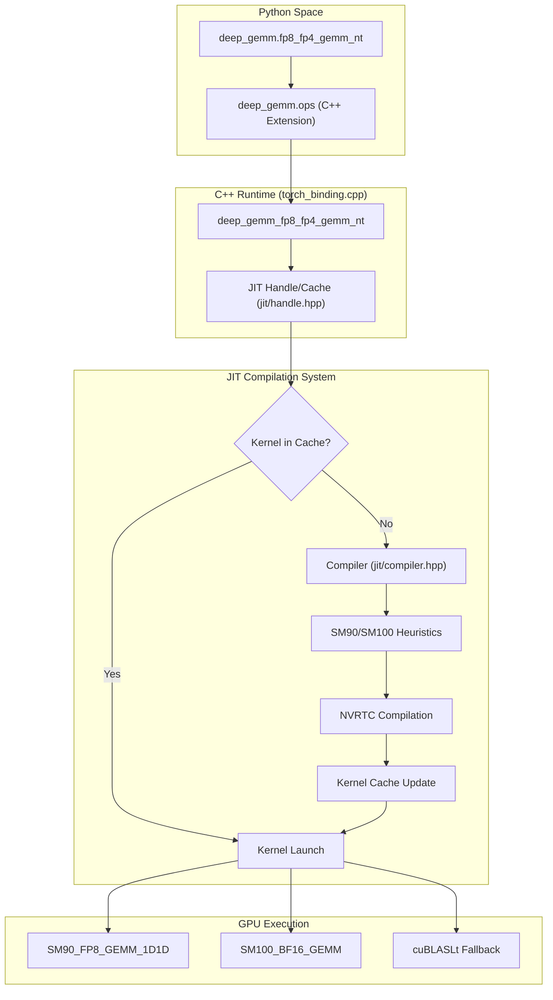
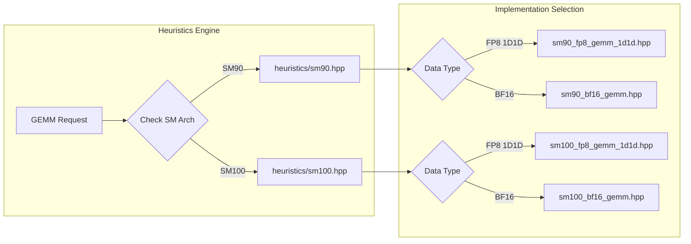

<!-- source: DeepWiki mcp.deepwiki.com · repo huggingface/kernels-community · extra page DeepGEMM: JIT FP8/BF16 GEMM · fetched 2026-10-26 -->

# DeepGEMM: JIT FP8/BF16 GEMM

Relevant source files

The following files were used as context for generating this wiki page:

- [deep-gemm/build.toml](deep-gemm/build.toml)
- [deep-gemm/flake.lock](deep-gemm/flake.lock)
- [deep-gemm/torch-ext/deep_gemm/__init__.py](deep-gemm/torch-ext/deep_gemm/__init__.py)
- [deep-gemm/torch-ext/torch_binding.cpp](deep-gemm/torch-ext/torch_binding.cpp)

DeepGEMM is a high-performance JIT-compiled GEMM library optimized for NVIDIA Hopper (SM90) and Blackwell (SM100) architectures. It provides specialized kernels for FP8, FP4, and BF16 precision, featuring advanced grouping strategies (M-grouped and K-grouped) and tight integration with cuBLASLt for fallback paths. The system utilizes a Just-In-Time (JIT) compilation strategy to generate kernels tailored to specific tensor shapes and hardware constraints.

## System Architecture and Data Flow

The DeepGEMM architecture bridges high-level PyTorch operations with low-level CUDA kernels through a JIT compilation layer. It leverages CUTLASS 4.0 for core matrix multiplication primitives while providing custom heuristics for SM90 and SM100 architectures.

### Data Flow Diagram
The following diagram illustrates the flow from a Python API call through the JIT compiler to the execution of a specialized CUDA kernel.

"DeepGEMM Execution Flow"

**Sources:** [deep-gemm/torch-ext/torch_binding.cpp:65-74](), [deep-gemm/build.toml:44-53](), [deep-gemm/torch-ext/deep_gemm/__init__.py:142-178]()

## Core GEMM Operations

DeepGEMM supports a variety of GEMM variants categorized by data type and grouping strategy. All operations are exposed via the `deep_gemm.ops` namespace and registered for `torch.compile` compatibility.

### Precision Variants
*   **FP8/FP4 GEMM:** Supports `NT`, `NN`, `TN`, and `TT` layouts. These kernels handle scaling factors (`sf`) for quantized tensors.
*   **BF16 GEMM:** Standard high-precision kernels for SM90/SM100.
*   **TF32 Hyperconnection:** Specialized kernels for hyperconnection layers with pre-normalization.

### Grouping Strategies
DeepGEMM implements advanced grouping to handle MoE (Mixture of Experts) and variable-length sequence workloads:
1.  **M-Grouped:** Groups rows of the input matrix `A`. Used for contiguous or masked layouts [deep-gemm/torch-ext/torch_binding.cpp:110-148]().
2.  **K-Grouped:** Groups the inner dimension `K`, often used in specialized attention or MoE kernels [deep-gemm/torch-ext/torch_binding.cpp:149-169]().

### API Reference Table
| Function Category | Python API Example | C++ Implementation Site |
| :--- | :--- | :--- |
| **FP8 GEMM** | `fp8_fp4_gemm_nt` | `deep_gemm_fp8_fp4_gemm_nt` |
| **M-Grouped FP8** | `m_grouped_fp8_fp4_gemm_nt_contiguous` | `deep_gemm_m_grouped_fp8_fp4_gemm_nt_contiguous` |
| **K-Grouped FP8** | `k_grouped_fp8_gemm_nt_contiguous` | `deep_gemm_k_grouped_fp8_gemm_nt_contiguous` |
| **BF16 GEMM** | `bf16_gemm_nt` | `deep_gemm_bf16_gemm_nt` |
| **Attention Ops** | `fp8_mqa_logits` | `deep_gemm_fp8_mqa_logits` |

**Sources:** [deep-gemm/torch-ext/torch_binding.cpp:65-180](), [deep-gemm/torch-ext/deep_gemm/__init__.py:142-350]()

## JIT Heuristics and Hardware Support

The library includes a sophisticated heuristics system that selects the optimal kernel configuration based on the target SM architecture.

### SM90 and SM100 Specialization
DeepGEMM differentiates between NVIDIA Hopper (SM90) and Blackwell (SM100) through specialized header files and heuristics:
*   **SM90 Heuristics:** Located in `csrc/jit_kernels/heuristics/sm90.hpp` [deep-gemm/build.toml:53]().
*   **SM100 Heuristics:** Located in `csrc/jit_kernels/heuristics/sm100.hpp` [deep-gemm/build.toml:52]().

### Kernel Implementation Components
The JIT system pulls from a library of template implementations:
*   **Layout Management:** `smxx_layout.hpp` handles TMA (Tensor Memory Accelerator) aligned layouts [deep-gemm/build.toml:70]().
*   **Epilogue Handling:** `epilogue.hpp` manages post-GEMM operations like scaling and bias addition [deep-gemm/build.toml:55]().
*   **cuBLASLt Integration:** `smxx_cublaslt.hpp` provides a fallback for shapes where JIT kernels are not yet optimized [deep-gemm/build.toml:67]().

"JIT Kernel Selection Logic"

**Sources:** [deep-gemm/build.toml:51-70](), [deep-gemm/torch-ext/torch_binding.cpp:181-200]()

## Runtime Configuration and Utilities

DeepGEMM allows for runtime tuning of GPU resources and provides utilities for memory layout alignment.

### Runtime Controls
Users can configure the hardware utilization through the following Python wrappers:
*   `set_num_sms(int)`: Limits the number of Streaming Multiprocessors used by the kernels [deep-gemm/torch-ext/deep_gemm/__init__.py:45-46]().
*   `set_tc_util(int)`: Configures Tensor Core utilization parameters [deep-gemm/torch-ext/deep_gemm/__init__.py:53-54]().

### Layout Utilities
The library provides functions to ensure tensors meet the strict alignment requirements of TMA:
*   `get_tma_aligned_size`: Calculates the required size for TMA alignment [deep-gemm/torch-ext/deep_gemm/__init__.py:68-69]().
*   `transform_sf_into_required_layout`: Transforms scaling factor tensors into the layout expected by FP8 kernels [deep-gemm/torch-ext/deep_gemm/__init__.py:87-118]().

**Sources:** [deep-gemm/torch-ext/torch_binding.cpp:12-26](), [deep-gemm/torch-ext/deep_gemm/__init__.py:45-124]()

## Build Configuration

DeepGEMM is built using the `kernel-builder` system with a dependency on `cutlass_4_0`. It targets CUDA compute capability `9.0a` (Hopper) and above.

### build.toml Specification
*   **Backends:** CUDA only [deep-gemm/build.toml:4]().
*   **CUDA Version:** Minimum 12.3 [deep-gemm/build.toml:8]().
*   **Compiler Flags:** Uses C++17 with `-O3` optimization and relaxed constexpr for Cute/CUTLASS compatibility [deep-gemm/build.toml:26-33]().

**Sources:** [deep-gemm/build.toml:1-33](), [deep-gemm/flake.lock:36-56]()

---

