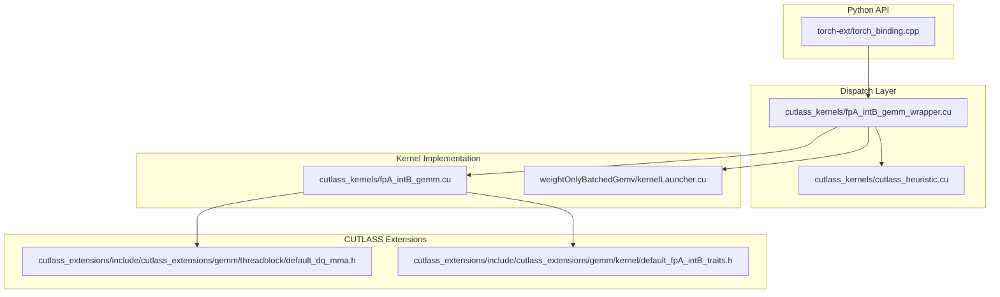
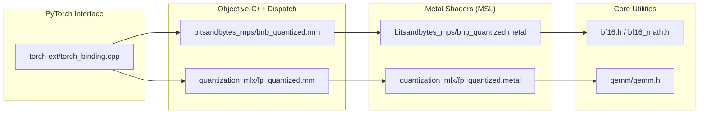

<!-- source: DeepWiki mcp.deepwiki.com · repo huggingface/kernels-community · extra page EETQ, FP8-FBGEMM, and Metal Quantization · fetched 2026-10-26 -->

# EETQ, FP8-FBGEMM, and Metal Quantization

Relevant source files

The following files were used as context for generating this wiki page:

- [bitsandbytes-mps/build.toml](bitsandbytes-mps/build.toml)
- [bitsandbytes-mps/flake.lock](bitsandbytes-mps/flake.lock)
- [bitsandbytes-mps/flake.nix](bitsandbytes-mps/flake.nix)
- [fp8-fbgemm/build.toml](fp8-fbgemm/build.toml)
- [fp8-fbgemm/flake.lock](fp8-fbgemm/flake.lock)
- [fp8-fbgemm/flake.nix](fp8-fbgemm/flake.nix)
- [fp8-fbgemm/torch-ext/fp8_fbgemm/__init__.py](fp8-fbgemm/torch-ext/fp8_fbgemm/__init__.py)
- [fp8-fbgemm/torch-ext/fp8_fbgemm/quantizer.py](fp8-fbgemm/torch-ext/fp8_fbgemm/quantizer.py)
- [mlx-quantization-metal-kernels/README.md](mlx-quantization-metal-kernels/README.md)
- [mlx-quantization-metal-kernels/build.toml](mlx-quantization-metal-kernels/build.toml)
- [mlx-quantization-metal-kernels/flake.lock](mlx-quantization-metal-kernels/flake.lock)
- [mlx-quantization-metal-kernels/flake.nix](mlx-quantization-metal-kernels/flake.nix)
- [mlx-quantization-metal-kernels/quantization_mlx/bf16.h](mlx-quantization-metal-kernels/quantization_mlx/bf16.h)
- [mlx-quantization-metal-kernels/quantization_mlx/bf16_math.h](mlx-quantization-metal-kernels/quantization_mlx/bf16_math.h)
- [mlx-quantization-metal-kernels/quantization_mlx/complex.h](mlx-quantization-metal-kernels/quantization_mlx/complex.h)
- [mlx-quantization-metal-kernels/quantization_mlx/defines.h](mlx-quantization-metal-kernels/quantization_mlx/defines.h)
- [mlx-quantization-metal-kernels/quantization_mlx/fp4.h](mlx-quantization-metal-kernels/quantization_mlx/fp4.h)
- [mlx-quantization-metal-kernels/quantization_mlx/fp8.h](mlx-quantization-metal-kernels/quantization_mlx/fp8.h)
- [mlx-quantization-metal-kernels/quantization_mlx/fp_quantized.h](mlx-quantization-metal-kernels/quantization_mlx/fp_quantized.h)
- [quantization-eetq/build.toml](quantization-eetq/build.toml)
- [quantization-eetq/flake.lock](quantization-eetq/flake.lock)
- [quantization-eetq/flake.nix](quantization-eetq/flake.nix)

This section documents the quantization kernel suite within the `kernels-community` repository, focusing on high-performance implementations for CUDA (EETQ, FP8-FBGEMM) and Apple Silicon Metal (BitsAndBytes-MPS, MLX-Quantization). These kernels provide optimized GEMM and dequantization routines for various bit-widths and numeric formats including INT8, FP8, and MXFP4.

## EETQ (Easy Efficient Transformer Quantization)

The `quantization-eetq` kernel provides a CUTLASS-based implementation for FP16xINT8 GEMM on NVIDIA GPUs. It is designed to accelerate transformer inference by quantizing weights to INT8 while keeping activations in FP16/BF16.

### Implementation Details
The implementation relies on CUTLASS 2.10 extensions to handle mixed-precision matrix multiplication [quantization-eetq/build.toml:23-25](). It supports both standard GEMM and specialized GEMV kernels for low batch sizes.

*   **Mixed-Precision MMA**: Uses `cutlass_extensions` to define traits for `fpA_intB` (Floating-point Activations, Integer Weights) [quantization-eetq/build.toml:40-41]().
*   **Batched GEMV**: Includes specialized kernels for small batch sizes (BS=1 to BS=4) to minimize latency during the decoding phase of LLM inference [quantization-eetq/build.toml:93-100]().
*   **Heuristics**: A heuristic engine selects the optimal tile sizes and pipeline stages based on the GPU architecture and problem dimensions [quantization-eetq/build.toml:57-58]().

### Component Mapping: EETQ CUDA Logic
The following diagram maps the CUTLASS-based C++ entities to the logical flow of the EETQ kernel.

**EETQ Kernel Architecture**

**Sources:** [quantization-eetq/build.toml:31-75](), [quantization-eetq/build.toml:84-101]()

---

## FP8-FBGEMM

The `fp8-fbgemm` kernel provides FP8 quantization support via the FBGEMM library. It is designed for cross-platform compatibility, supporting CUDA, ROCm, and Intel XPU backends [fp8-fbgemm/build.toml:5-9]().

### Features
*   **Quantization API**: Provides a high-level `quantizer.py` for converting standard PyTorch tensors to FP8 formats [fp8-fbgemm/torch-ext/fp8_fbgemm/quantizer.py]().
*   **Multi-Backend**: Leverages the unified FBGEMM interface to target different GPU vendors through a single API [fp8-fbgemm/build.toml:2-9]().

**Sources:** [fp8-fbgemm/build.toml:1-13]()

---

## Metal Quantization Kernels

For Apple Silicon (MPS), the repository provides two primary quantization suites: `bitsandbytes-mps` and `mlx-quantization-metal-kernels`. Both utilize Metal Shading Language (MSL) and are integrated into PyTorch via custom C++ extensions.

### BitsAndBytes-MPS
This kernel brings BitsAndBytes-style quantization (specifically INT8 and NF4 patterns) to Apple Silicon. It adapts the "Steel" GEMM infrastructure originally developed for MLX to execute on the MPS backend [bitsandbytes-mps/build.toml:30-39]().

*   **Codebooks**: Implements BnB-specific quantization types and codebooks in `bnb_types.h` [bitsandbytes-mps/build.toml:45]().
*   **MSL Integration**: Kernel logic is defined in `.metal` shaders and dispatched via Objective-C++ (`.mm`) wrappers [bitsandbytes-mps/build.toml:47-48]().

### MLX-Quantization-Metal-Kernels
A port of the MLX framework's quantization kernels, supporting advanced formats like MXFP4 and MXFP8 [mlx-quantization-metal-kernels/build.toml:38-39]().

*   **Affine Quantization**: Supports standard affine (scale/bias) quantized matmuls [mlx-quantization-metal-kernels/build.toml:41-43]().
*   **FP-Quantized**: Specialized kernels for floating-point quantized weights (FP4, FP8) [mlx-quantization-metal-kernels/build.toml:45-47]().
*   **GEMM Infrastructure**: Uses a sophisticated loader and MMA (Matrix Multiply-Accumulate) abstraction for Metal [mlx-quantization-metal-kernels/build.toml:28-32]().

### Component Mapping: Metal Quantization
This diagram illustrates how Metal-specific source files relate to the kernel execution pipeline.

**Metal Kernel Execution Flow**

**Sources:** [bitsandbytes-mps/build.toml:12-48](), [mlx-quantization-metal-kernels/build.toml:7-48]()

---

## Build Configuration Summary

The following table summarizes the build requirements and target platforms for the quantization kernels.

| Kernel Name | Primary Backend | Build Tool | Key Dependencies |
| :--- | :--- | :--- | :--- |
| `quantization-eetq` | CUDA | Nix / `build.toml` | `cutlass_2_10`, `torch` [quantization-eetq/build.toml:22-25]() |
| `fp8-fbgemm` | CUDA, ROCm, XPU | Nix / `build.toml` | `fbgemm` [fp8-fbgemm/build.toml:5-9]() |
| `bitsandbytes-mps` | Metal | Nix / `build.toml` | `torch >= 2.9` [bitsandbytes-mps/build.toml:11]() |
| `mlx-quantization` | Metal | Nix / `build.toml` | `torch` [mlx-quantization-metal-kernels/build.toml:17]() |

**Sources:** [quantization-eetq/build.toml:5](), [fp8-fbgemm/build.toml:5-9](), [bitsandbytes-mps/build.toml:4](), [mlx-quantization-metal-kernels/build.toml:4]()

---

