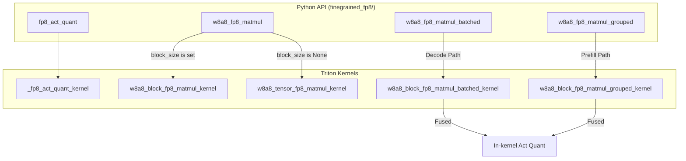
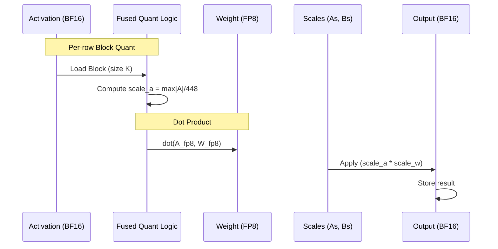

<!-- source: DeepWiki mcp.deepwiki.com · repo huggingface/kernels-community · extra page Fine-Grained FP8 MoE Kernels · fetched 2026-10-26 -->

# Fine-Grained FP8 MoE Kernels

Relevant source files

The following files were used as context for generating this wiki page:

- [finegrained-fp8/README.md](finegrained-fp8/README.md)
- [finegrained-fp8/build.toml](finegrained-fp8/build.toml)
- [finegrained-fp8/flake.lock](finegrained-fp8/flake.lock)
- [finegrained-fp8/flake.nix](finegrained-fp8/flake.nix)
- [finegrained-fp8/pytest.ini](finegrained-fp8/pytest.ini)
- [finegrained-fp8/tests/test_matmul.py](finegrained-fp8/tests/test_matmul.py)
- [finegrained-fp8/tests/test_moe.py](finegrained-fp8/tests/test_moe.py)
- [finegrained-fp8/torch-ext/finegrained_fp8/__init__.py](finegrained-fp8/torch-ext/finegrained_fp8/__init__.py)
- [finegrained-fp8/torch-ext/finegrained_fp8/act_quant.py](finegrained-fp8/torch-ext/finegrained_fp8/act_quant.py)
- [finegrained-fp8/torch-ext/finegrained_fp8/batched.py](finegrained-fp8/torch-ext/finegrained_fp8/batched.py)
- [finegrained-fp8/torch-ext/finegrained_fp8/grouped.py](finegrained-fp8/torch-ext/finegrained_fp8/grouped.py)
- [finegrained-fp8/torch-ext/finegrained_fp8/matmul.py](finegrained-fp8/torch-ext/finegrained_fp8/matmul.py)
- [finegrained-fp8/torch-ext/finegrained_fp8/utils.py](finegrained-fp8/torch-ext/finegrained_fp8/utils.py)

## Purpose and Scope

The `finegrained-fp8` library provides high-performance Triton kernels for W8A8 FP8 quantized Mixture of Experts (MoE) layers. These kernels are specifically designed to support the fine-grained quantization strategies used in modern large language models like DeepSeek-V3, featuring block-scale quantization, fused activation quantization, and CUDA graph compatibility.

The implementation covers three primary execution patterns:
1.  **Single Matmul**: Standard GEMM with block-wise or tensor-wise FP8 scaling.
2.  **Batched Expert GEMM**: Optimized for the **decode** phase where each token routes to a single expert (or small top-k), fusing activation quantization to eliminate redundant memory copies.
3.  **Grouped Expert GEMM**: Optimized for the **prefill** phase where tokens are grouped by expert, using a binary-search-based scheduling mechanism that supports CUDA graphs.

**Sources:** [finegrained-fp8/README.md:9-44](), [finegrained-fp8/torch-ext/finegrained_fp8/grouped.py:62-66](), [finegrained-fp8/torch-ext/finegrained_fp8/batched.py:58-62]()

## Core Implementation Logic

The following diagram illustrates the relationship between the Python API and the underlying Triton kernel implementations.

### Kernel Dispatch Architecture

**Sources:** [finegrained-fp8/torch-ext/finegrained_fp8/act_quant.py:27-36](), [finegrained-fp8/torch-ext/finegrained_fp8/matmul.py:186-213](), [finegrained-fp8/torch-ext/finegrained_fp8/batched.py:187-200](), [finegrained-fp8/torch-ext/finegrained_fp8/grouped.py:64-66]()

## Kernel Details

### 1. Activation Quantization (`fp8_act_quant`)
This kernel performs dynamic per-block quantization from BF16/FP16 to `float8_e4m3fn`. It splits the input tensor into contiguous blocks (default size 128) and computes a `max-abs` scale per block: `scale = max(|block|) / 448.0`.

*   **Input**: `x` (BF16/FP16/FP32)
*   **Output**: `y` (FP8), `s` (Float32 scales)
*   **Function**: `fp8_act_quant` in `act_quant.py` [finegrained-fp8/torch-ext/finegrained_fp8/act_quant.py:54-73]().

### 2. Batched Expert GEMM (Decode)
The `w8a8_fp8_matmul_batched` kernel is designed for MoE inference where tokens are routed to experts individually.
*   **Fused Quantization**: It avoids a separate `fp8_act_quant` pass by quantizing the activation row directly within the matmul's inner loop [finegrained-fp8/torch-ext/finegrained_fp8/batched.py:85-88]().
*   **Direct Indexing**: Each program uses `ExpertIds` to stride directly into the correct expert's weight slice in the `[E, N, K]` weight tensor [finegrained-fp8/torch-ext/finegrained_fp8/batched.py:69-74]().
*   **Optimization**: Eliminates the need for a gather/scatter copy of weights or activations [finegrained-fp8/README.md:29-31]().

### 3. Grouped Expert GEMM (Prefill)
The `w8a8_fp8_matmul_grouped` kernel handles the prefill phase where tokens are sorted by expert ID.
*   **Binary Search Scheduling**: Instead of launching one kernel per expert, it uses a single 2D grid. Each M-tile performs a compile-time unrolled binary search over `TileOffsets` to find its owning expert ID [finegrained-fp8/torch-ext/finegrained_fp8/grouped.py:82-94]().
*   **CUDA Graph Support**: The kernel uses a static grid size based on the total number of tiles, making it compatible with CUDA graph capture [finegrained-fp8/README.md:37-39]().

**Sources:** [finegrained-fp8/torch-ext/finegrained_fp8/grouped.py:33-61](), [finegrained-fp8/torch-ext/finegrained_fp8/batched.py:33-57](), [finegrained-fp8/README.md:13-44]()

## Data Flow and Scaling

The kernels support two primary scaling layouts: **Block-scale** and **Tensor-scale**.

### Block-Scale Data Flow

**Sources:** [finegrained-fp8/torch-ext/finegrained_fp8/matmul.py:81-92](), [finegrained-fp8/torch-ext/finegrained_fp8/grouped.py:121-130](), [finegrained-fp8/torch-ext/finegrained_fp8/batched.py:83-94]()

### Scaling Layouts
| Layout | Description | Implementation |
| :--- | :--- | :--- |
| **Block** | Per-block scales for both A and W. | `w8a8_block_fp8_matmul_kernel` [finegrained-fp8/torch-ext/finegrained_fp8/matmul.py:33-59]() |
| **Tensor** | One scale for the entire weight matrix, per-token scale for A. | `w8a8_tensor_fp8_matmul_kernel` [finegrained-fp8/torch-ext/finegrained_fp8/matmul.py:117-137]() |

## Build and Testing

### Build System
The kernel uses the standard Nix-based `kernel-builder` system [finegrained-fp8/flake.nix:13-16](). The `build.toml` (not shown in full) specifies the requirements for the Triton-based build.

### Testing Infrastructure
Correctness is verified against a pure-PyTorch reference implementation that performs dequantization followed by standard FP32 matmul [finegrained-fp8/tests/test_matmul.py:36-61]().
*   **Correctness**: `test_matmul_correctness` checks outputs across BF16, FP16, and FP32 [finegrained-fp8/tests/test_matmul.py:97-123]().
*   **MoE Benchmarking**: `test_moe.py` contains configurations for DeepSeek-style MoE layers (e.g., Qwen3-30B-A3B) to validate both performance and accuracy [finegrained-fp8/tests/test_moe.py:97-139]().

**Sources:** [finegrained-fp8/flake.nix:1-17](), [finegrained-fp8/tests/test_matmul.py:1-123](), [finegrained-fp8/tests/test_moe.py:1-140]()

---

