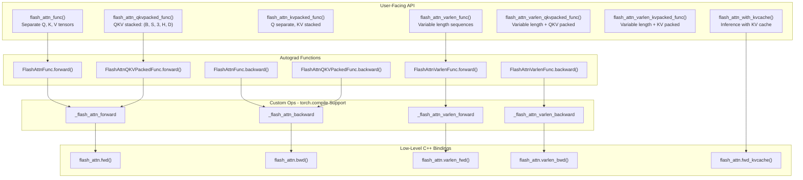
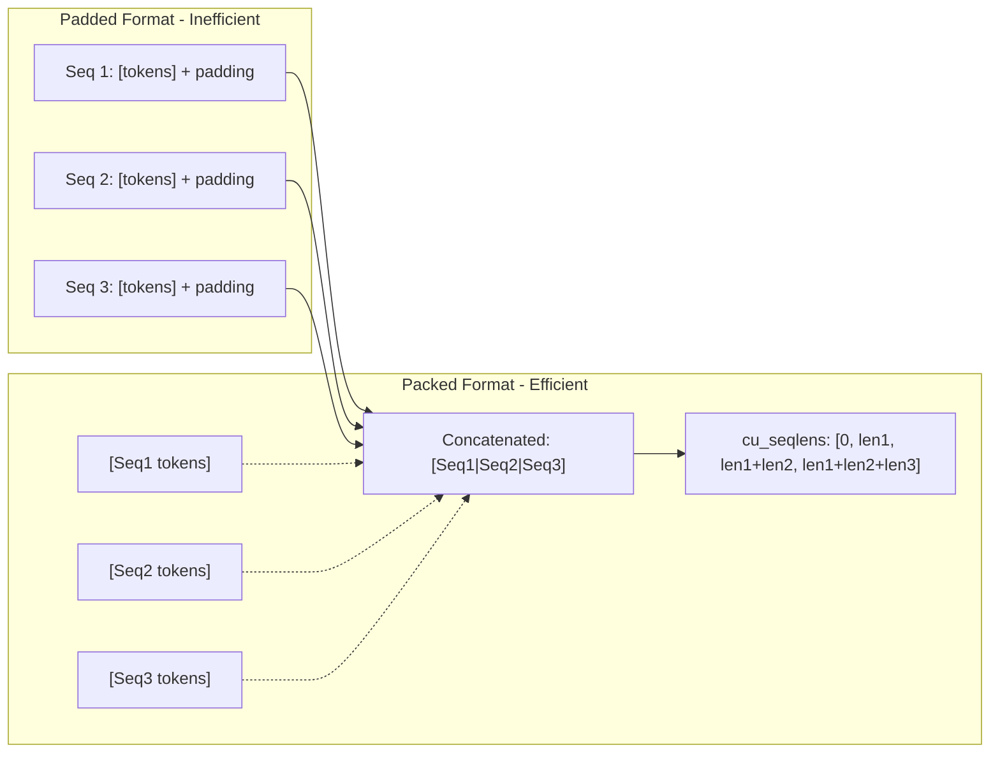
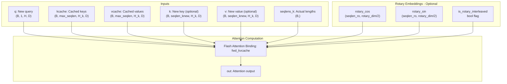

<!-- source: DeepWiki mcp.deepwiki.com · repo huggingface/kernels-community · extra page Flash Attention 2: Python API and Layers · fetched 2026-10-26 -->

# Flash Attention 2: Python API and Layers

<details>
<summary>Relevant source files</summary>

The following files were used as context for generating this wiki page:

- [flash-attn2/tests/test_flash_attn.py](flash-attn2/tests/test_flash_attn.py)
- [flash-attn2/torch-ext/flash_attn2/__init__.py](flash-attn2/torch-ext/flash_attn2/__init__.py)
- [flash-attn2/torch-ext/flash_attn2/bert_padding.py](flash-attn2/torch-ext/flash_attn2/bert_padding.py)
- [flash-attn2/torch-ext/flash_attn2/flash_attn_interface.py](flash-attn2/torch-ext/flash_attn2/flash_attn_interface.py)
- [flash-attn2/torch-ext/flash_attn2/layers/__init__.py](flash-attn2/torch-ext/flash_attn2/layers/__init__.py)
- [flash-attn2/torch-ext/flash_attn2/layers/patch_embed.py](flash-attn2/torch-ext/flash_attn2/layers/patch_embed.py)
- [flash-attn2/torch-ext/flash_attn2/layers/rotary.py](flash-attn2/torch-ext/flash_attn2/layers/rotary.py)
- [flash-attn2/torch-ext/flash_attn2/ops/__init__.py](flash-attn2/torch-ext/flash_attn2/ops/__init__.py)
- [flash-attn2/torch-ext/flash_attn2/ops/activations.py](flash-attn2/torch-ext/flash_attn2/ops/activations.py)
- [flash-attn2/torch-ext/flash_attn2/ops/fused_dense.py](flash-attn2/torch-ext/flash_attn2/ops/fused_dense.py)
- [flash-attn2/torch-ext/flash_attn2/ops/layer_norm.py](flash-attn2/torch-ext/flash_attn2/ops/layer_norm.py)
- [flash-attn2/torch-ext/flash_attn2/ops/triton/rotary.py](flash-attn2/torch-ext/flash_attn2/ops/triton/rotary.py)
- [flash-attn2/torch-ext/torch_binding.cpp](flash-attn2/torch-ext/torch_binding.cpp)

</details>


This page documents the Python API and layer implementations provided by the Flash Attention 2 kernel. This includes the high-level attention functions that users interact with, as well as auxiliary layers for layer normalization, rotary embeddings, and fused MLP operations. For details about the underlying CUDA kernel implementations, see [4.1.1]().

## Core Attention API

The Flash Attention 2 Python API provides several function variants to accommodate different input formats and use cases. All functions are exposed through the `flash_attn2` module and internally dispatch to optimized CUDA or XPU kernels.

### API Function Hierarchy



**Purpose:** This diagram shows the layered architecture of the Flash Attention API, from user-facing functions down to the C++ kernel bindings registered via `TORCH_LIBRARY_EXPAND`.

Sources: [flash-attn2/torch-ext/flash_attn2/__init__.py:4-12](), [flash-attn2/torch-ext/flash_attn2/flash_attn_interface.py:18-206](), [flash-attn2/torch-ext/torch_binding.cpp:16-148]()

### Standard Attention Functions

The primary attention function supports separate Q, K, V tensors with shape `(batch, seqlen, num_heads, head_dim)`.

| Function | Input Format | Use Case |
|----------|-------------|----------|
| `flash_attn_func` | Q, K, V separate | Standard multi-head attention |
| `flash_attn_qkvpacked_func` | QKV stacked `(B, S, 3, H, D)` | When Q/K/V already concatenated |
| `flash_attn_kvpacked_func` | Q separate, KV stacked | Multi-query or grouped-query attention |

**Key Parameters:**
- `dropout_p`: Dropout probability (default 0.0) [flash-attn2/torch-ext/flash_attn2/__init__.py:21]()
- `softmax_scale`: Scaling factor for `QK^T` (default `1/sqrt(head_dim)`) [flash-attn2/torch-ext/flash_attn2/__init__.py:51-53]()
- `is_causal`: Enable causal masking for autoregressive models [flash-attn2/torch-ext/flash_attn2/__init__.py:23]()
- `window_size_left/right`: Window size for sliding window attention [flash-attn2/torch-ext/flash_attn2/__init__.py:24-25]()
- `softcap`: Soft capping of attention scores (>0 to activate) [flash-attn2/torch-ext/flash_attn2/__init__.py:26]()
- `alibi_slopes`: ALiBi positional bias slopes [flash-attn2/torch-ext/flash_attn2/__init__.py:20]()

**Returns:**
- `out`: Attention output with same shape as Q
- `softmax_lse`: Log-sum-exp statistics `(batch, num_heads, seqlen_q)` [flash-attn2/torch-ext/flash_attn2/flash_attn_interface.py:143]()
- `rng_state`: Random state for dropout [flash-attn2/torch-ext/flash_attn2/flash_attn_interface.py:147]()

Sources: [flash-attn2/torch-ext/flash_attn2/__init__.py:15-69](), [flash-attn2/torch-ext/flash_attn2/flash_attn_interface.py:92-156]()

### Variable-Length Sequence Handling

Variable-length attention functions accept packed sequences without padding, significantly improving efficiency for batches with varied sequence lengths.



**Purpose:** Variable-length attention eliminates wasted computation on padding tokens by packing sequences contiguously.

**Input Shapes:**
- `q`: `(total_q, num_heads, head_dim)` - Concatenated query tokens [flash-attn2/torch-ext/flash_attn2/__init__.py:99]()
- `k`, `v`: `(total_k, num_heads_k, head_dim)` - Concatenated key/value tokens [flash-attn2/torch-ext/flash_attn2/__init__.py:100-101]()
- `cu_seqlens_q`: `(batch + 1,)` - Cumulative sequence lengths for queries [flash-attn2/torch-ext/flash_attn2/__init__.py:102]()
- `cu_seqlens_k`: `(batch + 1,)` - Cumulative sequence lengths for keys [flash-attn2/torch-ext/flash_attn2/__init__.py:103]()

**Additional Parameters:**
- `block_table`: `(batch, max_num_blocks_per_seq)` - For paged KV cache [flash-attn2/torch-ext/flash_attn2/__init__.py:107]()
- `leftpad_k`: `(batch,)` - Left padding for keys [flash-attn2/torch-ext/flash_attn2/__init__.py:106]()
- `seqused_k`: `(batch,)` - Actual keys to use per batch element [flash-attn2/torch-ext/flash_attn2/__init__.py:105]()

Sources: [flash-attn2/torch-ext/flash_attn2/__init__.py:72-150](), [flash-attn2/torch-ext/flash_attn2/flash_attn_interface.py:158-206]()

### KV Cache Attention for Inference

The KV cache attention function is optimized for autoregressive generation, supporting incremental decoding with cached key-value pairs and optional rotary embeddings.



**Purpose:** Efficient autoregressive generation with cached KV pairs and integrated rotary position embeddings directly in the CUDA/XPU kernel.

Sources: [flash-attn2/torch-ext/flash_attn2/__init__.py:318-394](), [flash-attn2/torch-ext/torch_binding.cpp:124-147]()

## Layer Normalization Operations

Flash Attention 2 provides fused layer normalization operations that combine dropout, residual connections, and normalization in a single kernel.

### Layer Norm Logic

The `_dropout_add_layer_norm_forward` function provides the primary implementation for fused normalization.

**Operation:** `LayerNorm(Dropout(x0) + residual)` [flash-attn2/torch-ext/flash_attn2/ops/layer_norm.py:26-27]()

**Parameters:**
- `x0`: Input tensor [flash-attn2/torch-ext/flash_attn2/ops/layer_norm.py:17]()
- `residual`: Residual connection [flash-attn2/torch-ext/flash_attn2/ops/layer_norm.py:18]()
- `gamma`, `beta`: Normalization weight and bias [flash-attn2/torch-ext/flash_attn2/ops/layer_norm.py:19-20]()
- `dropout_p`: Dropout probability [flash-attn2/torch-ext/flash_attn2/ops/layer_norm.py:23]()
- `epsilon`: Normalization epsilon [flash-attn2/torch-ext/flash_attn2/ops/layer_norm.py:24]()
- `is_rms_norm`: Boolean flag to switch between LayerNorm and RMSNorm [flash-attn2/torch-ext/flash_attn2/ops/layer_norm.py:26]()

**Parallel Residual Variant:**
The `_dropout_add_layer_norm_parallel_residual_forward` function handles two parallel streams simultaneously, often used in architectures like GPT-J where attention and MLP blocks are parallel [flash-attn2/torch-ext/flash_attn2/ops/layer_norm.py:212-251]().

Sources: [flash-attn2/torch-ext/flash_attn2/ops/layer_norm.py:16-52](), [flash-attn2/torch-ext/flash_attn2/ops/layer_norm.py:212-251]()

## Rotary Position Embeddings

Rotary Position Embeddings (RoPE) are implemented with a Triton-based kernel for CUDA and XPU backends.

### Rotary Kernel Implementation

The `rotary_kernel` in Triton handles both standard and variable-length sequences.

**Key Features:**
- **Interleaved Support:** Supports both GPT-NeoX style (half-half) and GPT-J style (interleaved) rotations [flash-attn2/torch-ext/flash_attn2/ops/triton/rotary.py:39]().
- **Variable Length:** Uses `CU_SEQLENS` to handle packed sequences [flash-attn2/torch-ext/flash_attn2/ops/triton/rotary.py:53-57]().
- **In-place:** Can modify the input tensor directly to save memory [flash-attn2/torch-ext/flash_attn2/ops/triton/rotary.py:110]().

```python
# Formula for interleaved rotation (GPT-J style)
o0 = x0 * cos - x1 * sin
o1 = x0 * sin + x1 * cos
```
Sources: [flash-attn2/torch-ext/flash_attn2/ops/triton/rotary.py:13-100](), [flash-attn2/torch-ext/flash_attn2/layers/rotary.py:15-21]()

### ApplyRotaryEmb API

The `apply_rotary_emb` function is the primary entry point for applying RoPE. It supports a `seqlen_offsets` parameter, which is critical for inference with KV caches where only the new token needs rotation at a specific position [flash-attn2/torch-ext/flash_attn2/layers/rotary.py:112]().

Sources: [flash-attn2/torch-ext/flash_attn2/layers/rotary.py:94-124](), [flash-attn2/torch-ext/flash_attn2/ops/triton/rotary.py:102-140]()

## Fused Dense and MLP Layers

The `fused_dense` module provides linear layers that integrate with distributed communication and optimized activation functions.

### FusedDenseFunc

`FusedDenseFunc` is a `torch.autograd.Function` that performs matrix multiplication and can optionally kick off an `all_gather` for sequence parallelism in distributed training [flash-attn2/torch-ext/flash_attn2/ops/fused_dense.py:45-47]().

**Heuristics and Limits:**
- Supports matrix dimensions up to 2M [flash-attn2/torch-ext/flash_attn2/ops/fused_dense.py:60-61]().
- Integrates with `fused_dense_lib` for optimized weight gradients [flash-attn2/torch-ext/flash_attn2/ops/fused_dense.py:107-109]().

Sources: [flash-attn2/torch-ext/flash_attn2/ops/fused_dense.py:27-115]()

### Activation Functions

The `activations.py` module provides JIT-scripted activation functions including GeLU and SwiGLU.

- **GeLU:** Uses the tanh approximation: `0.5 * x * (1 + tanh(sqrt(2/pi) * (x + 0.044715 * x^3)))` [flash-attn2/torch-ext/flash_attn2/ops/activations.py:18]().
- **SwiGLU:** Implemented using `torch.cuda.jiterator` for custom fused CUDA kernels [flash-attn2/torch-ext/flash_attn2/ops/activations.py:119-120]().

Sources: [flash-attn2/torch-ext/flash_attn2/ops/activations.py:15-34](), [flash-attn2/torch-ext/flash_attn2/ops/activations.py:107-136]()

## Padding Utilities

The `bert_padding` module provides utilities to convert between padded and unpadded (packed) tensor formats.

### unpad_input Logic

`unpad_input` calculates cumulative sequence lengths and extracts non-padding tokens.

**Outputs:**
- `hidden_states`: The packed tensor `(total_nnz, ...)` [flash-attn2/torch-ext/flash_attn2/bert_padding.py:123]().
- `indices`: Flattened indices of valid tokens [flash-attn2/torch-ext/flash_attn2/bert_padding.py:114]().
- `cu_seqlens`: Cumulative lengths used by `flash_attn_varlen_func` [flash-attn2/torch-ext/flash_attn2/bert_padding.py:116]().

Sources: [flash-attn2/torch-ext/flash_attn2/bert_padding.py:98-129]()

### Indexing Optimization

The module implements custom autograd functions `IndexFirstAxis` and `IndexPutFirstAxis` using `torch.gather` and `torch.scatter_` which are faster than standard Python indexing for these specific packing operations [flash-attn2/torch-ext/flash_attn2/bert_padding.py:15-18](), [flash-attn2/torch-ext/flash_attn2/bert_padding.py:50-52]().

Sources: [flash-attn2/torch-ext/flash_attn2/bert_padding.py:8-64]()

---

