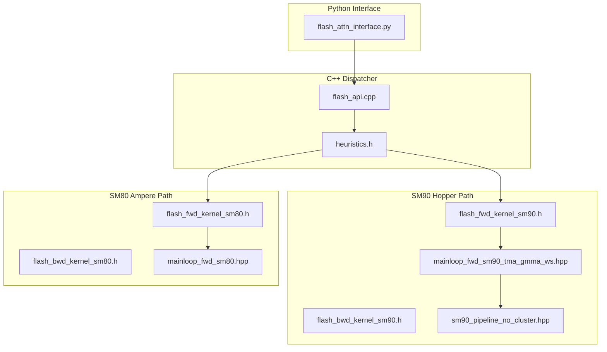
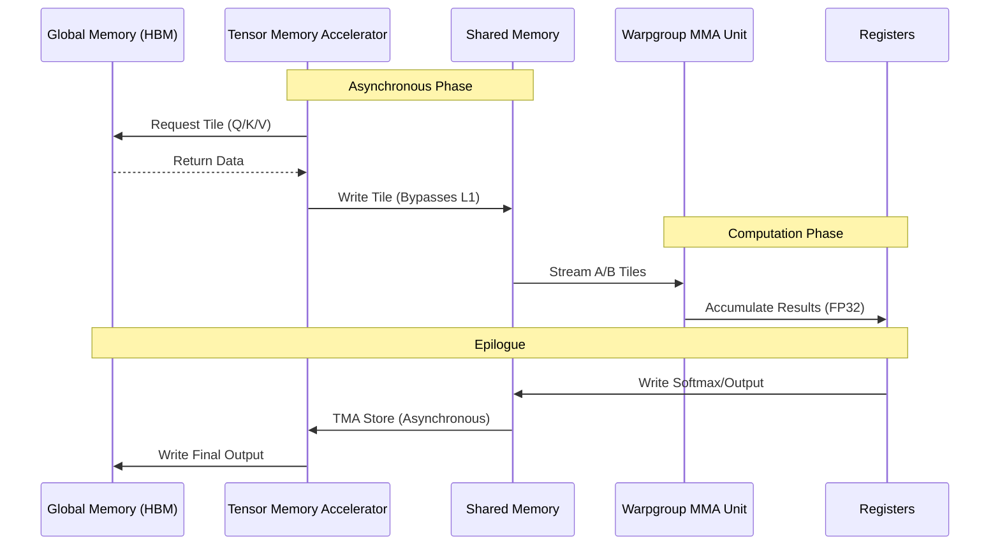

<!-- source: DeepWiki mcp.deepwiki.com · repo huggingface/kernels-community · extra page Flash Attention 3 and Flash MLA · fetched 2026-10-26 -->

# Flash Attention 3 and Flash MLA

Relevant source files

The following files were used as context for generating this wiki page:

- [.github/CODEOWNERS](.github/CODEOWNERS)
- [flash-attn3/build.toml](flash-attn3/build.toml)
- [flash-attn3/flake.lock](flash-attn3/flake.lock)
- [flash-attn3/flake.nix](flash-attn3/flake.nix)
- [flash-attn4/build.toml](flash-attn4/build.toml)
- [flash-attn4/flake.lock](flash-attn4/flake.lock)
- [flash-attn4/flake.nix](flash-attn4/flake.nix)
- [flash-attn4/tests/cute/benchmark_block_sparsity.py](flash-attn4/tests/cute/benchmark_block_sparsity.py)
- [flash-attn4/tests/cute/benchmark_mask_mod.py](flash-attn4/tests/cute/benchmark_mask_mod.py)
- [flash-attn4/tests/cute/conftest.py](flash-attn4/tests/cute/conftest.py)
- [flash-attn4/tests/cute/mask_mod_definitions.py](flash-attn4/tests/cute/mask_mod_definitions.py)
- [flash-attn4/tests/cute/score_mod_definitions.py](flash-attn4/tests/cute/score_mod_definitions.py)
- [flash-attn4/tests/cute/test_block_sparsity.py](flash-attn4/tests/cute/test_block_sparsity.py)
- [flash-attn4/tests/cute/test_flash_attn.py](flash-attn4/tests/cute/test_flash_attn.py)
- [flash-mla/build.toml](flash-mla/build.toml)
- [flash-mla/flake.lock](flash-mla/flake.lock)
- [flash-mla/flake.nix](flash-mla/flake.nix)
- [flash-mla/tests/test_flash_mla_dense_decoding.py](flash-mla/tests/test_flash_mla_dense_decoding.py)
- [flash-mla/tests/test_flash_mla_sparse_decoding.py](flash-mla/tests/test_flash_mla_sparse_decoding.py)
- [sgl-flash-attn3/build.toml](sgl-flash-attn3/build.toml)
- [sgl-flash-attn3/flake.lock](sgl-flash-attn3/flake.lock)
- [sgl-flash-attn3/torch-ext/sgl_flash_attn3/__init__.py](sgl-flash-attn3/torch-ext/sgl_flash_attn3/__init__.py)
- [vllm-flash-attn3/build.toml](vllm-flash-attn3/build.toml)
- [vllm-flash-attn3/flake.lock](vllm-flash-attn3/flake.lock)
- [vllm-flash-attn3/flake.nix](vllm-flash-attn3/flake.nix)
- [vllm-flash-attn3/flash-attn/flash_api.cpp](vllm-flash-attn3/flash-attn/flash_api.cpp)

This page documents the advanced Flash Attention implementations for NVIDIA Hopper (SM90) and Blackwell (SM100) architectures, including Flash Attention 3, Flash MLA (Multi-Head Latent Attention), and the specialized variants for vLLM and SGLang. These kernels leverage next-generation hardware features like Tensor Memory Accelerator (TMA) and WGMMA (Warpgroup Matrix Multiply-Accumulate).

## Overview and Architecture

The Flash Attention 3 family represents a shift from thread-centric programming to **warpgroup-centric programming** using the NVIDIA CuTe library and CUTLASS 3.x/4.x. 

### Key Technologies
*   **TMA (Tensor Memory Accelerator):** Hardware unit in SM90+ that handles multidimensional data transfers between Global Memory and Shared Memory asynchronously, bypassing the L1 cache [vllm-flash-attn3/build.toml:32-33]().
*   **WGMMA:** Instructions that allow a whole warpgroup (128 threads) to perform matrix multiplication collectively, achieving much higher throughput than individual thread-level operations [vllm-flash-attn3/build.toml:32-33]().
*   **Ping-Pong Scheduling:** Overlapping TMA loads for the next tile with WGMMA computations for the current tile to hide latency [vllm-flash-attn3/build.toml:108-108]().

### Implementation Variants

| Kernel | Target Architecture | Key Features | Source Path |
| :--- | :--- | :--- | :--- |
| **Flash Attention 3** | SM80, SM90 | FP8 support, TMA/WGMMA, Softcapping | `flash-attn3/` |
| **Flash MLA** | SM90, SM100 | Multi-Head Latent Attention for DeepSeek-V3 | `flash-mla/` |
| **Flash Attention 4** | SM90+ | CuTe DSL-based, experimental optimizations | `flash-attn4/` |
| **vLLM Flash Attn 3** | SM90 | vLLM-optimized, Paged KV, GQA packing | `vllm-flash-attn3/` |
| **SGL Flash Attn 3** | SM90 | SGLang-optimized with KV cache support | `sgl-flash-attn3/` |

Sources: [flash-attn3/build.toml:1-12](), [flash-mla/flake.nix:2-2](), [vllm-flash-attn3/build.toml:1-5](), [.github/CODEOWNERS:18-19]()

## Flash Attention 3 (SM90/Hopper)

Flash Attention 3 introduces asynchronous execution where the CPU issues instructions to the GPU's TMA and WGMMA units and continues, allowing for massive instruction-level parallelism.

### Kernel Dispatch and Specialization
The implementation uses heavy template specialization based on head dimensions (`hdim`), data types, and hardware capabilities.

**Flash Attention 3 Component Mapping**

Sources: [flash-attn3/build.toml:37-64](), [vllm-flash-attn3/build.toml:81-108]()

### Build Configuration
Flash Attention 3 requires CUDA 12.8+ and uses CUTLASS 4.0 for SM90 features.

*   **SM80 Support:** Uses standard `cp.async` and `mma` instructions [flash-attn3/build.toml:19-35]().
*   **SM90 Support:** Enables `CUTE_SM90_EXTENDED_MMA_SHAPES_ENABLED` and `CUTLASS_ENABLE_GDC_FOR_SM90` [vllm-flash-attn3/build.toml:32-33]().

Sources: [flash-attn3/build.toml:7-35](), [vllm-flash-attn3/build.toml:8-43]()

## Flash MLA (Multi-Head Latent Attention)

Flash MLA is specifically optimized for architectures like DeepSeek-V3/V4 which use latent vector compression for KV caches. It supports both dense and sparse decoding.

### Functional Capabilities
*   **Latent Vector Decoding:** Handles `d_qk` dimensions of 512 and 576 [flash-mla/tests/test_flash_mla_sparse_decoding.py:38-38]().
*   **Sparse Decoding:** Optimized for cases where only a `topk` subset of blocks are active [flash-mla/tests/test_flash_mla_sparse_decoding.py:44-44]().
*   **Tile Scheduling:** Uses a custom tile scheduler metadata system [flash-mla/tests/test_flash_mla_sparse_decoding.py:166-166]().

**Flash MLA Test Matrix**
The test suite validates performance and correctness across varying batch sizes, sequence lengths, and block sizes.

| Parameter | Values Tested |
| :--- | :--- |
| `d_qk` | 512, 576 |
| `h_q` | 64, 128 |
| `topk` | 64, 128, 576, 1024, 2048, 16384 |
| `block_size` | 2, 61, 64, 69, 256, 576 |

Sources: [flash-mla/tests/test_flash_mla_sparse_decoding.py:38-138](), [flash-mla/flake.nix:2-2]()

## vLLM and SGLang Variants

These variants are forks of the main Flash Attention 3 codebase, tailored for specific inference engines.

### vLLM Flash Attention 3
vLLM's version adds support for:
*   **Paged KV Cache:** Integration with vLLM's block manager [vllm-flash-attn3/build.toml:103-103]().
*   **GQA Packing:** Specialized kernels for Grouped Query Attention [vllm-flash-attn3/build.toml:102-102]().
*   **FP8 (E4M3):** Support for 8-bit floating point inference on Hopper [vllm-flash-attn3/build.toml:139-148]().
*   **Split-KV:** Splitting the KV cache processing across multiple CTAs for long sequences [vllm-flash-attn3/build.toml:132-133]().

Sources: [vllm-flash-attn3/build.toml:1-158]()

### SGL Flash Attention 3
The SGLang variant focuses on KV cache management and integration with the SGLang runtime environment [sgl-flash-attn3/build.toml:1-5]().

## Flash Attention 4 (Experimental)

Flash Attention 4 is a complete rewrite or extension using the CuTe DSL (Domain Specific Language). It is designed to explore even deeper hardware optimizations and flexible masking.

### Features
*   **Mask Modifiers:** Flexible attention masking via `mask_mod_definitions.py` [flash-attn4/tests/cute/mask_mod_definitions.py:1-5]().
*   **Score Modifiers:** Ability to modify attention scores before softmax [flash-attn4/tests/cute/score_mod_definitions.py:1-5]().
*   **Block Sparsity:** Experimental support for block-sparse attention patterns [flash-attn4/tests/cute/test_block_sparsity.py:1-10]().

Sources: [flash-attn4/build.toml:1-10](), [.github/CODEOWNERS:19-19]()

## Data Flow: TMA and WGMMA Pipeline

The following diagram illustrates how data moves through the SM90-specific TMA pipeline in Flash Attention 3.

**SM90 TMA Data Flow**

Sources: [vllm-flash-attn3/build.toml:32-33](), [vllm-flash-attn3/build.toml:98-99](), [vllm-flash-attn3/build.toml:105-105]()

## Comparison of Instantiations

The kernels generate hundreds of specialized `.cu` files for different configurations. Below is a summary of common specialization axes for SM90.

| Axis | Variants | Purpose |
| :--- | :--- | :--- |
| **Precision** | `fp16`, `bf16`, `e4m3` | Accuracy vs. Performance trade-offs |
| **Head Dim** | `64`, `96`, `128`, `192`, `256` | Model architecture compatibility |
| **Memory** | `paged`, `split-kv` | Inference engine memory management |
| **Features** | `softcap`, `packgqa` | Specialized model support (e.g., Grok, Llama) |

Sources: [vllm-flash-attn3/build.toml:109-158](), [flash-attn3/build.toml:65-143]()

---

