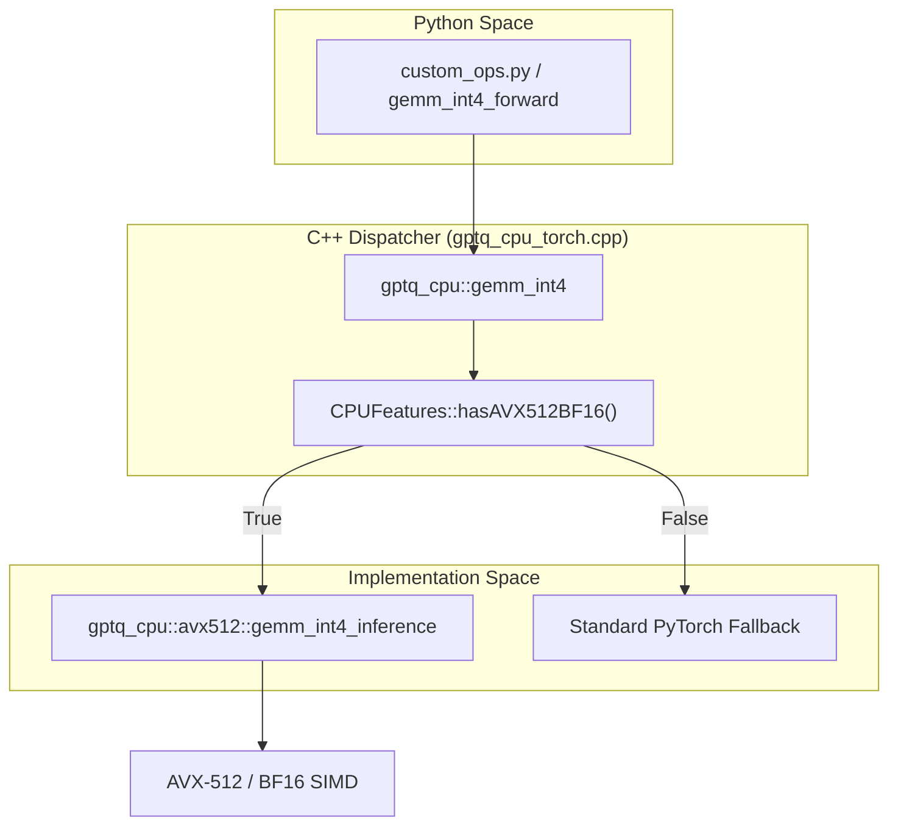
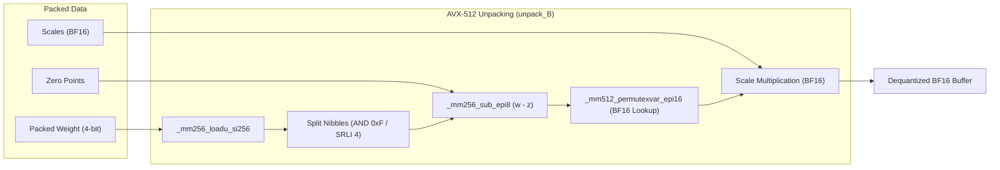

<!-- source: DeepWiki mcp.deepwiki.com · repo huggingface/kernels-community · extra page GPTQ and BitsAndBytes CPU Quantization · fetched 2026-10-26 -->

# GPTQ and BitsAndBytes CPU Quantization

Relevant source files

The following files were used as context for generating this wiki page:

- [quantization-bitsandbytes/bitsandbytes_cpu/bitsandbytes_avx512.cpp](quantization-bitsandbytes/bitsandbytes_cpu/bitsandbytes_avx512.cpp)
- [quantization-bitsandbytes/bitsandbytes_cpu/bitsandbytes_avx512.hpp](quantization-bitsandbytes/bitsandbytes_cpu/bitsandbytes_avx512.hpp)
- [quantization-bitsandbytes/bitsandbytes_cpu/bitsandbytes_cpu.cpp](quantization-bitsandbytes/bitsandbytes_cpu/bitsandbytes_cpu.cpp)
- [quantization-bitsandbytes/bitsandbytes_cpu/bitsandbytes_cpu.hpp](quantization-bitsandbytes/bitsandbytes_cpu/bitsandbytes_cpu.hpp)
- [quantization-bitsandbytes/bitsandbytes_cpu/bitsandbytes_cpu_torch.cpp](quantization-bitsandbytes/bitsandbytes_cpu/bitsandbytes_cpu_torch.cpp)
- [quantization-bitsandbytes/bitsandbytes_cpu/cpu_features.hpp](quantization-bitsandbytes/bitsandbytes_cpu/cpu_features.hpp)
- [quantization-bitsandbytes/build.toml](quantization-bitsandbytes/build.toml)
- [quantization-bitsandbytes/flake.lock](quantization-bitsandbytes/flake.lock)
- [quantization-bitsandbytes/flake.nix](quantization-bitsandbytes/flake.nix)
- [quantization-bitsandbytes/tests/__init__.py](quantization-bitsandbytes/tests/__init__.py)
- [quantization-bitsandbytes/tests/test_bitsandbytes.py](quantization-bitsandbytes/tests/test_bitsandbytes.py)
- [quantization-bitsandbytes/torch-ext/quantization_bitsandbytes/__init__.py](quantization-bitsandbytes/torch-ext/quantization_bitsandbytes/__init__.py)
- [quantization-gptq/build.toml](quantization-gptq/build.toml)
- [quantization-gptq/flake.lock](quantization-gptq/flake.lock)
- [quantization-gptq/flake.nix](quantization-gptq/flake.nix)
- [quantization-gptq/gptq_cpu/cpu_features.hpp](quantization-gptq/gptq_cpu/cpu_features.hpp)
- [quantization-gptq/gptq_cpu/gptq_avx512.cpp](quantization-gptq/gptq_cpu/gptq_avx512.cpp)
- [quantization-gptq/gptq_cpu/gptq_avx512.hpp](quantization-gptq/gptq_cpu/gptq_avx512.hpp)
- [quantization-gptq/gptq_cpu/gptq_cpu.cpp](quantization-gptq/gptq_cpu/gptq_cpu.cpp)
- [quantization-gptq/gptq_cpu/gptq_cpu.hpp](quantization-gptq/gptq_cpu/gptq_cpu.hpp)
- [quantization-gptq/gptq_cpu/gptq_cpu_torch.cpp](quantization-gptq/gptq_cpu/gptq_cpu_torch.cpp)
- [quantization-gptq/tests/__init__.py](quantization-gptq/tests/__init__.py)
- [quantization-gptq/tests/test_gptq.py](quantization-gptq/tests/test_gptq.py)
- [quantization-gptq/torch-ext/quantization_gptq/__init__.py](quantization-gptq/torch-ext/quantization_gptq/__init__.py)

This page documents the CPU-optimized quantization kernels within the `kernels-community` repository, specifically focusing on **quantization-gptq** and **quantization-bitsandbytes**. These implementations leverage x86 SIMD instructions (AVX-512) to provide high-performance dequantization and inference on CPU backends.

## Overview

The repository provides two primary CPU quantization extensions:
1.  **quantization-gptq**: Implements AVX-512 optimized 4-bit (INT4) dequantization and GEMM for GPTQ-style models `[quantization-gptq/build.toml:1-5]()`.
2.  **quantization-bitsandbytes**: Implements CPU-based BitsAndBytes (BnB) quantization routines, also utilizing AVX-512 for accelerated computation `[quantization-bitsandbytes/build.toml:1-5]()`.

Both kernels follow a tiered implementation strategy: they provide a high-performance AVX-512 path and a fallback standard C++/PyTorch path for CPUs lacking advanced instruction sets `[quantization-gptq/gptq_cpu/gptq_cpu.cpp:18-47]()`.

### System Architecture and Data Flow

The following diagram illustrates how the Python API interacts with the C++ dispatcher and the hardware-specific kernels.

**Kernel Dispatch Architecture**

Sources: `[quantization-gptq/gptq_cpu/gptq_cpu.cpp:8-48]()`, `[quantization-gptq/gptq_cpu/cpu_features.hpp:16-29]()`.

---

## CPU Feature Detection

To ensure compatibility across different x86 processors, the system includes a `CPUFeatures` class that performs runtime hardware inspection using the `cpuid` instruction `[quantization-gptq/gptq_cpu/cpu_features.hpp:16-174]()`.

| Feature | Detection Method | Use Case |
| :--- | :--- | :--- |
| **AVX2** | `checkAVX2()` via EBX bit 5 | General SIMD acceleration fallback `[quantization-gptq/gptq_cpu/cpu_features.hpp:32-54]()`. |
| **AVX-512** | `checkAVX512()` via EBX bit 16 + OSXSAVE | Foundation for high-width vector operations `[quantization-gptq/gptq_cpu/cpu_features.hpp:56-104]()`. |
| **AVX-512 BF16** | `/proc/cpuinfo` or CPUID(7,1) | Specifically required for BFloat16 optimized dequantization `[quantization-gptq/gptq_cpu/cpu_features.hpp:106-173]()`. |

Sources: `[quantization-gptq/gptq_cpu/cpu_features.hpp:1-177]()`.

---

## GPTQ CPU Implementation

The GPTQ implementation focuses on efficient 4-bit weight dequantization. Weights are stored in a packed `uint8` format where two 4-bit weights occupy one byte `[quantization-gptq/gptq_cpu/gptq_avx512.cpp:25-26]()`.

### Key Components

*   **`unpack_B`**: The core dequantization routine. It uses AVX-512 registers (`__m512i`, `__m512`) to process 64 weights simultaneously. It performs the operation `(w - z) * s`, where `w` is the nibble, `z` is the zero-point, and `s` is the scale `[quantization-gptq/gptq_cpu/gptq_avx512.cpp:20-106]()`.
*   **`gemm_int4` Dispatcher**: Located in `gptq_cpu.cpp`, this function calculates tensor strides and chooses between the optimized AVX-512 path and a fallback that uses standard PyTorch operators like `torch.bitwise_and` and `torch.matmul` `[quantization-gptq/gptq_cpu/gptq_cpu.cpp:8-48]()`.

### Data Flow: Dequantization Pipeline

Sources: `[quantization-gptq/gptq_cpu/gptq_avx512.cpp:20-106]()`.

---

## BitsAndBytes CPU Implementation

The `quantization-bitsandbytes` kernel provides similar CPU acceleration for BnB quantization formats. It shares the same structural pattern as GPTQ, utilizing a dedicated AVX-512 source file and a feature-detecting dispatcher.

### Build Configuration
The `build.toml` defines two distinct targets for the CPU backend:
1.  **`bitsandbytes_cpu`**: The base implementation including `cpu_features.hpp` `[quantization-bitsandbytes/build.toml:14-23]()`.
2.  **`bitsandbytes_cpu_avx512`**: Specifically compiled with AVX-512 flags such as `-mavx512f`, `-mavx512bf16`, and `-mavx512bw` to enable the high-performance path `[quantization-bitsandbytes/build.toml:25-43]()`.

Sources: `[quantization-bitsandbytes/build.toml:1-44]()`.

---

## Python API and Testing

Both kernels expose their functionality through a `torch-ext` binding. For GPTQ, the primary entry point is `gemm_int4_forward` `[quantization-gptq/tests/test_gptq.py:4]()`.

### Testing and Validation
The implementations are validated against a reference Python implementation (`ref_gemm_int4`) that simulates the bit-manipulation logic using standard PyTorch tensors `[quantization-gptq/tests/test_gptq.py:7-22]()`.

The test suite covers:
*   Varying Batch Sizes (`M`): 1 to 2666 `[quantization-gptq/tests/test_gptq.py:24]()`.
*   Hidden Dimensions (`K`, `N`): Up to 14336 `[quantization-gptq/tests/test_gptq.py:25-26]()`.
*   Group Sizes: 64 and 128 `[quantization-gptq/tests/test_gptq.py:27]()`.

Sources: `[quantization-gptq/tests/test_gptq.py:1-45]()`.

---

## Compilation and Dependencies

The build system utilizes Nix Flakes to manage the toolchain. Both kernels are restricted to `x86_64-linux` because they rely on x86-specific SIMD instructions `[quantization-gptq/flake.nix:12-19]()`, `[quantization-bitsandbytes/flake.nix:12-19]()`.

**Build Requirements:**
*   **Compiler Flags**: `-mavx512f`, `-mavx512bf16`, `-mavx512vl`, `-mavx512dq`, `-mavx512bw`, `-mavx512vbmi` `[quantization-gptq/build.toml:31-36]()`.
*   **OpenMP**: Enabled via `-fopenmp` for parallelizing the GEMM across multiple CPU cores `[quantization-gptq/build.toml:29]()`.

Sources: `[quantization-gptq/build.toml:25-37]()`, `[quantization-gptq/flake.nix:1-21]()`.

---

