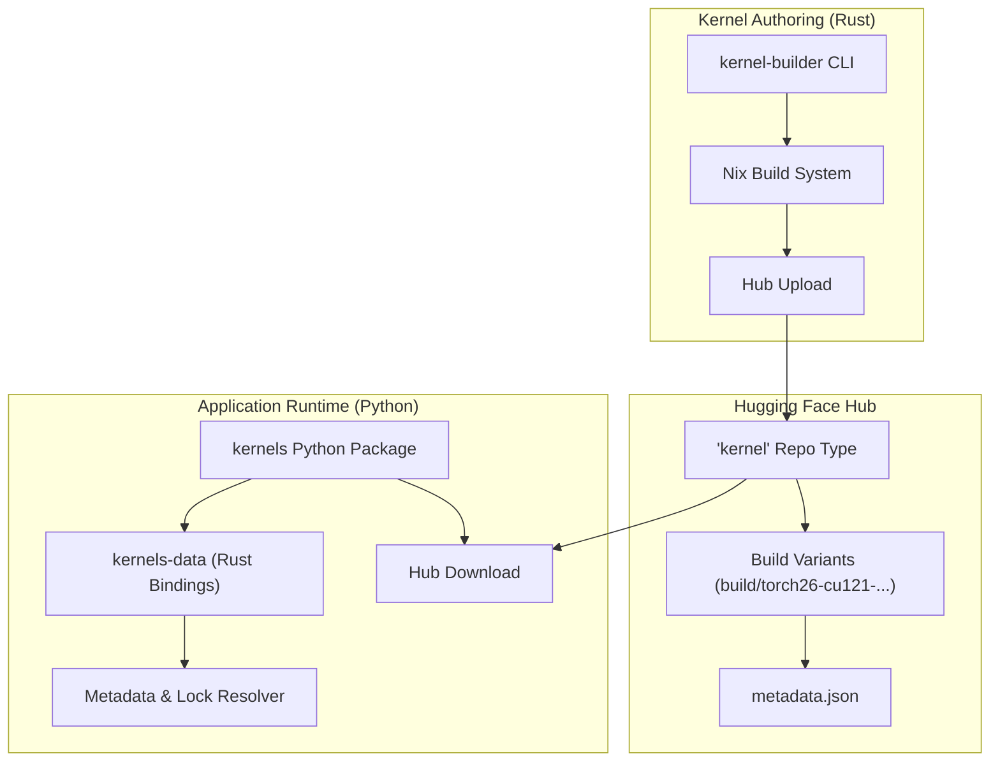
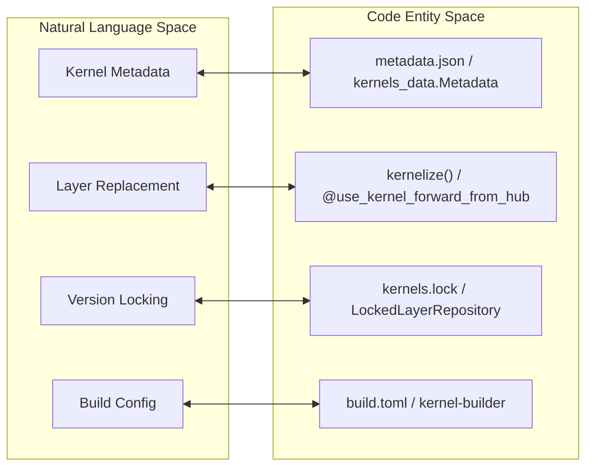

<!-- source: DeepWiki mcp.deepwiki.com · repo huggingface/kernels · page 1 Overview · fetched 2026-10-26 -->

# Overview

Relevant source files

The following files were used as context for generating this wiki page:

- [README.md](README.md)
- [docs/source/basic-usage.md](docs/source/basic-usage.md)
- [docs/source/blog.md](docs/source/blog.md)
- [docs/source/index.md](docs/source/index.md)
- [docs/source/integrating-kernels.md](docs/source/integrating-kernels.md)
- [docs/source/kernel-requirements.md](docs/source/kernel-requirements.md)
- [docs/source/layers.md](docs/source/layers.md)
- [docs/source/locking.md](docs/source/locking.md)
- [docs/source/migration.md](docs/source/migration.md)
- [docs/source/talks.md](docs/source/talks.md)
- [docs/source/why_kernels.md](docs/source/why_kernels.md)
- [examples/basic.py](examples/basic.py)

This document provides an overview of the `kernels` repository, a comprehensive system for managing and utilizing optimized compute kernels from the Hugging Face Hub. The kernels system enables Python applications to dynamically load high-performance compute kernels that can replace standard PyTorch operations with optimized implementations, solving common issues like ABI fragmentation and "CUDA version hell".

The scope of this documentation covers the complete kernels ecosystem, including kernel discovery, the Nix-based build system, PyTorch layer integration, and the Rust-powered metadata engine.

## What are Kernels?

Kernels in this context are optimized compute implementations (typically C++, CUDA, ROCm, or Triton) that can replace standard PyTorch operations. Unlike traditional Python packages, Hub kernels are designed to be:

- **Portable**: A kernel can be loaded from paths outside `PYTHONPATH` [README.md:25-25]().
- **Unique**: Multiple versions of the same kernel can be loaded in the same Python process [README.md:26-27]().
- **Compatible**: Kernels must support all recent versions of Python and different PyTorch build configurations (various CUDA versions and C++ ABIs) [README.md:28-30]().

*Sources: [README.md:20-31](), [docs/source/index.md:10-21]()*

## Two-Component Architecture

The repository is split into two primary components that bridge the gap between kernel development and user consumption:

1.  **`kernels` Python Package**: A user-facing library that lets users load compatible compute kernels from the Hub, manage local caches, and perform "kernelization" of PyTorch models [docs/source/index.md:28-29]().
2.  **`kernel-builder` CLI**: A Rust-based tool for kernel authors to build, package, and distribute kernels. It enforces reproducibility via Nix and generates the necessary `metadata.json` for Hub compatibility [docs/source/index.md:27-27]().

### System Component Interaction

The following diagram illustrates how the Python package, the Rust-based `kernels-data` library, and the `kernel-builder` interact with the Hugging Face Hub.

**System Architecture Overview**

*Sources: [docs/source/index.md:25-29](), [docs/source/kernel-requirements.md:34-40](), [docs/source/kernel-requirements.md:63-64]()*

## The Problem Solved: ABI and Versioning

Traditional Python wheels for CUDA kernels are often tied to a specific `torch` version and CUDA toolkit version. Upgrading `torch` frequently breaks local kernel builds. The `kernels` system solves this by:
- **Build Variants**: Providing a matrix of pre-compiled binaries for different `torch`, `cuda`, `rocm`, and `xpu` versions [docs/source/kernel-requirements.md:54-59]().
- **ABI Stability**: Enforcing `manylinux_2_28` and Python Limited API (`abi3`) to ensure binaries work across different Linux distributions [docs/source/kernel-requirements.md:4-5]().
- **Dynamic Selection**: `get_kernel()` automatically detects the host environment (e.g., `torch` version, C++ ABI, and GPU capability) to pull the correct binary [docs/source/basic-usage.md:40-49]().

## Key Concepts and Architecture

To navigate the codebase effectively, it is essential to understand the underlying data models and the lifecycle of a kernel from source to execution.

- **For a deep dive into vocabulary (Variants, Trusted Publishers, Backends), see [Key Concepts](#1.1).**
- **For details on the multi-language structure (Rust + Python) and the Nix build lifecycle, see [Architecture Overview](#1.2).**

### Core Entity Mapping

This diagram maps high-level concepts to the specific code entities that implement them.

**Entity Mapping: Natural Language to Code**

*Sources: [docs/source/kernel-requirements.md:63-70](), [docs/source/layers.md:15-19](), [docs/source/locking.md:12-16](), [docs/source/layers.md:88-95]()*

## Quick Summary of Interfaces

| Interface | Primary Symbols | Purpose |
| :--- | :--- | :--- |
| **Loader API** | `get_kernel`, `has_kernel` | Discovery and dynamic loading of Hub kernels [docs/source/basic-usage.md:9-12](). |
| **Layer API** | `kernelize`, `LayerRepository` | Injecting kernels into existing `nn.Module` graphs [docs/source/layers.md:88-95](). |
| **Locking API** | `get_locked_kernel`, `kernels.lock` | Reproducibility and version pinning [docs/source/locking.md:16-24](). |
| **Builder CLI** | `build-and-upload`, `create-pyproject` | Compiling and publishing new kernels [docs/source/migration.md:90-94](). |

For installation instructions and basic usage examples, see [Getting Started](#2). For detailed technical information about specific components, refer to the relevant sections in [Kernel Management](#3) and [Layer Kernelization](#4).

---

