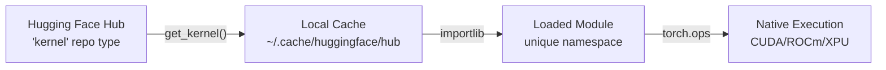
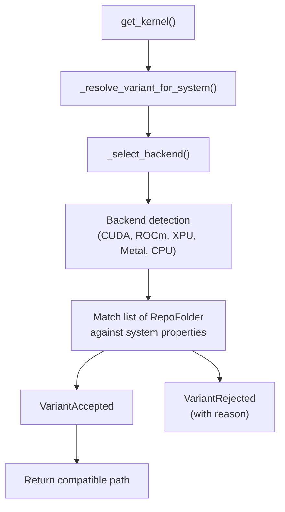
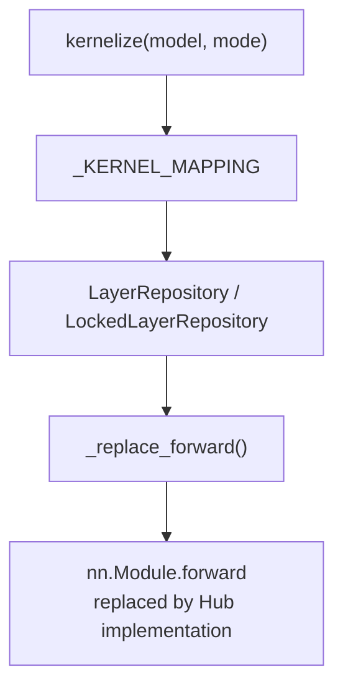

<!-- source: DeepWiki mcp.deepwiki.com · repo huggingface/kernels · page 1.1 Key Concepts · fetched 2026-10-26 -->

# Key Concepts

<details>
<summary>Relevant source files</summary>

The following files were used as context for generating this wiki page:

- [README.md](README.md)
- [docs/source/basic-usage.md](docs/source/basic-usage.md)
- [docs/source/blog.md](docs/source/blog.md)
- [docs/source/cli-versions.md](docs/source/cli-versions.md)
- [docs/source/index.md](docs/source/index.md)
- [docs/source/integrating-kernels.md](docs/source/integrating-kernels.md)
- [docs/source/kernel-requirements.md](docs/source/kernel-requirements.md)
- [docs/source/layers.md](docs/source/layers.md)
- [docs/source/locking.md](docs/source/locking.md)
- [docs/source/migration.md](docs/source/migration.md)
- [docs/source/talks.md](docs/source/talks.md)
- [docs/source/why_kernels.md](docs/source/why_kernels.md)
- [examples/basic.py](examples/basic.py)
- [kernels/src/kernels/variants.py](kernels/src/kernels/variants.py)
- [kernels/tests/test_variants.py](kernels/tests/test_variants.py)

</details>


This document defines the fundamental concepts and terminology used throughout the `kernels` system. It covers the core abstractions that enable portable, versioned, and optimized compute kernels to be loaded from Hugging Face Hub and integrated into PyTorch models.

## Kernels

A **kernel** is a precompiled, optimized compute implementation that can be dynamically loaded from the Hugging Face Hub. Kernels differ from traditional Python packages in three key ways:

| Property | Description |
|----------|-------------|
| **Portable** | Can be loaded from paths outside `PYTHONPATH` [README.md:25](). |
| **Unique** | Multiple versions of the same kernel can be loaded in the same Python process [README.md:26-27](). |
| **Compatible** | Support all recent PyTorch versions and build configurations (various CUDA versions and C++ ABIs) [README.md:28-30](). |

Kernels are accessed through the `get_kernel()` function, which downloads and caches them locally [kernels/src/kernels/basic-usage.md:12]().

```python
# Load a kernel from the Hub
activation = get_kernel("kernels-community/activation", version=1)

# Use kernel functions directly
y = torch.empty_like(x)
activation.gelu_fast(y, x)
```

**Kernel Lifecycle**
Title: "Kernel Distribution and Execution Flow"

Sources: [README.md:20-31](), [docs/source/basic-usage.md:5-22](), [docs/source/kernel-requirements.md:12-15]()

## Kernel Variants

**Kernel variants** are different builds of the same kernel optimized for specific hardware and software configurations. Each variant follows a naming convention that encodes the target environment [docs/source/kernel-requirements.md:36-40]():

```
<framework><version>-cxx<abiver>-<backend><ver>-<arch>-<os>
```

**Example Variants:**
- `torch26-cxx11-cu118-x86_64-linux`: PyTorch 2.6, C++11 ABI, CUDA 11.8, x86_64 Linux.
- `torch27-cxx98-rocm61-x86_64-linux`: PyTorch 2.7, C++98 ABI, ROCm 6.1, x86_64 Linux.
- `torch-universal`: Fallback variant for generic environments [docs/source/kernel-requirements.md:50-52]().

**Variant Selection Logic**
Title: "Variant Selection (Code Entity Space)"

Sources: [kernels/src/kernels/variants.py:201-215](), [kernels/src/kernels/variants.py:24-26](), [docs/source/kernel-requirements.md:36-40]()

## Hub Integration

Kernels are first-class repository types on the Hugging Face Hub [docs/source/index.md:11-12]().

### Trusted Publishers
By default, `kernels` only loads from a curated set of trusted publishers (e.g., `kernels-community`). Loading from other organizations requires an explicit `trust_remote_code=True` flag [docs/source/kernel-requirements.md:19-29]().

### Version vs. Revision
- **Version**: A major integer (e.g., `version=1`). Kernel maintainers must ensure no breaking changes within a major version [docs/source/basic-usage.md:25-32]().
- **Revision**: A specific Git ref (branch name or commit hash). Revisions are used for exact pinning [docs/source/basic-usage.md:31]().

Sources: [docs/source/kernel-requirements.md:17-32](), [docs/source/basic-usage.md:24-36]()

## Layer Kernelization

**Layer kernelization** replaces the `forward` method of an existing `torch.nn.Module` with an optimized Hub kernel [docs/source/layers.md:3-6]().

### Key Classes
- `LayerRepository`: Defines a Hub-backed replacement (repo, layer name, version/revision) [docs/source/layers.md:167-171]().
- `LocalLayerRepository`: Points to a local path for development.
- `LockedLayerRepository`: Uses a `kernels.lock` file for resolution [docs/source/locking.md:37-40]().

### Mode and Device
- **Mode**: Defines the context, such as `Mode.INFERENCE`, `Mode.TRAINING`, or `Mode.TORCH_COMPILE` [docs/source/layers.md:94-123]().
- **Device**: The compute backend (e.g., `cuda`, `rocm`, `xpu`, `metal`, `cpu`) [docs/source/layers.md:127-137]().

**Layer Replacement Logic**
Title: "Layer Kernelization (Code Entity Space)"

Sources: [docs/source/layers.md:84-110](), [docs/source/layers.md:160-188](), [docs/source/locking.md:31-45]()

## Extensible Layers

An **extensible layer** is a module designed to be intercepted. 
- **Decorator**: `@use_kernel_forward_from_hub("Name")` marks a class or function as extensible [docs/source/layers.md:19-24]().
- **Function Kernelization**: Functions can be made extensible using the same decorator and then attached to a module via `@use_kernelized_func(func)` [docs/source/layers.md:54-79]().

**Pure Layer Requirements:**
To ensure portability, kernel layers must be "pure":
1. No constructor (`__init__`) logic that changes state [docs/source/kernel-requirements.md:183]().
2. Stateless implementations.
3. Only `forward()` implementation is provided by the kernel.

Sources: [docs/source/layers.md:13-83](), [docs/source/kernel-requirements.md:183]()

## Version Locking

Version locking provides reproducible builds by pinning exact Git commit hashes in a `kernels.lock` file [docs/source/locking.md:16-19]().

1. **Dependency Definition**: Defined in `pyproject.toml` under `[tool.kernels.dependencies]` [docs/source/locking.md:7-14]().
2. **Lock Generation**: The `kernels lock .` command resolves constraints to exact revisions [docs/source/locking.md:16]().
3. **Consumption**: `get_locked_kernel()` or `load_kernel()` uses the lockfile to ensure the exact same code is used across different environments [docs/source/locking.md:18-24]().

Sources: [docs/source/locking.md:3-24](), [docs/source/locking.md:72-78]()

## Compute Backends

The system supports a wide matrix of compute backends, each with specific architecture requirements defined in `metadata.json` [docs/source/kernel-requirements.md:142-157]().

| Backend | Metadata `type` | Description |
|---------|-----------------|-------------|
| **CUDA** | `cuda` | NVIDIA GPUs (archs like `8.0`, `9.0+PTX`) |
| **ROCm** | `rocm` | AMD GPUs |
| **XPU** | `xpu` | Intel GPUs |
| **Metal** | `metal` | Apple Silicon (requires macOS 15+) [kernels/src/kernels/variants.py:33]() |
| **CPU** | `cpu` | Standard x86_64 or aarch64 |

Sources: [docs/source/kernel-requirements.md:142-157](), [kernels/src/kernels/variants.py:17-26]()

---

