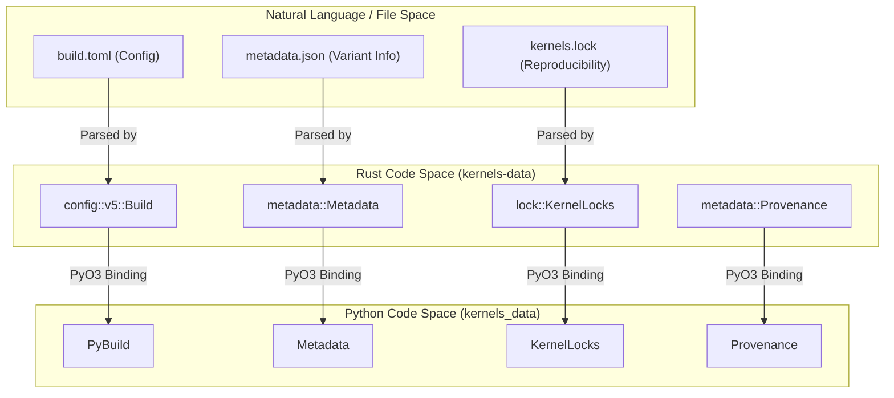
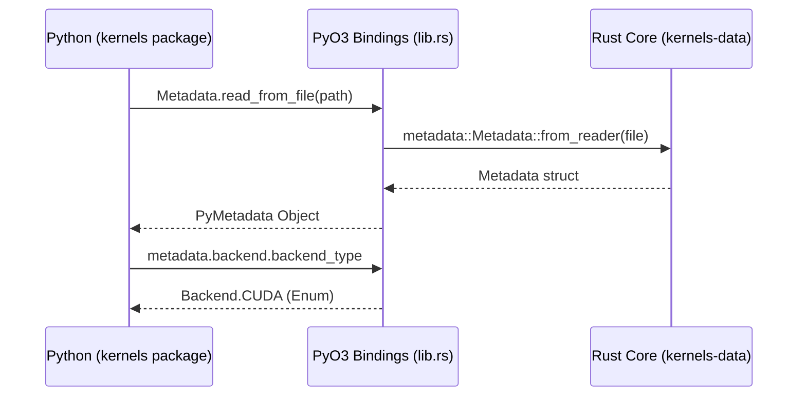

<!-- source: DeepWiki mcp.deepwiki.com · repo huggingface/kernels · page 10 kernels-data Reference · fetched 2026-10-26 -->

# kernels-data Reference

Relevant source files

The following files were used as context for generating this wiki page:

- [kernels-data/bindings/python/kernels_data.pyi](kernels-data/bindings/python/kernels_data.pyi)
- [kernels-data/bindings/python/src/lib.rs](kernels-data/bindings/python/src/lib.rs)
- [kernels-data/bindings/python/src/version.rs](kernels-data/bindings/python/src/version.rs)
- [kernels-data/bindings/python/tests/test_kernels_data.py](kernels-data/bindings/python/tests/test_kernels_data.py)
- [kernels-data/bindings/python/tests/test_version.py](kernels-data/bindings/python/tests/test_version.py)
- [kernels-data/src/config/mod.rs](kernels-data/src/config/mod.rs)
- [kernels-data/src/config/v2.rs](kernels-data/src/config/v2.rs)
- [kernels-data/src/config/v3.rs](kernels-data/src/config/v3.rs)
- [kernels-data/src/config/v4.rs](kernels-data/src/config/v4.rs)
- [kernels-data/src/config/v5.rs](kernels-data/src/config/v5.rs)
- [kernels-data/src/lib.rs](kernels-data/src/lib.rs)
- [kernels-data/src/metadata.rs](kernels-data/src/metadata.rs)
- [kernels-data/src/version.rs](kernels-data/src/version.rs)

The `kernels-data` crate is a shared Rust library and set of Python bindings that provides the core data structures and configuration logic for the `kernels` ecosystem. It serves as the single source of truth for kernel metadata, build configurations (`build.toml`), and lockfiles (`kernels.lock`), ensuring consistency between the Rust-based `kernel-builder` and the Python-based `kernels` runtime.

### Data and Logic Flow
The following diagram illustrates how `kernels-data` bridges the gap between raw configuration files and the active Python environment.

**Configuration to Python FFI Bridge**

Sources: [kernels-data/src/config/mod.rs:40-44](), [kernels-data/src/metadata.rs:92-109](), [kernels-data/bindings/python/src/lib.rs:10-21]()

---

## Data Models and Configuration

The Rust crate defines the schema for all kernel-related artifacts. A key feature is its support for multiple `build.toml` editions (v1 through v5), allowing the system to evolve while maintaining backward compatibility with older kernels.

### Core Entities
| Entity | Role | Source |
| :--- | :--- | :--- |
| `Metadata` | Describes a specific build variant, including its hardware `BackendInfo` and `Digest`. | [kernels-data/src/metadata.rs:92-109]() |
| `Build` | The internal representation of a `build.toml` file, organized by `General`, `Framework`, and `Kernel` sections. | [kernels-data/src/config/mod.rs:40-44]() |
| `Provenance` | Tracks the git state (`GitStatus`) of both the `kernel-builder` and the kernel source to ensure build integrity. | [kernels-data/src/metadata.rs:71-79]() |
| `Version` | A generic dotted numeric versioning system used for CUDA/ROCm versions and stable ABIs. | [kernels-data/src/version.rs:8-9]() |

For a deep dive into versioned formats, SHA-based hashing, and Git integration, see [Data Models and Configuration](#10.1).

---

## Python Bindings (`kernels_data`)

The `kernels-data` crate includes a `cdylib` target that exposes Rust structures to Python via **PyO3**. This allows the `kernels` Python package to perform high-performance metadata validation and lockfile resolution without re-implementing complex logic in Python.

### Mapping Rust to Python
The bindings use a `Py` prefix for internal Rust wrappers (e.g., `PyBackend`) but expose them to Python using the original names defined in `kernels_data.pyi`.

**FFI Interaction Diagram**

Sources: [kernels-data/bindings/python/src/lib.rs:10-13](), [kernels-data/bindings/python/kernels_data.pyi:37-47]()

### Key Components
*   **Type Stubs**: The `kernels_data.pyi` file provides full PEP 484 type hints for the compiled module. [kernels-data/bindings/python/kernels_data.pyi:1-32]()
*   **Safety**: Bindings include validation logic, such as `KernelName` regex checking (`^[a-z][-a-z0-9]*[a-z0-9]$`). [kernels-data/bindings/python/src/lib.rs:23-37]()
*   **Testing**: The bindings are verified using `pytest` to ensure that Rust's `serde` logic matches Python's expected dictionary shapes. [kernels-data/bindings/python/tests/test_kernels_data.py:74-100]()

For details on the FFI implementation, type stubs, and binding tests, see [Python Bindings (kernels_data)](#10.2).

---
Sources: [kernels-data/src/lib.rs:1-6](), [kernels-data/src/config/mod.rs:29-31](), [kernels-data/bindings/python/src/lib.rs:1-21]()

---

