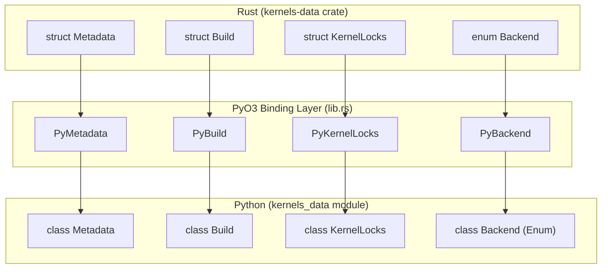
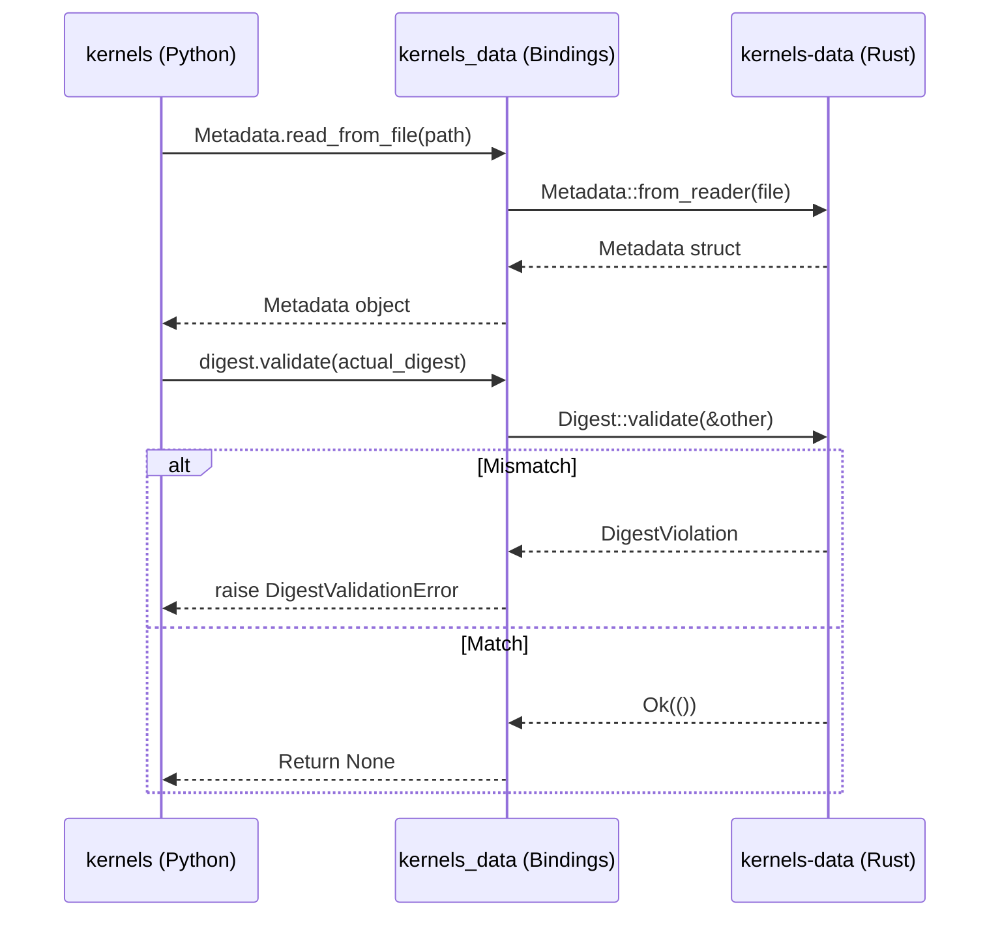

<!-- source: DeepWiki mcp.deepwiki.com · repo huggingface/kernels · page 10.2 Python Bindings (kernels_data) · fetched 2026-10-26 -->

# Python Bindings (kernels_data)

Relevant source files

The following files were used as context for generating this wiki page:

- [Cargo.lock](Cargo.lock)
- [kernel-builder/Cargo.toml](kernel-builder/Cargo.toml)
- [kernel-builder/src/hf.rs](kernel-builder/src/hf.rs)
- [kernels-data/Cargo.toml](kernels-data/Cargo.toml)
- [kernels-data/bindings/python/Cargo.toml](kernels-data/bindings/python/Cargo.toml)
- [kernels-data/bindings/python/kernels_data.pyi](kernels-data/bindings/python/kernels_data.pyi)
- [kernels-data/bindings/python/src/lib.rs](kernels-data/bindings/python/src/lib.rs)
- [kernels-data/bindings/python/src/version.rs](kernels-data/bindings/python/src/version.rs)
- [kernels-data/bindings/python/tests/test_kernels_data.py](kernels-data/bindings/python/tests/test_kernels_data.py)
- [kernels-data/bindings/python/tests/test_version.py](kernels-data/bindings/python/tests/test_version.py)
- [kernels-data/src/config/mod.rs](kernels-data/src/config/mod.rs)
- [kernels-data/src/config/v2.rs](kernels-data/src/config/v2.rs)
- [kernels-data/src/config/v3.rs](kernels-data/src/config/v3.rs)
- [kernels-data/src/config/v4.rs](kernels-data/src/config/v4.rs)
- [kernels-data/src/config/v5.rs](kernels-data/src/config/v5.rs)
- [kernels-data/src/lib.rs](kernels-data/src/lib.rs)
- [kernels-data/src/metadata.rs](kernels-data/src/metadata.rs)
- [kernels-data/src/version.rs](kernels-data/src/version.rs)
- [kernels/pyproject.toml](kernels/pyproject.toml)
- [kernels/uv.lock](kernels/uv.lock)
- [nix-builder/pkgs/crate-dirs.nix](nix-builder/pkgs/crate-dirs.nix)
- [nix-builder/pkgs/kernel-builder/default.nix](nix-builder/pkgs/kernel-builder/default.nix)
- [nix-builder/pkgs/python-modules/kernels-data/default.nix](nix-builder/pkgs/python-modules/kernels-data/default.nix)

The `kernels-data` library provides the core data structures and logic for kernel metadata, build configurations, and version locking. To enable the `kernels` Python package to perform high-performance metadata parsing and secure lock management, these Rust internals are exposed via Python bindings using **PyO3**.

### Architecture and Crate Structure

The bindings are implemented as a `cdylib` Rust crate located in `kernels-data/bindings/python`. This crate depends on the core `kernels-data` library and uses PyO3 to map Rust structs and enums to Python classes.

*   **Rust Source**: `kernels-data/bindings/python/src/lib.rs` [kernels-data/bindings/python/src/lib.rs:1-22]() defines the main Python module.
*   **Type Stubs**: `kernels-data/bindings/python/kernels_data.pyi` [kernels-data/bindings/python/kernels_data.pyi:1-32]() provides static type hints for Python IDEs and type checkers.
*   **Crate Configuration**: The `Cargo.toml` in the bindings directory specifies the `pyo3` dependency with the `extension-module` feature enabled.

#### Natural Language to Code Entity Mapping: Core Data Flow

The following diagram illustrates how high-level kernel concepts are mapped from the Rust `kernels-data` crate to the Python `kernels_data` module.

"Data Mapping: Rust to Python"

Sources: [kernels-data/bindings/python/src/lib.rs:24-136](), [kernels-data/src/metadata.rs:90-109](), [kernels-data/src/config/mod.rs:40-44]()

### Key Exposed Classes

#### Metadata and Backend
The `Metadata` class [kernels_data.pyi:24]() is the primary way the Python package interacts with `metadata.json` files found in Hub variants. It includes information about the `Backend` [kernels_data.pyi:37](), `python_depends` [kernels_data.pyi:101](), and `Provenance` [kernels_data.pyi:114]().

*   **Backend Support**: Supports `CUDA`, `ROCm`, `XPU`, `Metal`, `CPU`, `CANN`, `Neuron`, and `TPU` [kernels-data/bindings/python/src/lib.rs:58-75]().
*   **Hashing**: The `Digest` class [kernels_data.pyi:192]() allows Python to verify the integrity of downloaded kernel files against a reference hash [kernels-data/bindings/python/src/lib.rs:343-358]().

#### Versioning and Configuration
*   **Version**: A dotted numeric versioning system (e.g., `12.8.0`) used for hardware and framework compatibility [kernels-data/bindings/python/src/version.rs:8-15]().
*   **Build Config**: Exposes `build.toml` parsing through the `Build` class, allowing the Python layer to understand kernel requirements before triggering a build or download [kernels-data/bindings/python/src/config.rs:74](). It handles multiple schema editions (v3, v4, v5) [kernels-data/src/config/mod.rs:29-31]().

#### Lock Management
The `KernelLocks` and `NixKernelLocks` classes provide the backend for `kernels.lock` file generation and validation.
*   `PyKernelLocks` [kernels-data/bindings/python/src/lock.rs:84-90]() manages collections of `KernelLock` objects.
*   `NixKernelLocks` [kernels-data/bindings/python/src/lock.rs:164-170]() specifically handles locks related to Nix-based kernel builds, storing the Nix store path and output hash.

### Python-Rust Interaction Diagram

This diagram shows how the `kernels` Python package utilizes the `kernels_data` bindings to resolve and verify a kernel.

"Interaction: Python Package to Rust Bindings"

Sources: [kernels-data/bindings/python/src/lib.rs:307-320](), [kernels-data/bindings/python/src/lib.rs:388-400](), [kernels-data/src/metadata.rs:148-150]()

### Testing and Validation

The bindings are rigorously tested to ensure parity between Rust and Python behavior.

| Test File | Purpose |
| :--- | :--- |
| `test_kernels_data.py` | Validates `KernelName`, `Backend`, and `Metadata` parsing [kernels-data/bindings/python/tests/test_kernels_data.py:20-100](). |
| `test_version.py` | Ensures `Version` comparison and normalization logic matches Rust [kernels-data/bindings/python/tests/test_version.py:1-20](). |
| `test_kernel_lock.py` | Tests serialization/deserialization of `kernels.lock` files. |
| `test_digest.py` | Verifies file hashing and `DigestViolation` reporting [kernels-data/bindings/python/kernels_data.pyi:234-270](). |
| `test_config.py` | Validates that `build.toml` configurations are correctly mapped to Python objects. |

#### Stub Verification
To ensure the type stubs (`.pyi`) stay in sync with the actual Rust implementation, the CI runs `stubtest`. Any intentional deviations (like internal PyO3 helpers) must be added to `stubtest-allowlist.txt`.

Sources: [kernels-data/bindings/python/kernels_data.pyi:1-32](), [kernels-data/bindings/python/tests/test_kernels_data.py:1-180](), [kernels-data/bindings/python/src/lib.rs:1-22]()

---

