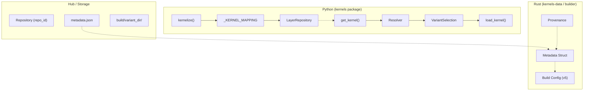
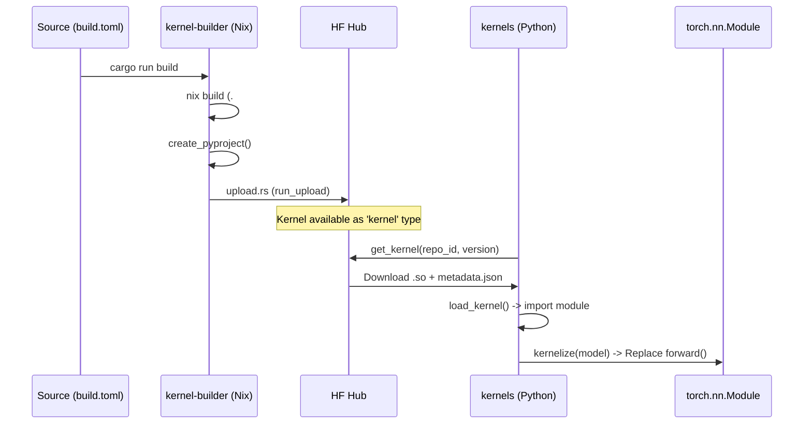

<!-- source: DeepWiki mcp.deepwiki.com · repo huggingface/kernels · page 11 Glossary · fetched 2026-10-26 -->

# Glossary

Relevant source files

The following files were used as context for generating this wiki page:

- [README.md](README.md)
- [docs/source/basic-usage.md](docs/source/basic-usage.md)
- [docs/source/blog.md](docs/source/blog.md)
- [docs/source/builder-cli.md](docs/source/builder-cli.md)
- [docs/source/builder/build-variants.md](docs/source/builder/build-variants.md)
- [docs/source/index.md](docs/source/index.md)
- [docs/source/integrating-kernels.md](docs/source/integrating-kernels.md)
- [docs/source/kernel-requirements.md](docs/source/kernel-requirements.md)
- [docs/source/layers.md](docs/source/layers.md)
- [docs/source/locking.md](docs/source/locking.md)
- [docs/source/migration.md](docs/source/migration.md)
- [docs/source/talks.md](docs/source/talks.md)
- [docs/source/why_kernels.md](docs/source/why_kernels.md)
- [examples/basic.py](examples/basic.py)
- [kernel-builder/src/main.rs](kernel-builder/src/main.rs)
- [kernel-builder/src/pyproject/mod.rs](kernel-builder/src/pyproject/mod.rs)
- [kernel-builder/src/pyproject/ops_identifier.rs](kernel-builder/src/pyproject/ops_identifier.rs)
- [kernel-builder/src/upload.rs](kernel-builder/src/upload.rs)
- [kernels-data/bindings/python/kernels_data.pyi](kernels-data/bindings/python/kernels_data.pyi)
- [kernels-data/bindings/python/src/lib.rs](kernels-data/bindings/python/src/lib.rs)
- [kernels-data/src/git.rs](kernels-data/src/git.rs)
- [kernels-data/src/lib.rs](kernels-data/src/lib.rs)
- [kernels-data/src/metadata.rs](kernels-data/src/metadata.rs)
- [kernels/src/kernels/cli/__init__.py](kernels/src/kernels/cli/__init__.py)
- [kernels/src/kernels/cli/verify_signature.py](kernels/src/kernels/cli/verify_signature.py)
- [kernels/src/kernels/layer/func.py](kernels/src/kernels/layer/func.py)
- [kernels/src/kernels/layer/layer.py](kernels/src/kernels/layer/layer.py)
- [kernels/tests/test_verify.py](kernels/tests/test_verify.py)
- [nix-builder/build-variants.json](nix-builder/build-variants.json)
- [nix-builder/overlay.nix](nix-builder/overlay.nix)
- [nix-builder/pkgs/aotriton/default.nix](nix-builder/pkgs/aotriton/default.nix)
- [nix-builder/pkgs/python-modules/torch/binary/generic.nix](nix-builder/pkgs/python-modules/torch/binary/generic.nix)
- [nix-builder/pkgs/rocm-packages/default.nix](nix-builder/pkgs/rocm-packages/default.nix)
- [nix-builder/pkgs/xpu-packages/onednn-xpu.nix](nix-builder/pkgs/xpu-packages/onednn-xpu.nix)
- [nix-builder/versions.nix](nix-builder/versions.nix)

This page provides definitions and technical context for codebase-specific terms, jargon, and abbreviations used throughout the `kernels` ecosystem. It serves as a reference for engineers onboarding to the repository.

## Core Concepts

### Kernel
A **kernel** in this repository refers to a portable, unique, and compatible compute implementation (typically CUDA, ROCm, or Triton) distributed via the Hugging Face Hub [README.md:20-31](). Unlike standard Python packages, kernels are designed to be loaded dynamically from arbitrary paths without polluting the global `PYTHONPATH` [README.md:25-27]().

### Build Variant
A specific binary artifact compiled for a particular combination of framework, Python ABI, compute backend, architecture, and operating system [docs/source/kernel-requirements.md:36-40](). 
- **Naming Convention**: `<framework><version>-cxx<abiver>-<cu><cudaver>-<arch>-<os>` (e.g., `torch26-cxx98-cu118-x86_64-linux`) [docs/source/kernel-requirements.md:39-40]().
- **Sources**: [nix-builder/build-variants.json](), [docs/source/builder/build-variants.md]().

### metadata.json
A mandatory file within each build variant directory that describes the kernel's identity, version, backend requirements, and security digests [docs/source/kernel-requirements.md:63-109]().
- **Implementation**: `Metadata` struct in Rust [kernels-data/src/metadata.rs:92-109]() and `PyMetadata` in Python bindings.

### kernels.lock
A lockfile used to ensure reproducible kernel loading by pinning specific repository revisions (Git SHAs) and their associated cryptographic digests [docs/source/locking.md]().
- **Implementation**: `KernelLocks` class [kernels-data/bindings/python/src/lib.rs:20]().

### Trusted Publisher
A security mechanism where the `kernels` package only loads code from a curated list of organizations (e.g., `kernels-community`) by default [docs/source/kernel-requirements.md:17-29](). Users must explicitly set `trust_remote_code=True` to load kernels from other publishers [docs/source/kernel-requirements.md:28-29]().

---

## Layer Kernelization

### Kernelize
The process of traversing a PyTorch model's graph and replacing standard `forward` methods with optimized Hub-based kernels [docs/source/layers.md:84-91]().
- **Key Function**: `kernelize(model, mode, device, ...)` [docs/source/layers.md:93-94]().

### LayerRepository
A descriptor used in kernel mappings to associate a logical layer name (e.g., "SiluAndMul") with a specific Hub repository and version [kernels/src/kernels/layer/layer.py:42-72]().
- **Variants**: `LocalLayerRepository` (for local dev) [kernels/src/kernels/layer/layer.py:139-161]() and `LockedLayerRepository` (for production/locked environments) [kernels/src/kernels/layer/layer.py:190-215]().

### Pure Layer
A requirement for kernelizable layers: they must be "stateless" in their implementation logic (though they can have parameters) so that the `forward` method can be swapped without side effects [docs/source/kernel-requirements.md:1-10]().

### Mode
An Enum used during kernelization to specify the execution context: `INFERENCE`, `TRAINING`, or `TORCH_COMPILE` [kernels/src/kernels/layer/mode.py](). These can be combined using bitwise OR [docs/source/layers.md:113-123]().

### Device & CUDAProperties
- **Device**: An abstraction representing the target hardware (e.g., `cuda`, `rocm`, `xpu`) [kernels/src/kernels/layer/device.py:28]().
- **CUDAProperties**: Used to filter kernel variants based on specific GPU compute capabilities (e.g., `sm_80`) [docs/source/kernel-requirements.md:124-125]().

---

## Build System & Nix

### Nix Flake
The entry point for the reproducible build system. The `flake.nix` file defines the development shells, build inputs, and the dependency graph for all kernel backends [nix-builder/overlay.nix]().

### Build Set
A collection of build variants grouped by a specific framework version (e.g., all CUDA/ROCm variants for Torch 2.5).
- **Key Function**: `mkBuildSets` in the Nix infrastructure creates the matrix of available builds [nix-builder/pkgs/python-modules/torch/binary/generic.nix]().

### Provenance
Metadata recorded at build time indicating the exact Git state of both the `kernel-builder` tool and the kernel source code [kernels-data/src/metadata.rs:71-79]().
- **Dirty Build**: A build generated from a source tree with uncommitted changes, flagged in the metadata to warn about lack of reproducibility [docs/source/kernel-requirements.md:97-104]().

### autoPatchelfHook
A Nix build hook used to automatically fix RPATHs in compiled binary extensions, ensuring they can find their dynamic library dependencies (like `libcudart.so`) regardless of where they are installed on the system [nix-builder/overlay.nix]().

### fetchFromHuggingFace
A custom Nix fetcher that allows the build system to treat the Hugging Face Hub as a source for build inputs, enabling multi-stage builds across different repositories [nix-builder/overlay.nix:15]().

---

## Technical Jargon & Tools

| Term | Definition | Code Pointer |
| :--- | :--- | :--- |
| **KernelIdentifier** | A unique string suffixed to kernel names to avoid collision in the Python namespace (often a partial Git SHA). | [kernel-builder/src/pyproject/ops_identifier.rs]() |
| **manylinux_2_28** | The minimum glibc standard targeted by the build system to ensure portability across modern Linux distros. | [docs/source/kernel-requirements.md:4-5]() |
| **ABI3 / Limited API** | Python's stable ABI, allowing a single compiled `.so` file to work across multiple Python versions (e.g., 3.9 through 3.12). | [docs/source/kernel-requirements.md:130]() |
| **aotriton** | Pre-compiled Triton kernels for AMD (ROCm) backends to avoid runtime compilation overhead. | [nix-builder/pkgs/aotriton/default.nix]() |
| **sycl-tla** | SYCL-based Tile Library Abstraction used for Intel XPU kernel optimization. | [nix-builder/pkgs/xpu-packages/onednn-xpu.nix]() |
| **hipify** | The process of converting CUDA source code to HIP code for ROCm compatibility. | [nix-builder/pkgs/rocm-packages/default.nix]() |
| **gencode flags** | CUDA compiler flags specifying which GPU architectures to generate code for (e.g., `-gencode arch=compute_80,code=sm_80`). | [kernels-data/src/metadata.rs:124]() |
| **XET** | Hugging Face's high-performance transfer protocol used for large binary artifacts. | [nix-builder/overlay.nix:117]() |
| **kernels-community** | The primary Hugging Face organization for curated, high-quality compute kernels. | [kernel-builder/src/upload.rs:44-45]() |
| **CARD.md** | A template file in kernel repositories used to generate the Model Card (README) on the Hub. | [kernel-builder/src/main.rs:219-227]() |
| **Edition** | A versioned set of build configurations in `build.toml` that defines compatible toolchains and dependencies. | [kernel-builder/src/main.rs:8]() |

---

## Architecture Diagrams

### System Entity Mapping
The following diagram bridges natural language concepts to specific code implementations within the `kernels` and `kernel-builder` crates.

"System Entity Mapping"

Sources: [kernels/src/kernels/layer/layer.py:29-31](), [kernels-data/src/metadata.rs:92-109](), [kernel-builder/src/main.rs:8]()

### Build & Load Lifecycle
This diagram illustrates how a kernel moves from source to a loaded module in a user's PyTorch model.

"Kernel Lifecycle"

Sources: [kernel-builder/src/upload.rs:177-182](), [kernel-builder/src/pyproject/mod.rs](), [kernels/src/kernels/layer/layer.py:106-112](), [docs/source/layers.md:84-91]()