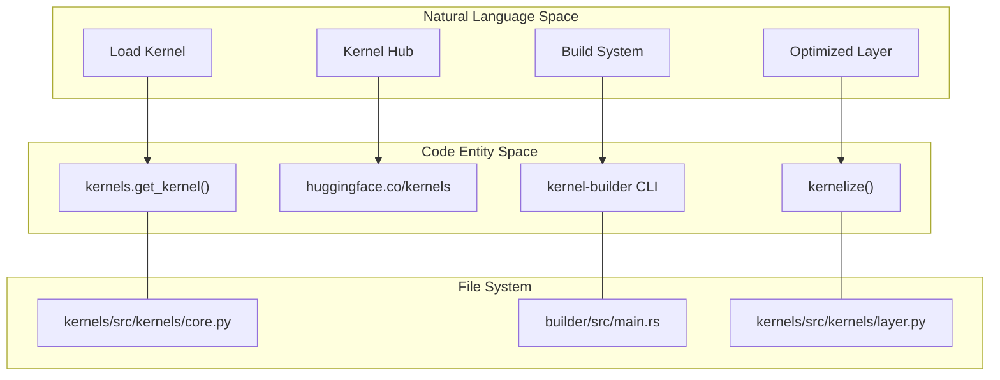
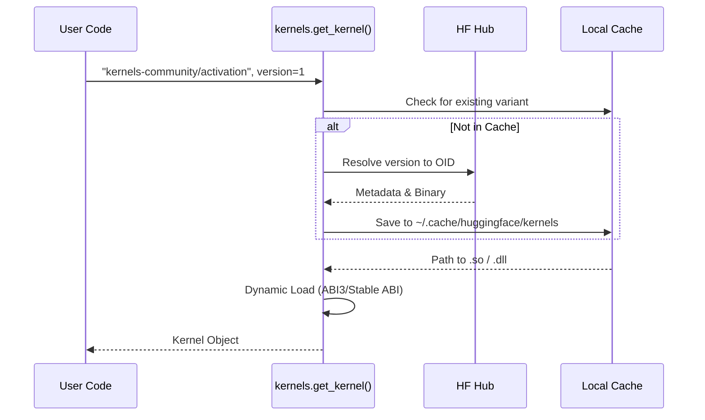

<!-- source: DeepWiki mcp.deepwiki.com · repo huggingface/kernels · page 2 Getting Started · fetched 2026-10-26 -->

# Getting Started

<details>
<summary>Relevant source files</summary>

The following files were used as context for generating this wiki page:

- [README.md](README.md)
- [docs/source/blog.md](docs/source/blog.md)
- [docs/source/builder/why-nix.md](docs/source/builder/why-nix.md)
- [docs/source/index.md](docs/source/index.md)
- [docs/source/installation.md](docs/source/installation.md)
- [docs/source/talks.md](docs/source/talks.md)
- [docs/source/why_kernels.md](docs/source/why_kernels.md)
- [examples/basic.py](examples/basic.py)
- [nix-builder/README.md](nix-builder/README.md)

</details>


This guide provides step-by-step instructions for installing and using the kernels system to load optimized compute kernels from Hugging Face Hub. It covers basic installation, your first kernel execution, and introduces core concepts needed for everyday usage.

For detailed installation requirements, see [Installation](#2.1). For more practical code samples, see [Basic Usage Examples](#2.2).

## Prerequisites and Installation

The `kernels` package requires `torch>=2.5` [README.md:40-40]() and is designed to support various compute backends including CUDA, ROCm, XPU, and Metal [nix-builder/README.md:49-57]().

### Installation

Install the core `kernels` package using `pip` or `uv`:

```bash
pip install kernels
# OR
uv pip install kernels
```

For specific environments, you can use curated dependency groups:
* **Standard Curated**: Includes common dependencies like CUTLASS DSL and einops [docs/source/installation.md:38-41]().
* **XPU Curated**: Optimized for Intel GPU platforms [docs/source/installation.md:47-51]().

```bash
pip install "kernels[curated]"
```

**Sources:** [README.md:40-44](), [docs/source/installation.md:18-52]()

## Core Workflow Overview

The system bridges the gap between the Hugging Face Hub and your local PyTorch runtime by managing the lifecycle of portable, unique, and compatible kernel binaries [docs/source/index.md:13-21]().

### System Component Mapping

This diagram maps Natural Language concepts to the specific code entities and files that implement them.



**Sources:** [README.md:32-37](), [docs/source/index.md:25-29]()

## Your First Kernel

The primary way to interact with the system is through the `get_kernel` function, which resolves a Hub repository to a local, usable object [examples/basic.py:8-8]().

### Basic Kernel Execution Example

```python
import torch
from kernels import get_kernel

# 1. Resolve and download kernel from Hub
# Reference: [examples/basic.py:8]
activation = get_kernel("kernels-community/activation", version=1)

# 2. Prepare data
x = torch.randn((10, 10), dtype=torch.float16, device="cuda")
y = torch.empty_like(x)

# 3. Execute optimized function
# Reference: [examples/basic.py:18]
activation.gelu_fast(y, x)
```

### Kernel Loading Lifecycle



**Sources:** [README.md:48-64](), [examples/basic.py:1-30]()

## Key Features

*   **Portability**: Kernels are loaded from paths outside the standard `PYTHONPATH` [README.md:25-25]().
*   **Uniqueness**: You can load multiple versions of the same kernel in one process without naming collisions [README.md:26-27]().
*   **Compatibility**: Supports a matrix of Python versions, C++ ABIs, and CUDA versions [README.md:28-30]().
*   **Reproducibility**: Uses Nix for the build system to ensure deterministic outputs [docs/source/builder/why-nix.md:7-10]().

## Next Steps

To dive deeper into specific areas of the ecosystem:

1.  **[Installation](#2.1)**: Learn about environment variables, hardware-specific extras (like `curated-xpu`), and version pinning [docs/source/installation.md:1-66]().
2.  **[Basic Usage Examples](#2.2)**: See more patterns for tensor operations and variant discovery [examples/basic.py:1-30]().
3.  **[Kernel Management](#3)**: Learn how to use `kernels.lock` for reproducible production deployments.
4.  **[Kernel Development](#5)**: Start building your own kernels using the `kernel-builder` and Nix [nix-builder/README.md:1-45]().

**Sources:** [README.md:68-70](), [docs/source/index.md:25-30]()

---

