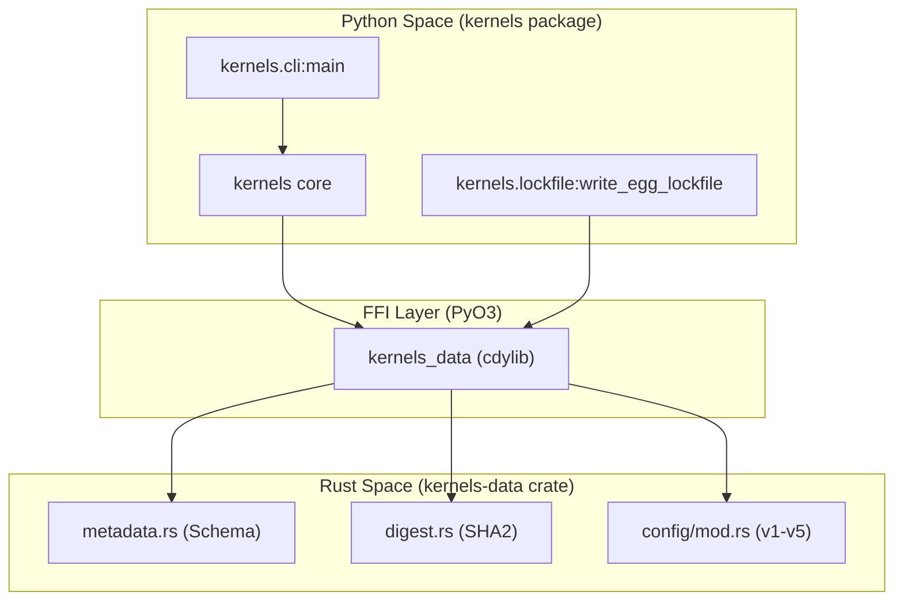
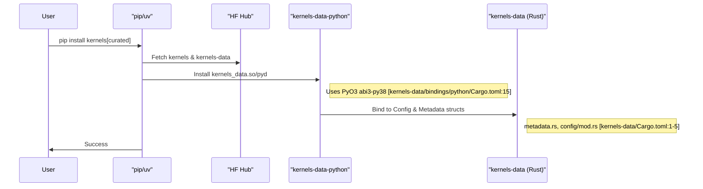

<!-- source: DeepWiki mcp.deepwiki.com · repo huggingface/kernels · page 2.1 Installation · fetched 2026-10-26 -->

# Installation

<details>
<summary>Relevant source files</summary>

The following files were used as context for generating this wiki page:

- [Cargo.lock](Cargo.lock)
- [docs/source/builder/why-nix.md](docs/source/builder/why-nix.md)
- [docs/source/installation.md](docs/source/installation.md)
- [kernel-builder/Cargo.toml](kernel-builder/Cargo.toml)
- [kernel-builder/src/hf.rs](kernel-builder/src/hf.rs)
- [kernels-data/Cargo.toml](kernels-data/Cargo.toml)
- [kernels-data/bindings/python/Cargo.toml](kernels-data/bindings/python/Cargo.toml)
- [kernels/pyproject.toml](kernels/pyproject.toml)
- [kernels/uv.lock](kernels/uv.lock)
- [nix-builder/README.md](nix-builder/README.md)
- [nix-builder/pkgs/crate-dirs.nix](nix-builder/pkgs/crate-dirs.nix)
- [nix-builder/pkgs/kernel-builder/default.nix](nix-builder/pkgs/kernel-builder/default.nix)
- [nix-builder/pkgs/python-modules/kernels-data/default.nix](nix-builder/pkgs/python-modules/kernels-data/default.nix)

</details>


This page provides comprehensive installation instructions for the Hugging Face `kernels` ecosystem. It covers the core Python package, hardware-specific dependencies, and the `kernel-builder` CLI tool used for creating new kernels.

## System Requirements

The `kernels` package has specific requirements for optimal functionality, particularly regarding the PyTorch ABI and Python version.

| Component | Requirement | Notes |
|-----------|-------------|-------|
| Python | >= 3.10 | Required for modern type safety and `kernels-data` bindings [kernels/pyproject.toml:11]() |
| PyTorch | >= 2.5 | Minimum version for ABI stability and modern loading [kernels/pyproject.toml:36]() |
| kernels-data | >= 0.14.0.dev1 | Rust-based metadata and lockfile parser [kernels/pyproject.toml:14]() |
| Operating System | Linux, macOS, Windows | Linux (WSL 2 for Windows) is recommended for GPU support [docs/source/installation.md:54-60]() |

> [!IMPORTANT]
> **Free-threaded Python:** It is strongly recommended to avoid free-threaded Python builds (experimental), as they do not support the stable ABI on Python versions before 3.15. Kernels rely on the stable ABI for portability [docs/source/installation.md:62-66]().

## Python Package Installation

### Basic Installation

Install the core package via `pip` or `uv`. This includes the `kernels` CLI and basic Hub integration.

```bash
pip install kernels
# OR
uv pip install kernels
```

Sources: [docs/source/installation.md:18-28](), [kernels/pyproject.toml:63-64]()

### Optional Dependency Groups

The `kernels` package provides several "extras" to install dependencies for specific use cases:

| Extra | Dependencies | Purpose |
|-------|--------------|---------|
| `torch` | `torch` | Ensures PyTorch is present for execution [kernels/pyproject.toml:49]() |
| `curated` | `nvidia-cutlass-dsl`, `einops`, `apache-tvm-ffi` | Standard runtime for many community kernels [kernels/pyproject.toml:50-54]() |
| `curated-xpu`| `einops`, `apache-tvm-ffi` | Runtime for Intel GPU (XPU) platforms [kernels/pyproject.toml:55-58]() |
| `benchmark` | `matplotlib`, `numpy`, `tabulate`, `torch` | Required for running `kernels benchmark` CLI [kernels/pyproject.toml:43-48]() |

```bash
# Example: Install for a standard GPU environment
pip install "kernels[curated,torch]"
```

Sources: [docs/source/installation.md:36-52](), [kernels/pyproject.toml:42-61]()

## The Installation Lifecycle

The following diagram illustrates how the Python package interacts with the Rust-based `kernels-data` library during installation and runtime.


**Architecture: Association of Python Entities to Rust Data Models**

Sources: [kernels/pyproject.toml:14](), [kernels-data/bindings/python/Cargo.toml:10-15](), [kernels-data/Cargo.toml:1-8]()

## Kernel-Builder Installation

The `kernel-builder` is a Rust-based CLI tool used to compile kernels into portable, Hub-compatible artifacts. It is not required for just *running* kernels, only for *developing* them.

### Method 1: Cargo (From Source)
Ensure you have a Rust toolchain installed.

```bash
git clone https://github.com/huggingface/kernels.git
cd kernels/kernel-builder
cargo install --path .
```
Sources: [kernel-builder/Cargo.toml:1-9]()

### Method 2: Nix (Recommended)
Nix provides a sandboxed environment that guarantees reproducible builds by explicitly managing CUDA, PyTorch, and C++ toolchain versions.

```bash
# Install kernel-builder using Nix
nix profile install github:huggingface/kernels#kernel-builder
```

To speed up builds, enable the Hugging Face binary cache:
```bash
nix run nixpkgs#cachix -- use huggingface
```
Sources: [nix-builder/README.md:21-31](), [docs/source/builder/why-nix.md:7-15]()

## Dependency Flow Diagram

This diagram maps the installation requirements from high-level user commands to the specific code entities that handle them.


**Code Entity Space: Dependency Resolution and Binding**

Sources: [kernels/pyproject.toml:12-21](), [kernels-data/bindings/python/Cargo.toml:10-20](), [kernels-data/Cargo.toml:10-25]()

## Verification

### CLI Verification
Verify that the `kernels` CLI is installed and can communicate with the Hub:
```bash
kernels --version
kernels info
```
Sources: [kernels/pyproject.toml:63-64]()

### Library Verification
Check if the Python package and its Rust bindings are working correctly:
```python
import kernels
import kernels_data
from kernels import get_kernel

print(f"Kernels version: {kernels.__version__}")
# Test that the Rust-backed metadata parser is functional
print(f"Data bindings version: {kernels_data.__version__}")
```
Sources: [kernels-data/bindings/python/Cargo.toml:1-5](), [kernels/pyproject.toml:1-4]()

---

