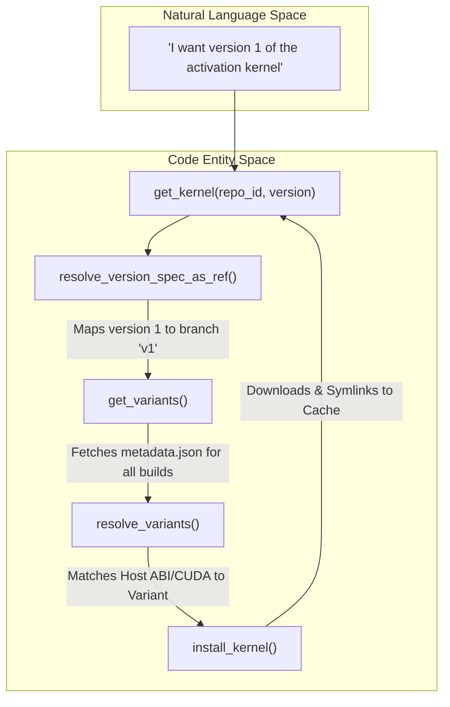
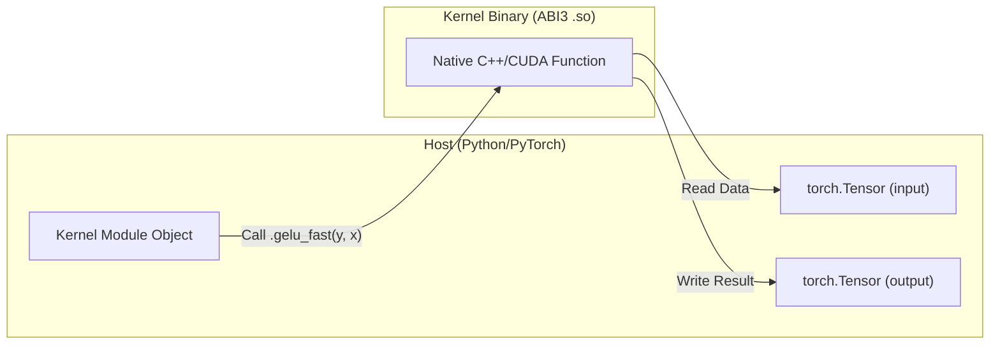

<!-- source: DeepWiki mcp.deepwiki.com · repo huggingface/kernels · page 2.2 Basic Usage Examples · fetched 2026-10-26 -->

# Basic Usage Examples

<details>
<summary>Relevant source files</summary>

The following files were used as context for generating this wiki page:

- [README.md](README.md)
- [docs/source/basic-usage.md](docs/source/basic-usage.md)
- [docs/source/blog.md](docs/source/blog.md)
- [docs/source/index.md](docs/source/index.md)
- [docs/source/integrating-kernels.md](docs/source/integrating-kernels.md)
- [docs/source/kernel-requirements.md](docs/source/kernel-requirements.md)
- [docs/source/layers.md](docs/source/layers.md)
- [docs/source/locking.md](docs/source/locking.md)
- [docs/source/migration.md](docs/source/migration.md)
- [docs/source/talks.md](docs/source/talks.md)
- [docs/source/why_kernels.md](docs/source/why_kernels.md)
- [examples/basic.py](examples/basic.py)
- [kernels/src/kernels/_versions.py](kernels/src/kernels/_versions.py)
- [kernels/src/kernels/cli/info.py](kernels/src/kernels/cli/info.py)
- [kernels/src/kernels/cli/versions.py](kernels/src/kernels/cli/versions.py)
- [kernels/src/kernels/hf_hub.py](kernels/src/kernels/hf_hub.py)
- [kernels/src/kernels/locking.py](kernels/src/kernels/locking.py)
- [kernels/tests/test_basic.py](kernels/tests/test_basic.py)

</details>


This page provides practical examples of loading and using optimized compute kernels from the Hugging Face Hub. It covers the fundamental operations needed to get started with the `kernels` system, including loading kernels, calling kernel functions, and inspecting kernel variants.

## Overview

The `kernels` package provides several key functions for interacting with the Hub. These functions manage the complexity of variant resolution (matching your PyTorch version, CUDA version, and CPU architecture to a specific build on the Hub) and dynamic loading.

*   `get_kernel()`: The primary entry point for downloading and loading a kernel.
*   `has_kernel()`: Checks if a compatible variant exists for the current environment.
*   `get_kernel_variants()`: Provides a detailed trace of which variants were accepted or rejected and why.
*   `get_loaded_kernels()`: Returns a list of all kernels currently loaded in the Python process.

## Basic Usage Pattern

The most common pattern is to load a kernel by its repository ID and a major version number.

### Loading and Calling a Kernel

The following example shows how to use the optimized activation kernels from the `kernels-community/activation` repository.

```python
import torch
from kernels import get_kernel

# 1. Load the kernel from the Hub. 
# Using version=1 fetches the latest compatible build from the v1 branch.
activation = get_kernel("kernels-community/activation", version=1)

# 2. Create tensors on the appropriate device (e.g., CUDA)
x = torch.randn((10, 10), dtype=torch.float16, device="cuda")
y = torch.empty_like(x)

# 3. Call the kernel function. 
# Many kernels use an in-place pattern where the output tensor is passed as the first argument.
activation.gelu_fast(y, x)

print(y)
```

**Sources:** [README.md:46-64](), [docs/source/basic-usage.md:5-22](), [examples/basic.py:8-20]()

### Versioning and Compatibility

Kernels use major versioning (e.g., `version=1`). A maintainer guarantees that within a major version, the API will not break and support for specific PyTorch versions will not be removed [docs/source/basic-usage.md:25-31](). Version `0` is reserved for experimental kernels where the API may change rapidly [docs/source/basic-usage.md:33-36]().

## System Architecture: From Hub to Tensor

The following diagrams illustrate how the `kernels` package bridges the gap between the Hugging Face Hub and execution on hardware.

### Natural Language to Code Entity Space: Kernel Loading


**Sources:** [kernels/src/kernels/_versions.py:64-91](), [kernels/src/kernels/cli/versions.py:12-22](), [kernels/src/kernels/locking.py:58-71]()

### Data Flow: Executing a Kernel Function


**Sources:** [README.md:60-61](), [examples/basic.py:17-18](), [docs/source/kernel-requirements.md:126-135]()

## Advanced Discovery and Inspection

### Checking Availability (`has_kernel`)

Before attempting to load a kernel, you can check if a compatible build exists for your specific hardware and software environment.

```python
from kernels import has_kernel

# Returns True if a compatible variant exists for the current Torch/CUDA/OS/Arch
if has_kernel("kernels-community/activation", version=1):
    activation = get_kernel("kernels-community/activation", version=1)
```
**Sources:** [docs/source/basic-usage.md:40-49](), [kernels/tests/test_basic.py:94-110]()

### Troubleshooting Variants (`get_kernel_variants`)

If `has_kernel` returns `False`, you can use `get_kernel_variants` to see the full resolution trace. This helps identify if the failure is due to an unsupported PyTorch version, a missing CUDA capability, or an incompatible OS.

```python
from kernels import get_kernel_variants, VariantAccepted

# Inspect every variant defined in the Hub repository
for decision in get_kernel_variants("kernels-community/activation", version=1):
    name = decision.variant.variant_str
    if isinstance(decision, VariantAccepted):
        print(f"{name}: compatible ✅")
    else:
        # decision.reason contains human-readable rejection info
        print(f"{name}: rejected ❌ ({decision.reason})")
```
**Sources:** [docs/source/basic-usage.md:51-66]()

### Inspecting Loaded Kernels

To see which kernels are currently resident in memory and where they originated from, use `get_loaded_kernels`.

```python
from kernels import get_loaded_kernels

for loaded in get_loaded_kernels():
    # LoadedKernel(module, package_name, repo_infos)
    print(f"Package: {loaded.package_name}")
    if loaded.repo_infos:
        print(f"  Source: {loaded.repo_infos.repo_id} @ {loaded.repo_infos.revision}")
```
**Sources:** [docs/source/basic-usage.md:70-86]()

## Kernel Metadata and Requirements

Every kernel variant on the Hub contains a `metadata.json` file. This file is generated by `kernel-builder` and defines the unique identity and hardware requirements of the binary.

| Key | Description |
| :--- | :--- |
| `id` | Unique Python module name (e.g., `_mykernel_cuda_7a4e5a7`). |
| `version` | The integer major version. |
| `backend` | Dictionary specifying type (`cuda`, `xpu`, `metal`, etc.) and architectures (e.g., `["8.0", "8.6"]`). |
| `digest` | SHA-256 hashes of all files in the variant for security verification. |
| `python-depends` | List of required Python packages (e.g., `["einops"]`). |

**Sources:** [docs/source/kernel-requirements.md:61-98](), [docs/source/kernel-requirements.md:113-136]()

---

