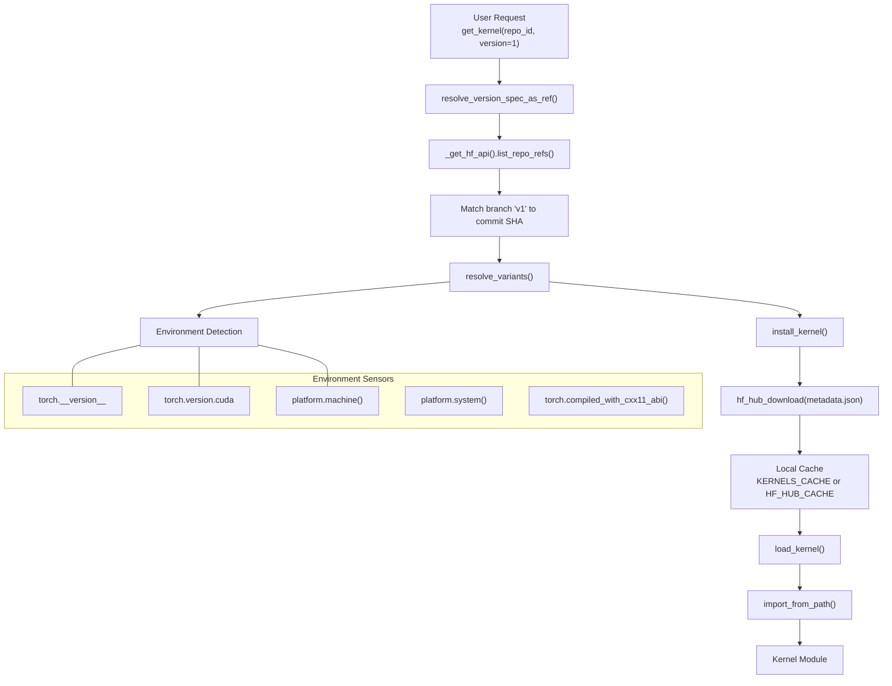
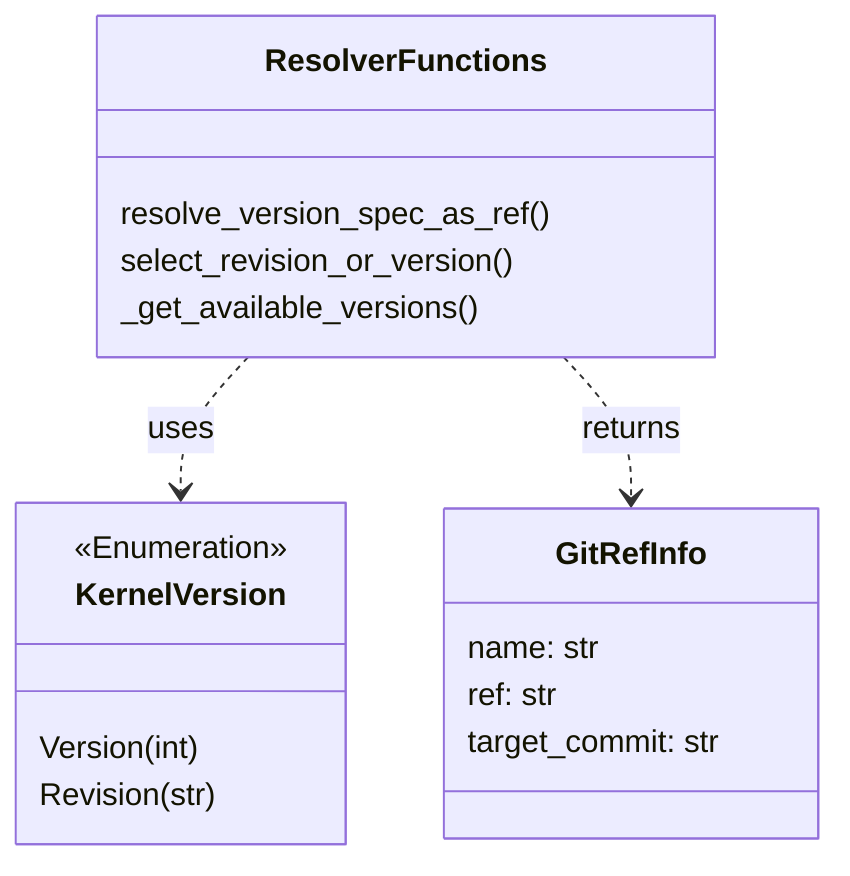

<!-- source: DeepWiki mcp.deepwiki.com · repo huggingface/kernels · page 3 Kernel Management · fetched 2026-10-26 -->

# Kernel Management

Relevant source files

The following files were used as context for generating this wiki page:

- [kernels/src/kernels/_versions.py](kernels/src/kernels/_versions.py)
- [kernels/src/kernels/cli/__init__.py](kernels/src/kernels/cli/__init__.py)
- [kernels/src/kernels/cli/info.py](kernels/src/kernels/cli/info.py)
- [kernels/src/kernels/cli/verify_signature.py](kernels/src/kernels/cli/verify_signature.py)
- [kernels/src/kernels/cli/versions.py](kernels/src/kernels/cli/versions.py)
- [kernels/src/kernels/hf_hub.py](kernels/src/kernels/hf_hub.py)
- [kernels/src/kernels/layer/func.py](kernels/src/kernels/layer/func.py)
- [kernels/src/kernels/layer/layer.py](kernels/src/kernels/layer/layer.py)
- [kernels/src/kernels/locking.py](kernels/src/kernels/locking.py)
- [kernels/tests/test_basic.py](kernels/tests/test_basic.py)
- [kernels/tests/test_verify.py](kernels/tests/test_verify.py)

This document covers the core kernel management system that handles downloading, installing, caching, and loading optimized compute kernels from the Hugging Face Hub. It explains the fundamental workflows for acquiring kernels and making them available to Python applications.

For detailed information about loading specific kernels, see [Loading Kernels](#3.1). For dependency management and reproducible builds, see [Version Locking](#3.2). For command-line usage, see [CLI Tools](#3.3).

## Overview

The kernel management system provides a complete lifecycle for working with Hub-hosted kernels, from discovery to execution. The system automatically detects the local environment configuration and selects compatible kernel variants, handling the complexity of PyTorch versions, CUDA versions, CPU architectures, and C++ ABI compatibility.

**Kernel Discovery and Resolution Pipeline**

Sources: [kernels/src/kernels/_versions.py:64-91](), [kernels/src/kernels/hf_hub.py:13-69](), [kernels/src/kernels/load.py:46-95]()

## Environment-Based Variant Selection

The kernel system uses a sophisticated variant selection mechanism to ensure compatibility across different system configurations. Each kernel repository contains multiple build variants targeting specific combinations of PyTorch versions, compute backends, and system architectures.

The `_get_hf_api` function constructs a specialized `user_agent` string that informs the Hub of the local environment, including `python` version, `backend` (CUDA/ROCm/XPU/Metal/CPU), `platform`, and `glibc` version.

**Variant Selection Logic**

| Component | Code Entity / Logic | Source |
|-----------|---------------------|--------|
| **Backend Detection** | `_select_backend(None)` | [kernels/src/kernels/hf_hub.py:42-42]() |
| **OS/Arch Detection** | `_platform()` | [kernels/src/kernels/hf_hub.py:13-22]() |
| **Glibc Version** | `glibc_version()` | [kernels/src/kernels/hf_hub.py:63-65]() |
| **Local Overrides** | `LOCAL_KERNELS` env var | [kernels/tests/test_basic.py:185-200]() |

Sources: [kernels/src/kernels/hf_hub.py:13-69](), [kernels/src/kernels/variants.py:5-9]()

## Kernel Loading and Versioning

The system provides several APIs for loading kernels. A key feature is the distinction between **versions** (stable integer identifiers like `version=1`) and **revisions** (git refs like `revision="main"` or a specific commit hash).

*   `get_kernel(repo_id, version=None, revision=None)`: The primary entry point. It resolves the version to a commit hash and downloads the best-matching variant.
*   `install_kernel(repo_id, revision)`: Downloads the kernel to the local cache without importing it.
*   `has_kernel(repo_id, version=None, revision=None)`: Checks if a compatible variant exists for the current environment.

**Version Resolution Entity Mapping**

Sources: [kernels/src/kernels/_versions.py:13-31](), [kernels/src/kernels/_versions.py:95-108](), [kernels/src/kernels/load.py:46-95]()

## Security and Trusted Publishers

To protect against malicious code, the system implements a `_check_trust_remote_code` mechanism. By default, kernels are only loaded if the publisher organization has the `trustedKernelPublisher` flag enabled on the Hugging Face Hub.

Users can bypass this by setting `trust_remote_code=True` in `get_kernel()` or via environment variables. The system also supports signature verification via the `verify-signature` CLI command, which checks kernel integrity using Sigstore and OIDC identities.

Sources: [kernels/src/kernels/hf_hub.py:95-148](), [kernels/src/kernels/cli/verify_signature.py:17-67]()

## CLI Toolset

The `kernel` command-line tool provides utilities for managing the kernel lifecycle outside of Python code.

| Command | Function | File |
|---------|----------|------|
| `download` | Pre-fetches kernels for offline use or all variants for distribution. | [kernels/src/kernels/cli/download.py]() |
| `lock` | Generates a `kernels.lock` file for reproducible environments. | [kernels/src/kernels/cli/lock.py]() |
| `info` | Displays metadata, supported backends, and dependencies for a kernel. | [kernels/src/kernels/cli/info.py]() |
| `versions` | Lists all available versions and their compatibility status. | [kernels/src/kernels/cli/versions.py]() |
| `verify-signature` | Validates the cryptographic signature of a kernel variant. | [kernels/src/kernels/cli/verify_signature.py]() |
| `benchmark` | Runs performance tests on a kernel and generates visual reports. | [kernels/src/kernels/cli/benchmark.py]() |

Sources: [kernels/src/kernels/cli/__init__.py:12-122]()

## Cache Management

Kernels are stored in a local cache directory to avoid redundant downloads. The location is determined by the `KERNELS_CACHE` environment variable, falling back to the standard `HF_HUB_CACHE`.

**Cache Structure**
1.  **Metadata Cache**: Stores `GitRefInfo` and version mappings.
2.  **Snapshot Cache**: Stores the actual kernel files (shared libraries, Python stubs) organized by commit hash and variant string (e.g., `build/torch25-cxx11-cu124-x86_64-linux/`).

Sources: [kernels/src/kernels/_versions.py:34-61](), [kernels/src/kernels/hf_hub.py:72-77]()

---

