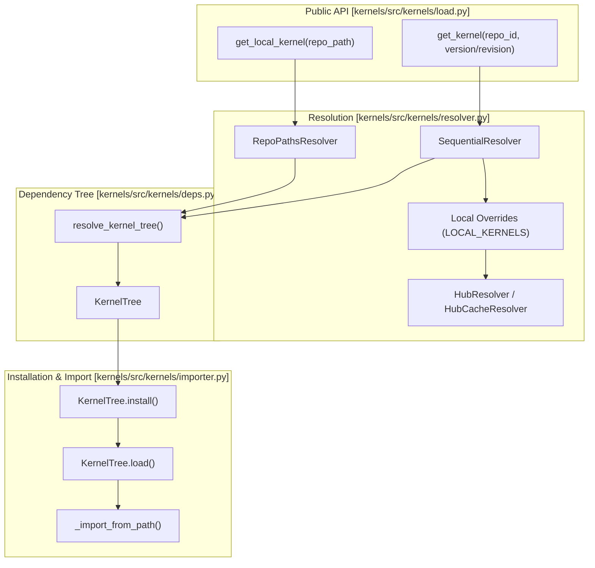
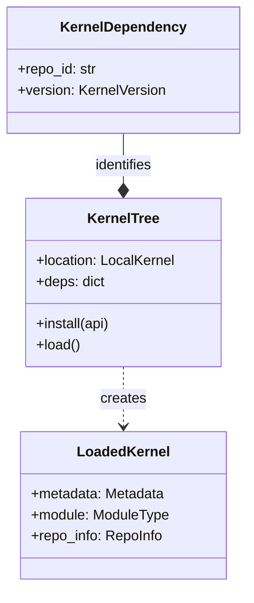

<!-- source: DeepWiki mcp.deepwiki.com · repo huggingface/kernels · page 3.1 Loading Kernels · fetched 2026-10-26 -->

# Loading Kernels

Relevant source files

The following files were used as context for generating this wiki page:

- [docs/source/cli-versions.md](docs/source/cli-versions.md)
- [kernels/src/kernels/__init__.py](kernels/src/kernels/__init__.py)
- [kernels/src/kernels/_versions.py](kernels/src/kernels/_versions.py)
- [kernels/src/kernels/cli/benchmark.py](kernels/src/kernels/cli/benchmark.py)
- [kernels/src/kernels/cli/info.py](kernels/src/kernels/cli/info.py)
- [kernels/src/kernels/cli/versions.py](kernels/src/kernels/cli/versions.py)
- [kernels/src/kernels/deps.py](kernels/src/kernels/deps.py)
- [kernels/src/kernels/hf_hub.py](kernels/src/kernels/hf_hub.py)
- [kernels/src/kernels/importer.py](kernels/src/kernels/importer.py)
- [kernels/src/kernels/install.py](kernels/src/kernels/install.py)
- [kernels/src/kernels/load.py](kernels/src/kernels/load.py)
- [kernels/src/kernels/locking.py](kernels/src/kernels/locking.py)
- [kernels/src/kernels/variants.py](kernels/src/kernels/variants.py)
- [kernels/tests/test_basic.py](kernels/tests/test_basic.py)
- [kernels/tests/test_deps.py](kernels/tests/test_deps.py)
- [kernels/tests/test_dirty_provenance.py](kernels/tests/test_dirty_provenance.py)
- [kernels/tests/test_loaded_kernels.py](kernels/tests/test_loaded_kernels.py)
- [kernels/tests/test_variants.py](kernels/tests/test_variants.py)

This document covers the core mechanisms for discovering, downloading, and loading optimized compute kernels from the Hugging Face Hub. It explains the version resolution pipeline, variant selection based on host environment, and the internal installation/import flow.

## Kernel Loading Functions Overview

The `kernels` package provides several entry points for loading kernels. These functions handle the transition from a repository identifier (e.g., `kernels-community/relu`) to a live Python module containing optimized operators.

| Function | Purpose | Caching Behavior |
|----------|---------|------------------|
| `get_kernel()` | High-level API to download and load a kernel by version or revision. | Downloads to HF cache; uses `SequentialResolver`. |
| `load_kernel()` | Loads a kernel using the current environment's detected backend. | Wrapper around `get_kernel`. |
| `get_local_kernel()` | Imports a kernel from a specific local file system path. | Overrides Hub resolution for the specified path. |
| `get_locked_kernel()` | Loads a kernel based on a `kernels.lock` file. | Ensures reproducible builds by pinning to a specific commit. |

**Kernel Discovery and Loading Pipeline**

Sources: [kernels/src/kernels/load.py:87-95](), [kernels/src/kernels/load.py:157-163](), [kernels/src/kernels/deps.py:76-81](), [kernels/src/kernels/importer.py:131]()

## Version Resolution Pipeline

When a user requests a kernel via `version=N`, the system must resolve this integer to a specific Git reference (commit SHA) on the Hugging Face Hub.

1.  **Branch Discovery**: The system lists repository references, looking for branches named with a `v` prefix (e.g., `v1`, `v2`) [kernels/src/kernels/_versions.py:20-31]().
2.  **Version Selection**: It maps the integer version to the corresponding branch. If a user requests an older version while a newer one is available, a warning is logged [kernels/src/kernels/_versions.py:82-91]().
3.  **Offline Resolution**: If `HF_HUB_OFFLINE` is enabled, the system attempts to resolve the version by inspecting the local Hugging Face cache directory (`refs` folder) [kernels/src/kernels/_versions.py:34-61]().

Sources: [kernels/src/kernels/_versions.py:13-31](), [kernels/src/kernels/_versions.py:64-91]()

## Variant Selection

Kernels are distributed as multiple "variants" within a single repository to handle ABI fragmentation (PyTorch versions, C++ ABI) and hardware diversity.

### The Variant Selection Algorithm
The `_resolve_variant_for_system` function in `kernels.variants` filters available variants based on the host environment:

*   **Framework**: Matches PyTorch version (e.g., `torch210`) or `torch-stable-abi` [kernels/src/kernels/variants.py:48-71]().
*   **ABI**: Matches Linux C++11 ABI (`cxx11` vs `cxx98`) [kernels/src/kernels/variants.py:48-58]().
*   **Backend**: Selects the best hardware backend (CUDA, ROCm, XPU, Metal, or CPU) [kernels/src/kernels/variants.py:237-240]().
*   **Architecture/OS**: Matches CPU architecture (e.g., `x86_64`) and OS (e.g., `linux`) [kernels/src/kernels/variants.py:144-152]().

**Backend Selection Logic**
For GPU backends like CUDA, the system prefers an exact match for the installed toolkit version (e.g., `cu128`). If an exact match isn't found, it falls back to the highest compatible version lower than the host version [kernels/tests/test_variants.py:186-200](). If no specific arch-variant matches, it falls back to a `noarch` variant (e.g., `torch-cuda`) [kernels/tests/test_variants.py:203-218]().

Sources: [kernels/src/kernels/variants.py:173-198](), [kernels/src/kernels/variants.py:218-241](), [kernels/tests/test_variants.py:169-200]()

## Trusted Publisher Checks

Security is enforced via the `trust_remote_code` mechanism. By default, only kernels from "trusted organizations" (e.g., `kernels-community`, `kernels-test`) are allowed to load [kernels/src/kernels/hf_hub.py:53-64]().

*   **Verification**: Before downloading or loading, the system checks the `repo_id`.
*   **Override**: Users must explicitly set `trust_remote_code=True` to load kernels from other organizations [kernels/src/kernels/load.py:94-95]().
*   **Local Files**: The trust check is also performed in offline mode to prevent loading untrusted cached code [kernels/src/kernels/hf_hub.py:66-70]().

Sources: [kernels/src/kernels/hf_hub.py:46-73](), [kernels/src/kernels/load.py:138-147]()

## Development Overrides: `LOCAL_KERNELS`

For local development, the `LOCAL_KERNELS` environment variable allows redirecting Hub `repo_id` lookups to local disk paths.

*   **Format**: `repo_id_1=path_1:repo_id_2=path_2`
*   **Mechanism**: The `_get_local_kernel_overrides` function parses this variable and injects a `RepoPathsResolver` at the start of the resolution chain [kernels/src/kernels/load.py:28-34]().
*   **Precedence**: Local overrides take precedence over Hub-based resolution, allowing developers to test kernel changes without uploading to the Hub [kernels/src/kernels/load.py:140-141]().

Sources: [kernels/src/kernels/load.py:28-49](), [kernels/tests/test_basic.py:185-200]()

## The Install/Load/Import Pipeline

Once a variant and its dependencies are resolved, the system executes the following pipeline:

1.  **Installation**: `KernelTree.install()` ensures all required files for the selected variant are present in the local cache [kernels/src/kernels/deps.py:172]().
2.  **Dependency Injection**: The `use_kernel_deps` context manager makes dependency modules available to the kernel being loaded [kernels/src/kernels/deps.py:168-172]().
3.  **Import**: `_import_from_path()` uses `importlib` to dynamically load the kernel's `__init__.py`.
4.  **Provenance Warning**: If a kernel was built from a "dirty" git tree (uncommitted changes), a `UserWarning` is emitted during import to alert the user [kernels/src/kernels/importer.py:131]().
5.  **Registry**: Loaded kernels are stored in a process-wide registry, accessible via `get_loaded_kernels()` [kernels/src/kernels/importer.py:41-52]().

**Code Entity Space: Import Logic**

Sources: [kernels/src/kernels/deps.py:38-58](), [kernels/src/kernels/importer.py:25-30](), [kernels/src/kernels/importer.py:131]()

---

