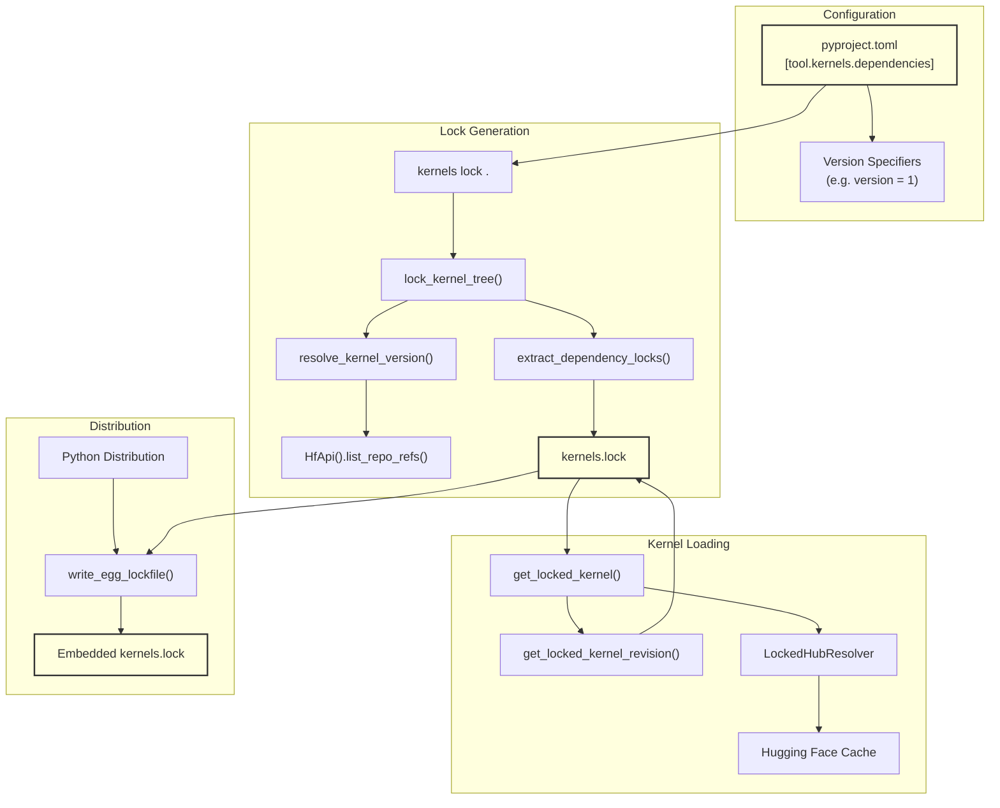
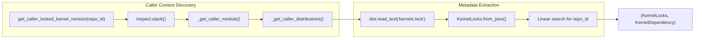

<!-- source: DeepWiki mcp.deepwiki.com · repo huggingface/kernels · page 3.2 Version Locking · fetched 2026-10-26 -->

# Version Locking

<details>
<summary>Relevant source files</summary>

The following files were used as context for generating this wiki page:

- [kernels-data/bindings/python/src/lock.rs](kernels-data/bindings/python/src/lock.rs)
- [kernels-data/bindings/python/stubtest-allowlist.txt](kernels-data/bindings/python/stubtest-allowlist.txt)
- [kernels-data/bindings/python/tests/test_kernel_lock.py](kernels-data/bindings/python/tests/test_kernel_lock.py)
- [kernels-data/src/config/kernel_deps.rs](kernels-data/src/config/kernel_deps.rs)
- [kernels-data/src/lock.rs](kernels-data/src/lock.rs)
- [kernels/src/kernels/_versions.py](kernels/src/kernels/_versions.py)
- [kernels/src/kernels/cli/__init__.py](kernels/src/kernels/cli/__init__.py)
- [kernels/src/kernels/cli/download.py](kernels/src/kernels/cli/download.py)
- [kernels/src/kernels/cli/info.py](kernels/src/kernels/cli/info.py)
- [kernels/src/kernels/cli/lock.py](kernels/src/kernels/cli/lock.py)
- [kernels/src/kernels/cli/verify_signature.py](kernels/src/kernels/cli/verify_signature.py)
- [kernels/src/kernels/cli/versions.py](kernels/src/kernels/cli/versions.py)
- [kernels/src/kernels/hf_hub.py](kernels/src/kernels/hf_hub.py)
- [kernels/src/kernels/layer/func.py](kernels/src/kernels/layer/func.py)
- [kernels/src/kernels/layer/layer.py](kernels/src/kernels/layer/layer.py)
- [kernels/src/kernels/locking.py](kernels/src/kernels/locking.py)
- [kernels/tests/kernel_locking/kernels.lock](kernels/tests/kernel_locking/kernels.lock)
- [kernels/tests/kernel_locking/pyproject.toml](kernels/tests/kernel_locking/pyproject.toml)
- [kernels/tests/layer_locking/kernels.lock](kernels/tests/layer_locking/kernels.lock)
- [kernels/tests/test_basic.py](kernels/tests/test_basic.py)
- [kernels/tests/test_kernel_locking.py](kernels/tests/test_kernel_locking.py)
- [kernels/tests/test_verify.py](kernels/tests/test_verify.py)

</details>


Version locking provides reproducible kernel dependency management by pinning exact kernel versions and variant hashes. This ensures consistent builds across different environments and time periods. The system utilizes a `kernels.lock` file containing SHA commits and cryptographic hashes for each kernel variant, enabling verifiable and reproducible execution.

## Locking Lifecycle

The version locking system follows a multi-step process from dependency specification to kernel loading:



Sources: [kernels/src/kernels/locking.py:21-98](), [kernels/src/kernels/locking.py:101-125](), [kernels/src/kernels/locking.py:144-162]()

## Dependency Configuration

Kernel dependencies are specified in `pyproject.toml`. The configuration allows pinning to a major version (integer) or a specific Git revision.

| Configuration Field | Type | Description |
|---------------------|------|-------------|
| `repo-id` | `str` | The Hugging Face Hub repository ID (e.g., `kernels-community/relu`). |
| `version` | `int` | A stable kernel API version (e.g., `1`). Mutually exclusive with `revision`. |
| `revision` | `str` | An explicit Hub revision (branch, tag, or commit). Mutually exclusive with `version`. |

These are represented in code by the `KernelDependency` struct and `KernelVersion` enum.

Sources: [kernels-data/src/config/kernel_deps.rs:4-16](), [kernels-data/src/config/kernel_deps.rs:39-63]()

## The Locking Process

### Recursive Tree Locking
The `lock_kernel_tree` function performs a recursive exploration of the dependency graph. Unlike standard resolution which picks one variant, locking explores **all** variants of a kernel to ensure every potential environment dependency is pinned.

1. **Resolution**: Converts a version specifier to a specific Git commit SHA using `resolve_kernel_version` [kernels/src/kernels/locking.py:58]().
2. **Metadata Inspection**: Downloads `metadata.json` for every variant of the kernel at that revision [kernels/src/kernels/locking.py:60-71]().
3. **Recursion**: For every dependency listed in `metadata.kernel_depends`, the process repeats [kernels/src/kernels/locking.py:73-75]().
4. **Cycle Detection**: Maintains a `seen` set to prevent infinite loops in cyclic dependencies [kernels/src/kernels/locking.py:47-49]().

### Lock File Format
The `kernels.lock` file is a JSON array of objects, where each object pairs a `KernelDependency` with its resolved `KernelLock` (the specific commit SHA).

```json
[
  {
    "dependency": {
      "repo-id": "kernels-community/relu",
      "version": 1
    },
    "lock": {
      "commit": "d649efb56fb249ac8f7a57fa1866728ad0c60e52"
    }
  }
]
```

Sources: [kernels/src/kernels/locking.py:21-83](), [kernels/tests/kernel_locking/kernels.lock:1-38]()

## Loading Locked Kernels

For library authors and reproducible applications, `kernels` provides mechanisms to load kernels based on the lockfile rather than dynamic Hub resolution.

### Resolution Logic
When loading a locked kernel, the system uses specialized resolvers:
- **`LockedHubResolver`**: Resolves the kernel revision by looking it up in a provided `kernels.lock` file [kernels/src/kernels/layer/layer.py:15]().
- **`LockedHubCacheResolver`**: A variant that enforces usage of the local cache, typically used when kernels have been pre-downloaded [kernels/src/kernels/layer/layer.py:15]().

### API for Library Authors
Library authors can use `get_caller_locked_kernel_revision` to automatically discover a `kernels.lock` file embedded in their package distribution.



Sources: [kernels/src/kernels/locking.py:149-162](), [kernels/src/kernels/locking.py:164-186]()

## Distribution and Packaging

To ensure that locked versions persist when a package is installed via `pip`, the lockfile must be embedded in the Python distribution.

1. **`write_egg_lockfile`**: This utility is designed for integration with build systems (like `setuptools`). It reads the local `kernels.lock` and writes it into the package metadata directory (e.g., `.egg-info` or `.dist-info`) [kernels/src/kernels/locking.py:101-125]().
2. **Installation**: When a user installs the library, the `kernels.lock` file is included in the site-packages metadata.
3. **Runtime Discovery**: At runtime, `get_caller_locked_kernel_revision` finds this file, ensuring the library uses the exact kernel versions it was tested against [kernels/src/kernels/locking.py:152-157]().

Sources: [kernels/src/kernels/locking.py:101-125](), [kernels/src/kernels/locking.py:149-162]()

---

