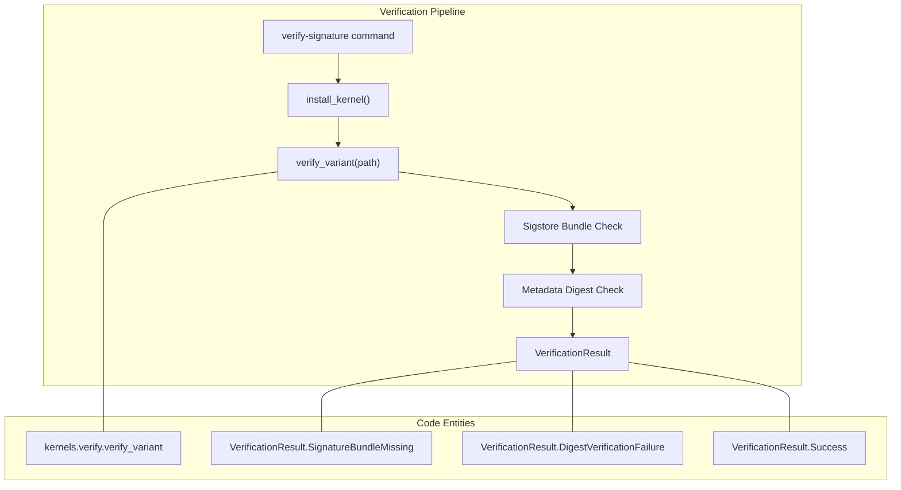
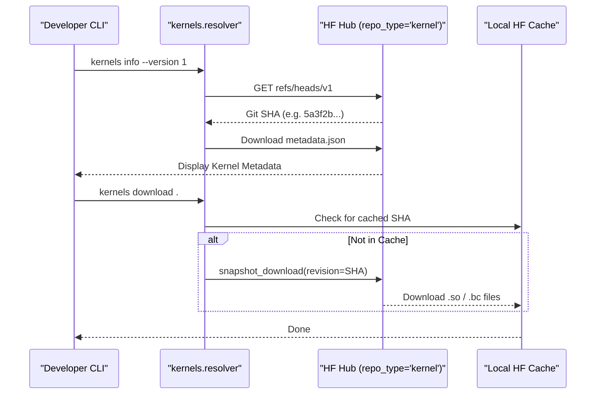

<!-- source: DeepWiki mcp.deepwiki.com · repo huggingface/kernels · page 3.3 CLI Tools · fetched 2026-10-26 -->

# CLI Tools

<details>
<summary>Relevant source files</summary>

The following files were used as context for generating this wiki page:

- [docs/source/_toctree.yml](docs/source/_toctree.yml)
- [docs/source/builder/build.md](docs/source/builder/build.md)
- [docs/source/builder/github-actions.md](docs/source/builder/github-actions.md)
- [docs/source/builder/local-dev.md](docs/source/builder/local-dev.md)
- [docs/source/builder/writing-kernels.md](docs/source/builder/writing-kernels.md)
- [docs/source/cli-info.md](docs/source/cli-info.md)
- [docs/source/cli.md](docs/source/cli.md)
- [kernels/src/kernels/cli/__init__.py](kernels/src/kernels/cli/__init__.py)
- [kernels/src/kernels/cli/verify_signature.py](kernels/src/kernels/cli/verify_signature.py)
- [kernels/src/kernels/layer/func.py](kernels/src/kernels/layer/func.py)
- [kernels/src/kernels/layer/layer.py](kernels/src/kernels/layer/layer.py)
- [kernels/tests/test_cli_info.py](kernels/tests/test_cli_info.py)
- [kernels/tests/test_verify.py](kernels/tests/test_verify.py)

</details>


The `kernels` CLI provides a suite of tools for managing compute kernels throughout their lifecycle—from dependency locking and downloading to benchmarking and security verification. It is the primary interface for ensuring reproducible environments and verifying kernel integrity.

## CLI Command Overview

The CLI is structured using `argparse` subparsers, providing specialized tools for different management tasks.

| Command | Purpose | Implementation |
| :--- | :--- | :--- |
| `info` | Describes a kernel's metadata, backends, and dependencies. | `print_kernel_info` |
| `versions` | Lists all available versions for a specific kernel on the Hub. | `print_kernel_versions` |
| `lock` | Generates a `kernels.lock` file for reproducible builds. | `lock_kernels` |
| `download` | Fetches locked kernels into the local Hugging Face cache. | `download_kernels` |
| `verify-signature` | Validates kernel integrity using Sigstore/OIDC signatures. | `verify_signature` |
| `benchmark` | Executes performance tests and generates visual reports. | `run_benchmark` |

Sources: [kernels/src/kernels/cli/__init__.py:12-122](), [docs/source/cli.md:7-14]()

## Command Reference

### `kernels info`
Describes a kernel repository, including its supported backends, license, and upstream source. It can query both remote Hub repositories and local build directories.

**Usage:**
```bash
kernels info <repo_id_or_path> [--version <int> | --revision <str>] [--json]
```
**Options:**
- `--version`: Specify an integer version (e.g., `1`).
- `--revision`: Specify a git ref (branch, tag, or commit).
- `--json`: Output machine-readable JSON instead of a formatted table.

Sources: [kernels/src/kernels/cli/__init__.py:33-54](), [kernels/tests/test_cli_info.py:8-28]()

### `kernels lock`
Scans a project directory for kernel dependencies and generates a `kernels.lock` file. This file pins every kernel to a specific Git SHA and records metadata for all available variants, ensuring that every environment uses the exact same kernel code.

**Usage:**
```bash
kernels lock <project_dir>
```

Sources: [kernels/src/kernels/cli/__init__.py:60-66](), [kernels/src/kernels/cli/lock.py:7-7]()

### `kernels download`
Downloads the kernels defined in a `kernels.lock` file. By default, it only downloads the variant compatible with the host system (e.g., CUDA 12.4 on Linux x86_64).

**Usage:**
```bash
kernels download <project_dir> [--all-variants]
```
**Options:**
- `--all-variants`: Downloads every build variant (all CUDA versions, ROCm, XPU, etc.) defined in the lockfile. Useful for preparing containers or air-gapped deployments.

Sources: [kernels/src/kernels/cli/__init__.py:20-31](), [kernels/src/kernels/cli/download.py:5-5]()

### `kernels verify-signature`
Verifies the cryptographic integrity of a kernel. It checks that the kernel metadata has not been tampered with and that the signature matches a trusted OIDC identity (e.g., a GitHub Actions workflow).

**Usage:**
```bash
kernels verify-signature <repo_id> <version> [--all-variants] [--filter-unsigned]
```

**Implementation Flow:**

Sources: [kernels/src/kernels/cli/verify_signature.py:17-65](), [kernels/tests/test_verify.py:17-32]()

### `kernels benchmark`
Runs performance benchmarks for a kernel and compares it against baselines (typically standard PyTorch operations). It can generate JSON results or visual plots.

**Usage:**
```bash
kernels benchmark <repo_id> [--version <int>] [--visual <path>] [--rasterized]
```
**Options:**
- `--visual`: Generates SVG plots of the benchmark results.
- `--rasterized`: If specified, outputs PNG/GIF instead of SVG.
- `--iterations`: Number of timed loops (default: 100).

Sources: [kernels/src/kernels/cli/__init__.py:68-103](), [kernels/src/kernels/cli/benchmark.py:152-162]()

## Data Flow: CLI to Hub Integration

The CLI acts as the bridge between the user's local environment and the Hugging Face Hub's specialized `kernel` repository type.


Sources: [kernels/src/kernels/cli/__init__.py:128-139](), [kernels/src/kernels/resolver.py:10-15](), [kernels/src/kernels/hf_hub.py:8-13]()

## Summary of Subcommand Functions

| Subcommand | Function Mapping | File Reference |
| :--- | :--- | :--- |
| `download` | `download_kernels` | [kernels/src/kernels/cli/download.py]() |
| `info` | `print_kernel_info` | [kernels/src/kernels/cli/info.py]() |
| `lock` | `lock_kernels` | [kernels/src/kernels/cli/lock.py]() |
| `verify-signature` | `verify_signature` | [kernels/src/kernels/cli/verify_signature.py]() |
| `versions` | `print_kernel_versions` | [kernels/src/kernels/cli/versions.py]() |
| `benchmark` | `run_benchmark` | [kernels/src/kernels/cli/benchmark.py]() |

Sources: [kernels/src/kernels/cli/__init__.py:5-9]()

---

