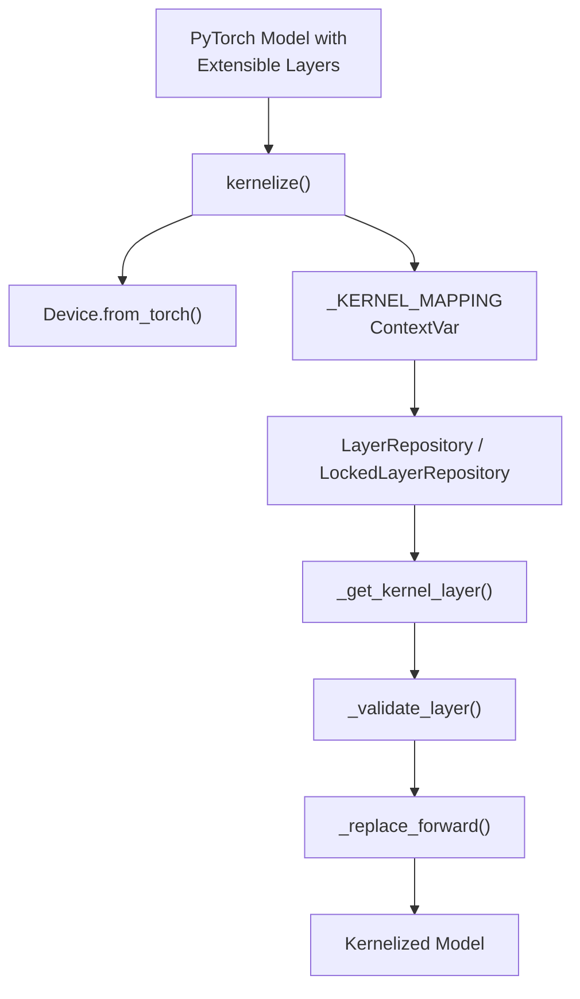
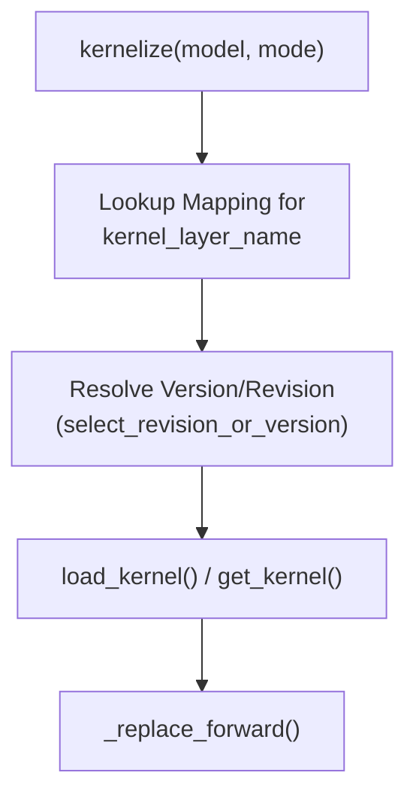

<!-- source: DeepWiki mcp.deepwiki.com · repo huggingface/kernels · page 4 Layer Kernelization · fetched 2026-10-26 -->

# Layer Kernelization

<details>
<summary>Relevant source files</summary>

The following files were used as context for generating this wiki page:

- [docs/source/basic-usage.md](docs/source/basic-usage.md)
- [docs/source/integrating-kernels.md](docs/source/integrating-kernels.md)
- [docs/source/kernel-requirements.md](docs/source/kernel-requirements.md)
- [docs/source/layers.md](docs/source/layers.md)
- [docs/source/locking.md](docs/source/locking.md)
- [docs/source/migration.md](docs/source/migration.md)
- [kernels/src/kernels/cli/__init__.py](kernels/src/kernels/cli/__init__.py)
- [kernels/src/kernels/cli/verify_signature.py](kernels/src/kernels/cli/verify_signature.py)
- [kernels/src/kernels/layer/func.py](kernels/src/kernels/layer/func.py)
- [kernels/src/kernels/layer/layer.py](kernels/src/kernels/layer/layer.py)
- [kernels/tests/test_verify.py](kernels/tests/test_verify.py)

</details>


Layer kernelization is the process of replacing PyTorch layer `forward` methods with optimized kernel implementations from the Hugging Face Hub. This system allows transparent acceleration of neural network layers without changing user code, enabling automatic selection of device-specific optimized kernels at runtime.

This document covers the layer kernelization subsystem. For details on specific topics, see the child pages:
- **[Using kernelize()](#4.1)**: Detailed guide on the `kernelize()` function, `LayerRepository` types, and mapping configurations.
- **[Creating Extensible Layers](#4.2)**: How to use decorators like `@use_kernel_forward_from_hub` to make your models kernel-ready.
- **[Environment Variables](#4.3)**: Configuration flags like `LOCAL_KERNELS` and `HF_HUB_OFFLINE`.

## Core Architecture

The layer kernelization system consists of several key components that work together to replace PyTorch layer implementations with Hub-based kernels:

### Layer Kernelization Flow


Sources: [kernels/src/kernels/layer/layer.py:447-533](), [kernels/src/kernels/layer/device.py:33-52]()

### Data Structures

The system uses several key data structures to manage kernel mappings and device compatibility:

| Class | Purpose | Key Fields |
|-------|---------|------------|
| `Device` | Represents device type and properties (e.g., CUDA capability) | `type: str`, `properties: CUDAProperties` |
| `LayerRepository` | Points to a kernel implementation on the Hub via version/revision | `repo_id`, `layer_name`, `version` |
| `LockedLayerRepository` | Points to a kernel revision locked in a `kernels.lock` file | `repo_id`, `lockfile`, `layer_name` |
| `Mode` | Enum defining the target execution environment | `INFERENCE`, `TRAINING`, `TORCH_COMPILE` |

Sources: [kernels/src/kernels/layer/device.py:12-31](), [kernels/src/kernels/layer/layer.py:42-137](), [kernels/src/kernels/layer/layer.py:190-225](), [kernels/src/kernels/layer/mode.py:6-15]()

## Making Layers Extensible

Layers are made extensible by annotating them with a unique name that the kernelization system can look up in a mapping.

### Using the Decorator
The `@use_kernel_forward_from_hub` decorator marks a `nn.Module` or a function as replaceable. When applied to a function, the system wraps it in a singleton `nn.Module` to allow standard layer injection.

```python
@use_kernel_forward_from_hub("SiluAndMul")
class SiluAndMul(nn.Module):
    def forward(self, input: torch.Tensor) -> torch.Tensor:
        ...
```
For details on pure layer requirements and function-to-layer conversion, see **[Creating Extensible Layers](#4.2)**.

Sources: [kernels/src/kernels/layer/layer.py:284-306](), [docs/source/layers.md:15-24]()

## The kernelize() Function

The `kernelize()` function is the primary API for applying optimizations to a model. It performs an in-place traversal of the model's module tree.

### Kernelization Logic
1. **Device Inference**: If no device is provided, it attempts to infer the device from model parameters using `Device.from_torch()`.
2. **Traversal**: It inspects every submodule for the `kernel_layer_name` attribute.
3. **Resolution**: It looks up the appropriate `LayerRepository` in the current `_KERNEL_MAPPING`.
4. **Injection**: It replaces the `forward` method using `_replace_forward()`.


Sources: [kernels/src/kernels/layer/layer.py:447-533](), [kernels/src/kernels/layer/layer.py:587-632]()

## Kernel Mapping and Repositories

Mappings associate abstract layer names with specific Hub repositories.

### Global vs. Scoped Mappings
- **`register_kernel_mapping()`**: Sets a global mapping used by all subsequent `kernelize()` calls.
- **`use_kernel_mapping()`**: A context manager for temporary mappings, useful for testing or local overrides.

### Repository Types
- **`LayerRepository`**: Standard Hub-backed repository requiring a `version` (e.g., `1`) or `revision` (e.g., `main`).
- **`LocalLayerRepository`**: Points to a local directory, primarily used for development via the `LOCAL_KERNELS` environment variable.
- **`LockedLayerRepository`**: Ensures reproducibility by reading specific commit SHAs from a `kernels.lock` file.

For detailed usage examples, see **[Using kernelize()](#4.1)** and **[Version Locking](#3.2)**.

Sources: [kernels/src/kernels/layer/layer.py:246-281](), [kernels/src/kernels/layer/layer.py:42-188](), [docs/source/locking.md:31-46]()

## Validation and Compatibility

To ensure system stability, kernels must pass strict validation before being injected into a model:
- **Statelessness**: Kernels must not override `__init__` or maintain internal state.
- **Signature Matching**: The kernel's `forward` signature must match the original layer's signature.
- **Mode Compatibility**: If `Mode.TORCH_COMPILE` is requested, the kernel must explicitly set `can_torch_compile = True`.

Sources: [kernels/src/kernels/layer/layer.py:536-584](), [docs/source/kernel-requirements.md:63-138]()

---

