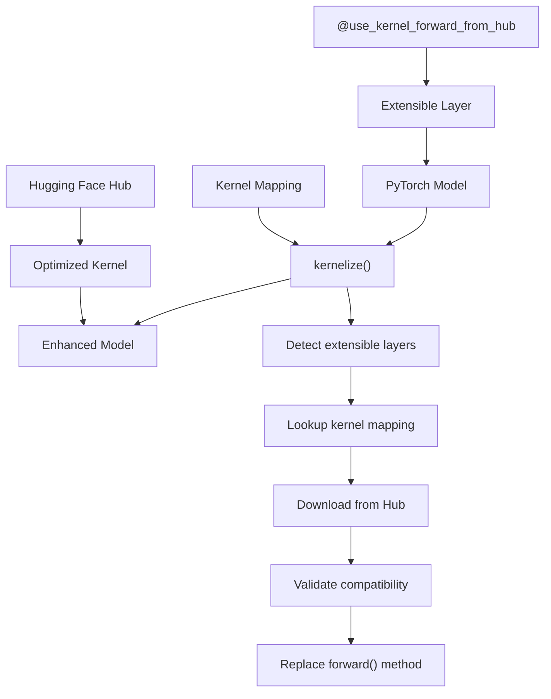
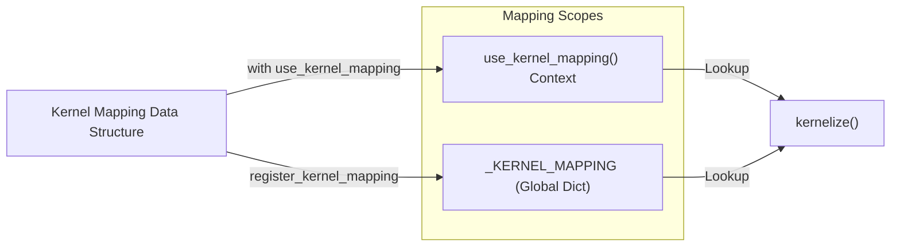
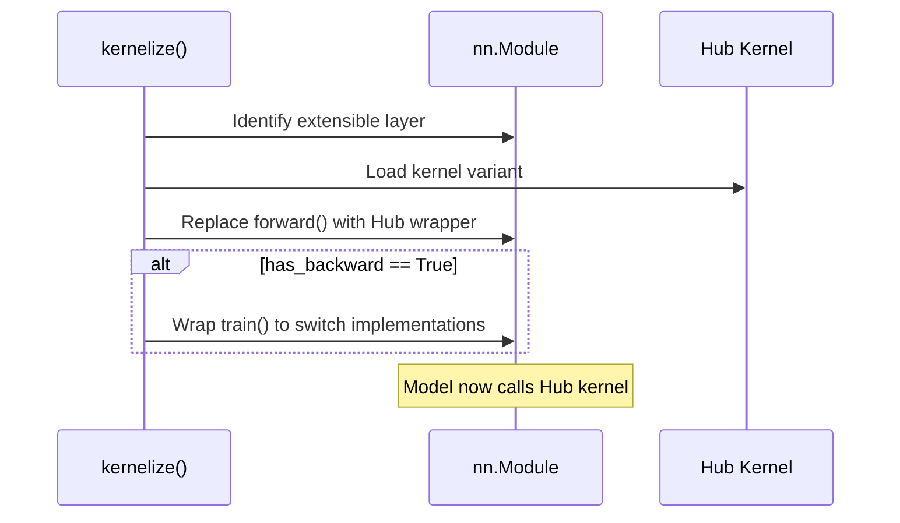

<!-- source: DeepWiki mcp.deepwiki.com · repo huggingface/kernels · page 4.1 Using kernelize() · fetched 2026-10-26 -->

# Using kernelize()

<details>
<summary>Relevant source files</summary>

The following files were used as context for generating this wiki page:

- [docs/source/api/kernels.md](docs/source/api/kernels.md)
- [docs/source/api/layers.md](docs/source/api/layers.md)
- [docs/source/basic-usage.md](docs/source/basic-usage.md)
- [docs/source/integrating-kernels.md](docs/source/integrating-kernels.md)
- [docs/source/kernel-requirements.md](docs/source/kernel-requirements.md)
- [docs/source/layers.md](docs/source/layers.md)
- [docs/source/locking.md](docs/source/locking.md)
- [docs/source/migration.md](docs/source/migration.md)
- [kernels/src/kernels/cli/__init__.py](kernels/src/kernels/cli/__init__.py)
- [kernels/src/kernels/cli/benchmark_graphics.py](kernels/src/kernels/cli/benchmark_graphics.py)
- [kernels/src/kernels/cli/verify_signature.py](kernels/src/kernels/cli/verify_signature.py)
- [kernels/src/kernels/layer/__init__.py](kernels/src/kernels/layer/__init__.py)
- [kernels/src/kernels/layer/device.py](kernels/src/kernels/layer/device.py)
- [kernels/src/kernels/layer/func.py](kernels/src/kernels/layer/func.py)
- [kernels/src/kernels/layer/kernelize.py](kernels/src/kernels/layer/kernelize.py)
- [kernels/src/kernels/layer/layer.py](kernels/src/kernels/layer/layer.py)
- [kernels/src/kernels/layer/repos.py](kernels/src/kernels/layer/repos.py)
- [kernels/tests/test_func.py](kernels/tests/test_func.py)
- [kernels/tests/test_layer.py](kernels/tests/test_layer.py)
- [kernels/tests/test_verify.py](kernels/tests/test_verify.py)

</details>


This document explains how to use the `kernelize()` function to replace PyTorch layer forward methods with optimized kernels from Hugging Face Hub. The `kernelize()` function is the primary interface for applying kernel optimizations to existing PyTorch models.

For information about creating extensible layers, see [Creating Extensible Layers](4.2). For environment variable configuration, see [Environment Variables](4.3).

## Overview

The `kernelize()` function traverses a PyTorch model and replaces the `forward` methods of extensible layers with optimized kernel implementations. This process requires three components:

1.  **Extensible layers** - PyTorch layers decorated with `@use_kernel_forward_from_hub` [kernels/src/kernels/layer/layer.py:233-248]()
2.  **Kernel mappings** - Configuration that maps layer names to Hub repositories [kernels/src/kernels/layer/layer.py:29-31]()
3.  **Hub kernels** - Optimized implementations available on Hugging Face Hub [docs/source/kernel-requirements.md:12-15]()



**kernelize() Workflow**

Sources: [kernels/src/kernels/layer/kernelize.py:113-199](), [kernels/src/kernels/layer/layer.py:408-439]()

## Basic Usage

### Simple Kernelization

The most basic usage of `kernelize()` requires only a model with extensible layers and registered kernel mappings:

```python
from kernels import kernelize, register_kernel_mapping, LayerRepository

# Register kernel mapping
kernel_mapping = {
    "SiluAndMul": {
        "cuda": LayerRepository(
            repo_id="kernels-community/activation",
            layer_name="SiluAndMul",
            version=1
        )
    }
}
register_kernel_mapping(kernel_mapping)

# Kernelize model
model = MyModel()
kernelized_model = kernelize(model, mode=Mode.INFERENCE)
```

The `kernelize()` function modifies the model in-place and returns it for convenience [kernels/src/kernels/layer/kernelize.py:113-134]().

Sources: [kernels/src/kernels/layer/kernelize.py:113-134](), [kernels/tests/test_layer.py:170-185]()

### Device-Specific Kernelization

When the model's device cannot be inferred from parameters, specify the device explicitly using the `Device` abstraction or a string:

```python
from kernels import Device
model = MyModel()  # Model with no parameters
kernelized_model = kernelize(model, device="cuda", mode=Mode.INFERENCE)
# Or using the Device class
kernelized_model = kernelize(model, device=Device(type="cuda"), mode=Mode.INFERENCE)
```

Sources: [kernels/src/kernels/layer/kernelize.py:136-141](), [kernels/src/kernels/layer/device.py:7-25]()

## Modes and Compatibility

### Mode Enum

The `Mode` enum controls how kernels are selected and applied based on the intended use case [kernels/src/kernels/layer/mode.py:4-15]():

| Mode | Description |
| :--- | :--- |
| `Mode.INFERENCE` | Optimized for forward-only passes. |
| `Mode.TRAINING` | Requires kernels that support backward passes. |
| `Mode.TORCH_COMPILE` | Requires kernels compatible with `torch.compile` (FakeTensor support). |

Modes can be combined using the bitwise OR operator (e.g., `Mode.TRAINING | Mode.TORCH_COMPILE`) [docs/source/layers.md:113-123]().

Sources: [kernels/src/kernels/layer/mode.py:4-15](), [docs/source/layers.md:98-123]()

### Fallback Behavior

If a registered kernel does not support the requested `Mode` (e.g., training requested but kernel is forward-only), `kernelize()` defaults to the original layer unless `use_fallback=False` is passed [kernels/src/kernels/layer/kernelize.py:175-181]().

Sources: [kernels/src/kernels/layer/kernelize.py:175-181](), [docs/source/layers.md:142-150]()

## Kernel Mappings

### Mapping Repositories

Three main repository classes are used to configure where kernels are loaded from:

*   **`LayerRepository`**: Points to a Hub repository. Requires a `version` (major version number) or a specific `revision` [kernels/src/kernels/layer/layer.py:42-81]().
*   **`LocalLayerRepository`**: Points to a local directory containing a kernel [kernels/src/kernels/layer/layer.py:139-170]().
*   **`LockedLayerRepository`**: Uses a `kernels.lock` file to ensure reproducible kernel loading [kernels/src/kernels/layer/layer.py:190-219]().

### Registration and Scoping

*   **`register_kernel_mapping(mapping)`**: Registers a global mapping of layer names to repositories [kernels/src/kernels/layer/layer.py:120-131]().
*   **`use_kernel_mapping(mapping)`**: A context manager for temporary mappings. By default, it inherits from the global mapping unless `inherit_mapping=False` [kernels/src/kernels/layer/layer.py:84-117]().



Sources: [kernels/src/kernels/layer/layer.py:84-131](), [kernels/tests/test_layer.py:197-215]()

## Hardware Abstractions

### Device and CUDAProperties

The system uses a `Device` class to abstract hardware types (`cuda`, `rocm`, `xpu`, `metal`, `cpu`) [kernels/src/kernels/layer/device.py:7-25](). For filtering based on hardware capabilities, `CUDAProperties` (and similar for other backends) can be used to filter variants based on compute capability [kernels/src/kernels/layer/device.py:35-50]().

Sources: [kernels/src/kernels/layer/device.py:7-50](), [docs/source/kernel-requirements.md:142-157]()

## Implementation Detail: Forward Injection

When a layer is kernelized, `kernelize()` replaces the layer's `forward` method with a specialized wrapper. If the kernel supports backward passes, it also overrides the `train()` method to swap between the optimized kernel and the original implementation depending on whether the module is in training or evaluation mode [kernels/src/kernels/layer/kernelize.py:270-289]().



Sources: [kernels/src/kernels/layer/kernelize.py:254-289](), [kernels/src/kernels/layer/layer.py:408-439]()

---

