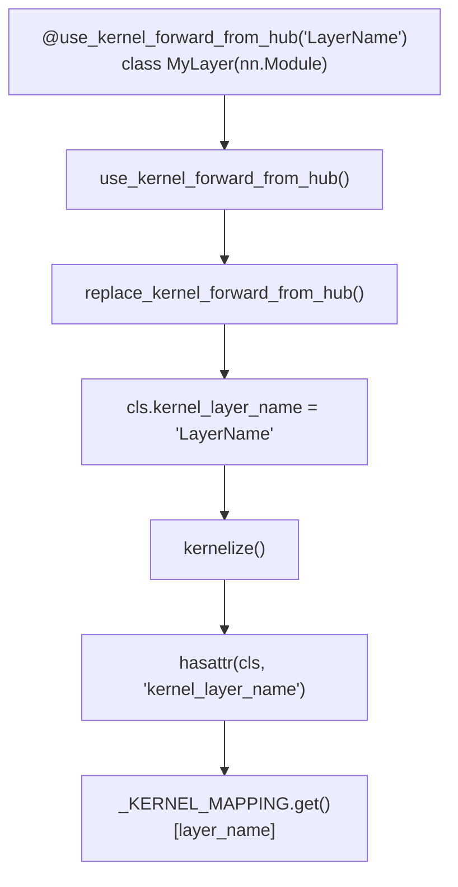
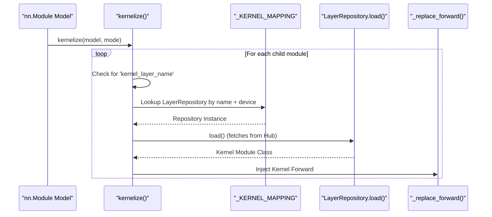

<!-- source: DeepWiki mcp.deepwiki.com · repo huggingface/kernels · page 4.2 Creating Extensible Layers · fetched 2026-10-26 -->

# Creating Extensible Layers

<details>
<summary>Relevant source files</summary>

The following files were used as context for generating this wiki page:

- [docs/source/api/kernels.md](docs/source/api/kernels.md)
- [docs/source/api/layers.md](docs/source/api/layers.md)
- [docs/source/basic-usage.md](docs/source/basic-usage.md)
- [docs/source/integrating-kernels.md](docs/source/integrating-kernels.md)
- [docs/source/kernel-requirements.md](docs/source/kernel-requirements.md)
- [docs/source/layers.md](docs/source/layers.md)
- [docs/source/locking.md](docs/source/locking.md)
- [docs/source/migration.md](docs/source/migration.md)
- [kernels/src/kernels/cli/__init__.py](kernels/src/kernels/cli/__init__.py)
- [kernels/src/kernels/cli/benchmark_graphics.py](kernels/src/kernels/cli/benchmark_graphics.py)
- [kernels/src/kernels/cli/verify_signature.py](kernels/src/kernels/cli/verify_signature.py)
- [kernels/src/kernels/layer/__init__.py](kernels/src/kernels/layer/__init__.py)
- [kernels/src/kernels/layer/device.py](kernels/src/kernels/layer/device.py)
- [kernels/src/kernels/layer/func.py](kernels/src/kernels/layer/func.py)
- [kernels/src/kernels/layer/kernelize.py](kernels/src/kernels/layer/kernelize.py)
- [kernels/src/kernels/layer/layer.py](kernels/src/kernels/layer/layer.py)
- [kernels/src/kernels/layer/repos.py](kernels/src/kernels/layer/repos.py)
- [kernels/tests/test_func.py](kernels/tests/test_func.py)
- [kernels/tests/test_layer.py](kernels/tests/test_layer.py)
- [kernels/tests/test_verify.py](kernels/tests/test_verify.py)

</details>


This document explains how to create PyTorch layers that can be optimized with kernels from the Hugging Face Hub. It covers the decorator-based approach for new layers, function-based extensibility, validation requirements, and the `_replace_forward` injection mechanism.

## Overview

Extensible layers are PyTorch `nn.Module` classes or functions that can have their implementation dynamically replaced with optimized kernels from the Hub. The system uses annotations to mark entities as extensible and a mapping system to locate appropriate kernels for different device types.

## Making Layers Extensible with Decorators

The primary method for creating extensible layers is the `@use_kernel_forward_from_hub` decorator. This decorator annotates a layer class with a kernel name that will be used for Hub kernel lookup during `kernelize()`.

### Basic Usage

```python
@use_kernel_forward_from_hub("SiluAndMul")
class SiluAndMul(nn.Module):
    def forward(self, input: torch.Tensor) -> torch.Tensor:
        d = input.shape[-1] // 2
        return F.silu(input[..., :d]) * input[..., d:]
```

The decorator stores the kernel name in the `kernel_layer_name` attribute of the class. [docs/source/layers.md:19-24]().

### Decorator Implementation


**Sources:** [kernels/src/kernels/layer/layer.py:249-258](), [kernels/src/kernels/layer/layer.py:130-146](), [kernels/tests/test_layer.py:91-93]()

## Using Functions as Extensible Layers

Starting with version 0.16, functions can also be made extensible using the same `@use_kernel_forward_from_hub` decorator. [docs/source/migration.md:107-118]().

### Function Kernelization Pattern

1. **Decorate the function**: Assign a name for Hub lookup.
2. **Annotate the Module**: Use `@use_kernelized_func` on the `nn.Module` that calls the function to make it discoverable by `kernelize()`.

```python
@use_kernel_forward_from_hub("silu_and_mul")
def silu_and_mul(x: torch.Tensor) -> torch.Tensor:
    return F.silu(x[..., :d]) * x[..., d:]

@use_kernelized_func(silu_and_mul)
class FeedForward(nn.Module):
    def forward(self, x: torch.Tensor) -> torch.Tensor:
        return silu_and_mul(x)
```

**Sources:** [docs/source/layers.md:54-79](), [kernels/src/kernels/layer/layer.py:348-353]()

## External Layer Support

For existing layers that cannot be modified to include the decorator, use the `replace_kernel_forward_from_hub()` function:

```python
from somelibrary import ExistingLayer
replace_kernel_forward_from_hub(ExistingLayer, "LayerName")
```
**Sources:** [docs/source/layers.md:30-44](), [kernels/src/kernels/layer/layer.py:261-276]()

## Layer Requirements and Validation

Hub kernel layers must be "pure" to ensure safe replacement. The `_validate_layer` function enforces these constraints. [kernels/src/kernels/layer/layer.py:279-317]().

### Validation Logic

| Requirement | Implementation Check | Reason |
| :--- | :--- | :--- |
| **Module Type** | `issubclass(cls, nn.Module)` | Must be a PyTorch module. |
| **Stateless** | `cls.__init__ is nn.Module.__init__` | Must not have a custom constructor or state. |
| **No Extra Members** | No additional attributes except allowed ones | Prevents side effects. |
| **Allowed Attributes** | `can_torch_compile`, `has_backward` | Only metadata attributes allowed. |
| **Signature** | `inspect.signature` check | Must match original layer's `forward`. |

**Sources:** [kernels/src/kernels/layer/layer.py:287-308](), [kernels/tests/test_layer.py:151-166]()

## The Kernelization Process

The `kernelize()` function traverses the model graph and performs the injection. [kernels/src/kernels/layer/kernelize.py:126-150]().

### Kernelization Flow


**Sources:** [kernels/src/kernels/layer/layer.py:148-246](), [kernels/src/kernels/layer/layer.py:319-327](), [kernels/src/kernels/layer/layer.py:356-375]()

### Injection Mechanism (`_replace_forward`)

The core injection logic uses `MethodType` to bind the kernel's `forward` to the original module instance. [kernels/src/kernels/layer/layer.py:356-375]().

1. **Detection**: It checks if the kernel supports the requested `Mode` (e.g., `Mode.TRAINING` requires `has_backward=True`). [kernels/src/kernels/layer/layer.py:221-235]().
2. **Binding**: It binds the kernel class `forward` method to the existing module instance. [kernels/src/kernels/layer/layer.py:364-372]().
3. **Fallback**: If requirements aren't met (e.g., no backward support in training), it restores the original class's `forward`. [kernels/src/kernels/layer/layer.py:237-243]().

## Best Practices for Extensible Layers

* **Statelessness**: Ensure the kernel layer does not require any `self.attribute` that isn't present in the original layer. [kernels/src/kernels/layer/layer.py:291-294]().
* **Versioned Repositories**: Use `LayerRepository` with a major `version` (e.g., `version=1`) to ensure API stability within a branch. [docs/source/layers.md:183-187]().
* **Validation**: Always run `kernel-builder check-abi` during development to catch violations early. [kernels/src/kernels/cli/__init__.py:141-146]().

**Sources:** [docs/source/layers.md:165-178](), [kernels/src/kernels/layer/layer.py:42-72]()

---

