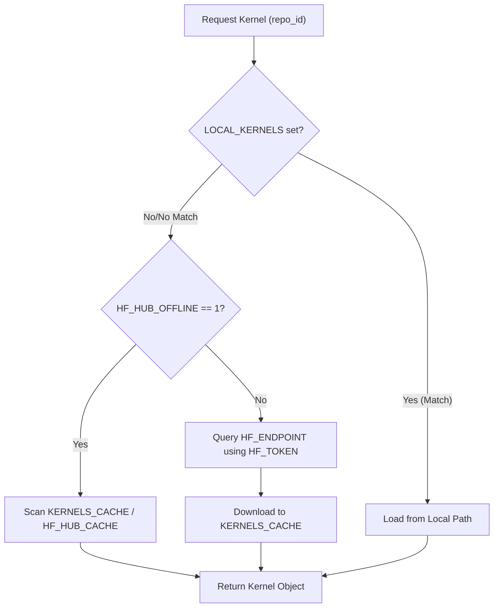
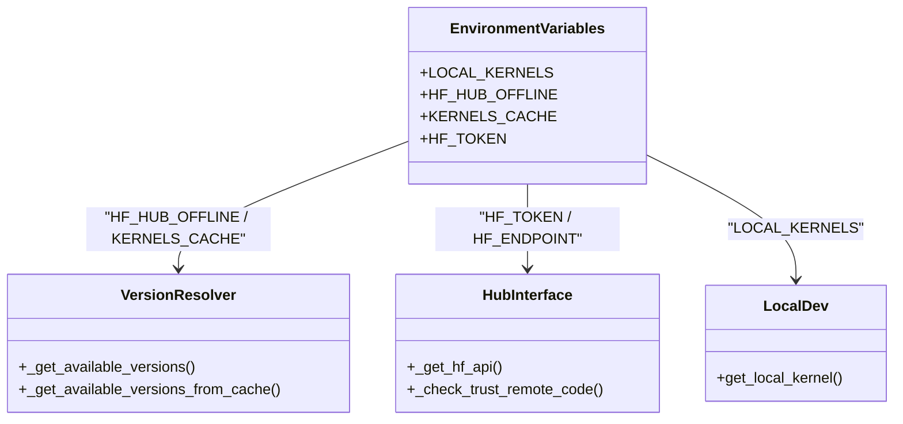

<!-- source: DeepWiki mcp.deepwiki.com · repo huggingface/kernels · page 4.3 Environment Variables · fetched 2026-10-26 -->

# Environment Variables

<details>
<summary>Relevant source files</summary>

The following files were used as context for generating this wiki page:

- [.github/workflows/build_documentation.yaml](.github/workflows/build_documentation.yaml)
- [.github/workflows/build_pr_documentation.yaml](.github/workflows/build_pr_documentation.yaml)
- [.github/workflows/upload_pr_documentation.yaml](.github/workflows/upload_pr_documentation.yaml)
- [docs/source/_toctree.yml](docs/source/_toctree.yml)
- [docs/source/builder/build.md](docs/source/builder/build.md)
- [docs/source/builder/github-actions.md](docs/source/builder/github-actions.md)
- [docs/source/builder/local-dev.md](docs/source/builder/local-dev.md)
- [docs/source/builder/writing-kernels.md](docs/source/builder/writing-kernels.md)
- [docs/source/cli.md](docs/source/cli.md)
- [docs/source/env.md](docs/source/env.md)
- [docs/source/faq.md](docs/source/faq.md)
- [kernels/src/kernels/_versions.py](kernels/src/kernels/_versions.py)
- [kernels/src/kernels/cli/info.py](kernels/src/kernels/cli/info.py)
- [kernels/src/kernels/cli/versions.py](kernels/src/kernels/cli/versions.py)
- [kernels/src/kernels/hf_hub.py](kernels/src/kernels/hf_hub.py)
- [kernels/src/kernels/locking.py](kernels/src/kernels/locking.py)
- [kernels/tests/test_basic.py](kernels/tests/test_basic.py)

</details>


This document covers the environment variables that control the behavior of the kernels system, including local development overrides, offline mode, authentication, and security settings. These variables allow for runtime configuration of kernel discovery, loading, and layer kernelization.

## Overview

The kernels system leverages environment variables to manage how the library interacts with the Hugging Face Hub and the local filesystem. These configurations are critical for developers working on new kernels, users in restricted network environments, and for maintaining security when loading remote code.

## Available Environment Variables

### LOCAL_KERNELS
Used for local development to override Hub-based kernels with local directory paths.

| Variable | Type | Format | Purpose |
|----------|------|--------|---------|
| `LOCAL_KERNELS` | String | `repo_id=path:repo_id2=path2` | Maps Hub repository IDs to local filesystem paths |

When `get_kernel` or `LayerRepository` is called, the system checks this variable. If a match is found for the requested `repo_id`, it loads the kernel from the specified local path instead of the Hub [kernels/src/kernels/cli/local_dev.md:70-75](). This is essential for testing kernels before they are published [kernels/src/kernels/cli/local_dev.md:68-69]().

**Implementation:**
The override logic is tested in the test suite to ensure that local paths take precedence over Hub versions [kernels/tests/test_basic.py:185-200]().

### HF_HUB_OFFLINE
Controls whether the library attempts to contact the Hugging Face Hub.

| Variable | Type | Default | Purpose |
|----------|------|---------|---------|
| `HF_HUB_OFFLINE` | Boolean (0/1) | `0` | Disables all outgoing Hub requests when set to `1` |

When enabled, `_get_available_versions` will only look for kernels in the local cache [kernels/src/kernels/_versions.py:13-18](). If a requested version is missing from the cache while offline, a `ValueError` is raised [kernels/src/kernels/_versions.py:72-77]().

### KERNELS_CACHE
Specifies a custom directory for storing downloaded kernels.

| Variable | Type | Default | Purpose |
|----------|------|---------|---------|
| `KERNELS_CACHE` | String (path) | `HF_HUB_CACHE` | Overrides the default Hub cache location |

The system resolves the cache path by checking `KERNELS_CACHE` first, falling back to the standard Hugging Face Hub cache directory [kernels/src/kernels/_versions.py:36]().

### HF_TOKEN
Used for authentication when accessing private or gated kernel repositories.

| Variable | Type | Default | Purpose |
|----------|------|---------|---------|
| `HF_TOKEN` | String | None | Hub authentication token |

This token is used by the underlying `HfApi` to authorize downloads and uploads [kernels/src/kernels/hf_hub.py:1-20]().

### HF_ENDPOINT
Allows redirecting Hub requests to a custom endpoint (e.g., a local mirror or enterprise Hub).

| Variable | Type | Default | Purpose |
|----------|------|---------|---------|
| `HF_ENDPOINT` | String (URL) | `https://huggingface.co` | Custom Hub endpoint URL |

### HF_HUB_DISABLE_TELEMETRY
Disables the collection of usage information.

| Variable | Type | Default | Purpose |
|----------|------|---------|---------|
| `HF_HUB_DISABLE_TELEMETRY` | String | None | Disables telemetry when set to `yes` |

By default, the library reports the `kernels` version, `torch` version, and kernel build info during `get_kernel` calls [docs/source/faq.md:45-51]().

## Trust Remote Code Behavior

The system includes a security check for "remote code" (custom Python logic bundled with kernels).

- **Default Behavior**: The library checks if a repository is trusted before downloading [kernels/src/kernels/locking.py:51-56]().
- **trust_remote_code Flag**: Functions like `get_kernel` and `kernelize` accept a `trust_remote_code` boolean. If `False` (default), the system will verify the repository against a list of trusted publishers or local configurations [kernels/src/kernels/hf_hub.py:17]().

## Data Flow: Kernel Resolution

The following diagram shows how environment variables influence the `get_kernel` and `kernelize` logic.


Sources: [kernels/src/kernels/_versions.py:13-61](), [kernels/src/kernels/cli/local_dev.md:70-86](), [kernels/src/kernels/hf_hub.py:17]()

## Code Entity Mapping

This diagram bridges the environment variables to the specific internal functions that consume them.


Sources: [kernels/src/kernels/_versions.py:34-61](), [kernels/src/kernels/hf_hub.py:1-20](), [kernels/src/kernels/locking.py:149-161]()

## Usage Examples

### Local Development Override
```bash
# Force the app to use a local build of the relu kernel
export LOCAL_KERNELS="kernels-community/relu=/home/user/dev/relu-kernel"
python main.py
```
Sources: [docs/source/builder/local-dev.md:75-78]()

### Offline Execution
```bash
# Prevent any Hub access, use only cached kernels
export HF_HUB_OFFLINE=1
python main.py
```
Sources: [kernels/src/kernels/_versions.py:72-77]()

### Custom Cache for CI/CD
```bash
# Redirect downloads to a workspace-specific folder
export KERNELS_CACHE="./.kernel_cache"
python -m pytest tests/
```
Sources: [kernels/src/kernels/_versions.py:36]()

Sources:
- [kernels/src/kernels/_versions.py:13-140]()
- [kernels/src/kernels/cli/local_dev.md:68-86]()
- [kernels/src/kernels/hf_hub.py:1-20]()
- [kernels/src/kernels/locking.py:51-56]()
- [docs/source/faq.md:45-51]()
- [kernels/tests/test_basic.py:185-200]()

---

