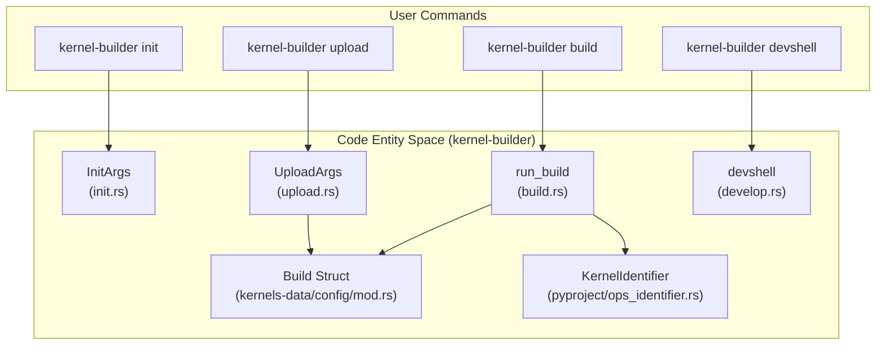

<!-- source: DeepWiki mcp.deepwiki.com · repo huggingface/kernels · page 5 Kernel Development · fetched 2026-10-26 -->

# Kernel Development

<details>
<summary>Relevant source files</summary>

The following files were used as context for generating this wiki page:

- [docs/source/_toctree.yml](docs/source/_toctree.yml)
- [docs/source/builder-cli.md](docs/source/builder-cli.md)
- [docs/source/builder/build.md](docs/source/builder/build.md)
- [docs/source/builder/github-actions.md](docs/source/builder/github-actions.md)
- [docs/source/builder/local-dev.md](docs/source/builder/local-dev.md)
- [docs/source/builder/writing-kernels.md](docs/source/builder/writing-kernels.md)
- [docs/source/cli.md](docs/source/cli.md)
- [kernel-builder/src/main.rs](kernel-builder/src/main.rs)
- [kernel-builder/src/pyproject/mod.rs](kernel-builder/src/pyproject/mod.rs)
- [kernel-builder/src/pyproject/ops_identifier.rs](kernel-builder/src/pyproject/ops_identifier.rs)
- [kernel-builder/src/upload.rs](kernel-builder/src/upload.rs)
- [kernels-data/src/git.rs](kernels-data/src/git.rs)

</details>


This document provides a guide for developers creating and distributing optimized compute kernels through the Hugging Face Hub. It covers technical requirements, the Nix-based build system, and the lifecycle of kernel development from initialization to Hub distribution.

For detailed specifications, see the child pages:
- [Kernel Requirements](#5.1) — Technical constraints, ABI standards, and namespace isolation.
- [Build System](#5.2) — Configuration via `build.toml`, Nix sandboxing, and variant generation.
- [Documentation Generation](#5.3) — Automated README/Kernel Card creation.
- [Security and Agent-Assisted Development](#5.4) — Security best practices and AI coding skills.

## Overview

Kernel development in this ecosystem involves creating portable, version-isolated native extensions. Unlike traditional Python packages, these kernels are designed to be dynamically loaded from the Hub, allowing multiple versions of the same kernel to coexist in a single process without symbol conflicts [docs/source/builder/writing-kernels.md:9-30]().

The development workflow typically involves:
1. **Initialization**: Using `kernel-builder init` to scaffold a project [kernel-builder/src/main.rs:85-86]().
2. **Implementation**: Writing C++/CUDA/Triton code and registering Torch operators [docs/source/builder/writing-kernels.md:134-155]().
3. **Local Development**: Generating CMake/Python project files for IDE support via `create-pyproject` [kernel-builder/src/main.rs:174-202]().
4. **Multi-variant Building**: Using Nix to build for the entire matrix of PyTorch, CUDA, and C++ ABI versions [docs/source/builder/build.md:54-67]().
5. **Distribution**: Uploading build artifacts to `kernel`-type repositories on the Hub [kernel-builder/src/upload.rs:177-182]().

## System Architecture: Code Entity Mapping

The following diagrams bridge the gap between high-level development concepts and the specific code entities that implement them.

### Project Lifecycle and Build Entities

This diagram maps the development commands to the internal Rust modules and data structures in `kernel-builder`.


Sources: [kernel-builder/src/main.rs:81-162](), [kernel-builder/src/pyproject/mod.rs:28-46](), [kernel-builder/src/upload.rs:144-150]()

### Build Provenance and Identity

This diagram shows how the system uniquely identifies a kernel revision to prevent namespace collisions, mapping source control entities to build metadata.

```mermaid
graph TD
    subgraph "Natural Language Space"
        "Git Commit SHA"
        "Dirty Flag"
        "Kernel Name"
        "Unique Build ID"
    end

    subgraph "Code Entity Space"
        Oid["Oid<br/>(kernels-data/src/git.rs)"]
        GitStatus["GitStatus<br/>(kernels-data/src/git.rs)"]
        KernelIdentifier["KernelIdentifier<br/>(pyproject/ops_identifier.rs)"]
        Provenance["Provenance<br/>(kernels-data/src/metadata.rs)"]
    end

    "Git Commit SHA" --> Oid
    Oid --> GitStatus
    "Dirty Flag" --> GitStatus
    
    "Kernel Name" --> KernelIdentifier
    "Unique Build ID" --> KernelIdentifier
    
    GitStatus --> Provenance
    KernelIdentifier --> Provenance
```
Sources: [kernels-data/src/git.rs:16-17](), [kernels-data/src/git.rs:75-87](), [kernel-builder/src/pyproject/ops_identifier.rs:55-58](), [kernel-builder/src/pyproject/mod.rs:65-74]()

## Project Layout

A standard kernel project created by `kernel-builder` follows a specific structure to support both local development and the Nix build system.

| Path | Description |
| :--- | :--- |
| `build.toml` | The primary configuration file defining backends, versions, and sources [docs/source/builder/writing-kernels.md:163-189](). |
| `flake.nix` | Nix configuration for reproducible builds and dev shells [docs/source/builder/build.md:149-170](). |
| `torch-ext/` | Contains C++ bindings and the Python package wrapper [docs/source/builder/writing-kernels.md:144-151](). |
| `CARD.md` | A template for the Hugging Face Hub model card [docs/source/builder/writing-kernels.md:153-154](). |
| `metadata.json` | Generated during build; contains variant-specific ABI and dependency metadata [kernel-builder/src/upload.rs:169-172](). |

## Development Workflow

### 1. Initialization
Start by running `kernel-builder init`. This command allows you to specify the target Hub repository name and the compute backends (e.g., `cuda`, `rocm`, `xpu`) you intend to support [docs/source/builder/writing-kernels.md:87-115]().

### 2. Local Development & IDE Setup
To enable autocompletion and linting in IDEs, use `kernel-builder create-pyproject`. This generates standard `CMakeLists.txt` and `setup.py` files [docs/source/builder/local-dev.md:19-25](). Developers can then enter a `devshell` which provides a pre-configured environment with all necessary dependencies like PyTorch and hardware toolchains [docs/source/builder/build.md:70-82]().

### 3. Building Variants
The `build-and-copy` command triggers the Nix build system. It builds the kernel in a sandbox for the current environment's variant (e.g., `torch211-cxx11-cu126-x86_64-linux`) and places the artifacts in a local `build/` directory [docs/source/builder/build.md:56-67]().

### 4. Hub Distribution
Once verified, `build-and-upload` compiles all configured variants and pushes them to the Hugging Face Hub [kernel-builder/src/main.rs:113-153](). The system supports multi-branch synchronization, typically uploading to a branch named `v{version}` (e.g., `v1`) as defined in `build.toml` [kernel-builder/src/upload.rs:169-175]().

For details on distribution and PR-based workflows, see [Build System](#5.2).

---

