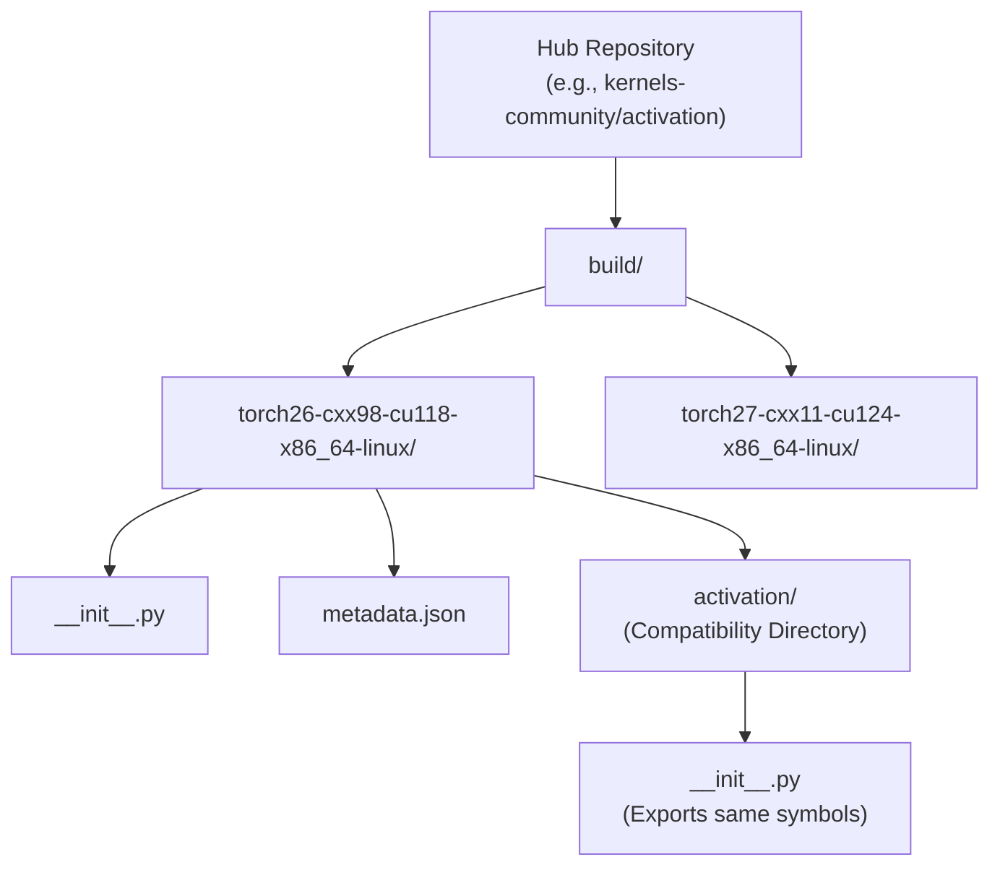
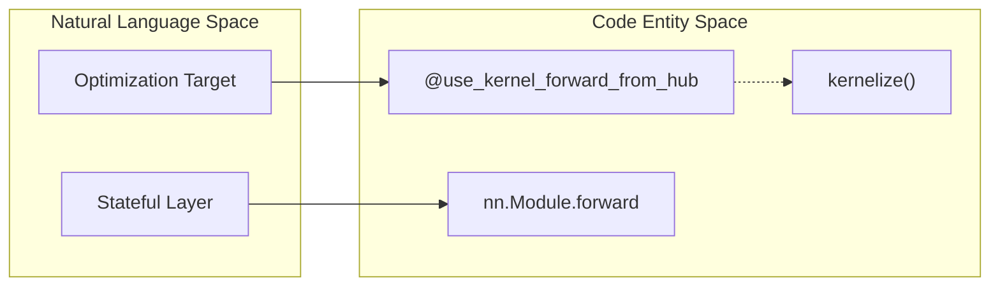

<!-- source: DeepWiki mcp.deepwiki.com · repo huggingface/kernels · page 5.1 Kernel Requirements · fetched 2026-10-26 -->

# Kernel Requirements

Relevant source files

The following files were used as context for generating this wiki page:

- [docs/source/basic-usage.md](docs/source/basic-usage.md)
- [docs/source/integrating-kernels.md](docs/source/integrating-kernels.md)
- [docs/source/kernel-requirements.md](docs/source/kernel-requirements.md)
- [docs/source/layers.md](docs/source/layers.md)
- [docs/source/locking.md](docs/source/locking.md)
- [docs/source/migration.md](docs/source/migration.md)
- [kernel-abi-check/Cargo.toml](kernel-abi-check/Cargo.toml)
- [kernel-abi-check/src/manylinux/manylinux-policy.json](kernel-abi-check/src/manylinux/manylinux-policy.json)
- [kernel-abi-check/src/python_abi/stable_abi.toml](kernel-abi-check/src/python_abi/stable_abi.toml)
- [kernel-abi-check/src/torch_stable_abi/shim_function_versions.txt](kernel-abi-check/src/torch_stable_abi/shim_function_versions.txt)

This document defines the technical requirements and constraints for creating Hub-compatible kernels that can be distributed through the Hugging Face Hub and consumed by the `kernels` system. These requirements ensure kernels work across diverse Linux environments and PyTorch builds while maintaining compatibility with the kernel management infrastructure.

## Repository Type and Trust

Compliant kernels must be published as `kernel`-type repositories on the Hugging Face Hub [docs/source/kernel-requirements.md:10-15]().

By default, the `kernels` package only loads from a curated set of **trusted publishers**. Loading from any other publisher requires an explicit opt-in using `trust_remote_code=True` in functions like `get_kernel()` [docs/source/kernel-requirements.md:17-29]().

## Directory Layout

A kernel repository on the Hub must contain a `build` directory. This directory contains build variants following the template: `<framework><version>-cxx<abiver>-<cu><cudaver>-<arch>-<os>` [docs/source/kernel-requirements.md:34-40]().

### Variant Structure

**Layout Requirements**
- Each variant directory must contain an `__init__.py` [docs/source/kernel-requirements.md:42-43]().
- **Compatibility Directory**: To support older `kernels` package versions, each variant must contain a subdirectory named after the repository (with hyphens replaced by underscores) containing its own `__init__.py` [docs/source/kernel-requirements.md:43-52]().

Sources: [docs/source/kernel-requirements.md:34-52]()

## Kernel Metadata (`metadata.json`)

Every build variant directory must include a `metadata.json` file. This file is automatically generated by `kernel-builder` [docs/source/kernel-requirements.md:63-64]().

### Metadata Schema
| Key | Type | Requirement | Description |
|:---|:---|:---|:---|
| `id` | `str` | Required | Unique identifier (valid Python module name). Torch ops must be registered as `torch.ops.<id>` [docs/source/kernel-requirements.md:66-68](). |
| `name` | `str` | Required | Kernel name (dashes replaced by underscores = module name) [docs/source/kernel-requirements.md:69-70](). |
| `version` | `int` | Required | Major kernel version number [docs/source/kernel-requirements.md:71](). |
| `license` | `str` | Required | Supported Hub license identifier [docs/source/kernel-requirements.md:72-73](). |
| `backend` | `dict` | Required | Compute backend info (type: `cuda`, `rocm`, `xpu`, etc.) and supported `archs` [docs/source/kernel-requirements.md:79-80](), [docs/source/kernel-requirements.md:142-157](). |
| `digest` | `dict` | Required | SHA-256 hash of all files in the variant [docs/source/kernel-requirements.md:81](). |
| `python-depends`| `list` | Optional | Curated list of Python dependencies (e.g., `einops`) [docs/source/kernel-requirements.md:82-83](). |
| `provenance` | `dict` | Optional | Metadata about `kernel-builder` version and source `dirty` status [docs/source/kernel-requirements.md:84-98](). |

Sources: [docs/source/kernel-requirements.md:63-136]()

## ABI and Library Standards

To ensure portability across Linux distributions, kernels must adhere to strict Binary Interface (ABI) standards.

### Linux Compatibility (Manylinux)
Kernels must be compatible with `manylinux_2_28` [docs/source/kernel-requirements.md:3-5](). The `kernel-abi-check` tool enforces this by checking symbol versions for:
- **GLIBC**: e.g., versions up to 2.28 [kernel-abi-check/src/manylinux/manylinux-policy.json:115-125]().
- **CXXABI** and **GLIBCXX**: Standard C++ library versioning.

### Python Limited API (ABI3)
Native extensions should target the Python Limited API (ABI3) to remain compatible across multiple Python minor versions (e.g., 3.9 through 3.13) without recompilation [kernel-abi-check/src/python_abi/stable_abi.toml:1-33]().

### Torch Stable ABI
For PyTorch integration, kernels should use the stable shim functions. The `kernel-abi-check` tool validates that kernels do not use functions newer than the targeted PyTorch version [kernel-abi-check/src/torch_stable_abi/shim_function_versions.txt:1-6]().

Sources: [kernel-abi-check/src/manylinux/manylinux-policy.json:1-125](), [kernel-abi-check/src/python_abi/stable_abi.toml:1-156](), [kernel-abi-check/src/torch_stable_abi/shim_function_versions.txt:1-138]()

## Python Code and Layer Requirements

### Namespace Isolation
To allow multiple versions of the same kernel to coexist in one process, kernels must use **relative imports** for internal modules [docs/source/kernel-requirements.md:66-68]().

### Pure Layer Constraints
Kernel layers are intended to replace the `forward` method of existing `nn.Module` objects. To be compliant, they must be "pure":
1. **No custom `__init__`**: The layer must be instantiable without arguments or rely on state provided by the original module [docs/source/layers.md:160-167]().
2. **State Access**: Access parameters (like `self.weight`) via type annotations to signal requirements to the `kernelize()` function [docs/source/layers.md:1-9]().
3. **Compatibility**: Annotate classes with `@use_kernel_forward_from_hub("Name")` to signal intent for Hub-based optimization [docs/source/layers.md:19-24]().

Sources: [docs/source/layers.md:11-82](), [docs/source/layers.md:160-188]()

## The `kernel-abi-check` Tool

This Rust-based utility performs static analysis on the compiled `.so` files to ensure they meet the requirements.

### Key Checks
- **ManylinuxViolation**: Checks if the binary links against GLIBC symbols newer than the `manylinux_2_28` standard [kernel-abi-check/src/manylinux/manylinux-policy.json:115-125]().
- **PythonAbiViolation**: Ensures the binary only uses symbols defined in the Python Stable ABI [kernel-abi-check/src/python_abi/stable_abi.toml:98-156]().
- **TorchStableAbiViolation**: Checks usage of `aoti_torch_*` or `torch_*` shim functions against the version matrix in `shim_function_versions.txt` [kernel-abi-check/src/torch_stable_abi/shim_function_versions.txt:8-61]().

Sources: [kernel-abi-check/Cargo.toml:1-20](), [kernel-abi-check/src/torch_stable_abi/shim_function_versions.txt:1-61]()

---

