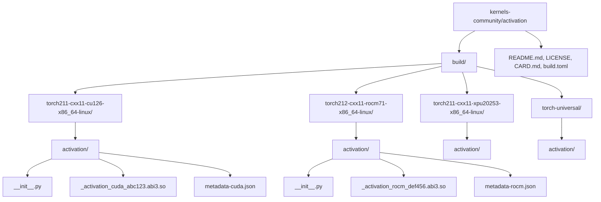

<!-- source: DeepWiki mcp.deepwiki.com · repo huggingface/kernels · page 5.2 Build System · fetched 2026-10-26 -->

# Build System

Relevant source files

The following files were used as context for generating this wiki page:

- [docs/source/_toctree.yml](docs/source/_toctree.yml)
- [docs/source/builder-cli.md](docs/source/builder-cli.md)
- [docs/source/builder/build.md](docs/source/builder/build.md)
- [docs/source/builder/github-actions.md](docs/source/builder/github-actions.md)
- [docs/source/builder/local-dev.md](docs/source/builder/local-dev.md)
- [docs/source/builder/writing-kernels.md](docs/source/builder/writing-kernels.md)
- [docs/source/cli.md](docs/source/cli.md)
- [kernel-builder/src/build.rs](kernel-builder/src/build.rs)
- [kernel-builder/src/develop.rs](kernel-builder/src/develop.rs)
- [kernel-builder/src/list_variants.rs](kernel-builder/src/list_variants.rs)
- [kernel-builder/src/main.rs](kernel-builder/src/main.rs)
- [kernel-builder/src/nix.rs](kernel-builder/src/nix.rs)
- [kernel-builder/src/pyproject/common.rs](kernel-builder/src/pyproject/common.rs)
- [kernel-builder/src/pyproject/mod.rs](kernel-builder/src/pyproject/mod.rs)
- [kernel-builder/src/pyproject/ops_identifier.rs](kernel-builder/src/pyproject/ops_identifier.rs)
- [kernel-builder/src/pyproject/templates/kernel.cmake](kernel-builder/src/pyproject/templates/kernel.cmake)
- [kernel-builder/src/pyproject/templates/torch/preamble.cmake](kernel-builder/src/pyproject/templates/torch/preamble.cmake)
- [kernel-builder/src/pyproject/templates/tvm_ffi/preamble.cmake](kernel-builder/src/pyproject/templates/tvm_ffi/preamble.cmake)
- [kernel-builder/src/pyproject/templates/utils.cmake](kernel-builder/src/pyproject/templates/utils.cmake)
- [kernel-builder/src/pyproject/templates/xpu/dep-sycl-tla.cmake](kernel-builder/src/pyproject/templates/xpu/dep-sycl-tla.cmake)
- [kernel-builder/src/pyproject/torch/mod.rs](kernel-builder/src/pyproject/torch/mod.rs)
- [kernel-builder/src/pyproject/torch/noarch.rs](kernel-builder/src/pyproject/torch/noarch.rs)
- [kernel-builder/src/pyproject/tvm_ffi/mod.rs](kernel-builder/src/pyproject/tvm_ffi/mod.rs)
- [kernel-builder/src/upload.rs](kernel-builder/src/upload.rs)
- [kernel-builder/tests/arch-intersection.cmake](kernel-builder/tests/arch-intersection.cmake)
- [kernels-data/src/git.rs](kernels-data/src/git.rs)
- [nix-builder/lib/cache.nix](nix-builder/lib/cache.nix)
- [nix-builder/lib/checks.nix](nix-builder/lib/checks.nix)
- [nix-builder/pkgs/xpu-packages/sycl-tla.nix](nix-builder/pkgs/xpu-packages/sycl-tla.nix)

The `kernels` build system is a multi-layered infrastructure designed to solve the fragmentation of Deep Learning environments (CUDA versions, C++ ABIs, and PyTorch versions). It centers around the `kernel-builder` CLI, which leverages Nix for hermetic builds and a CMake template system for cross-platform compatibility.

## Build Directory Layout

Kernel repositories on the Hugging Face Hub follow a standardized directory structure. The build artifacts are organized into a `build/` directory containing multiple variants, each tailored for a specific environment.

### Repository Structure

Each variant directory contains a Python package. A key component is the `metadata-<backend>.json` file, which describes the specific build provenance and capabilities (e.g., CUDA compute capabilities).

**Sources:** [docs/source/builder/writing-kernels.md:119-140](), [kernel-builder/src/pyproject/common.rs:34-51]()

### Variant Naming Convention
Variants are named using a precise schema: `<framework><version>-cxx<abiver>-<backend><backendver>-<arch>-<os>`.
- **Framework**: e.g., `torch211`
- **ABI**: `cxx11` (Standard for modern PyTorch) or `cxx98`
- **Backend**: `cu128`, `rocm71`, `xpu20253`, `cpu`, or `metal`
- **Arch/OS**: `x86_64-linux`, `aarch64-linux`, `arm64-macos`

**Sources:** [docs/source/builder/build.md:111-127]()

## Build Configuration (`build.toml`)

The `build.toml` file is the source of truth for the build system. It defines the kernel's identity, supported backends, and source file mappings.

### Key Sections
- `[general]`: Defines `name`, `version`, and `edition` (currently `5`). [docs/source/builder/writing-kernels.md:164-171]()
- `[torch]`: Specifies the C++ entry points and headers for the Torch extension. [docs/source/builder/writing-kernels.md:175-179]()
- `[kernel.<name>]`: Defines backend-specific source files and hardware requirements (e.g., `cuda-capabilities`). [docs/source/builder/writing-kernels.md:181-189]()

**Sources:** [docs/source/builder/writing-kernels.md:158-190]()

## kernel-builder CLI

The `kernel-builder` is a Rust-based tool that orchestrates the build, validation, and distribution lifecycle.

### Command Lifecycle

| Command | Role |
|---------|------|
| `init` | Scaffolds a new project from templates. [kernel-builder/src/main.rs:85-86]() |
| `create-pyproject` | Generates the `CMakeLists.txt` and `setup.py` using Jinja2-style templates. [kernel-builder/src/main.rs:174-202]() |
| `build-and-copy` | Executes Nix builds for all supported variants and copies artifacts to `./build`. [kernel-builder/src/main.rs:103-110]() |
| `devshell` | Spawns a shell with the exact dependencies (compiler, Torch, CUDA) for a variant. [kernel-builder/src/main.rs:205-215]() |
| `upload` | Synchronizes the `./build` directory with the Hugging Face Hub. [kernel-builder/src/upload.rs:177-182]() |

**Sources:** [kernel-builder/src/main.rs:81-255](), [docs/source/builder-cli.md:33-52]()

## Unique Naming and `KernelIdentifier`

To allow multiple versions of the same kernel to coexist in one Python process, the build system uses a `KernelIdentifier`.

1. **Unique ID**: A suffix (often a Git SHA or unique string) is generated. [kernel-builder/src/main.rs:187-191]()
2. **Namespace Injection**: This ID is passed to the CMake template.
3. **Symbol Renaming**: The internal Torch op name becomes `_{kernel_name}_{backend}_{unique_id}`. [kernel-builder/src/pyproject/templates/torch/preamble.cmake:51-51]()

**Sources:** [kernel-builder/src/pyproject/ops_identifier.rs:5-15](), [kernel-builder/src/pyproject/templates/torch/preamble.cmake:51-51]()

## Hardware Backend Templates

The build system uses a specialized CMake template system to handle backend-specific complexities.

### CUDA / ROCm (Torch Backend)
- **Gencode Management**: Automatically manages `-gencode` (CUDA) and `--offload-arch` (ROCm) flags based on `build.toml` capabilities. [kernel-builder/src/pyproject/templates/torch/preamble.cmake:132-152]()
- **ABI Stability**: Injects `-DTORCH_TARGET_VERSION` for Stable ABI support. [kernel-builder/src/pyproject/templates/torch/preamble.cmake:73-95]()

### XPU / SYCL (Intel Backend)
- **Compiler**: Uses `icpx` (Linux) or `icx` (Windows). [kernel-builder/src/pyproject/templates/xpu/dep-sycl-tla.cmake:94-94]()
- **Fat Binaries**: Configures AOT (Ahead-of-Time) images for devices like `pvc` and `xe-lpg`. [kernel-builder/src/pyproject/templates/xpu/dep-sycl-tla.cmake:74-79]()
- **SPIR-V Extensions**: Probes the compiler to append required extensions like `SPV_INTEL_2d_block_io`. [kernel-builder/src/pyproject/templates/xpu/dep-sycl-tla.cmake:81-107]()

**Sources:** [kernel-builder/src/pyproject/templates/torch/preamble.cmake:1-180](), [kernel-builder/src/pyproject/templates/xpu/dep-sycl-tla.cmake:1-111]()

## Upload Lifecycle

The `upload` process (`run_upload`) ensures that builds are correctly synchronized with the Hub.

1. **Variant Discovery**: Scans the local build directory for valid variants. [kernel-builder/src/upload.rs:190-195]()
2. **Dirty Check**: Warns if variants were built from a "dirty" Git state. [kernel-builder/src/upload.rs:197-198]()
3. **Branch Mapping**: Maps the build to a version branch (e.g., `v1`). [kernel-builder/src/upload.rs:200-200]()
4. **Hub Sync**: Uses `HFRepositorySync` to perform atomic commits. If `--create-pr` is used, it opens a Pull Request instead of committing to `main`. [kernel-builder/src/upload.rs:97-100](), [kernel-builder/src/upload.rs:206-215]()

**Sources:** [kernel-builder/src/upload.rs:177-220](), [docs/source/builder/build.md:215-224]()

## Nix Sandbox Execution

The build system relies on Nix to provide a reproducible environment.
- **Hermeticity**: Nix ensures that system libraries (like `glibc`) are pinned to compatible versions (Manylinux 2.28). [docs/source/builder/writing-kernels.md:24-27]()
- **Binary Cache**: The Hugging Face binary cache is used to avoid rebuilding large dependencies like PyTorch or the CUDA toolkit. [docs/source/builder/build.md:20-38]()
- **Multi-platform**: Nix flakes (`flake.nix`) handle the matrix of Torch versions and backends. [docs/source/builder/build.md:144-170]()

**Sources:** [docs/source/builder/build.md:1-46](), [docs/source/builder/writing-kernels.md:51-73]()

---

