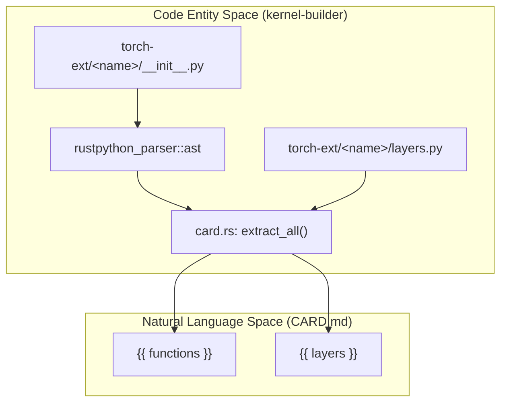
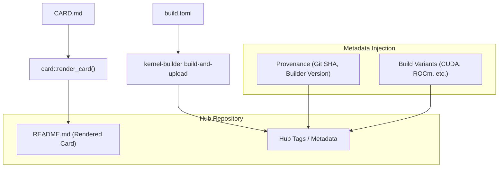

<!-- source: DeepWiki mcp.deepwiki.com · repo huggingface/kernels · page 5.3 Documentation Generation · fetched 2026-10-26 -->

# Documentation Generation

<details>
<summary>Relevant source files</summary>

The following files were used as context for generating this wiki page:

- [docs/source/_toctree.yml](docs/source/_toctree.yml)
- [docs/source/builder-cli.md](docs/source/builder-cli.md)
- [docs/source/builder/build.md](docs/source/builder/build.md)
- [docs/source/builder/github-actions.md](docs/source/builder/github-actions.md)
- [docs/source/builder/local-dev.md](docs/source/builder/local-dev.md)
- [docs/source/builder/writing-kernels.md](docs/source/builder/writing-kernels.md)
- [docs/source/cli.md](docs/source/cli.md)
- [kernel-builder/src/card.rs](kernel-builder/src/card.rs)
- [kernel-builder/src/main.rs](kernel-builder/src/main.rs)
- [kernel-builder/src/pyproject/mod.rs](kernel-builder/src/pyproject/mod.rs)
- [kernel-builder/src/pyproject/ops_identifier.rs](kernel-builder/src/pyproject/ops_identifier.rs)
- [kernel-builder/src/upload.rs](kernel-builder/src/upload.rs)
- [kernel-builder/src/util.rs](kernel-builder/src/util.rs)
- [kernels-data/bindings/python/src/config.rs](kernels-data/bindings/python/src/config.rs)
- [kernels-data/bindings/python/tests/test_config.py](kernels-data/bindings/python/tests/test_config.py)
- [kernels-data/src/config/compat.rs](kernels-data/src/config/compat.rs)
- [kernels-data/src/git.rs](kernels-data/src/git.rs)

</details>


This page covers the automated documentation generation system for kernel repositories. The system manages the lifecycle of documentation from source templates to the final Model Card (README.md) on the Hugging Face Hub, integrating build-time metadata and Python introspection.

## Overview

The documentation generation system automatically creates comprehensive README files for kernel repositories by:

1. **Template Rendering**: Filling a `CARD.md` template with dynamic kernel information during the build process.
2. **Metadata Population**: Injecting build-time provenance, hardware requirements, and versioning into the Hub metadata.
3. **Python Introspection**: Extracting docstrings and function signatures from the `torch-ext` or `tvm-ffi-ext` modules.
4. **Hub Synchronization**: Automatically uploading the rendered README to the Hugging Face Hub during the `upload` or `build-and-upload` lifecycle.

## Kernel Card Template (`CARD.md`)

Kernel projects include a `CARD.md` file in their root directory [docs/source/builder/writing-kernels.md:153-154](). This file acts as a Jinja2 template that is rendered into the final `README.md`.

### Template Variables
The `kernel-builder` uses `minijinja` to render the card [kernel-builder/src/card.rs:9, 132-145](). The following variables are available to the template:

| Variable | Source | Description |
| :--- | :--- | :--- |
| `repo_id` | `build.toml` | The Hugging Face Hub repository ID. |
| `version` | `build.toml` | The major version of the kernel. |
| `functions` | Introspection | List of public functions exported in `__all__`. |
| `layers` | Introspection | List of classes defined in the `layers` submodule. |
| `has_benchmark` | Filesystem | Boolean indicating if `benchmarks/benchmark.py` exists. |
| `upstream` | `build.toml` | URL of the original upstream repository. |
| `source` | `build.toml` | URL of the kernel source code. |
| `license` | `build.toml` | The license type (e.g., Apache-2.0). |

Sources: [kernel-builder/src/card.rs:134-143](), [kernel-builder/src/card.rs:124-130]()

### Introspection Logic
The builder performs static analysis of the Python source code using `rustpython_parser` to populate the template without executing the code [kernel-builder/src/card.rs:10, 26-59]().


Sources: [kernel-builder/src/card.rs:14-60](), [kernel-builder/src/card.rs:73-105]()

## Metadata and Hub Integration

During the build and upload process, `kernel-builder` generates a `metadata.json` for every variant and uses it to populate the Hub's repository metadata.

### Data Flow: Build to Hub Card

The `kernel-builder upload` command manages the transition from local build artifacts to Hub documentation.


Sources: [kernel-builder/src/upload.rs:200-227](), [kernel-builder/src/card.rs:147-150]()

### Automated Metadata Fields
When a kernel is uploaded, the following metadata is synchronized:
- **Provenance**: The specific Git SHA of the kernel source and the version of `kernel-builder` used are recorded [kernel-builder/src/pyproject/mod.rs:71-74]().
- **Variants**: The Hub repository is updated to reflect supported hardware backends (e.g., CUDA capabilities, ROCm versions) based on the discovered build variants [kernel-builder/src/upload.rs:190-200]().

## CLI Reference Generation

The `kernel-builder` documentation itself is partially self-documenting. The project maintains a reference for its own CLI commands.

- **Builder CLI Reference**: The `docs/source/builder-cli.md` file provides a complete mapping of subcommands like `init`, `build`, `upload`, and `create-pyproject` [docs/source/builder-cli.md:7-25]().
- **Kernels CLI Overview**: The `docs/source/cli.md` file summarizes the Python-side management tools like `benchmark`, `lock`, and `verify-signature` [docs/source/cli.md:7-14]().

## Implementation Details

### `fill-card` Command
While usually called internally during upload, the `fill-card` command can be used manually to preview the documentation:
```bash
kernel-builder fill-card --kernel-dir ./my-kernel --output README.md
```
Sources: [kernel-builder/src/main.rs:219-227](), [kernel-builder/src/card.rs:147-166]()

### Function and Layer Extraction
- **Functions**: Extracted by looking at the `__all__` list in the extension's `__init__.py`. It filters out the string `"layers"` to separate functional entry points from module structures [kernel-builder/src/card.rs:62-71]().
- **Layers**: Extracted by parsing `layers.py` or `layers/__init__.py` and identifying all `ClassDef` nodes in the AST [kernel-builder/src/card.rs:73-105]().

Sources: [kernel-builder/src/card.rs:14-105]()

---

