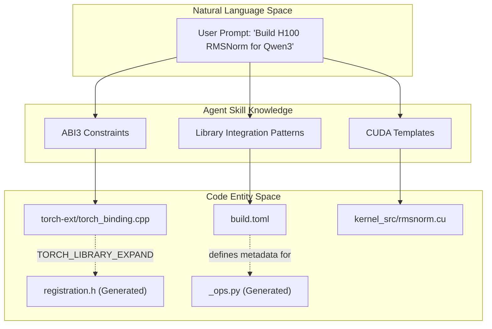
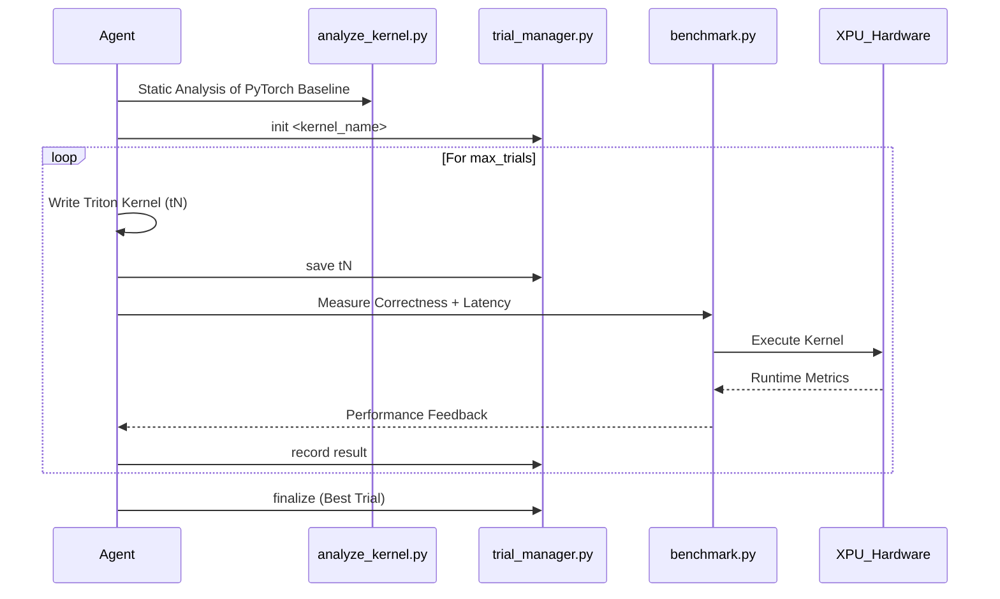

<!-- source: DeepWiki mcp.deepwiki.com · repo huggingface/kernels · page 5.4 Security and Agent-Assisted Development · fetched 2026-10-26 -->

# Security and Agent-Assisted Development

Relevant source files

The following files were used as context for generating this wiki page:

- [docs/source/builder/agents-guide.md](docs/source/builder/agents-guide.md)
- [docs/source/builder/design-nix-builder.md](docs/source/builder/design-nix-builder.md)
- [docs/source/builder/design-overview.md](docs/source/builder/design-overview.md)
- [docs/source/builder/ide-setup.md](docs/source/builder/ide-setup.md)
- [docs/source/builder/metal.md](docs/source/builder/metal.md)
- [docs/source/builder/security.md](docs/source/builder/security.md)
- [docs/source/cli-skills.md](docs/source/cli-skills.md)
- [kernel-builder/skills/cuda-kernels/SKILL.md](kernel-builder/skills/cuda-kernels/SKILL.md)
- [kernel-builder/skills/cuda-kernels/references/a100-optimization-guide.md](kernel-builder/skills/cuda-kernels/references/a100-optimization-guide.md)
- [kernel-builder/skills/cuda-kernels/references/diffusers-h100.md](kernel-builder/skills/cuda-kernels/references/diffusers-h100.md)
- [kernel-builder/skills/cuda-kernels/references/diffusers-integration.md](kernel-builder/skills/cuda-kernels/references/diffusers-integration.md)
- [kernel-builder/skills/cuda-kernels/references/h100-optimization-guide.md](kernel-builder/skills/cuda-kernels/references/h100-optimization-guide.md)
- [kernel-builder/skills/cuda-kernels/references/huggingface-kernels-integration.md](kernel-builder/skills/cuda-kernels/references/huggingface-kernels-integration.md)
- [kernel-builder/skills/cuda-kernels/references/kernel-templates.md](kernel-builder/skills/cuda-kernels/references/kernel-templates.md)
- [kernel-builder/skills/cuda-kernels/references/t4-optimization-guide.md](kernel-builder/skills/cuda-kernels/references/t4-optimization-guide.md)
- [kernel-builder/skills/cuda-kernels/references/transformers-integration.md](kernel-builder/skills/cuda-kernels/references/transformers-integration.md)
- [kernel-builder/skills/cuda-kernels/references/troubleshooting.md](kernel-builder/skills/cuda-kernels/references/troubleshooting.md)
- [kernel-builder/skills/cuda-kernels/scripts/benchmark_example.py](kernel-builder/skills/cuda-kernels/scripts/benchmark_example.py)
- [kernel-builder/skills/triton-kernels/CHANGELOG.md](kernel-builder/skills/triton-kernels/CHANGELOG.md)
- [kernel-builder/skills/triton-kernels/SKILL.md](kernel-builder/skills/triton-kernels/SKILL.md)
- [kernel-builder/skills/triton-kernels/examples/fused_softmax.py](kernel-builder/skills/triton-kernels/examples/fused_softmax.py)
- [kernel-builder/skills/triton-kernels/examples/skill_test_layernorm.py](kernel-builder/skills/triton-kernels/examples/skill_test_layernorm.py)
- [kernel-builder/skills/triton-kernels/manifest.txt](kernel-builder/skills/triton-kernels/manifest.txt)
- [kernel-builder/skills/triton-kernels/references/autotune-guide.md](kernel-builder/skills/triton-kernels/references/autotune-guide.md)
- [kernel-builder/skills/triton-kernels/references/benchmarking-guide.md](kernel-builder/skills/triton-kernels/references/benchmarking-guide.md)
- [kernel-builder/skills/triton-kernels/references/kernel-patterns.md](kernel-builder/skills/triton-kernels/references/kernel-patterns.md)
- [kernel-builder/skills/xpu-kernels/README.md](kernel-builder/skills/xpu-kernels/README.md)
- [kernel-builder/skills/xpu-kernels/SKILL.md](kernel-builder/skills/xpu-kernels/SKILL.md)
- [kernel-builder/skills/xpu-kernels/manifest.txt](kernel-builder/skills/xpu-kernels/manifest.txt)
- [kernel-builder/skills/xpu-kernels/references/correctness.yaml](kernel-builder/skills/xpu-kernels/references/correctness.yaml)
- [kernel-builder/skills/xpu-kernels/references/dtype_optimizations.yaml](kernel-builder/skills/xpu-kernels/references/dtype_optimizations.yaml)
- [kernel-builder/skills/xpu-kernels/references/fusion_patterns.yaml](kernel-builder/skills/xpu-kernels/references/fusion_patterns.yaml)
- [kernel-builder/skills/xpu-kernels/references/huggingface-kernels-integration.md](kernel-builder/skills/xpu-kernels/references/huggingface-kernels-integration.md)
- [kernel-builder/skills/xpu-kernels/references/implementation_reference.md](kernel-builder/skills/xpu-kernels/references/implementation_reference.md)
- [kernel-builder/skills/xpu-kernels/references/xpu_optimizations.yaml](kernel-builder/skills/xpu-kernels/references/xpu_optimizations.yaml)
- [kernel-builder/src/skills.rs](kernel-builder/src/skills.rs)

This page outlines the security protocols required for kernel builders and provides a comprehensive guide to leveraging AI coding agents for kernel generation. It covers PR hygiene, build isolation, and the "skills" system that enables agents to produce ABI3-compliant kernels for various compute backends.

## 1. Security Best Practices

Kernel builders distribute binaries that may run on millions of machines. Maintaining the integrity of these binaries is paramount. The following practices are mandatory for official kernel repositories.

### 1.1 Pull Request Hygiene
The Hugging Face Hub allows community contributions via Pull Requests. Builders must adhere to strict PR management to prevent supply-chain attacks.

*   **Never merge `build/` directories**: Binaries in a `build/` directory cannot be easily audited. Even if the source code changes look legitimate, the binaries could be compromised [docs/source/builder/security.md:16-21]().
*   **Request clean re-submissions**: If a contributor includes build outputs, ask them to remove the `build/` directory and re-submit [docs/source/builder/security.md:20-21]().
*   **Independent Builds**: Always build the kernel on your own trusted infrastructure after merging the source-only PR [docs/source/builder/security.md:21-22]().

### 1.2 Build Machine Isolation and Hygiene
To minimize the risk of credential theft or binary injection, builds should be performed in isolated environments.

*   **Dedicated Infrastructure**: Use a dedicated VM or machine for builds, ideally accessed via hardware-stored SSH keys [docs/source/builder/security.md:30-34]().
*   **Nix Sandboxing**: Always build with Nix sandboxing enabled. This prevents the build process from accessing the network or stray system dependencies, ensuring a pure build environment [docs/source/builder/security.md:46-54]().
*   **Clean Git Trees**: Never build from "dirty" trees (uncommitted changes). `kernel-builder` bakes the git shorthash into the operation name to ensure provenance [docs/source/builder/security.md:66-71]().

### 1.3 Provenance and Reproducibility
The system tracks the origin of every kernel variant to provide transparency to end-users.

| Feature | Security Impact |
| :--- | :--- |
| **Dirty Flag** | The `provenance` metadata records if a variant was built from uncommitted changes [docs/source/builder/security.md:73-74](). |
| **Upload Warnings** | `kernel-builder upload` warns if dirty variants are being published and injects a warning into the Hub `README.md` [docs/source/builder/security.md:77-79](). |
| **Loader Warnings** | The `kernels` Python package emits a warning at runtime if it loads a variant built from a dirty tree [docs/source/builder/security.md:80-81](). |

**Sources:** [docs/source/builder/security.md:1-81](), [docs/source/builder/design-nix-builder.md:5-14]()

---

## 2. Agent-Assisted Development

Kernel development is complex, requiring specific project layouts and ABI3-compliant bindings. The `kernel-builder` provides "skills" that instruct AI agents (like Claude Code, Cursor, or Codex) on how to generate complete, valid projects.

### 2.1 The Skills System
Skills are metadata and reference files located in the `kernel-builder/skills/` directory of the repository [docs/source/cli-skills.md:11-12](). They contain hardware-specific optimization patterns and library integration guides.

**Supported Backend Skills:**
*   `cuda-kernels`: Targeting H100, A100, T4 [docs/source/builder/agents-guide.md:16-17]().
*   `rocm-kernels`: Targeting AMD Instinct/Radeon [docs/source/cli-skills.md:6-6]().
*   `xpu-kernels`: Targeting Intel GPUs (Xe-Forge workflow) [kernel-builder/skills/xpu-kernels/SKILL.md:10-12]().
*   `triton-kernels`: Cross-platform portability and fusion [docs/source/cli-skills.md:26-30]().
*   `cpu-kernels`: AVX512/AMX optimizations for Xeon [docs/source/cli-skills.md:16-19]().

### 2.2 Agent Workflow (Natural Language to Code)
The following diagram illustrates how natural language prompts are transformed into a structured `kernel-builder` project using agent skills.

**Diagram: Natural Language to Code Entity Mapping**

**Sources:** [docs/source/builder/agents-guide.md:30-57](), [kernel-builder/skills/cuda-kernels/SKILL.md:32-68]()

### 2.3 Hard Constraints for Agents
Agents must be strictly instructed to follow these rules to ensure the resulting kernel is compatible with the Hub and the `kernels` loader.

| Constraint | Disallowed Pattern | Required Pattern |
| :--- | :--- | :--- |
| **Python API** | `pybind11` or `#include <torch/extension.h>` [kernel-builder/skills/cuda-kernels/SKILL.md:22-22]() | `torch/torch.h` + `torch/library.h` [kernel-builder/skills/cuda-kernels/SKILL.md:22-22]() |
| **Bindings** | `TORCH_LIBRARY(name, ...)` [kernel-builder/skills/cuda-kernels/SKILL.md:24-24]() | `TORCH_LIBRARY_EXPAND(TORCH_EXTENSION_NAME, ops)` [kernel-builder/skills/cuda-kernels/SKILL.md:24-24]() |
| **Build System** | Hand-written `setup.py` [kernel-builder/skills/cuda-kernels/SKILL.md:23-23]() | `build.toml` + Nix builder [kernel-builder/skills/cuda-kernels/SKILL.md:23-23]() |
| **Imports** | Absolute imports (`from my_kernel...`) [kernel-builder/skills/cuda-kernels/SKILL.md:28-28]() | Relative imports (`from ._ops import ops`) [kernel-builder/skills/cuda-kernels/SKILL.md:28-28]() |

### 2.4 Implementation Details: XPU Xe-Forge Workflow
For Intel XPU, the skill enables an LLM-driven trial loop for kernel optimization.

**Diagram: XPU Optimization Data Flow**

**Sources:** [kernel-builder/skills/xpu-kernels/SKILL.md:16-38](), [kernel-builder/skills/xpu-kernels/SKILL.md:94-116]()

## 3. Toolchain and IDE Setup
To allow agents or developers to have IDE completion (IntelliSense) for CUDA/Torch headers, the environment must be synced with the Nix toolchain.

1.  **Generate Project Files**: Run `kernel-builder create-pyproject -f` to emit CMake and setuptools files that IDEs can parse [docs/source/builder/ide-setup.md:13-14]().
2.  **Environment Activation**: Use `direnv` with `use flake` in `.envrc` to automatically load the Nix devshell (including `nvcc`, `torch` headers, and compilers) into the shell and IDE [docs/source/builder/ide-setup.md:61-69]().
3.  **Compilation Database**: Run `cmake -B build-ext -DCMAKE_EXPORT_COMPILE_COMMANDS=ON` to generate `compile_commands.json`, allowing `clangd` to resolve symbols [docs/source/builder/ide-setup.md:104-107]().

**Sources:** [docs/source/builder/ide-setup.md:1-107]()

---

