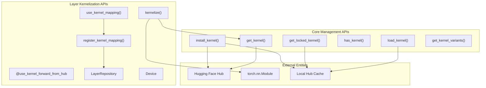
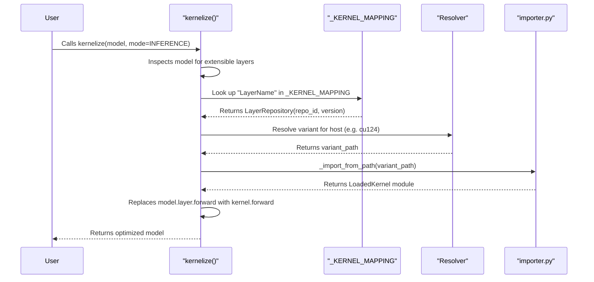

<!-- source: DeepWiki mcp.deepwiki.com · repo huggingface/kernels · page 6 API Reference · fetched 2026-10-26 -->

# API Reference

Relevant source files

The following files were used as context for generating this wiki page:

- [docs/source/api/kernels.md](docs/source/api/kernels.md)
- [docs/source/api/layers.md](docs/source/api/layers.md)
- [kernels/src/kernels/__init__.py](kernels/src/kernels/__init__.py)
- [kernels/src/kernels/cli/benchmark.py](kernels/src/kernels/cli/benchmark.py)
- [kernels/src/kernels/cli/benchmark_graphics.py](kernels/src/kernels/cli/benchmark_graphics.py)
- [kernels/src/kernels/deps.py](kernels/src/kernels/deps.py)
- [kernels/src/kernels/layer/__init__.py](kernels/src/kernels/layer/__init__.py)
- [kernels/src/kernels/layer/device.py](kernels/src/kernels/layer/device.py)
- [kernels/src/kernels/layer/kernelize.py](kernels/src/kernels/layer/kernelize.py)
- [kernels/src/kernels/layer/repos.py](kernels/src/kernels/layer/repos.py)
- [kernels/tests/test_dirty_provenance.py](kernels/tests/test_dirty_provenance.py)
- [kernels/tests/test_func.py](kernels/tests/test_func.py)
- [kernels/tests/test_layer.py](kernels/tests/test_layer.py)
- [kernels/tests/test_loaded_kernels.py](kernels/tests/test_loaded_kernels.py)

This page provides comprehensive documentation for all public functions, classes, and interfaces in the `kernels` library. The system is divided into kernel management utilities for downloading and loading optimized compute kernels, and layer kernelization functions for transparently replacing PyTorch layer implementations.

For details on the command-line interface, see [CLI Commands](#6.3).

## API Overview

The `kernels` library exposes its functionality through specialized modules for discovery, loading, and layer integration.

Sources: [kernels/src/kernels/__init__.py:5-43](), [kernels/src/kernels/layer/__init__.py:1-21]()

## Core Kernel Management Functions

These functions handle the discovery, resolution, and dynamic loading of kernel modules. For full signatures and resolver internals, see [Core Functions](#6.1).

### get_kernel()
The primary entry point for fetching and importing a kernel. It resolves the appropriate build variant for the host environment and imports it as a Python module.
[kernels/src/kernels/load.py:112-148]()

### load_kernel()
Loads a kernel using a `kernels.lock` file to ensure reproducible builds by pinning specific revisions and build variants.
[kernels/src/kernels/load.py:186-218]()

### install_kernel()
Downloads a kernel and its dependencies to the local Hub cache without importing them. This is useful for pre-fetching kernels in restricted environments.
[kernels/src/kernels/install.py:19-74]()

### get_kernel_variants()
Returns a list of all available build variants for a given repository, categorized into `VariantAccepted` and `VariantRejected` based on host compatibility.
[kernels/src/kernels/variants.py:108-146]()

Sources: [kernels/src/kernels/load.py:32-38](), [kernels/src/kernels/install.py:12-12](), [kernels/src/kernels/variants.py:39-43]()

## Layer Kernelization Functions

These APIs allow users to swap standard PyTorch `forward` implementations with optimized kernel versions. For detailed behavior on `Mode` and `Device` selection, see [Layer Functions](#6.2).

### kernelize()
Recursively traverses a `torch.nn.Module` and replaces methods of layers marked as extensible if a mapping exists for the current device and mode.
[kernels/src/kernels/layer/kernelize.py:175-236]()

### register_kernel_mapping()
Registers a global mapping between a layer name (e.g., `"LlamaRMSNorm"`) and its `LayerRepository` location on the Hub.
[kernels/src/kernels/layer/kernelize.py:97-174]()

### @use_kernel_forward_from_hub
A class decorator that marks a `nn.Module` as "kernel-aware," allowing it to be intercepted by the `kernelize()` function.
[kernels/src/kernels/layer/layer.py:328-348]()

### use_kernel_mapping()
A context manager that temporarily overrides or extends the global kernel mappings.
[kernels/src/kernels/layer/kernelize.py:17-94]()

Sources: [kernels/src/kernels/layer/kernelize.py:1-16](), [kernels/src/kernels/layer/layer.py:13-20]()

## Key Classes and Data Types

### Device & Properties
The `Device` class encapsulates the target hardware (e.g., `cuda`, `rocm`, `xpu`). For GPU backends, `CUDAProperties` and `ROCMProperties` allow filtering kernels by compute capability ranges.
[kernels/src/kernels/layer/device.py:8-160]()

### LayerRepository
Defines where a specific layer implementation resides, including the `repo_id`, `layer_name`, and versioning information (`version` or `revision`).
[kernels/src/kernels/layer/repos.py:116-160]()

### Mode
An `IntFlag` enum used to select kernels based on the execution context: `INFERENCE`, `TRAINING`, or `TORCH_COMPILE`.
[kernels/src/kernels/layer/mode.py:4-28]()

Sources: [kernels/src/kernels/layer/device.py:1-7](), [kernels/src/kernels/layer/repos.py:1-10](), [kernels/src/kernels/layer/mode.py:1-3]()

## Kernelization Workflow

The diagram below illustrates how `kernelize` bridges the "Natural Language Space" (Layer Names) to the "Code Entity Space" (Imported Modules).

Sources: [kernels/src/kernels/layer/kernelize.py:175-236](), [kernels/src/kernels/importer.py:90-131](), [kernels/src/kernels/resolver.py:44-90]()

## Environment Variables

| Variable | Purpose |
|----------|---------|
| `LOCAL_KERNELS` | List of local paths to search for kernels before checking the Hub. |
| `HF_HUB_OFFLINE` | If set to `1`, prevents all network calls to Hugging Face Hub. |
| `HF_TOKEN` | Authentication token for accessing private kernel repositories. |

Sources: [kernels/src/kernels/load.py:72-85](), [kernels/src/kernels/hf_hub.py:15-40]()

---

