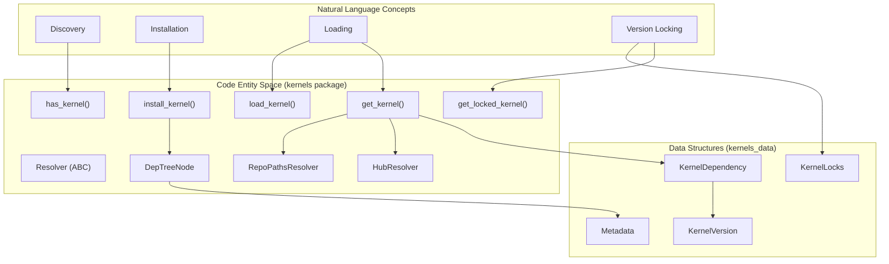
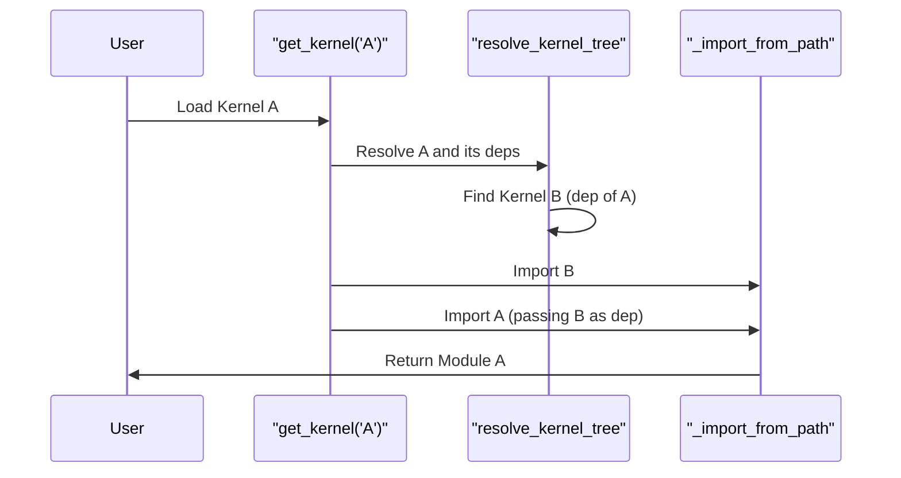

<!-- source: DeepWiki mcp.deepwiki.com · repo huggingface/kernels · page 6.1 Core Functions · fetched 2026-10-26 -->

# Core Functions

<details>
<summary>Relevant source files</summary>

The following files were used as context for generating this wiki page:

- [kernels/src/kernels/__init__.py](kernels/src/kernels/__init__.py)
- [kernels/src/kernels/_versions.py](kernels/src/kernels/_versions.py)
- [kernels/src/kernels/cli/benchmark.py](kernels/src/kernels/cli/benchmark.py)
- [kernels/src/kernels/cli/info.py](kernels/src/kernels/cli/info.py)
- [kernels/src/kernels/cli/versions.py](kernels/src/kernels/cli/versions.py)
- [kernels/src/kernels/deps.py](kernels/src/kernels/deps.py)
- [kernels/src/kernels/hf_hub.py](kernels/src/kernels/hf_hub.py)
- [kernels/src/kernels/importer.py](kernels/src/kernels/importer.py)
- [kernels/src/kernels/install.py](kernels/src/kernels/install.py)
- [kernels/src/kernels/load.py](kernels/src/kernels/load.py)
- [kernels/src/kernels/locking.py](kernels/src/kernels/locking.py)
- [kernels/src/kernels/python_deps.py](kernels/src/kernels/python_deps.py)
- [kernels/src/kernels/resolver.py](kernels/src/kernels/resolver.py)
- [kernels/tests/test_basic.py](kernels/tests/test_basic.py)
- [kernels/tests/test_deps.py](kernels/tests/test_deps.py)
- [kernels/tests/test_dirty_provenance.py](kernels/tests/test_dirty_provenance.py)
- [kernels/tests/test_loaded_kernels.py](kernels/tests/test_loaded_kernels.py)
- [kernels/tests/test_python_deps.py](kernels/tests/test_python_deps.py)
- [kernels/tests/test_resolver.py](kernels/tests/test_resolver.py)

</details>


This document covers the core utility functions for downloading, installing, and loading kernels from Hugging Face Hub. These functions handle the fundamental operations of kernel management, including environment detection, variant selection, caching, and dependency resolution.

For information about kernelizing PyTorch layers, see [Layer Functions](6.2). For command-line interface documentation, see [CLI Commands](6.3).

## Function Overview

The core functions provide a complete kernel lifecycle management system. All functions automatically detect the current environment (PyTorch version, CUDA/ROCm/XPU/Metal, architecture) to select the appropriate kernel variant.

### Core Architecture and Entity Mapping

The following diagram bridges the natural language concepts to the specific code entities and data structures used for kernel management.



**Title: Natural Language to Code Entity Mapping**

Sources: [kernels/src/kernels/load.py:87-154](), [kernels/src/kernels/deps.py:31-70](), [kernels/src/kernels/resolver.py:1-50]()

## Kernel Loading Functions

### get_kernel()

The primary entry point for loading kernels. It resolves version specifications, handles local overrides via environment variables, selects the correct hardware variant, and recursively loads dependencies.

```python
def get_kernel(
    repo_id: str,
    *,
    revision: str | None = None,
    version: int | None = None,
    backend: str | None = None,
    user_agent: str | dict | None = None,
    trust_remote_code: bool | list[str] = False,
) -> ModuleType
```

| Parameter | Type | Description |
|-----------|------|-------------|
| `repo_id` | `str` | Hub repository identifier (e.g., "kernels-community/relu") |
| `revision` | `str` | Specific git ref (branch/tag/commit). Cannot be used with `version`. |
| `version` | `int` | Integer version (e.g., 1). Maps to Hub branch `v1`. |
| `backend` | `str` | Target backend (e.g., "cuda", "cpu"). Auto-detected if None. |
| `trust_remote_code`| `bool` | Whether to allow untrusted publishers. Defaults to `False`. |

**Behavior:**
1. **Version Resolution**: Converts `version=1` to a specific commit SHA using `resolve_version_spec_as_ref` [kernels/src/kernels/_versions.py:64-91]().
2. **Local Overrides**: Checks the `LOCAL_KERNELS` environment variable for developer overrides [kernels/src/kernels/load.py:30-34]().
3. **Dependency Resolution**: Uses `resolve_kernel_tree` to build a directed acyclic graph (DAG) of kernel dependencies [kernels/src/kernels/deps.py:88-137]().
4. **Hardware Selection**: Filters available variants based on host environment (PyTorch version, CUDA capability, etc.) [kernels/src/kernels/resolver.py:123-150]().

Sources: [kernels/src/kernels/load.py:87-154](), [kernels/src/kernels/deps.py:88-137]()

### load_kernel()

Loads a kernel based on an existing `kernels.lock` file. This is intended for production environments where reproducibility is required.

```python
def load_kernel(repo_id: str, *, lockfile: Path | None = None) -> ModuleType
```

If `lockfile` is not provided, it attempts to find one in the caller's package metadata using `get_caller_locked_kernel_revision` [kernels/src/kernels/locking.py:149-161]().

Sources: [kernels/src/kernels/load.py:228-251]()

### get_locked_kernel()

Resolves a kernel from a lockfile and ensures it is installed before loading.

Sources: [kernels/src/kernels/load.py:254-282]()

## Installation Functions

### install_kernel()

Downloads the appropriate variant of a kernel to the local Hugging Face cache.

```python
def install_kernel(
    repo_id: str,
    *,
    revision: str | None = None,
    version: int | None = None,
    backend: str | None = None,
    local_files_only: bool = False,
    trust_remote_code: bool | list[str] = False,
) -> Path
```

**Returns:** The filesystem `Path` to the specific variant directory (e.g., `.../snapshots/<sha>/build/torch25-cxx11-cu124-x86_64-linux`) [kernels/src/kernels/install.py:69]().

Sources: [kernels/src/kernels/install.py:12-70]()

### has_kernel()

Lightweight check to determine if a compatible build exists for the current environment.

Sources: [kernels/src/kernels/load.py:192-225]()

## Dependency Management

The system supports transitive kernel-to-kernel dependencies. When a kernel is loaded, its dependencies (defined in `metadata.json`) are also loaded and made available via `get_kernel_dep`.



**Title: Recursive Kernel Loading Flow**

Sources: [kernels/src/kernels/deps.py:88-137](), [kernels/src/kernels/importer.py:43-69]()

### get_kernel_dep()

Used *inside* a kernel's `__init__.py` to access its dependencies.

```python
# Inside a kernel's code
from kernels import get_kernel_dep
dependency_b = get_kernel_dep("kernels-community/dependency-b")
```

Sources: [kernels/src/kernels/deps.py:151-172]()

## Variant Selection Internals

The `Resolver` classes determine which build variant is compatible with the host system.

| Resolver | Role |
|----------|------|
| `RepoPathsResolver` | Handles local paths and `LOCAL_KERNELS` overrides [kernels/src/kernels/resolver.py:53-73](). |
| `HubResolver` | Queries the Hugging Face Hub for available variants [kernels/src/kernels/resolver.py:123-150](). |
| `HubCacheResolver` | Resolves variants from the local cache (offline mode) [kernels/src/kernels/resolver.py:153-176](). |

### Selection Logic
1. **Metadata Retrieval**: Downloads `metadata.json` for all available variants.
2. **Compatibility Check**: Compares `python-depends` (e.g., `torch>=2.5`) and hardware requirements (e.g., CUDA compute capability) against the host system [kernels/src/kernels/python_deps.py:15-38]().
3. **Scoring**: Ranks variants. Specific hardware variants (e.g., `cu124`) are preferred over universal or CPU variants.

Sources: [kernels/src/kernels/resolver.py:123-150](), [kernels/src/kernels/variants.py:13-43]()

## Local Overrides

Developers can override Hub kernels with local versions using the `LOCAL_KERNELS` environment variable.

**Format:** `repo_id=path:repo_id2=path2`

**Example:**
```bash
export LOCAL_KERNELS="kernels-community/relu=/home/user/my-relu-build"
```

The system will prioritize these paths before checking the Hub cache.

Sources: [kernels/src/kernels/load.py:30-49](), [kernels/tests/test_basic.py:185-200]()

## Security and Provenance

When a kernel is loaded from a path, the system checks its `provenance` metadata. If the kernel was built from a "dirty" git tree (uncommitted changes), a warning is issued to the user.

Sources: [kernels/src/kernels/importer.py:110-128](), [kernels/tests/test_dirty_provenance.py:48-60]()

---

