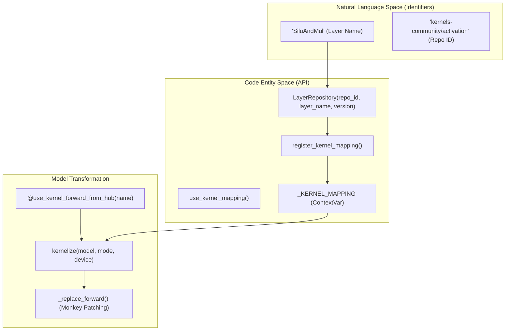
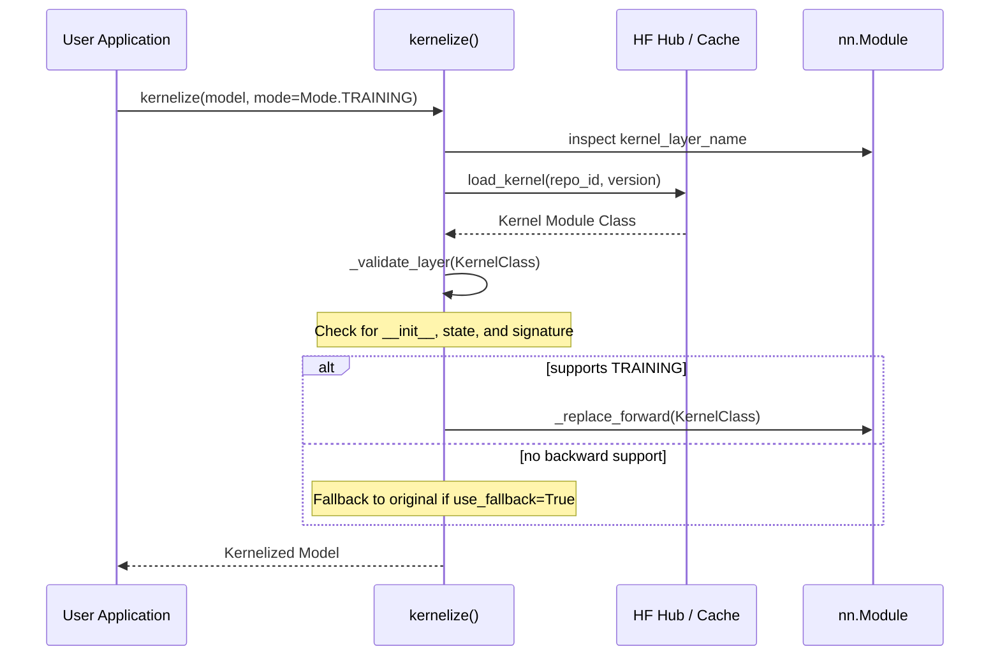

<!-- source: DeepWiki mcp.deepwiki.com · repo huggingface/kernels · page 6.2 Layer Functions · fetched 2026-10-26 -->

# Layer Functions

<details>
<summary>Relevant source files</summary>

The following files were used as context for generating this wiki page:

- [docs/source/api/kernels.md](docs/source/api/kernels.md)
- [docs/source/api/layers.md](docs/source/api/layers.md)
- [docs/source/basic-usage.md](docs/source/basic-usage.md)
- [docs/source/integrating-kernels.md](docs/source/integrating-kernels.md)
- [docs/source/kernel-requirements.md](docs/source/kernel-requirements.md)
- [docs/source/layers.md](docs/source/layers.md)
- [docs/source/locking.md](docs/source/locking.md)
- [docs/source/migration.md](docs/source/migration.md)
- [kernels/src/kernels/cli/__init__.py](kernels/src/kernels/cli/__init__.py)
- [kernels/src/kernels/cli/benchmark_graphics.py](kernels/src/kernels/cli/benchmark_graphics.py)
- [kernels/src/kernels/cli/verify_signature.py](kernels/src/kernels/cli/verify_signature.py)
- [kernels/src/kernels/layer/__init__.py](kernels/src/kernels/layer/__init__.py)
- [kernels/src/kernels/layer/device.py](kernels/src/kernels/layer/device.py)
- [kernels/src/kernels/layer/func.py](kernels/src/kernels/layer/func.py)
- [kernels/src/kernels/layer/kernelize.py](kernels/src/kernels/layer/kernelize.py)
- [kernels/src/kernels/layer/layer.py](kernels/src/kernels/layer/layer.py)
- [kernels/src/kernels/layer/repos.py](kernels/src/kernels/layer/repos.py)
- [kernels/tests/test_func.py](kernels/tests/test_func.py)
- [kernels/tests/test_layer.py](kernels/tests/test_layer.py)
- [kernels/tests/test_verify.py](kernels/tests/test_verify.py)

</details>


This document provides detailed API reference for layer-related functions in the `kernels` system. These functions enable the replacement of PyTorch layer `forward` methods with optimized kernels from Hugging Face Hub. For core kernel management functions like `get_kernel()` and `install_kernel()`, see [Core Functions](6.1).

## Core Classes

### Device
The `Device` class represents a compute device type for kernel selection.

```python
@dataclass(frozen=True)
class Device:
    type: str
```

**Parameters:**
- `type` (str): Device type identifier (e.g., `"cuda"`, `"rocm"`, `"xpu"`, `"neuron"`, `"metal"`, `"cpu"`).

Sources: [kernels/src/kernels/layer/device.py:6-15](), [docs/source/kernel-requirements.md:154-157]()

### LayerRepository
The `LayerRepository` class specifies a kernel layer location on Hugging Face Hub. It requires either a `version` (major version number) or a `revision` (git branch, tag, or commit).

```python
class LayerRepository:
    def __init__(
        self,
        repo_id: str,
        *,
        layer_name: str,
        revision: str | None = None,
        version: int | None = None,
        trust_remote_code: bool | list[str] = False,
    )
```

**Parameters:**
- `repo_id` (str): Hugging Face Hub repository identifier.
- `layer_name` (str): Name of the layer class within the kernel repository.
- `version` (int): Major version of the kernel. Recommended for stability.
- `revision` (str): Specific git ref. Cannot be used with `version`.
- `trust_remote_code` (bool): Whether to allow loading from untrusted publishers.

Sources: [kernels/src/kernels/layer/layer.py:42-90](), [docs/source/layers.md:165-189]()

### LocalLayerRepository / LockedLayerRepository
- **LocalLayerRepository**: References a kernel from a local directory path [kernels/src/kernels/layer/layer.py:139-168]().
- **LockedLayerRepository**: References a kernel defined in a `kernels.lock` file for reproducible deployments [kernels/src/kernels/layer/layer.py:190-215]().

### Mode
An Enum used by `kernelize()` to specify the execution context. Modes can be combined using the bitwise OR (`|`) operator.

```python
class Mode(Flag):
    INFERENCE = auto()
    TRAINING = auto()
    TORCH_COMPILE = auto()
```

Sources: [kernels/src/kernels/layer/mode.py:6-12](), [docs/source/layers.md:113-123]()

## Layer Registration and Mapping

The kernel mapping system connects layer names to device-specific kernel implementations using a context-variable-based registry.

### System Architecture



Sources: [kernels/src/kernels/layer/layer.py:29-31](), [kernels/src/kernels/layer/kernelize.py:43-110](), [docs/source/layers.md:84-95]()

### register_kernel_mapping()
Registers global mappings between layer names and device-specific repositories.

```python
def register_kernel_mapping(mapping: dict[str, dict[Device | str, RepositoryProtocol]])
```

Sources: [kernels/src/kernels/layer/globals.py:8](), [kernels/tests/test_layer.py:37-73]()

### use_kernel_mapping()
A context manager for providing temporary kernel mappings.

```python
with use_kernel_mapping(mapping, inherit_mapping=True):
    model = kernelize(model)
```

Sources: [kernels/src/kernels/layer/globals.py:8]()

## Layer Decoration and Function Kernelization

### use_kernel_forward_from_hub()
Decorator that marks a `nn.Module` or a function as kernelizable. For functions, it wraps them in a singleton `nn.Module` to allow stateful kernel replacement.

```python
@use_kernel_forward_from_hub("SiluAndMul")
class SiluAndMul(nn.Module):
    def forward(self, input: torch.Tensor): ...
```

Sources: [kernels/src/kernels/layer/layer.py:441-450](), [docs/source/layers.md:19-24]()

### use_kernelized_func()
Used on a `nn.Module` to make a decorated function visible to the `kernelize()` traversal.

```python
@use_kernelized_func(silu_and_mul_func)
class MyLayer(nn.Module):
    def forward(self, x):
        return silu_and_mul_func(x)
```

Sources: [kernels/src/kernels/layer/layer.py:530-544](), [docs/source/layers.md:72-79]()

### FuncRepository (Deprecated)
`FuncRepository` and `LocalFuncRepository` are deprecated as of version 0.16. Users should migrate to `LayerRepository` by wrapping functions in a standard `nn.Module` within the kernel repository.

Sources: [kernels/src/kernels/layer/func.py:35-41](), [docs/source/migration.md:109-112]()

## Model Kernelization

### kernelize()
Main function that traverses the model graph and replaces `forward` methods of extensible layers.

```python
def kernelize(
    model: nn.Module,
    device: str | torch.device | Device | None = None,
    mode: Mode = Mode.INFERENCE,
    use_fallback: bool = True,
) -> nn.Module
```

**Behavior:**
1. **Device Detection**: If `device` is `None`, it attempts to infer the device from model parameters [kernels/src/kernels/layer/kernelize.py:59-60]().
2. **Traversal**: Iterates through all named modules [kernels/src/kernels/layer/kernelize.py:72]().
3. **Lookup**: For modules with a `kernel_layer_name`, it looks up the mapping for the detected device [kernels/src/kernels/layer/kernelize.py:77-81]().
4. **Validation**: Checks if the Hub kernel is compatible with the requested `Mode` (e.g., supports `TORCH_COMPILE` or `TRAINING`) [kernels/src/kernels/layer/kernelize.py:100-105]().
5. **Injection**: Replaces the module's `forward` method using `_replace_forward` [kernels/src/kernels/layer/kernelize.py:109]().

#### Kernelization Logic Flow



Sources: [kernels/src/kernels/layer/kernelize.py:43-110](), [kernels/src/kernels/layer/layer.py:279-317]()

### Kernel Validation Requirements
To ensure safety during monkey-patching, Hub layers must be "pure":
- Must inherit from `torch.nn.Module` [kernels/src/kernels/layer/layer.py:287]().
- Must NOT have a custom `__init__` method (must be stateless) [kernels/src/kernels/layer/layer.py:292]().
- Must NOT define additional member variables [kernels/src/kernels/layer/layer.py:296]().
- The `forward` signature must match the original layer [kernels/src/kernels/layer/layer.py:304]().

Sources: [kernels/src/kernels/layer/layer.py:279-317](), [docs/source/kernel-requirements.md:183-186]()

## Hardware and Performance

### CUDAProperties
Used to filter or verify kernels based on CUDA-specific hardware capabilities.

```python
@dataclass(frozen=True)
class CUDAProperties:
    major: int
    minor: int
    multi_processor_count: int
```

Sources: [kernels/src/kernels/layer/device.py:18-23]()

### ROCMProperties
Similar to `CUDAProperties`, used for AMD hardware capability verification.

Sources: [kernels/src/kernels/layer/device.py:30-34]()

## Usage Example: Training with Fallback

```python
from kernels import kernelize, Mode, register_kernel_mapping, LayerRepository

# Define mapping
register_kernel_mapping({
    "RmsNorm": {
        "cuda": LayerRepository("kernels-community/activation", layer_name="RmsNorm", version=1)
    }
})

# Kernelize for training
# If the kernel doesn't support backward, it falls back to original PyTorch code
model = kernelize(model, mode=Mode.TRAINING, use_fallback=True)
```

Sources: [docs/source/layers.md:98-105](), [docs/source/layers.md:142-147]()

---

