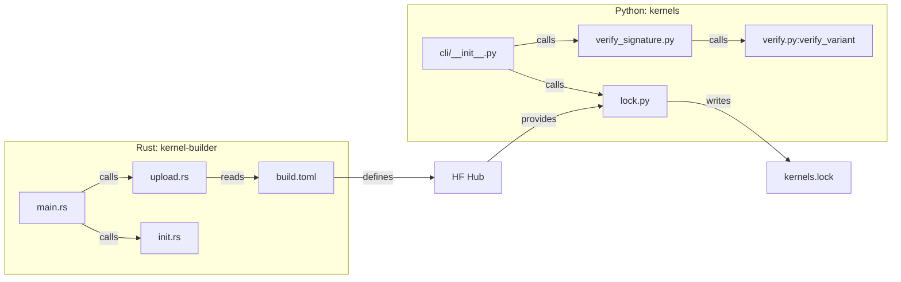

<!-- source: DeepWiki mcp.deepwiki.com · repo huggingface/kernels · page 6.3 CLI Commands · fetched 2026-10-26 -->

# CLI Commands

<details>
<summary>Relevant source files</summary>

The following files were used as context for generating this wiki page:

- [docs/source/_toctree.yml](docs/source/_toctree.yml)
- [docs/source/builder-cli.md](docs/source/builder-cli.md)
- [docs/source/builder/build.md](docs/source/builder/build.md)
- [docs/source/builder/github-actions.md](docs/source/builder/github-actions.md)
- [docs/source/builder/local-dev.md](docs/source/builder/local-dev.md)
- [docs/source/builder/writing-kernels.md](docs/source/builder/writing-kernels.md)
- [docs/source/cli.md](docs/source/cli.md)
- [kernel-builder/src/main.rs](kernel-builder/src/main.rs)
- [kernel-builder/src/pyproject/mod.rs](kernel-builder/src/pyproject/mod.rs)
- [kernel-builder/src/pyproject/ops_identifier.rs](kernel-builder/src/pyproject/ops_identifier.rs)
- [kernel-builder/src/upload.rs](kernel-builder/src/upload.rs)
- [kernels-data/src/git.rs](kernels-data/src/git.rs)
- [kernels/src/kernels/cli/__init__.py](kernels/src/kernels/cli/__init__.py)
- [kernels/src/kernels/cli/verify_signature.py](kernels/src/kernels/cli/verify_signature.py)
- [kernels/src/kernels/layer/func.py](kernels/src/kernels/layer/func.py)
- [kernels/src/kernels/layer/layer.py](kernels/src/kernels/layer/layer.py)
- [kernels/tests/test_verify.py](kernels/tests/test_verify.py)

</details>


This document provides a complete technical reference for the command-line interfaces provided by the `kernels` ecosystem. It covers both the `kernels` Python CLI (for users/consumers) and the `kernel-builder` Rust CLI (for kernel developers).

## Architecture Overview

The system employs two distinct CLI tools to manage the lifecycle of a compute kernel, from initial development and Nix-based building to Hub distribution and local dependency locking.

```mermaid
graph TD
    subgraph "Development Space (kernel-builder)"
        KB_INIT["kernel-builder init"] --> KB_BUILD["kernel-builder build"]
        KB_BUILD --> KB_UPLOAD["kernel-builder upload"]
    end

    subgraph "Hub Space (huggingface.co)"
        KB_UPLOAD --> HUB_REPO[("Kernel Repository")]
    end

    subgraph "Consumer Space (kernels CLI)"
        HUB_REPO --> K_LOCK["kernels lock"]
        K_LOCK --> K_DL["kernels download"]
        K_DL --> K_INFO["kernels info"]
    end

    KB_INIT -.-> [kernel-builder/src/init.rs]
    KB_BUILD -.-> [kernel-builder/src/build.rs]
    KB_UPLOAD -.-> [kernel-builder/src/upload.rs]
    K_LOCK -.-> [kernels/src/kernels/cli/lock.py]
    K_DL -.-> [kernels/src/kernels/cli/download.py]
```

Sources: [kernel-builder/src/main.rs:81-260](), [kernels/src/kernels/cli/__init__.py:12-123]()

---

## 1. `kernels` Python CLI Reference

The `kernels` CLI is installed via `pip install kernels`. It is primarily used by application developers to manage kernel dependencies and verify signatures.

### Subcommands

| Command | Function | Source |
|:---|:---|:---|
| `info` | Describe a kernel's metadata and variants | [kernels/src/kernels/cli/info.py]() |
| `versions` | List available versions on the Hub | [kernels/src/kernels/cli/versions.py]() |
| `lock` | Generate `kernels.lock` for reproducible builds | [kernels/src/kernels/cli/lock.py]() |
| `download` | Fetch locked kernels into the local cache | [kernels/src/kernels/cli/download.py]() |
| `verify-signature` | Verify cryptographic signatures of kernels | [kernels/src/kernels/cli/verify_signature.py]() |
| `benchmark` | Run performance benchmarks for a kernel | [kernels/src/kernels/cli/benchmark.py]() |

### `kernels info`
Describes a kernel repository.
- **Usage**: `kernels info <repo_id> [--revision <rev>] [--version <ver>] [--json]`
- **Implementation**: Calls `print_kernel_info` which fetches metadata from the Hub or local path [kernels/src/kernels/cli/__init__.py:33-55]().

### `kernels lock`
Resolves kernel versions and generates a `kernels.lock` file.
- **Usage**: `kernels lock <project_dir>`
- **Mechanism**: Scans the project for kernel dependencies and writes a JSON lockfile containing specific Git SHAs and variant digests [kernels/src/kernels/cli/__init__.py:60-67]().

### `kernels verify-signature`
Ensures kernel integrity using Sigstore/OIDC signatures.
- **Usage**: `kernels verify-signature <repo_id> <version> [--all-variants]`
- **Logic**: Iterates through variants, calls `verify_variant()`, and checks for `VerificationResult::Success` [kernels/src/kernels/cli/verify_signature.py:17-69]().

Sources: [kernels/src/kernels/cli/__init__.py:1-123](), [kernels/src/kernels/cli/verify_signature.py:17-69]()

---

## 2. `kernel-builder` Rust CLI Reference

The `kernel-builder` is a Rust-based tool used to create, build (via Nix), and publish kernels. It is typically installed via Nix or the Hugging Face install script.

### Build and Lifecycle Commands

| Command | Purpose | Code Entity |
|:---|:---|:---|
| `init` | Scaffold a new kernel project | `run_init` [kernel-builder/src/init.rs]() |
| `build` | Build artifacts locally (alias for `build-and-copy`) | `run_build_and_copy` [kernel-builder/src/build.rs]() |
| `build-and-upload` | Atomic build and Hub push | `run_upload` [kernel-builder/src/upload.rs]() |
| `check-abi` | Validate Manylinux/Python ABI compliance | `run_check_abi` [kernel-builder/src/check_abi.rs]() |
| `devshell` | Enter a Nix shell with all build dependencies | `devshell` [kernel-builder/src/develop.rs]() |

### `kernel-builder upload`
Uploads build artifacts to the Hugging Face Hub.
- **Arguments**:
  - `--repo-id`: Target Hub repository [kernel-builder/src/upload.rs:82-83]().
  - `--create-pr`: Opens a PR instead of committing directly [kernel-builder/src/upload.rs:97-100]().
  - `--repo-type`: Defaults to `kernel` [kernel-builder/src/upload.rs:93-95]().
- **Data Flow**:
  1. `discover_variants()` finds compiled binaries in the `build/` directory [kernel-builder/src/upload.rs:190]().
  2. `get_repo_and_branch()` resolves the target branch (usually `v{version}`) [kernel-builder/src/upload.rs:200]().
  3. `hf_hub` library performs multi-file commit batching [kernel-builder/src/upload.rs:10-14]().

### `kernel-builder create-pyproject`
Generates local build files (`setup.py`, `CMakeLists.txt`) for IDE support and local development.
- **Usage**: `kernel-builder create-pyproject [--unique-id <id>]`
- **Purpose**: Bridges the Nix-based sandbox to standard Python build tools for local iteration [kernel-builder/src/main.rs:174-202]().

Sources: [kernel-builder/src/main.rs:81-260](), [kernel-builder/src/upload.rs:74-109]()

---

## 3. Environment Variables

Both tools respect a set of environment variables for configuration:

| Variable | Tool | Purpose |
|:---|:---|:---|
| `LOCAL_KERNELS` | `kernels` | Override Hub kernels with local paths (Format: `repo_id=path:repo_id2=path2`) |
| `HF_HUB_OFFLINE` | `kernels` | Disable network requests; use local cache only [kernels/src/kernels/layer/layer.py:103](). |
| `HF_TOKEN` | Both | Authentication token for Hugging Face Hub operations. |
| `HF_ENDPOINT` | Both | Custom Hub endpoint (e.g., for internal mirrors). |

Sources: [docs/source/builder/local-dev.md:70-86](), [kernels/src/kernels/layer/layer.py:102-104]()

---

## 4. CLI Interaction Diagram

The following diagram illustrates how `kernel-builder` (Rust) and `kernels` (Python) interact with the file system and the Hub.



Sources: [kernel-builder/src/main.rs:73-260](), [kernels/src/kernels/cli/__init__.py:12-123](), [kernel-builder/src/upload.rs:149-175]()

---

