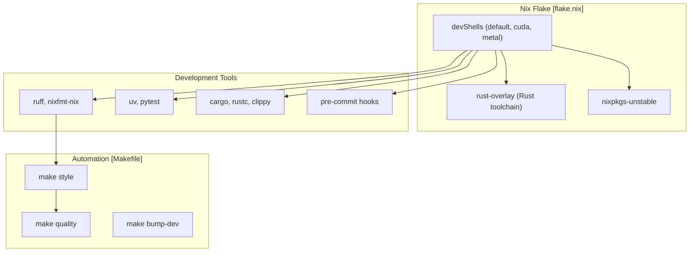
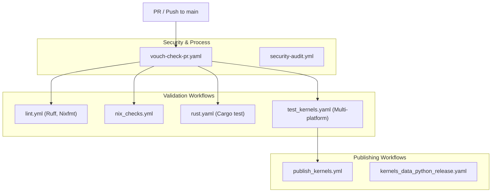

<!-- source: DeepWiki mcp.deepwiki.com · repo huggingface/kernels · page 7 Development Setup · fetched 2026-10-26 -->

# Development Setup

<details>
<summary>Relevant source files</summary>

The following files were used as context for generating this wiki page:

- [.pre-commit-config.yaml](.pre-commit-config.yaml)
- [CONTRIBUTING.md](CONTRIBUTING.md)
- [Makefile](Makefile)
- [scripts/_version_common.py](scripts/_version_common.py)
- [scripts/bump_version.py](scripts/bump_version.py)

</details>


This document provides instructions for contributors to set up a development environment for the `kernels` repository and run tests. It covers environment setup using Nix, Rust, or traditional Python tools, testing procedures, and the CI/CD pipeline structure.

For details on the repository's Nix-based build infrastructure, see [Nix Build System Deep Dive](#9). For instructions on creating and distributing kernels, see [Kernel Development](#5).

## Environment Setup Options

The kernels repository supports multiple development environment approaches to accommodate different developer preferences and system configurations.

### Nix Development Environment

The repository provides a Nix flake for reproducible development environments. The Nix setup includes all necessary development tools and dependencies for both Python and Rust components.

#### Nix Environment Components



**Sources:** [flake.nix:1-57](), [Makefile:1-30](), [.pre-commit-config.yaml:1-17]()

To enter the Nix development shell:
```bash
nix develop
```
For details, see [Environment Setup](#7.1).

### Traditional Python and Rust Setup

If you prefer not to use Nix, you can set up the environment using `uv` for Python and `rustup` for Rust.

1.  **Python Setup**: Install the Python package in editable mode with development extras.
    ```bash
    pip install -e "kernels/[dev]"
    ```
2.  **Rust Setup**: The repository contains several Rust crates, including `kernels-data` and `kernel-builder`. Ensure you have a recent Rust toolchain installed.
3.  **Dependency Synchronization**: The `Makefile` provides targets to keep versions consistent across `Cargo.toml`, `pyproject.toml`, and lockfiles.
    ```bash
    make bump-dev  # Refreshes Cargo.lock and kernels/uv.lock
    ```

**Sources:** [CONTRIBUTING.md:56-61](), [Makefile:34-38](), [scripts/_version_common.py:20-25]()

## Testing Infrastructure

The repository uses a multi-layered testing strategy covering Python bindings, Rust logic, and Nix builds.

### Testing Components

| Component | Tool | Command | Description |
|-----------|------|---------|-------------|
| **Python Package** | `pytest` | `cd kernels && pytest` | Tests kernel loading, layer kernelization, and API. |
| **Rust Crates** | `cargo` | `cargo test` | Tests metadata parsing, hashing, and git logic in `kernels-data`. |
| **Python Bindings** | `pytest` | `pytest kernels-data/bindings/python` | Validates the PyO3 bindings for `kernels-data`. |
| **Nix Builds** | `nix` | `nix flake check` | Validates flake outputs and builds. |

**Sources:** [CONTRIBUTING.md:70-74](), [Makefile:4](), [flake.nix:40-45]()

### Code Quality and Formatting

Before pushing, ensure your changes adhere to the project's quality standards using the provided `Makefile` targets:
- `make style`: Auto-formats Python code with `ruff` and fixes linting issues.
- `make quality`: Checks formatting and linting (this is what runs in CI).

**Sources:** [Makefile:11-13](), [Makefile:27-29](), [.pre-commit-config.yaml:8-13]()

For details on test structure and writing new tests, see [Testing](#7.2).

## CI/CD Pipeline

The GitHub Actions workflows provide comprehensive testing across multiple platforms (CUDA, ROCm, XPU, Windows, macOS) and automate the publishing process.

### CI Workflow Architecture



**Sources:** [CONTRIBUTING.md:24-28](), [Makefile:24-25]()

### Key Pipeline Features

- **Vouching**: PRs from non-vouched contributors are automatically closed to manage review bandwidth. Contributors are managed in `.github/VOUCHED.td`.
- **Version Management**: The `scripts/bump_version.py` script synchronizes version strings across all `pyproject.toml` and `Cargo.toml` files in the repository.
- **Multi-Platform Testing**: `test_kernels.yaml` ensures compatibility across different compute backends and operating systems.

**Sources:** [CONTRIBUTING.md:24-28](), [scripts/bump_version.py:1-34](), [scripts/_version_common.py:16-25]()

For details on the specific workflows and deployment steps, see [CI/CD Pipeline](#7.3).

---

