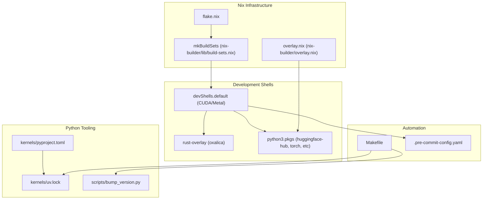
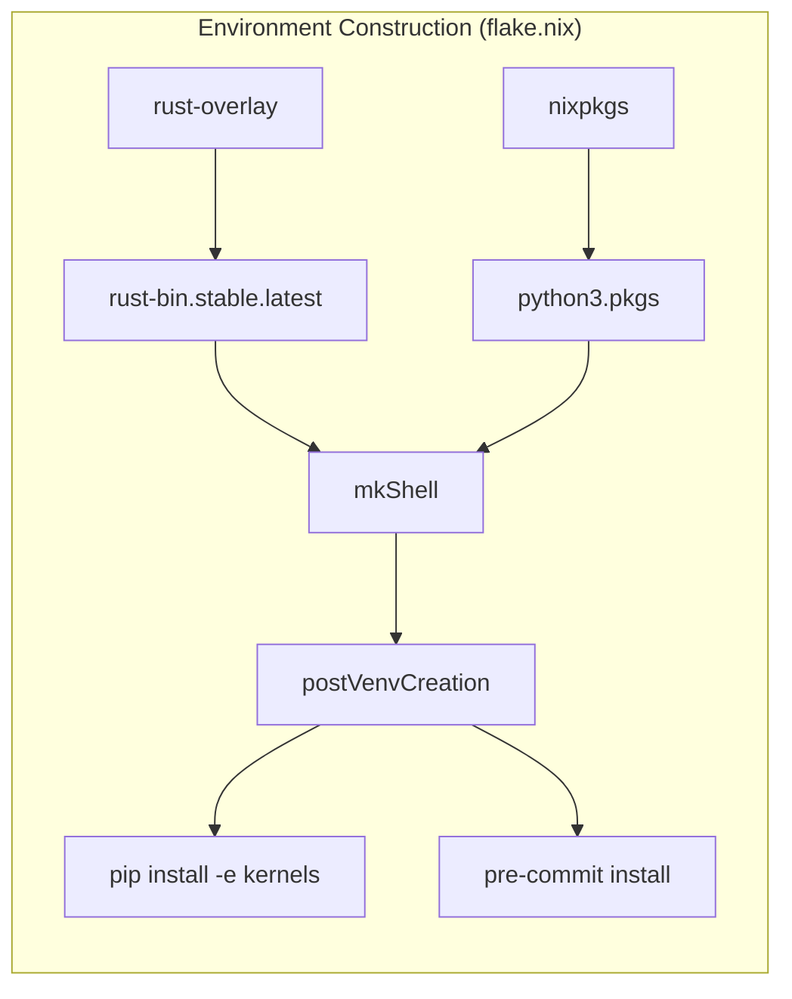

<!-- source: DeepWiki mcp.deepwiki.com · repo huggingface/kernels · page 7.1 Environment Setup · fetched 2026-10-26 -->

# Environment Setup

<details>
<summary>Relevant source files</summary>

The following files were used as context for generating this wiki page:

- [.pre-commit-config.yaml](.pre-commit-config.yaml)
- [Makefile](Makefile)
- [docs/source/builder/why-nix.md](docs/source/builder/why-nix.md)
- [docs/source/installation.md](docs/source/installation.md)
- [flake.lock](flake.lock)
- [flake.nix](flake.nix)
- [nix-builder/README.md](nix-builder/README.md)
- [nix-builder/lib/mk-build-set.nix](nix-builder/lib/mk-build-set.nix)
- [nix-builder/pkgs/fetch-from-huggingface/default.nix](nix-builder/pkgs/fetch-from-huggingface/default.nix)
- [nix-builder/pkgs/fetch-from-huggingface/download.py](nix-builder/pkgs/fetch-from-huggingface/download.py)
- [nix-builder/pkgs/rocm-packages/overrides.nix](nix-builder/pkgs/rocm-packages/overrides.nix)
- [scripts/_version_common.py](scripts/_version_common.py)
- [scripts/bump_version.py](scripts/bump_version.py)

</details>


This document covers setting up a local development environment for contributing to the `kernels` repository. It provides three main approaches: **Nix** (recommended for reproducibility and cross-platform backend support), **traditional Python tooling** (using `uv`), and **Docker-based development**.

For end-user installation instructions, see [Installation](#2.1). For production Docker usage, see [Docker Usage](#8.1).

## Overview

The `kernels` project is a multi-language codebase (Rust and Python) with complex hardware dependencies (CUDA, ROCm, XPU, Metal). The development environment is designed to handle these complexities by providing specialized shells for different compute backends and automated tooling for version management and quality control.

## System Requirements

### Base Requirements

| Requirement | Version | Notes |
|-------------|---------|--------|
| Python | ≥ 3.9 | Required for all setup methods [[docs/source/installation.md:63-67]]() |
| PyTorch | ≥ 2.5 | Core dependency for kernel execution [[docs/source/installation.md:18-18]]() |
| Rust | Stable | Required for building `kernels-data` and `kernel-builder` [[flake.nix:149-154]]() |
| Git LFS | Latest | Required for handling large kernel artifacts |

### Optional Requirements

| Component | Purpose | Setup Method |
|-----------|---------|--------------|
| NVIDIA CUDA | GPU kernel development | Nix, Docker, Manual |
| AMD ROCm | AMD GPU support | Nix (Tiers 2) [[nix-builder/README.md:52-52]]() |
| Intel XPU | Intel GPU support | Nix (Tiers 2) [[nix-builder/README.md:53-53]]() |
| Apple Metal | macOS GPU support | Nix (Tiers 2) [[nix-builder/README.md:54-54]]() |
| Nix | Reproducible builds | Nix Flakes [[nix-builder/README.md:21-23]]() |
| uv | Dependency management | Makefile, Manual [[Makefile:37-37]]() |

Sources: [docs/source/installation.md:18-22](), [flake.nix:149-196](), [nix-builder/README.md:49-57]()

## Development Environment Architecture

The following diagram maps the relationship between high-level setup tasks and the specific code entities or configuration files that implement them.

### Tooling to Code Entity Mapping

Sources: [flake.nix:32-49](), [flake.nix:144-196](), [Makefile:34-37](), [nix-builder/lib/mk-build-set.nix:13-13]()

## Nix Setup (Recommended)

Nix is the primary tool for kernel development as it manages the complex matrix of PyTorch versions, CUDA toolkits, and Rust toolchains in an isolated sandbox.

### Environment Activation
The project uses `flake.nix` to define development shells. The default shell is tailored to the host architecture (CUDA for Linux, Metal for macOS).

```bash
# Enter the default development shell
nix develop

# Or enter a specific backend shell (e.g., ROCm)
nix develop .#rocm
```
Sources: [flake.nix:132-143](), [flake.nix:145-209]()

### Nix Development Shell Implementation
The `devShellByBackend` function in `flake.nix` constructs the environment using `mkShell`. It integrates the Rust toolchain via `rust-overlay` and Python packages defined in the Hugging Face Nix overlay.


Sources: [flake.nix:149-156](), [flake.nix:202-206]()

### Key Nix Components:
- **`rust-overlay`**: Provides the latest stable Rust compiler and extensions like `rust-analyzer` [[flake.nix:149-154]]().
- **`venvShellHook`**: Automatically manages a `.venv` directory in the project root [[flake.nix:195-195]]().
- **`builderProvenance`**: A record of the Git SHA and dirty status of the `kernel-builder` burned into the binary [[flake.nix:32-38]]().

## Python and Rust Tooling

For developers not using Nix, the environment relies on `uv` for Python and `cargo` for Rust.

### Dependency Management
- **Python**: Dependencies are defined in `kernels/pyproject.toml`. The project uses `uv` to maintain a lockfile (`kernels/uv.lock`) ensuring consistent environments [[Makefile:37-37]]().
- **Rust**: The `kernels-data` crate and `kernel-builder` CLI are managed by Cargo. The `Makefile` includes targets to keep these in sync [[Makefile:36-36]]().

### Makefile Tasks
The `Makefile` serves as the entry point for common development tasks:

| Target | Command | Description |
|--------|---------|-------------|
| `style` | `ruff format` & `ruff check --fix` | Formats and fixes Python code [[Makefile:11-13]]() |
| `bump-dev` | `scripts/bump_version.py --dev` | Bumps version to next dev release and refreshes lockfiles [[Makefile:34-37]]() |
| `kernel-builder-cli-docs` | `cargo build -p hf-kernel-builder` | Generates the CLI reference documentation [[Makefile:15-22]]() |
| `quality` | `ruff format --check` | Performs linting checks without modifying files [[Makefile:27-29]]() |

Sources: [Makefile:11-73]()

## Version Management
Version synchronization across Python (`pyproject.toml`) and Rust (`Cargo.toml`) is handled by `scripts/bump_version.py`.

### Versioning Logic
The script supports patch and minor (major) bumps with optional `.devN` suffixes.
- **Python Version**: `0.10.1.dev0` [[scripts/bump_version.py:21-27]]()
- **Cargo Version**: `0.10.1-dev0` [[scripts/bump_version.py:94-94]]()

### Impacted Files
The script updates the following files to ensure consistency:
- `kernels/pyproject.toml` [[scripts/_version_common.py:18-18]]()
- `kernels-data/Cargo.toml` [[scripts/_version_common.py:21-21]]()
- `kernels-data/bindings/python/Cargo.toml` [[scripts/_version_common.py:22-22]]()
- `kernel-builder/Cargo.toml` [[scripts/_version_common.py:23-23]]()
- `kernel-abi-check/Cargo.toml` [[scripts/_version_common.py:24-24]]()

Sources: [scripts/bump_version.py:54-96](), [scripts/_version_common.py:14-25]()

## Pre-commit Hooks
The project uses `pre-commit` to enforce quality standards before code is committed.
- **`no-commit-to-branch`**: Prevents direct commits to the `main` branch [[.pre-commit-config.yaml:5-6]]().
- **`ruff`**: Runs linting and formatting for Python code [[.pre-commit-config.yaml:8-13]]().
- **`nixfmt`**: Formats Nix files [[.pre-commit-config.yaml:14-17]]().

## Hugging Face Hub Integration
During development and build, the environment interacts with the Hub using `fetch-from-huggingface`. This Nix fetcher uses `huggingface_hub.snapshot_download` to pull kernel source or artifacts into the Nix store [[nix-builder/pkgs/fetch-from-huggingface/download.py:9-14]]().

- **Authentication**: Uses the `HF_TOKEN` environment variable [[nix-builder/pkgs/fetch-from-huggingface/default.nix:67-67]]().
- **Stability**: Automatically removes `.cache` metadata after download to ensure a stable Nix output hash [[nix-builder/pkgs/fetch-from-huggingface/download.py:18-18]]().

Sources: [nix-builder/pkgs/fetch-from-huggingface/default.nix:14-68](), [nix-builder/pkgs/fetch-from-huggingface/download.py:1-18]()

---

