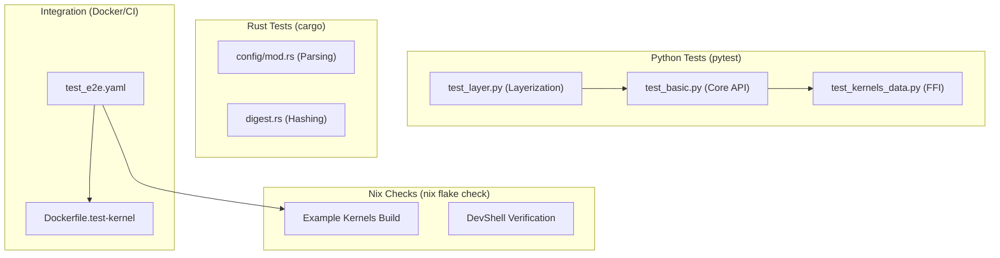
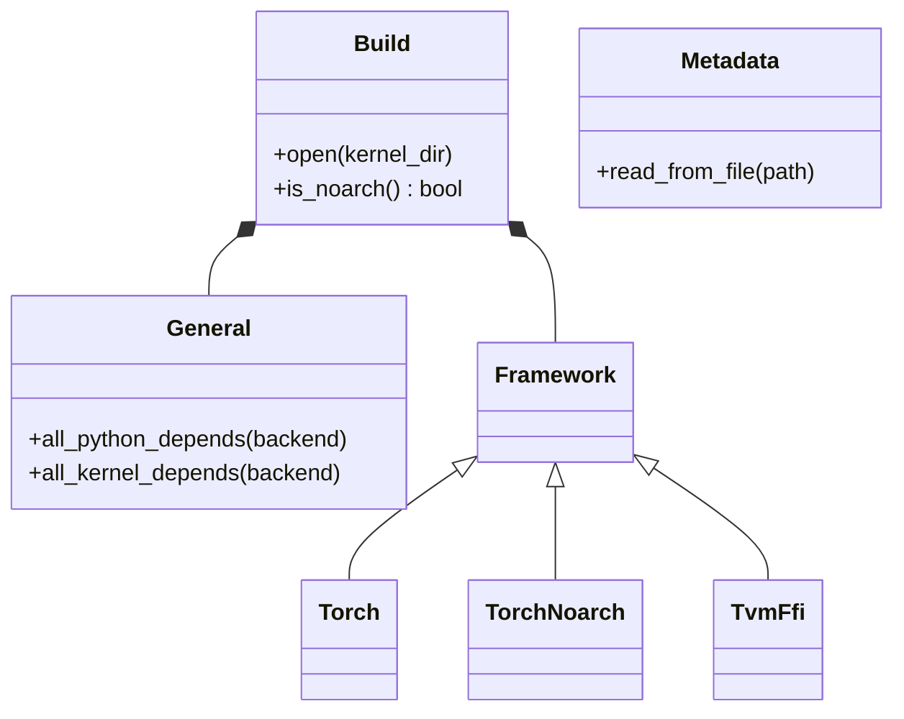
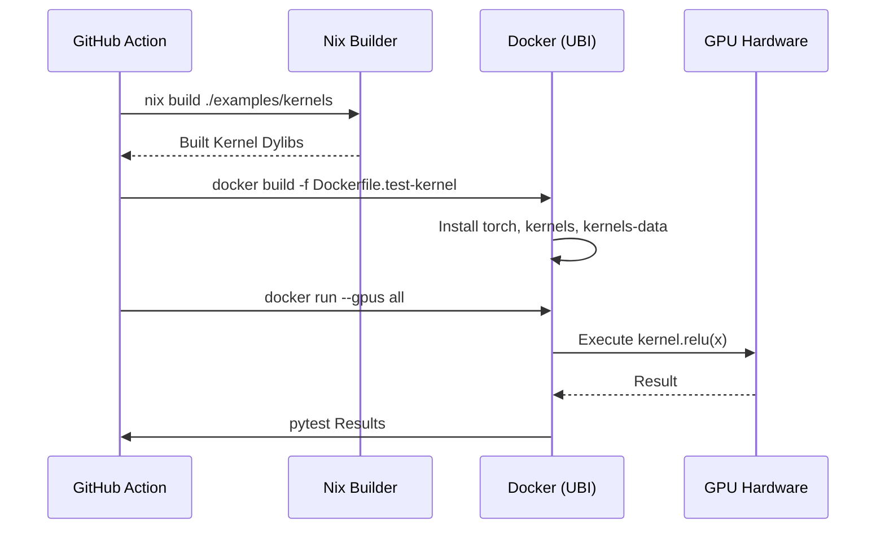

<!-- source: DeepWiki mcp.deepwiki.com · repo huggingface/kernels · page 7.2 Testing · fetched 2026-10-26 -->

# Testing

Relevant source files

The following files were used as context for generating this wiki page:

- [.github/workflows/build_kernel.yaml](.github/workflows/build_kernel.yaml)
- [docs/source/api/kernels.md](docs/source/api/kernels.md)
- [docs/source/api/layers.md](docs/source/api/layers.md)
- [examples/kernels/flake.nix](examples/kernels/flake.nix)
- [kernels-data/bindings/python/src/version.rs](kernels-data/bindings/python/src/version.rs)
- [kernels-data/bindings/python/tests/test_kernels_data.py](kernels-data/bindings/python/tests/test_kernels_data.py)
- [kernels-data/bindings/python/tests/test_version.py](kernels-data/bindings/python/tests/test_version.py)
- [kernels-data/src/config/mod.rs](kernels-data/src/config/mod.rs)
- [kernels-data/src/config/v2.rs](kernels-data/src/config/v2.rs)
- [kernels-data/src/config/v3.rs](kernels-data/src/config/v3.rs)
- [kernels-data/src/config/v4.rs](kernels-data/src/config/v4.rs)
- [kernels-data/src/config/v5.rs](kernels-data/src/config/v5.rs)
- [kernels-data/src/version.rs](kernels-data/src/version.rs)
- [kernels/src/kernels/_versions.py](kernels/src/kernels/_versions.py)
- [kernels/src/kernels/cli/benchmark_graphics.py](kernels/src/kernels/cli/benchmark_graphics.py)
- [kernels/src/kernels/cli/info.py](kernels/src/kernels/cli/info.py)
- [kernels/src/kernels/cli/versions.py](kernels/src/kernels/cli/versions.py)
- [kernels/src/kernels/hf_hub.py](kernels/src/kernels/hf_hub.py)
- [kernels/src/kernels/layer/__init__.py](kernels/src/kernels/layer/__init__.py)
- [kernels/src/kernels/layer/device.py](kernels/src/kernels/layer/device.py)
- [kernels/src/kernels/layer/kernelize.py](kernels/src/kernels/layer/kernelize.py)
- [kernels/src/kernels/layer/repos.py](kernels/src/kernels/layer/repos.py)
- [kernels/src/kernels/locking.py](kernels/src/kernels/locking.py)
- [kernels/tests/test_basic.py](kernels/tests/test_basic.py)
- [kernels/tests/test_func.py](kernels/tests/test_func.py)
- [kernels/tests/test_layer.py](kernels/tests/test_layer.py)
- [nix-builder/tests/Dockerfile.test-kernel](nix-builder/tests/Dockerfile.test-kernel)
- [nix-builder/tests/run-tests.sh](nix-builder/tests/run-tests.sh)

This document covers the testing infrastructure and practices for the `kernels` repository. It explains how to run tests, understand the test structure, and write new tests for kernel functionality across Python, Rust, and Nix environments.

For information about setting up the development environment, see [Environment Setup](#7.1). For details about the CI/CD pipeline that runs these tests automatically, see [CI/CD Pipeline](#7.3).

## Test Structure Overview

The repository utilizes a multi-layered testing strategy covering Python bindings, core Rust logic, Nix build integrity, and end-to-end kernel execution.

**Sources:** [kernels/tests/test_basic.py:1-13]() | [kernels/tests/test_layer.py:1-29]() | [kernels-data/bindings/python/tests/test_kernels_data.py:1-11]() | [examples/kernels/flake.nix:37-207]()

## Python Testing (pytest)

Python tests are located in `kernels/tests` and `kernels-data/bindings/python/tests`. They validate the high-level API, dynamic loading, and the `kernelize()` logic.

### Core API Tests (`test_basic.py`)
These tests cover basic kernel lifecycle functions: `get_kernel`, `install_kernel`, `has_kernel`, and version resolution.

- **Version Resolution**: Validates that numerical versions (e.g., `version=1`) are correctly mapped to Git refs and that outdated version warnings are issued [kernels/tests/test_basic.py:112-135]().
- **Local Overrides**: Tests the `LOCAL_KERNELS` environment variable for development, allowing developers to point to local build directories instead of the Hub [kernels/tests/test_basic.py:185-200]().
- **Path Handling**: Ensures `get_local_kernel` works with repo roots, `build/` subdirectories, or specific variant paths [kernels/tests/test_basic.py:57-85]().

### Layerization Tests (`test_layer.py`)
Validates the `kernelize()` function and `@use_kernel_forward_from_hub` decorator.

- **Mapping Registration**: Tests `register_kernel_mapping` and `use_kernel_mapping` for injecting kernel implementations into `nn.Module` objects [kernels/tests/test_layer.py:37-73]().
- **Device Dispatch**: Ensures the correct kernel is selected based on the `Device` (CUDA, ROCm, XPU, Neuron, etc.) [kernels/tests/test_layer.py:171-255]().

### Data Binding Tests (`test_kernels_data.py`)
Tests the PyO3 bindings for the `kernels-data` Rust crate.

- **Metadata Validation**: Ensures `Metadata.read_from_file` correctly parses `metadata.json` produced by the builder [kernels-data/bindings/python/tests/test_kernels_data.py:74-100]().
- **Immutability**: Validates that core data structures like `KernelDependency` are immutable in Python [kernels-data/bindings/python/tests/test_kernels_data.py:218-223]().

**Sources:** [kernels/tests/test_basic.py:10-141]() | [kernels/tests/test_layer.py:37-255]() | [kernels-data/bindings/python/tests/test_kernels_data.py:74-223]()

## Rust Testing (cargo test)

The `kernels-data` crate contains unit tests for the core logic shared between the CLI and the Python package.

**Key Areas:**
- **Config Migration**: Tests the transformation of `build.toml` from older editions (v3, v4) to the current v5 format [kernels-data/src/config/v3.rs:162-188]() | [kernels-data/src/config/v4.rs:178-191]().
- **Dependency Resolution**: Validates `all_python_depends` and `all_kernel_depends` which aggregate backend-specific and general dependencies [kernels-data/src/config/mod.rs:186-209]().

**Sources:** [kernels-data/src/config/mod.rs:40-209]() | [kernels-data/src/config/v5.rs:1-20]()

## Nix Build Checks

The `examples/kernels/flake.nix` file serves as a comprehensive integration test for the build system. It defines a `ciKernels` list that builds various kernel configurations in CI.

| Test Target | Purpose |
| :--- | :--- |
| `relu-kernel` | Basic CUDA build with capability checks (7.0-9.0) [examples/kernels/flake.nix:45-59](). |
| `relu-torch-stable-abi-kernel` | Validates building against the Torch Stable ABI [examples/kernels/flake.nix:94-97](). |
| `relu-tvm-ffi-kernel` | Validates the TVM FFI backend [examples/kernels/flake.nix:99-103](). |
| `relu-dev-shell` | Ensures `nix develop` environments are correctly generated [examples/kernels/flake.nix:177-180](). |
| `relu-invalid-capability` | Negative test: ensures build fails if capabilities are empty [examples/kernels/flake.nix:168-174](). |

**Sources:** [examples/kernels/flake.nix:37-207]()

## CI Integration & Docker

The repository uses GitHub Actions to orchestrate multi-platform testing.

### End-to-End Execution
The `build_kernel.yaml` workflow builds example kernels on `x86_64-linux` and `aarch64-linux` runners, then executes them inside a Docker container [ .github/workflows/build_kernel.yaml:18-97]().

### Docker Test Environment
`nix-builder/tests/Dockerfile.test-kernel` provides a reproducible environment based on NVIDIA UBI images. It installs `uv`, `rustup`, and the local `kernels` packages to run the test suite against real hardware [nix-builder/tests/Dockerfile.test-kernel:8-95]().

**Sources:** [.github/workflows/build_kernel.yaml:18-96]() | [nix-builder/tests/Dockerfile.test-kernel:1-95]()

## Writing New Tests

### Adding a Python Test
1. Place the test in `kernels/tests/`.
2. Use `@pytest.mark.cuda_only` or similar markers if hardware is required [kernels/tests/test_basic.py:43-44]().
3. Use the `kernel` or `local_kernel` fixtures to obtain a kernel handle [kernels/tests/test_basic.py:14-29]().

### Adding a Build System Test
1. Add a new example kernel directory in `examples/kernels/`.
2. Register the kernel in `examples/kernels/flake.nix` under `ciKernels` [examples/kernels/flake.nix:37-42]().
3. Specify required hardware capabilities or ABI versions to verify [examples/kernels/flake.nix:49-58]().

**Sources:** [kernels/tests/test_basic.py:14-44]() | [examples/kernels/flake.nix:37-58]()

---

