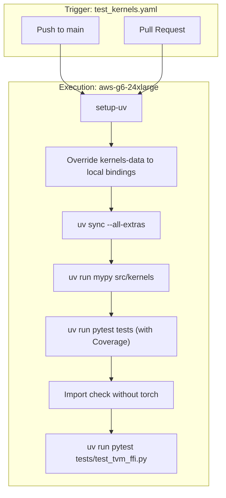
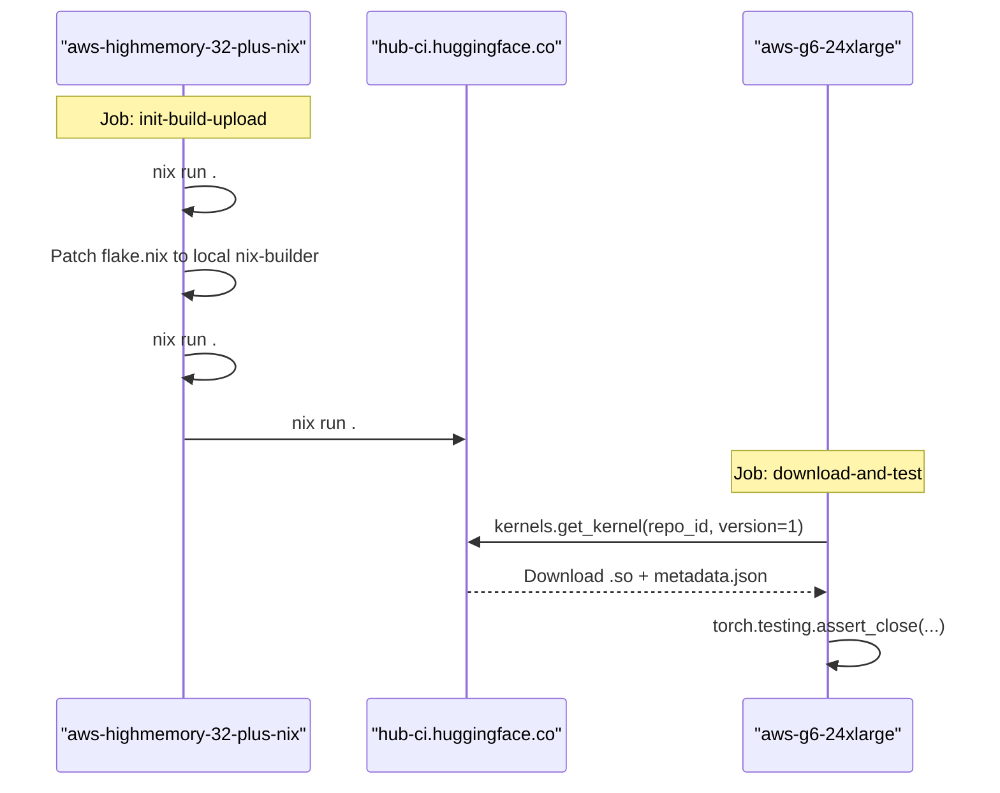

<!-- source: DeepWiki mcp.deepwiki.com · repo huggingface/kernels · page 7.3 CI/CD Pipeline · fetched 2026-10-26 -->

# CI/CD Pipeline

Relevant source files

The following files were used as context for generating this wiki page:

- [.github/ISSUE_TEMPLATE/bug_report.yml](.github/ISSUE_TEMPLATE/bug_report.yml)
- [.github/ISSUE_TEMPLATE/feature_request.yml](.github/ISSUE_TEMPLATE/feature_request.yml)
- [.github/VOUCHED.td](.github/VOUCHED.td)
- [.github/pull_request_template.md](.github/pull_request_template.md)
- [.github/workflows/build_kernel_macos.yaml](.github/workflows/build_kernel_macos.yaml)
- [.github/workflows/build_kernel_rocm.yaml](.github/workflows/build_kernel_rocm.yaml)
- [.github/workflows/build_kernel_windows.yaml](.github/workflows/build_kernel_windows.yaml)
- [.github/workflows/build_kernel_xpu.yaml](.github/workflows/build_kernel_xpu.yaml)
- [.github/workflows/check_variants.yaml](.github/workflows/check_variants.yaml)
- [.github/workflows/kernels_data_python_release.yaml](.github/workflows/kernels_data_python_release.yaml)
- [.github/workflows/lint.yml](.github/workflows/lint.yml)
- [.github/workflows/nix_checks.yml](.github/workflows/nix_checks.yml)
- [.github/workflows/publish_kernels.yml](.github/workflows/publish_kernels.yml)
- [.github/workflows/rust.yaml](.github/workflows/rust.yaml)
- [.github/workflows/security-audit.yml](.github/workflows/security-audit.yml)
- [.github/workflows/test_e2e.yaml](.github/workflows/test_e2e.yaml)
- [.github/workflows/test_extra_commands.yaml](.github/workflows/test_extra_commands.yaml)
- [.github/workflows/test_kernels.yaml](.github/workflows/test_kernels.yaml)
- [.github/workflows/test_python.yaml](.github/workflows/test_python.yaml)
- [.github/workflows/vouch-check-pr.yaml](.github/workflows/vouch-check-pr.yaml)
- [nix-builder/pkgs/python-modules/torch/binary/torch-versions-hash.json](nix-builder/pkgs/python-modules/torch/binary/torch-versions-hash.json)
- [nix-builder/pkgs/python-modules/torch/binary/torch-versions.json](nix-builder/pkgs/python-modules/torch/binary/torch-versions.json)
- [nix-builder/pkgs/python-modules/triton-xpu/default.nix](nix-builder/pkgs/python-modules/triton-xpu/default.nix)
- [nix-builder/pkgs/python-modules/triton/default.nix](nix-builder/pkgs/python-modules/triton/default.nix)

This document describes the continuous integration and continuous deployment (CI/CD) system for the kernels repository. The pipeline consists of automated workflows that test, build, and publish the `kernels` Python package, the `kernel-builder` CLI, and the `kernels-data` shared library using GitHub Actions.

## Pipeline Overview

The kernels repository uses a suite of GitHub Actions workflows to ensure code quality across multiple hardware platforms (CUDA, ROCm, XPU, Metal) and automate the distribution of software artifacts.

### Key Workflows

| Workflow | File | Purpose |
|----------|------|---------|
| **Test kernels** | `test_kernels.yaml` | Validates the Python `kernels` package across Python/Torch versions. |
| **E2E Test** | `test_e2e.yaml` | Full lifecycle test: init, build, upload to Hub, and download/load. |
| **Multi-Platform Build** | `build_kernel_*.yaml` | Validates kernel builds on ROCm, XPU, Windows, and macOS. |
| **Lints** | `lint.yml` | Code style (Ruff), API compatibility (Griffe), and dependency sync checks. |
| **Security Audit** | `security-audit.yml` | AI-assisted security review of code changes using Claude Code. |
| **Publishing** | `publish_kernels.yml` | Handles PyPI releases for the `kernels` package. |

## Test Workflow Architecture

The primary testing infrastructure focuses on the Python `kernels` package, running on GPU-enabled runners to verify native code loading and execution.

The `test_kernels.yaml` workflow uses a matrix of Python 3.10/3.14 and PyTorch 2.12.0/2.13.0 [.github/workflows/test_kernels.yaml:31-32](). It specifically overrides the `kernels-data` dependency to use local Rust bindings from the repository during CI [.github/workflows/test_kernels.yaml:47-49]().

**Sources:** [.github/workflows/test_kernels.yaml:1-115]()

## End-to-End (E2E) Pipeline

The E2E workflow simulates a developer's full journey: creating a new kernel project, building it for a specific hardware target, uploading it to a CI Hub endpoint, and then consuming it via the `kernels` library.

The E2E test uses a dummy repository ID and a dedicated CI endpoint `https://hub-ci.huggingface.co` [.github/workflows/test_e2e.yaml:21-23](). It verifies that the `kernel-builder` scaffold (generated files like `build.toml`, `flake.nix`, and `.cu` files) is valid [.github/workflows/test_e2e.yaml:56-70]().

**Sources:** [.github/workflows/test_e2e.yaml:1-154]()

## Multi-Platform Validation

To prevent regressions across hardware backends, the CI runs specialized build checks for ROCm, XPU, Windows, and macOS.

### ROCm and XPU (Nix-based)
The `build_kernel_rocm.yaml` and `build_kernel_xpu.yaml` workflows use Nix on AWS runners to build all example kernels for their respective backends [.github/workflows/build_kernel_rocm.yaml:41](), [.github/workflows/build_kernel_xpu.yaml:41]().

### Windows (PowerShell-based)
The `build_kernel_windows.yaml` workflow uses a native Windows runner with a custom PowerShell builder script `nix-builder\scripts\windows\builder.ps1` [.github/workflows/build_kernel_windows.yaml:134-143](). It includes a caching strategy for the CUDA toolkit to reduce runtime from ~7 minutes to seconds on cache hits [.github/workflows/build_kernel_windows.yaml:41-50]().

**Sources:** [.github/workflows/build_kernel_rocm.yaml:1-41](), [.github/workflows/build_kernel_xpu.yaml:1-41](), [.github/workflows/build_kernel_windows.yaml:1-143]()

## Security and Governance

### Security Audit
The `security-audit.yml` workflow performs a penetration-test-style review of changes using the Claude Code agent [.github/workflows/security-audit.yml:24](). It focuses on:
- **Trust Model:** Changes to `trust_remote_code` or trusted-org allowlists [.github/workflows/security-audit.yml:122-126]().
- **Integrity:** The chain from build to lockfile and runtime hash verification [.github/workflows/security-audit.yml:127-131]().
- **Path Traversal:** Sanitization of Hub-served metadata fields used in filesystem paths [.github/workflows/security-audit.yml:132-135]().

### Vouching System
The repository implements a "Vouch" check for PRs from external contributors. The `vouch-check-pr.yaml` workflow checks the PR author against the `.github/VOUCHED.td` file [.github/VOUCHED.td:1-19](). If the author is not vouched, the CI requires manual approval to prevent malicious code execution on GPU runners.

**Sources:** [.github/workflows/security-audit.yml:1-138](), [.github/VOUCHED.td:1-19]()

## Release Workflows

### Python Package Release
The `publish_kernels.yml` workflow automates releases of the `kernels` package to PyPI. It uses `astral-sh/setup-uv` to build the distribution and handles publishing only on tag pushes [.github/workflows/publish_kernels.yml:1-30]().

### kernels-data Python Release
The `kernels_data_python_release.yaml` workflow specifically handles the Rust-to-Python bindings. It uses `PyO3/maturin-action` to build wheels for multiple architectures (x86_64, aarch64) across Linux, Windows, and macOS [.github/workflows/kernels_data_python_release.yaml:1-50]().

**Sources:** [.github/workflows/publish_kernels.yml:1-30](), [.github/workflows/kernels_data_python_release.yaml:1-50]()

## Linting and Maintenance

The `lint.yml` workflow performs several critical checks:
1. **API Compatibility:** Uses `griffe` to check for breaking changes against the `main` branch [.github/workflows/lint.yml:48-49]().
2. **Dependency Synchronization:** Validates that `kernels-data/src/python_dependencies.json` and `kernels/src/kernels/python_depends.json` are identical [.github/workflows/lint.yml:57-58]().
3. **Style:** Runs `ruff` for linting and formatting [.github/workflows/lint.yml:23-33]().

**Sources:** [.github/workflows/lint.yml:1-58]()

---

