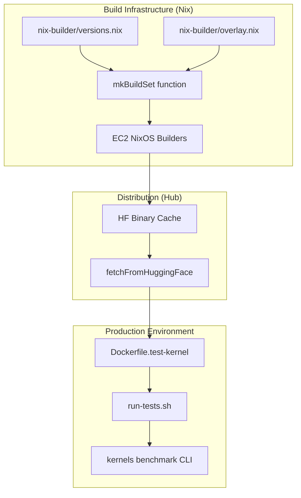

<!-- source: DeepWiki mcp.deepwiki.com · repo huggingface/kernels · page 8 Deployment · fetched 2026-10-26 -->

# Deployment

Relevant source files

The following files were used as context for generating this wiki page:

- [docs/source/builder/build-variants.md](docs/source/builder/build-variants.md)
- [flake.lock](flake.lock)
- [flake.nix](flake.nix)
- [nix-builder/build-variants.json](nix-builder/build-variants.json)
- [nix-builder/lib/mk-build-set.nix](nix-builder/lib/mk-build-set.nix)
- [nix-builder/overlay.nix](nix-builder/overlay.nix)
- [nix-builder/pkgs/aotriton/default.nix](nix-builder/pkgs/aotriton/default.nix)
- [nix-builder/pkgs/fetch-from-huggingface/default.nix](nix-builder/pkgs/fetch-from-huggingface/default.nix)
- [nix-builder/pkgs/fetch-from-huggingface/download.py](nix-builder/pkgs/fetch-from-huggingface/download.py)
- [nix-builder/pkgs/python-modules/torch/binary/generic.nix](nix-builder/pkgs/python-modules/torch/binary/generic.nix)
- [nix-builder/pkgs/rocm-packages/default.nix](nix-builder/pkgs/rocm-packages/default.nix)
- [nix-builder/pkgs/rocm-packages/overrides.nix](nix-builder/pkgs/rocm-packages/overrides.nix)
- [nix-builder/pkgs/xpu-packages/onednn-xpu.nix](nix-builder/pkgs/xpu-packages/onednn-xpu.nix)
- [nix-builder/versions.nix](nix-builder/versions.nix)

This document covers production deployment considerations for the kernels system, including Docker containerization, performance optimization, and the Nix-based build infrastructure. It focuses on operational aspects of running kernels in production environments across various hardware backends (CUDA, ROCm, XPU, Metal).

## Docker Usage

The kernels system provides robust support for containerized environments, specifically tailored for GPU-accelerated workloads. Deployment typically involves passthrough of host GPU drivers to the container.

### Testing and Validation
For testing purposes, the repository includes a specialized Dockerfile (`Dockerfile.test-kernel`) and a test runner script `nix-builder/tests/run-tests.sh` [nix-builder/tests/run-tests.sh:1-10](). These tools allow developers to validate kernel behavior in a clean, reproducible environment that mimics production constraints.

For detailed instructions on GPU passthrough, container builds, and the test runner, see **[Docker Usage](#8.1)**.

**Sources:** [nix-builder/tests/run-tests.sh:1-10]()

## Performance Optimization

Optimizing kernel performance is central to the project. The codebase provides built-in benchmarking tools to measure and visualize kernel efficiency across different backends.

### Benchmarking Infrastructure
The `kernels benchmark` CLI command serves as the entry point for performance analysis. The underlying logic is handled by the `benchmark.py` and `benchmark_graphics.py` modules, which can generate visual outputs in SVG, PNG, or GIF formats to help developers interpret results.

Key optimization targets include:
* **Activation Benchmarks**: Measuring throughput and latency for various activation functions.
* **Backend Comparisons**: Comparing performance across CUDA, ROCm, and Intel XPU targets.

For details on interpreting results and using the benchmarking CLI, see **[Performance Optimization](#8.2)**.

## Build Infrastructure

The project utilizes a sophisticated Nix-based build system to solve ABI fragmentation and "dependency hell" across different hardware and software versions.

### Nix-based Build Sets
The build infrastructure is centered around the `nix-builder` overlay [nix-builder/overlay.nix:1-211](). It uses factory functions like `mkBuildSets` and `mkBuildSet` [nix-builder/lib/mk-build-set.nix:1-168]() to generate a comprehensive matrix of build variants based on the version specifications in `nix-builder/versions.nix` [nix-builder/versions.nix:1-225]().

### Hardware and Software Matrix
The system supports a wide array of configurations, including:
* **PyTorch Versions**: 2.11 through 2.14 [nix-builder/versions.nix:1-225]().
* **Compute Backends**: CUDA (12.6, 13.0, 13.2), ROCm (7.1, 7.2), and Intel XPU (2025.3, 2026.0) [nix-builder/versions.nix:1-225]().
* **Provisioning**: Terraform scripts are used to provision high-performance NixOS build machines on EC2 (e.g., `m7i.8xlarge` instances).

### Binary Caching
To avoid expensive rebuilds of large dependencies like PyTorch or the ROCm toolkit, the project utilizes a Hugging Face binary cache [flake.nix:5-9]().

For a deep dive into the Nix overlay system and cloud build machine provisioning, see **[Build Infrastructure](#8.3)**.

**Sources:** [nix-builder/overlay.nix:1-211](), [nix-builder/lib/mk-build-set.nix:1-168](), [nix-builder/versions.nix:1-225](), [flake.nix:5-9]()

## Deployment Architecture

**Sources:** [nix-builder/overlay.nix:8-36](), [nix-builder/lib/mk-build-set.nix:107-121](), [nix-builder/versions.nix:1-10](), [flake.nix:4-9]()

## Build Variant Mapping

The deployment system relies on a strict naming convention for build variants to ensure the correct binary is loaded for the host environment.

| Backend | Platform | Example Variant Name |
| :--- | :--- | :--- |
| **CUDA** | x86_64-linux | `torch214-cxx11-cu132-x86_64-linux` |
| **ROCm** | x86_64-linux | `torch214-cxx11-rocm72-x86_64-linux` |
| **XPU** | x86_64-linux | `torch214-cxx11-xpu20261-x86_64-linux` |
| **Metal** | aarch64-darwin | `torch214-metal-aarch64-darwin` |

**Sources:** [nix-builder/build-variants.json:2-61](), [docs/source/builder/build-variants.md:8-68]()

---

