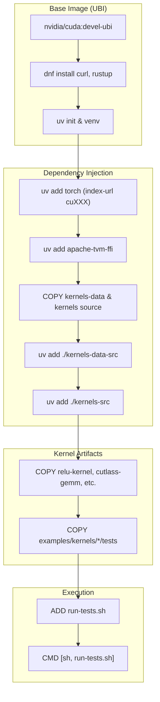
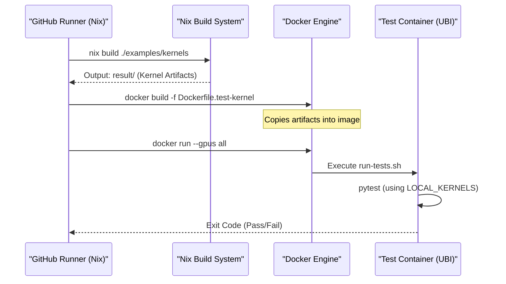

<!-- source: DeepWiki mcp.deepwiki.com · repo huggingface/kernels · page 8.1 Docker Usage · fetched 2026-10-26 -->

# Docker Usage

Relevant source files

The following files were used as context for generating this wiki page:

- [.github/workflows/build_kernel.yaml](.github/workflows/build_kernel.yaml)
- [examples/kernels/flake.nix](examples/kernels/flake.nix)
- [nix-builder/lib/build.nix](nix-builder/lib/build.nix)
- [nix-builder/lib/extension/torch/arch.nix](nix-builder/lib/extension/torch/arch.nix)
- [nix-builder/lib/extension/torch/no-arch.nix](nix-builder/lib/extension/torch/no-arch.nix)
- [nix-builder/lib/extension/tvm-ffi/arch.nix](nix-builder/lib/extension/tvm-ffi/arch.nix)
- [nix-builder/lib/gen-flake-outputs.nix](nix-builder/lib/gen-flake-outputs.nix)
- [nix-builder/lib/source-set.nix](nix-builder/lib/source-set.nix)
- [nix-builder/pkgs/get-kernel-check/default.nix](nix-builder/pkgs/get-kernel-check/default.nix)
- [nix-builder/pkgs/get-kernel-check/get-kernel-check-hook.sh](nix-builder/pkgs/get-kernel-check/get-kernel-check-hook.sh)
- [nix-builder/scripts/windows/builder.ps1](nix-builder/scripts/windows/builder.ps1)
- [nix-builder/tests/Dockerfile.test-kernel](nix-builder/tests/Dockerfile.test-kernel)
- [nix-builder/tests/run-tests.sh](nix-builder/tests/run-tests.sh)

Using kernels in Docker containers requires proper configuration of GPU passthrough, backend-specific drivers, and optimized build environments. The `kernels` repository provides dedicated tools and Dockerfiles for testing kernels across different Linux distributions and hardware backends.

## Testing Kernels in Docker

The primary mechanism for validating kernels in a containerized environment is `nix-builder/tests/Dockerfile.test-kernel`. This Dockerfile is designed to test built kernel artifacts against specific versions of PyTorch and CUDA within a Red Hat Universal Base Image (UBI) environment.

### Dockerfile.test-kernel Architecture

The test container follows a multi-stage process to prepare a runtime environment that mirrors production deployments while allowing for local artifact injection.

Sources: [nix-builder/tests/Dockerfile.test-kernel:1-95]()

### GPU Passthrough Configuration

To execute kernels within the container, the NVIDIA runtime must be correctly configured. The Dockerfile sets environment variables to ensure the container can see the host's GPU hardware and utilize compute capabilities.

| Variable | Value | Purpose |
| :--- | :--- | :--- |
| `NVIDIA_VISIBLE_DEVICES` | `all` | Exposes all host GPUs to the container [nix-builder/tests/Dockerfile.test-kernel:14]() |
| `NVIDIA_DRIVER_CAPABILITIES` | `compute,utility` | Enables CUDA compute and monitoring tools [nix-builder/tests/Dockerfile.test-kernel:15]() |
| `CUDA_VISIBLE_DEVICES` | `""` (Optional) | Used in `run-tests.sh` to force CPU-only testing for specific variants [nix-builder/tests/run-tests.sh:31-35]() |

## Automated Test Runner (`run-tests.sh`)

The `nix-builder/tests/run-tests.sh` script acts as the entry point for the test container. It maps built kernel directories to the `LOCAL_KERNELS` environment variable, allowing the `kernels` library to load local artifacts instead of downloading them from the Hugging Face Hub.

### Implementation Details

1.  **Path Expansion**: The script uses shell expansion to find the specific variant directory (e.g., `relu-kernel/torch*`) because the exact variant name depends on the build matrix [nix-builder/tests/run-tests.sh:4-15]().
2.  **Environment Mapping**: It constructs a colon-separated list for `LOCAL_KERNELS` in the format `repo/name=path` [nix-builder/tests/run-tests.sh:17-21]().
3.  **Test Execution**: It runs `pytest` against the copied test suites for each kernel type (Torch, TVM FFI, Triton, CPU) [nix-builder/tests/run-tests.sh:18-36]().

Sources: [nix-builder/tests/run-tests.sh:1-36]()

## Container-Based Kernel Builds

While the `nix-builder` primarily uses Nix for reproducible builds, the repository includes a PowerShell wrapper (`nix-builder/scripts/windows/builder.ps1`) and GitHub Actions workflows that facilitate containerized or cross-platform builds.

### CI Build Workflow

The `.github/workflows/build_kernel.yaml` workflow demonstrates the lifecycle of building kernels in a Nix-enabled runner and then testing them inside a Docker container.

Sources: [.github/workflows/build_kernel.yaml:46-96]()

## Build System Integration

The Nix build system (`nix-builder/lib/build.nix`) supports various hardware backends that are often containerized:
- **CUDA**: Requires `cuda_nvcc` and `cuda_cudart` [nix-builder/lib/extension/torch/arch.nix:205-208]().
- **ROCm**: Uses `clr` (Compute Language Runtime) and specialized libraries like `hipcub` [nix-builder/lib/extension/torch/arch.nix:217-226]().
- **XPU**: Requires Intel `oneapi-torch-dev` and `onednn-xpu` [nix-builder/lib/extension/torch/arch.nix:229-232]().

### RPATH Management
In Docker environments where Nix is not present at runtime, the build system provides a `stripRPath` option [nix-builder/lib/extension/torch/arch.nix:69](). This is critical for portability, as it prevents the kernel from looking for dependencies in absolute Nix store paths that do not exist inside a standard Docker container.

Sources: [nix-builder/lib/build.nix:115](), [nix-builder/lib/extension/torch/arch.nix:69-70]()

---

