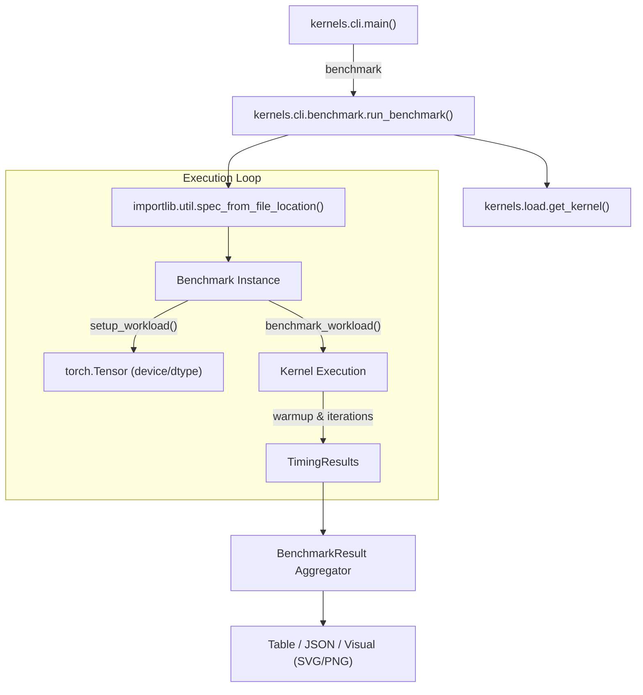
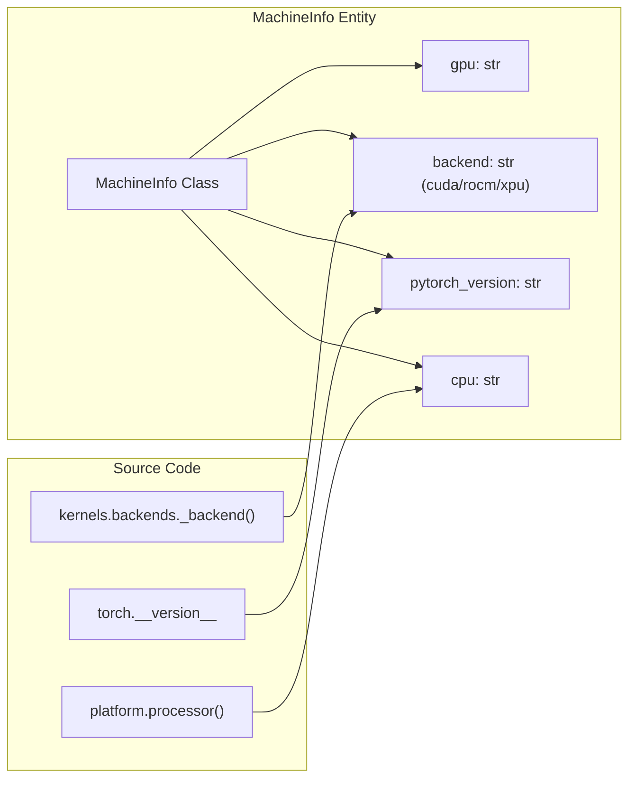

<!-- source: DeepWiki mcp.deepwiki.com · repo huggingface/kernels · page 8.2 Performance Optimization · fetched 2026-10-26 -->

# 8.2 Performance Optimization

Relevant source files

The following files were used as context for generating this wiki page:

- [kernels/src/kernels/__init__.py](kernels/src/kernels/__init__.py)
- [kernels/src/kernels/benchmark.py](kernels/src/kernels/benchmark.py)
- [kernels/src/kernels/benchmarks/activation.py](kernels/src/kernels/benchmarks/activation.py)
- [kernels/src/kernels/cli/__init__.py](kernels/src/kernels/cli/__init__.py)
- [kernels/src/kernels/cli/benchmark.py](kernels/src/kernels/cli/benchmark.py)
- [kernels/src/kernels/cli/verify_signature.py](kernels/src/kernels/cli/verify_signature.py)
- [kernels/src/kernels/deps.py](kernels/src/kernels/deps.py)
- [kernels/src/kernels/layer/func.py](kernels/src/kernels/layer/func.py)
- [kernels/src/kernels/layer/layer.py](kernels/src/kernels/layer/layer.py)
- [kernels/tests/test_dirty_provenance.py](kernels/tests/test_dirty_provenance.py)
- [kernels/tests/test_loaded_kernels.py](kernels/tests/test_loaded_kernels.py)
- [kernels/tests/test_verify.py](kernels/tests/test_verify.py)

This document covers the benchmarking infrastructure and performance optimization strategies within the `kernels` repository. It focuses on the `kernels benchmark` CLI, the underlying `Benchmark` class, and methodologies for interpreting results across different hardware backends (CUDA, ROCm, XPU).

## Benchmarking Framework

The `kernels` package provides a structured framework for measuring kernel performance, comparing against reference implementations, and visualizing results.

### The `Benchmark` Base Class

Kernel authors define benchmarks by subclassing `kernels.benchmark.Benchmark` [kernels/src/kernels/benchmark.py:4-38](). This class provides a standard interface for setup, execution, and verification.

*   **`setup()`**: Used to initialize tensors and state. Sub-workloads can define specific setups like `setup_small()` [kernels/src/kernels/benchmarks/activation.py:11-13]().
*   **`benchmark_<name>()`**: Contains the code to be timed [kernels/src/kernels/benchmarks/activation.py:15-16]().
*   **`verify_<name>()`**: Returns a reference `torch.Tensor`. The runner automatically compares the kernel output (`self.out`) against this reference to ensure correctness [kernels/src/kernels/benchmark.py:22-25]().

### Data Flow: From CLI to Results

The following diagram illustrates how the `kernels benchmark` command interacts with the benchmark modules and hardware backends.

**Benchmark Execution Flow**

Sources: [kernels/src/kernels/cli/__init__.py:68-103](), [kernels/src/kernels/cli/benchmark.py:245-310](), [kernels/src/kernels/benchmark.py:4-38]()

## CLI Command: `kernels benchmark`

The CLI tool allows users to run benchmarks for any kernel hosted on the Hugging Face Hub or stored locally.

| Argument | Description | Source |
| :--- | :--- | :--- |
| `repo_id` | The Hub repository ID (e.g., `kernels-community/activation`). | [kernels/src/kernels/cli/__init__.py:72-76]() |
| `--iterations` | Number of timed iterations (default: 100). | [kernels/src/kernels/cli/__init__.py:90]() |
| `--warmup` | Number of untimed warmup iterations (default: 10). | [kernels/src/kernels/cli/__init__.py:91]() |
| `--visual` | Base path for saving SVG/PNG/GIF performance plots. | [kernels/src/kernels/cli/__init__.py:93-97]() |
| `--rasterized` | Output PNG/GIF formats instead of SVG. | [kernels/src/kernels/cli/__init__.py:99-102]() |
| `--json` | Print full JSON results to stdout. | [kernels/src/kernels/cli/__init__.py:86-89]() |

### Interpreting Results

The benchmark runner calculates several statistical metrics to ensure reliability:
*   **Mean/Std/Min/Max**: Standard timing metrics in milliseconds [kernels/src/kernels/cli/benchmark.py:77-80]().
*   **IQR (Interquartile Range)**: Calculated using the 25th (`q1`) and 75th (`q3`) percentiles to measure spread [kernels/src/kernels/cli/benchmark.py:61-64]().
*   **Outliers**: Values outside `[Q1 - 1.5*IQR, Q3 + 1.5*IQR]` are counted to identify noise in the compute environment [kernels/src/kernels/cli/benchmark.py:67-69]().
*   **Speedup**: If a `verify` method exists, the runner measures the reference PyTorch implementation and calculates the ratio `Ref Time / Kernel Time` [kernels/src/kernels/cli/benchmark.py:182-183]().

Sources: [kernels/src/kernels/cli/benchmark.py:45-71](), [kernels/src/kernels/cli/benchmark.py:161-216]()

## Visualization and Reporting

The `benchmark_graphics.py` module (referenced via `--visual`) generates visual representations of performance data.

*   **SVG/PNG Outputs**: Generates light and dark mode variants of performance plots [kernels/src/kernels/cli/__init__.py:96-97]().
*   **GIF Animation**: Can produce animated visualizations showing performance across different iterations or workloads [kernels/src/kernels/cli/__init__.py:99-102]().
*   **JSON Payloads**: For automated tracking, the `BenchmarkResult.to_payload()` method generates a structured dictionary containing `machineInfo` (GPU, CPU, OS, PyTorch version) and `timingResults` [kernels/src/kernels/cli/benchmark.py:111-158]().

**Machine Metadata Mapping**

Sources: [kernels/src/kernels/cli/benchmark.py:99-108](), [kernels/src/kernels/cli/benchmark.py:255-265]()

## Optimization Strategies

### Memory and Precision
Benchmarks typically utilize `torch.float16` and pre-allocated output tensors to minimize allocation overhead during timed loops.
*   **Pre-allocation**: Output tensors are created in `setup()` using `torch.empty()` or `torch.empty_like()` [kernels/src/kernels/benchmarks/activation.py:13]().
*   **Precision**: `float16` is preferred for GPU backends to leverage Tensor Cores (CUDA) or Matrix Cores (ROCm) [kernels/src/kernels/benchmarks/activation.py:12]().

### Workload Scaling
The activation benchmarks (e.g., `SiluAndMulBenchmark`) categorize workloads into `small`, `medium`, and `large` to evaluate how kernels scale with increasing sequence lengths and hidden dimensions [kernels/src/kernels/benchmarks/activation.py:7-47]().

### Backend Specifics
*   **CUDA**: Uses `torch.cuda.synchronize()` to ensure accurate timing of asynchronous GPU kernels [kernels/src/kernels/cli/benchmark.py:339]().
*   **ROCm/XPU**: The `MachineInfo` captures the specific backend to allow for cross-hardware performance comparisons in the JSON logs [kernels/src/kernels/cli/benchmark.py:102]().

Sources: [kernels/src/kernels/benchmarks/activation.py:1-85](), [kernels/src/kernels/cli/benchmark.py:99-108]()

---

