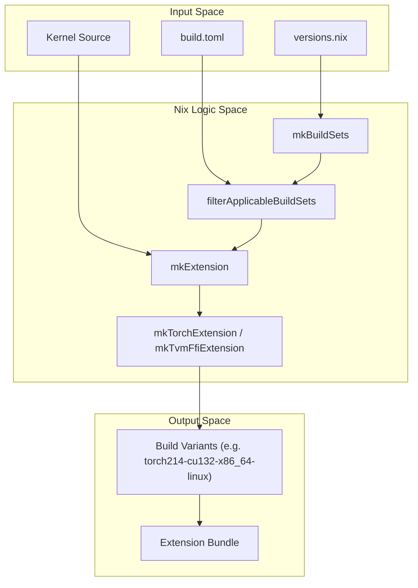
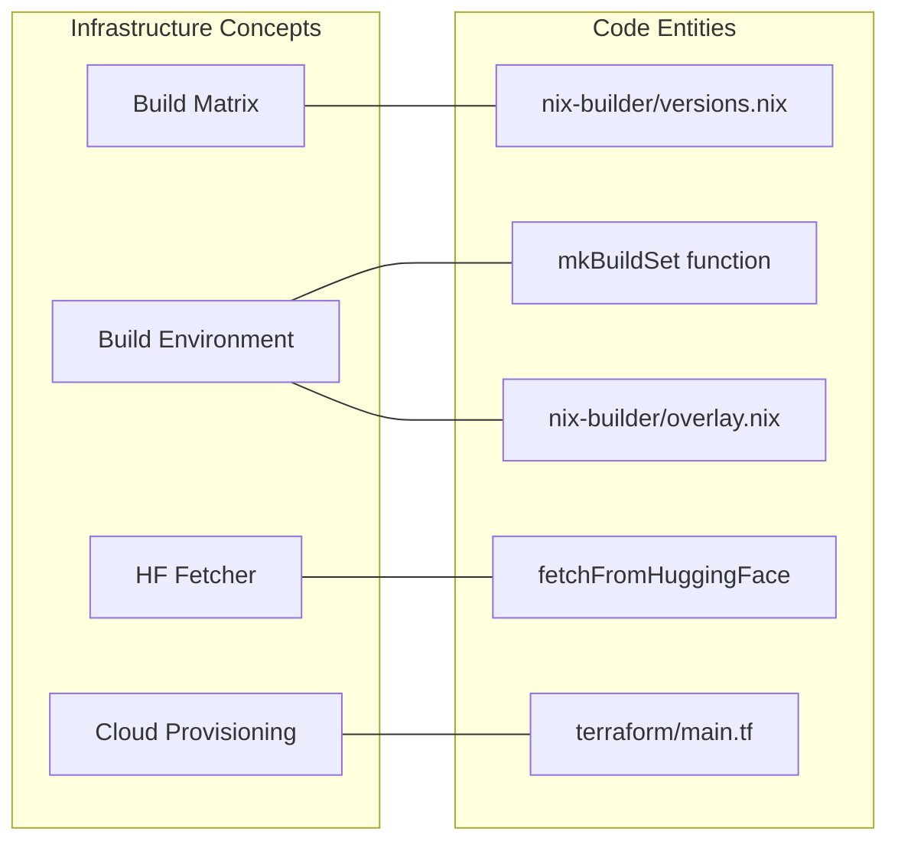

<!-- source: DeepWiki mcp.deepwiki.com · repo huggingface/kernels · page 8.3 Build Infrastructure · fetched 2026-10-26 -->

# Build Infrastructure

Relevant source files

The following files were used as context for generating this wiki page:

- [docs/source/builder/build-variants.md](docs/source/builder/build-variants.md)
- [flake.lock](flake.lock)
- [flake.nix](flake.nix)
- [nix-builder/build-variants.json](nix-builder/build-variants.json)
- [nix-builder/lib/build.nix](nix-builder/lib/build.nix)
- [nix-builder/lib/extension/torch/arch.nix](nix-builder/lib/extension/torch/arch.nix)
- [nix-builder/lib/extension/torch/no-arch.nix](nix-builder/lib/extension/torch/no-arch.nix)
- [nix-builder/lib/extension/tvm-ffi/arch.nix](nix-builder/lib/extension/tvm-ffi/arch.nix)
- [nix-builder/lib/gen-flake-outputs.nix](nix-builder/lib/gen-flake-outputs.nix)
- [nix-builder/lib/mk-build-set.nix](nix-builder/lib/mk-build-set.nix)
- [nix-builder/lib/source-set.nix](nix-builder/lib/source-set.nix)
- [nix-builder/overlay.nix](nix-builder/overlay.nix)
- [nix-builder/pkgs/aotriton/default.nix](nix-builder/pkgs/aotriton/default.nix)
- [nix-builder/pkgs/fetch-from-huggingface/default.nix](nix-builder/pkgs/fetch-from-huggingface/default.nix)
- [nix-builder/pkgs/fetch-from-huggingface/download.py](nix-builder/pkgs/fetch-from-huggingface/download.py)
- [nix-builder/pkgs/get-kernel-check/default.nix](nix-builder/pkgs/get-kernel-check/default.nix)
- [nix-builder/pkgs/get-kernel-check/get-kernel-check-hook.sh](nix-builder/pkgs/get-kernel-check/get-kernel-check-hook.sh)
- [nix-builder/pkgs/python-modules/torch/binary/generic.nix](nix-builder/pkgs/python-modules/torch/binary/generic.nix)
- [nix-builder/pkgs/rocm-packages/default.nix](nix-builder/pkgs/rocm-packages/default.nix)
- [nix-builder/pkgs/rocm-packages/overrides.nix](nix-builder/pkgs/rocm-packages/overrides.nix)
- [nix-builder/pkgs/xpu-packages/onednn-xpu.nix](nix-builder/pkgs/xpu-packages/onednn-xpu.nix)
- [nix-builder/scripts/windows/builder.ps1](nix-builder/scripts/windows/builder.ps1)
- [nix-builder/versions.nix](nix-builder/versions.nix)
- [terraform/.gitignore](terraform/.gitignore)
- [terraform/README.md](terraform/README.md)
- [terraform/main.tf](terraform/main.tf)
- [terraform/nixos-configuration.nix](terraform/nixos-configuration.nix)
- [terraform/outputs.tf](terraform/outputs.tf)
- [terraform/terraform.tfvars.example](terraform/terraform.tfvars.example)
- [terraform/variables.tf](terraform/variables.tf)

The `kernels` repository utilizes a sophisticated Nix-based build infrastructure to solve the challenges of ABI fragmentation and dependency management across diverse hardware backends (CUDA, ROCm, XPU, Metal, CPU). This infrastructure automates the creation of reproducible build environments, manages a complex matrix of PyTorch and hardware driver versions, and provisions cloud-based build machines via Terraform.

## Nix Build System Architecture

The build system is centered around a Nix Flake that defines the environment and build logic for all kernel variants. It extends standard `nixpkgs` with machine-learning-specific packages and custom build hooks [nix-builder/overlay.nix:8-11]().

### The Overlay System
The `nix-builder/overlay.nix` file provides the core extensions to the Nix package set. It includes:
*   **Custom Hooks**: `cmakeNvccThreadsHook` for parallelizing NVCC builds [nix-builder/overlay.nix:13-13](), `hash-kernel-hook` for integrity, and `kernel-layout-check` for compliance [nix-builder/overlay.nix:21-23]().
*   **Framework Overrides**: Patches for `ucx` and `ucc` to ensure CUDA support and parallel builds [nix-builder/overlay.nix:55-69]().
*   **Python Modules**: Custom derivations for `triton` (CUDA/ROCm/XPU variants) [nix-builder/overlay.nix:77-92](), `huggingface-hub`, and the `kernels` package itself [nix-builder/overlay.nix:107-195]().

### Build Set Factory Functions
To manage the version matrix, the system uses "Build Sets". A build set is an attribute set containing a specific Nixpkgs instance and a corresponding PyTorch derivation [nix-builder/lib/build.nix:5-9]().

*   **`mkBuildSets`**: A high-level function that takes a list of target systems and version specifications (from `versions.nix`) to generate all valid build combinations [flake.nix:41-44]().
*   **`mkBuildSet`**: The internal factory that constructs the specific environment for a single combination (e.g., Torch 2.14 + CUDA 13.2 on x86_64-linux) [nix-builder/lib/mk-build-set.nix]().

### Build Logic Flow

The following diagram illustrates how the Nix infrastructure transforms a kernel source into a multi-variant bundle.

**Kernel Build Pipeline**

**Sources:** [nix-builder/lib/build.nix:33-95](), [nix-builder/lib/build.nix:101-200](), [flake.nix:58-59]()

## Hardware Backend Support

The infrastructure provides specialized support for different compute backends through specific Nix modules:

| Backend | Key Components / Implementation |
| :--- | :--- |
| **CUDA** | Uses `cudaPackages.setupCudaHook` and `cmakeNvccThreadsHook`. Manages `ptxas` and `nvcc` parallelism [nix-builder/lib/extension/torch/arch.nix:186-189](). |
| **ROCm** | Utilizes `rocmtoolkit_joined` to merge disparate ROCm components into a single path. Includes `aotriton` for pre-compiled Triton kernels [nix-builder/pkgs/python-modules/torch/binary/generic.nix:89-135](). |
| **XPU** | Integrates Intel OneAPI components like `onednn-xpu`, `ocloc`, and `oneapi-torch-dev` [nix-builder/lib/extension/torch/arch.nix:229-232](). |
| **Metal** | Uses a specialized `xcrunHost` wrapper to access the host macOS Metal toolchain from within the Nix sandbox [nix-builder/lib/extension/torch/arch.nix:114-118](). |

**Sources:** [nix-builder/lib/extension/torch/arch.nix:186-234](), [nix-builder/pkgs/python-modules/torch/binary/generic.nix:89-135]()

## Cloud Build Infrastructure

The project uses Terraform to provision high-performance NixOS build machines on AWS EC2.

### Build Machine Specifications
The standard build node is defined in `terraform/variables.tf`:
*   **Instance Type**: `m7i.8xlarge` (32 vCPUs, 128 GiB RAM) [terraform/variables.tf:26-30]().
*   **Storage**: 
    *   200 GiB root volume (GP3).
    *   1 TiB dedicated data volume for the Nix store and build artifacts [terraform/main.tf:65-80]().
*   **OS**: NixOS, allowing for fully declarative machine configuration via `terraform/nixos-configuration.nix`.

### Binary Cache
To avoid expensive rebuilds of large dependencies like PyTorch or the ROCm toolkit, the infrastructure integrates with a Hugging Face binary cache hosted on Cachix [flake.nix:4-9]().
*   **Substituter**: `https://huggingface.cachix.org`
*   **Trusted Public Key**: `huggingface.cachix.org-1:ynTPbLS0W8ofXd9fDjk1KvoFky9K2jhxe6r4nXAkc/o=`

**Sources:** [terraform/main.tf:65-80](), [terraform/variables.tf:26-30](), [flake.nix:4-9]()

## Specialized Nix Fetchers

### `fetchFromHuggingFace`
A custom Nix fetcher designed to retrieve assets directly from the Hugging Face Hub. It is used primarily for downloading pre-built binary dependencies or large model weights required during the build or test phase [nix-builder/overlay.nix:15-15]().

### `fetchKernelDeps`
Automates the resolution and fetching of C++ dependencies specified in a kernel's `build.toml`. It ensures that third-party libraries (like CUTLASS) are available in the Nix sandbox during compilation [nix-builder/overlay.nix:17-17](), [nix-builder/lib/build.nix:139-139]().

## Code Entity Map

The following diagram bridges the conceptual build infrastructure to the specific code entities implementing it.

**Infrastructure Entity Mapping**

**Sources:** [nix-builder/versions.nix:1-225](), [nix-builder/lib/mk-build-set.nix](), [nix-builder/overlay.nix:1-35](), [terraform/main.tf:1-100]()

---

