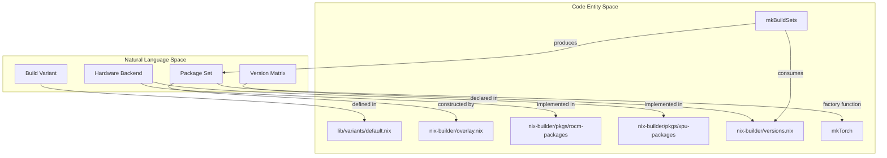
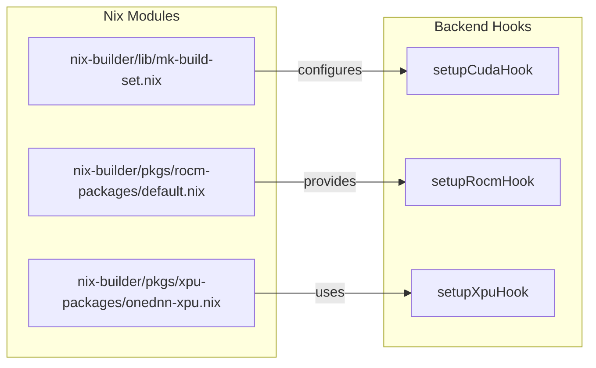

<!-- source: DeepWiki mcp.deepwiki.com · repo huggingface/kernels · page 9 Nix Build System Deep Dive · fetched 2026-10-26 -->

# Nix Build System Deep Dive

Relevant source files

The following files were used as context for generating this wiki page:

- [docs/source/builder/build-variants.md](docs/source/builder/build-variants.md)
- [flake.lock](flake.lock)
- [flake.nix](flake.nix)
- [nix-builder/build-variants.json](nix-builder/build-variants.json)
- [nix-builder/lib/mk-build-set.nix](nix-builder/lib/mk-build-set.nix)
- [nix-builder/overlay.nix](nix-builder/overlay.nix)
- [nix-builder/pkgs/aotriton/default.nix](nix-builder/pkgs/aotriton/default.nix)
- [nix-builder/pkgs/fetch-from-huggingface/default.nix](nix-builder/pkgs/fetch-from-huggingface/default.nix)
- [nix-builder/pkgs/fetch-from-huggingface/download.py](nix-builder/pkgs/fetch-from-huggingface/download.py)
- [nix-builder/pkgs/python-modules/torch/binary/generic.nix](nix-builder/pkgs/python-modules/torch/binary/generic.nix)
- [nix-builder/pkgs/rocm-packages/default.nix](nix-builder/pkgs/rocm-packages/default.nix)
- [nix-builder/pkgs/rocm-packages/overrides.nix](nix-builder/pkgs/rocm-packages/overrides.nix)
- [nix-builder/pkgs/xpu-packages/onednn-xpu.nix](nix-builder/pkgs/xpu-packages/onednn-xpu.nix)
- [nix-builder/versions.nix](nix-builder/versions.nix)

The `kernels` repository utilizes a sophisticated Nix-based build infrastructure to solve the "CUDA version hell" and ABI fragmentation common in machine learning environments. This system ensures that every kernel is built against a precise matrix of PyTorch versions, compute backends (CUDA, ROCm, XPU, Metal), and hardware architectures.

The core logic resides within the `nix-builder/` directory, providing a reproducible environment that generates binary-compatible artifacts for distribution via the Hugging Face Hub.

### System Architecture Overview

The build system is structured as a Nix Flake that defines a complex matrix of "Build Sets." Each Build Set is a self-contained Nixpkgs instance tailored to a specific environment (e.g., PyTorch 2.14 + CUDA 13.2 on x86_64 Linux).

#### Build Entity Mapping
The following diagram illustrates how high-level build concepts map to specific Nix code entities.

**Build Infrastructure Mapping**

*Sources: [flake.nix:41-47](), [nix-builder/lib/mk-build-set.nix:107-168](), [nix-builder/versions.nix:1-225]()*

### Nix Overlay and Package Sets
The foundation of the build system is a custom Nix overlay that extends `nixpkgs` with machine-learning-specific tools and pinned versions of critical libraries. This includes specialized fetchers like `fetchFromHuggingFace` and the `mkTorch` factory function which handles the complex task of patching binary PyTorch wheels to work within the Nix sandbox.

Key components of the overlay include:
*   **Triton Variants**: Specific derivations for `triton-cuda`, `triton-rocm`, and `triton-xpu` [nix-builder/overlay.nix:77-92]().
*   **Binary PyTorch**: The `mkTorch` function manages `RPATH` via `autoPatchelfHook` and handles hardware-specific dependencies [nix-builder/pkgs/python-modules/torch/binary/generic.nix:190-252]().
*   **Custom Fetchers**: `fetchFromHuggingFace` allows the build system to pull assets directly from the Hub during the build process [nix-builder/overlay.nix:15]().

For details, see [Nix Overlay and Package Sets](#9.1).

### Build Variants and Version Matrix
A "Build Variant" is a unique string (e.g., `torch214-cxx11-cu132-x86_64-linux`) that identifies a specific target environment. The system manages a large matrix of these variants, defined in `versions.nix`.

| Component | Supported Versions |
| :--- | :--- |
| **PyTorch** | 2.11, 2.12, 2.13, 2.14 |
| **CUDA** | 12.6, 13.0, 13.2 |
| **ROCm** | 7.1, 7.2 |
| **XPU** | 2025.3.2, 2026.0.0, 2026.1.0 |

The `mkBuildSets` function [flake.nix:44]() processes this matrix to generate the complete list of buildable targets.

For details, see [Build Variants and Version Matrix](#9.2).

### Hardware Backend Support
Each compute backend requires specific Nix integration to ensure drivers and compilers are correctly linked.

**Backend Integration Logic**

*Sources: [nix-builder/lib/mk-build-set.nix:31-63](), [nix-builder/pkgs/python-modules/torch/binary/generic.nix:192-198]()*

*   **CUDA**: Uses `overlayForCudaVersion` to override `cudaPackages` and provides a mechanism to swap `ptxas` versions for compatibility [nix-builder/lib/mk-build-set.nix:32-55]().
*   **ROCm**: Utilizes `rocmtoolkit_joined` to merge disparate ROCm components into a single `ROCM_PATH` environment [nix-builder/pkgs/python-modules/torch/binary/generic.nix:89-135]().
*   **XPU**: Integrates Intel OneAPI components like `onednn-xpu` and uses the `icx`/`icpx` compilers for SYCL kernels [nix-builder/pkgs/xpu-packages/onednn-xpu.nix:50-59]().

For details, see [Hardware Backend Support](#9.3).

### Binary Caching
To avoid expensive rebuilds of heavy dependencies (like PyTorch or the ROCm toolkit), the system is configured to use a dedicated Hugging Face binary cache at `https://huggingface.cachix.org` [flake.nix:4-9]().

*Sources: [flake.nix:1-9](), [nix-builder/overlay.nix:1-35](), [nix-builder/lib/mk-build-set.nix:1-168](), [nix-builder/versions.nix:1-225]()*

---

