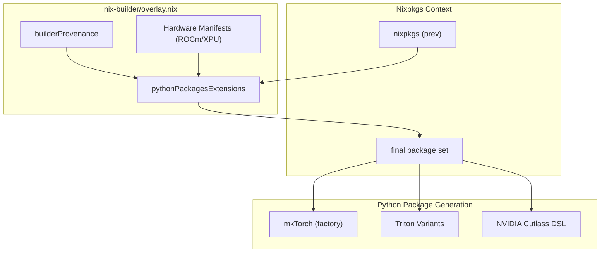
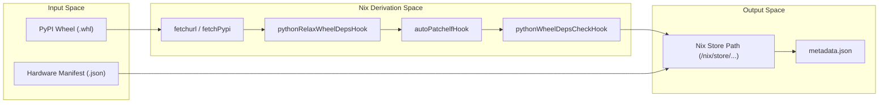

<!-- source: DeepWiki mcp.deepwiki.com · repo huggingface/kernels · page 9.1 Nix Overlay and Package Sets · fetched 2026-10-26 -->

# Nix Overlay and Package Sets

Relevant source files

The following files were used as context for generating this wiki page:

- [docs/source/builder/build-variants.md](docs/source/builder/build-variants.md)
- [nix-builder/build-variants.json](nix-builder/build-variants.json)
- [nix-builder/overlay.nix](nix-builder/overlay.nix)
- [nix-builder/pkgs/aotriton/default.nix](nix-builder/pkgs/aotriton/default.nix)
- [nix-builder/pkgs/python-modules/hooks/python-wheel-deps-check-hook.sh](nix-builder/pkgs/python-modules/hooks/python-wheel-deps-check-hook.sh)
- [nix-builder/pkgs/python-modules/nvidia-cuda-nvdisasm/default.nix](nix-builder/pkgs/python-modules/nvidia-cuda-nvdisasm/default.nix)
- [nix-builder/pkgs/python-modules/nvidia-cutlass-dsl-libs-core/default.nix](nix-builder/pkgs/python-modules/nvidia-cutlass-dsl-libs-core/default.nix)
- [nix-builder/pkgs/python-modules/nvidia-cutlass-dsl-libs-cu/default.nix](nix-builder/pkgs/python-modules/nvidia-cutlass-dsl-libs-cu/default.nix)
- [nix-builder/pkgs/python-modules/nvidia-cutlass-dsl-libs/default.nix](nix-builder/pkgs/python-modules/nvidia-cutlass-dsl-libs/default.nix)
- [nix-builder/pkgs/python-modules/nvidia-cutlass-dsl/default.nix](nix-builder/pkgs/python-modules/nvidia-cutlass-dsl/default.nix)
- [nix-builder/pkgs/python-modules/torch/binary/generic.nix](nix-builder/pkgs/python-modules/torch/binary/generic.nix)
- [nix-builder/pkgs/rocm-packages/clr.nix](nix-builder/pkgs/rocm-packages/clr.nix)
- [nix-builder/pkgs/rocm-packages/components.nix](nix-builder/pkgs/rocm-packages/components.nix)
- [nix-builder/pkgs/rocm-packages/default.nix](nix-builder/pkgs/rocm-packages/default.nix)
- [nix-builder/pkgs/rocm-packages/manifests/7.1.1.json](nix-builder/pkgs/rocm-packages/manifests/7.1.1.json)
- [nix-builder/pkgs/rocm-packages/manifests/7.2.1.json](nix-builder/pkgs/rocm-packages/manifests/7.2.1.json)
- [nix-builder/pkgs/rocm-packages/mk-packages.nix](nix-builder/pkgs/rocm-packages/mk-packages.nix)
- [nix-builder/pkgs/xpu-packages/components.nix](nix-builder/pkgs/xpu-packages/components.nix)
- [nix-builder/pkgs/xpu-packages/default.nix](nix-builder/pkgs/xpu-packages/default.nix)
- [nix-builder/pkgs/xpu-packages/manifests/2025.3.2.json](nix-builder/pkgs/xpu-packages/manifests/2025.3.2.json)
- [nix-builder/pkgs/xpu-packages/manifests/2026.0.0.json](nix-builder/pkgs/xpu-packages/manifests/2026.0.0.json)
- [nix-builder/pkgs/xpu-packages/onednn-xpu.nix](nix-builder/pkgs/xpu-packages/onednn-xpu.nix)
- [nix-builder/versions.nix](nix-builder/versions.nix)

The `nix-builder` infrastructure uses a Nix overlay to extend standard `nixpkgs` with machine-learning-specific packages, custom hardware toolchains (ROCm, XPU), and optimized PyTorch binary distributions. This system ensures that all kernels are built against a consistent, reproducible set of dependencies that match the target runtime environments.

## Overlay Structure

The primary entry point is `nix-builder/overlay.nix`, which defines how the `kernels` repository modifies the Nix package set. It handles local package definitions, Python module extensions, and overrides for standard Nix packages to enable GPU support.

### Key Components of the Overlay
*   **Local Tools**: Packages like `kernel-builder` [nix-builder/overlay.nix:11](), `fetchFromHuggingFace` [nix-builder/overlay.nix:15](), and various verification hooks (e.g., `torch-ops-check` [nix-builder/overlay.nix:35]()).
*   **Python Extensions**: The `pythonPackagesExtensions` block [nix-builder/overlay.nix:72-211]() adds ML libraries such as `triton`, `cuda-bindings`, `kernels-data`, and the factory function `mkTorch`.
*   **Upstream Overrides**: Modifications to packages like `ucc` and `ucx` to ensure they use correct CUDA compilers and parallel build flags [nix-builder/overlay.nix:55-70]().

### Data Flow: Overlay to Package Set

**Sources:** [nix-builder/overlay.nix:1-211](), [nix-builder/pkgs/python-modules/torch/binary/generic.nix:1-63]()

## PyTorch Binary Factory (`mkTorch`)

The `mkTorch` function is a specialized factory located in `nix-builder/pkgs/python-modules/torch/binary/` [nix-builder/overlay.nix:201](). It transforms upstream PyTorch wheels into Nix-compatible derivations while handling complex RPATH management and hardware-specific dependencies.

### Support Matrix and Dependencies
`mkTorch` accepts configuration flags for `cudaSupport`, `rocmSupport`, `xpuSupport`, `tpuSupport`, and `metalSupport` [nix-builder/pkgs/python-modules/torch/binary/generic.nix:12-17](). Depending on these flags, it selects the appropriate `triton` variant:
*   **CUDA**: Uses `triton-cuda` [nix-builder/pkgs/python-modules/torch/binary/generic.nix:70-71]().
*   **ROCm**: Uses `triton-rocm` and pre-compiled `aotriton` images [nix-builder/pkgs/python-modules/torch/binary/generic.nix:72-73]().
*   **XPU**: Uses `triton-xpu` [nix-builder/pkgs/python-modules/torch/binary/generic.nix:74-75]().

### Version Matrix (`versions.nix`)
The `nix-builder/versions.nix` file defines the supported combinations of PyTorch and hardware versions. This data is used to generate the `torch-bin` derivations:
*   **Torch 2.12 - 2.14**: Mapped against CUDA 12.6, 13.0, and 13.2 [nix-builder/versions.nix:21-60]().
*   **ROCm**: Mapped to versions 7.1 and 7.2 [nix-builder/versions.nix:69-78]().
*   **XPU**: Mapped to Intel oneAPI versions 2025.3 through 2026.1 [nix-builder/versions.nix:81-223]().

**Sources:** [nix-builder/pkgs/python-modules/torch/binary/generic.nix:69-83](), [nix-builder/versions.nix:1-225]()

## Hardware Backend Sets

The overlay dynamically generates package sets for ROCm and XPU based on JSON manifests.

### ROCm Package Set
The ROCm set is built by importing manifests from `nix-builder/pkgs/rocm-packages/manifests/` [nix-builder/pkgs/rocm-packages/default.nix:14-27](). 
*   **rocmtoolkit_joined**: A `symlinkJoin` derivation that merges core ROCm components (clr, hipblas, miopen, etc.) into a single path and exports `ROCM_PATH` via a setup hook [nix-builder/pkgs/python-modules/torch/binary/generic.nix:89-135]().
*   **AOTriton**: Pre-compiled images for specific AMD architectures (gfx90a, gfx942, etc.) are fetched and stripped to provide `aotriton.images` [nix-builder/pkgs/aotriton/default.nix:9-22]().

### XPU (Intel) Package Set
Similar to ROCm, XPU packages are generated from Intel oneAPI Base Kit metadata [nix-builder/pkgs/xpu-packages/components.nix:3-10]().
*   **oneDNN-XPU**: A custom derivation that compiles oneDNN with the `icx`/`icpx` compilers and SYCL runtime [nix-builder/pkgs/xpu-packages/onednn-xpu.nix:50-59]().

**Sources:** [nix-builder/pkgs/rocm-packages/default.nix:1-33](), [nix-builder/pkgs/aotriton/default.nix:1-132](), [nix-builder/pkgs/xpu-packages/onednn-xpu.nix:1-68]()

## Manylinux and RPATH Management

To ensure binary portability while maintaining Nix's strict dependency isolation, the build system employs several hooks and tools.

### autoPatchelfHook and RPATH
For binary wheels (like PyTorch and Cutlass), `autoPatchelfHook` is used to resolve dynamic library dependencies [nix-builder/pkgs/python-modules/torch/binary/generic.nix:190]().
*   **Driver Discovery**: `autoAddDriverRunpath` is used to ensure libraries can find GPU drivers (e.g., `libcuda.so.1`) at runtime [nix-builder/pkgs/python-modules/torch/binary/generic.nix:193]().
*   **Missing Deps**: Certain libraries that are expected to be provided by the host environment are explicitly ignored using `autoPatchelfIgnoreMissingDeps` [nix-builder/pkgs/python-modules/nvidia-cutlass-dsl-libs/default.nix:68-70]().

### Package Generation Lifecycle

### Manylinux Compliance
The system targets `manylinux_2_28` for modern GPU compatibility [nix-builder/pkgs/python-modules/nvidia-cutlass-dsl-libs/default.nix:47](). For specialized environments like TPU, it may target `manylinux_2_31` [nix-builder/pkgs/python-modules/torch/binary/generic.nix:144]().

**Sources:** [nix-builder/pkgs/python-modules/torch/binary/generic.nix:184-198](), [nix-builder/pkgs/python-modules/nvidia-cutlass-dsl-libs/default.nix:42-56](), [nix-builder/pkgs/python-modules/nvidia-cutlass-dsl-libs/default.nix:68-70]()

---

