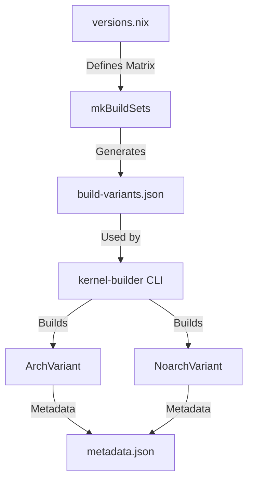
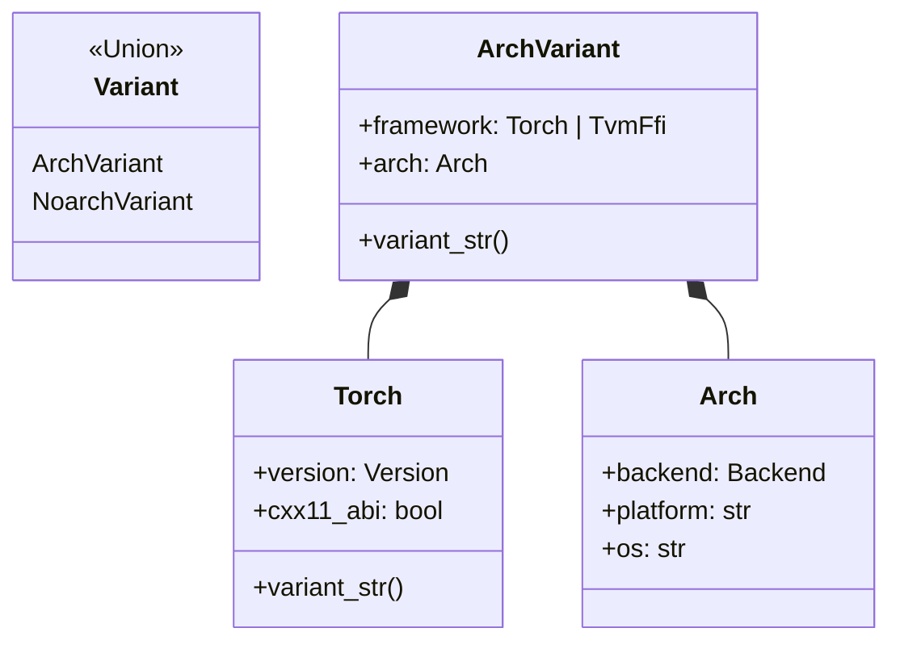

<!-- source: DeepWiki mcp.deepwiki.com · repo huggingface/kernels · page 9.2 Build Variants and Version Matrix · fetched 2026-10-26 -->

# Build Variants and Version Matrix

Relevant source files

The following files were used as context for generating this wiki page:

- [.github/workflows/test_e2e.yaml](.github/workflows/test_e2e.yaml)
- [docs/source/builder/build-variants.md](docs/source/builder/build-variants.md)
- [docs/source/cli-versions.md](docs/source/cli-versions.md)
- [kernel-builder/src/pyproject/templates/torch/build-variants.cmake](kernel-builder/src/pyproject/templates/torch/build-variants.cmake)
- [kernel-builder/src/pyproject/templates/tvm_ffi/build-variants.cmake](kernel-builder/src/pyproject/templates/tvm_ffi/build-variants.cmake)
- [kernels/src/kernels/variants.py](kernels/src/kernels/variants.py)
- [kernels/tests/test_variants.py](kernels/tests/test_variants.py)
- [nix-builder/build-variants.json](nix-builder/build-variants.json)
- [nix-builder/lib/kernel-config.nix](nix-builder/lib/kernel-config.nix)
- [nix-builder/lib/variants/default.nix](nix-builder/lib/variants/default.nix)
- [nix-builder/lib/variants/torch.nix](nix-builder/lib/variants/torch.nix)
- [nix-builder/lib/variants/tvm-ffi.nix](nix-builder/lib/variants/tvm-ffi.nix)
- [nix-builder/overlay.nix](nix-builder/overlay.nix)
- [nix-builder/pkgs/aotriton/default.nix](nix-builder/pkgs/aotriton/default.nix)
- [nix-builder/pkgs/python-modules/torch/binary/generic.nix](nix-builder/pkgs/python-modules/torch/binary/generic.nix)
- [nix-builder/pkgs/python-modules/torch/binary/torch-versions-hash.json](nix-builder/pkgs/python-modules/torch/binary/torch-versions-hash.json)
- [nix-builder/pkgs/python-modules/torch/binary/torch-versions.json](nix-builder/pkgs/python-modules/torch/binary/torch-versions.json)
- [nix-builder/pkgs/python-modules/triton-xpu/default.nix](nix-builder/pkgs/python-modules/triton-xpu/default.nix)
- [nix-builder/pkgs/python-modules/triton/default.nix](nix-builder/pkgs/python-modules/triton/default.nix)
- [nix-builder/pkgs/rocm-packages/default.nix](nix-builder/pkgs/rocm-packages/default.nix)
- [nix-builder/pkgs/xpu-packages/onednn-xpu.nix](nix-builder/pkgs/xpu-packages/onednn-xpu.nix)
- [nix-builder/versions.nix](nix-builder/versions.nix)

This page details how the `kernels` repository manages the explosion of build combinations resulting from the intersection of PyTorch versions, hardware backends (CUDA, ROCm, XPU, Metal), and host operating systems. It describes the naming conventions, the Nix-based version matrix, and the resolution logic used to select the correct binary for a given environment.

## Overview of Build Variants

A **Build Variant** is a specific binary distribution of a kernel optimized for a particular environment. Because kernels often contain compiled C++/CUDA/HIP code that links against PyTorch's C++ ABI, they are highly sensitive to the version of PyTorch and the compute toolkit used during compilation [docs/source/builder/build-variants.md:3-6]().

Variants are broadly categorized into two types:
1.  **Arch Variants**: Hardware-specific binaries (e.g., `.so` files for CUDA) that require strict matching of PyTorch versions and hardware capabilities [kernels/src/kernels/variants.py:173-182]().
2.  **Noarch Variants**: Framework-agnostic or pure-Python kernels (e.g., Triton-based) that only require a general backend match [kernels/src/kernels/variants.py:186-195]().

### Variant Naming Convention

The repository enforces a strict naming convention for variants to ensure unique identification and automated resolution:

`torch<ver>[-cxx<abi>]-<backend><ver>-<arch>-<os>`

| Component | Example | Description |
| :--- | :--- | :--- |
| **Framework** | `torch212` | PyTorch major + minor version [kernels/src/kernels/variants.py:55-55](). |
| **ABI Tag** | `cxx11` | (Linux only) The C++ ABI used (`cxx11` or `cxx98`) [kernels/src/kernels/variants.py:45-48](). |
| **Backend** | `cu126` | Compute backend + version (e.g., `cu`, `rocm`, `xpu`, `metal`) [nix-builder/build-variants.json:39-39](). |
| **Arch** | `x86_64` | CPU architecture (e.g., `x86_64`, `aarch64`) [nix-builder/build-variants.json:32-32](). |
| **OS** | `linux` | Operating system (e.g., `linux`, `darwin`) [nix-builder/build-variants.json:32-32](). |

**Example:** `torch212-cxx11-cu126-x86_64-linux` [docs/source/builder/build-variants.md:46-46]().

---

## The Version Matrix

The version matrix is defined in Nix to drive the automated build infrastructure. It maps supported PyTorch versions to compatible hardware backends and architectures.

### Matrix Configuration (`versions.nix`)

The source of truth for the build matrix is [nix-builder/versions.nix](). It defines a list of attribute sets describing valid combinations:

*   **PyTorch 2.11**: CPU and TPU support on `x86_64-linux` [nix-builder/versions.nix:2-18]().
*   **PyTorch 2.12 - 2.14**: Expanded support for CUDA (12.6, 13.0, 13.2), ROCm (7.1, 7.2), XPU (2025.3.2+), and Metal [nix-builder/versions.nix:20-223]().

### Backend Versions
The matrix currently tracks the following backend versions:
*   **CUDA**: 12.6, 13.0, 13.2 [nix-builder/pkgs/python-modules/torch/binary/torch-versions.json:10-22]().
*   **ROCm**: 7.1, 7.2 [nix-builder/pkgs/python-modules/torch/binary/torch-versions.json:35-42]().
*   **XPU**: 2025.3.2, 2026.0.0, 2026.1.0 [nix-builder/pkgs/python-modules/torch/binary/torch-versions.json:45-143]().

Sources: [nix-builder/versions.nix](), [nix-builder/pkgs/python-modules/torch/binary/torch-versions.json]()

---

## Implementation Details

### Data Flow: From Matrix to Build
The build system uses these definitions to generate unique derivation paths for every variant.

Sources: [nix-builder/build-variants.json](), [kernel-builder/src/pyproject/templates/torch/build-variants.cmake]()

### Variant Resolution Logic

When `get_kernel` is called, the system must resolve the "best" variant for the host. The logic is implemented in `kernels.variants._resolve_variant_for_system` [kernels/src/kernels/variants.py:343-343]().

1.  **Backend Matching**: It first filters for the active backend (e.g., `CUDA`).
2.  **Version Compatibility**:
    *   For CUDA/ROCm, it prefers an exact version match.
    *   If no exact match exists, it falls back to the **highest available version that is less than or equal to** the host version [kernels/tests/test_variants.py:186-201]().
3.  **ABI & Arch**: It strictly matches the PyTorch version, C++ ABI (`cxx11` vs `cxx98`), CPU architecture, and OS [kernels/src/kernels/variants.py:404-434]().
4.  **Noarch Fallback**: If no specific arch variant is compatible, it attempts to load a `noarch` variant (e.g., `torch-cuda`) [kernels/tests/test_variants.py:203-218]().

### Key Code Entities

| Entity | File | Role |
| :--- | :--- | :--- |
| `ArchVariant` | [kernels/src/kernels/variants.py:173-182]() | Data class representing a hardware-specific build. |
| `NoarchVariant` | [kernels/src/kernels/variants.py:186-195]() | Data class representing a hardware-agnostic build. |
| `parse_variant` | [kernels/src/kernels/variants.py:218-241]() | Regex-based parser for variant strings. |
| `flattenVersion` | [nix-builder/lib/variants/default.nix]() | Nix utility to convert "2.12.0" to "212" for string identifiers. |

Sources: [kernels/src/kernels/variants.py:37-182]()

---

## Nix Infrastructure Support

The `nix-builder` provides the underlying packages required to satisfy the version matrix.

### Torch Binary Management
The system does not build PyTorch from source for every variant. Instead, it uses `mkTorch` [nix-builder/overlay.nix:201-201]() to wrap official PyTorch wheels.
*   **Hashes**: Wheel hashes for all supported versions are stored in `torch-versions-hash.json` [nix-builder/pkgs/python-modules/torch/binary/torch-versions-hash.json]().
*   **Patching**: The `generic.nix` builder uses `autoPatchelfHook` and `setupCudaHook` to ensure the wheels link correctly against Nix-provided system libraries while maintaining compatibility with the host's NVIDIA drivers [nix-builder/pkgs/python-modules/torch/binary/generic.nix:190-198]().

### Triton Variants
For `noarch` variants that use Triton, Nix manages specific Triton versions for each backend:
*   `triton-cuda`
*   `triton-rocm`
*   `triton-xpu` (supporting versions 3.7.1, 3.7.2, and 3.8.0) [nix-builder/pkgs/python-modules/triton-xpu/default.nix:9-25]()

Sources: [nix-builder/pkgs/python-modules/torch/binary/generic.nix](), [nix-builder/pkgs/python-modules/triton-xpu/default.nix](), [nix-builder/overlay.nix]()

---

