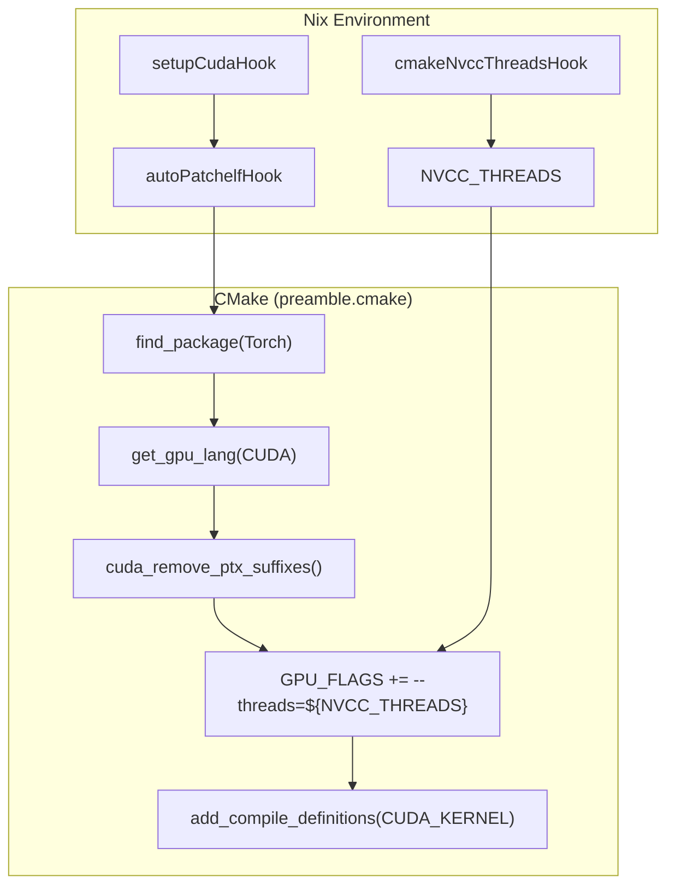
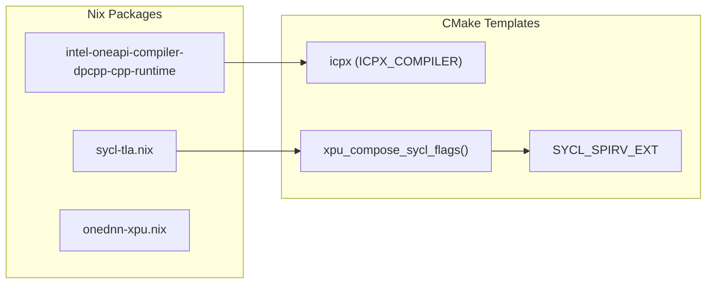

<!-- source: DeepWiki mcp.deepwiki.com · repo huggingface/kernels · page 9.3 Hardware Backend Support · fetched 2026-10-26 -->

# Hardware Backend Support

Relevant source files

The following files were used as context for generating this wiki page:

- [docs/source/builder/build-variants.md](docs/source/builder/build-variants.md)
- [kernel-builder/src/pyproject/templates/kernel.cmake](kernel-builder/src/pyproject/templates/kernel.cmake)
- [kernel-builder/src/pyproject/templates/torch/preamble.cmake](kernel-builder/src/pyproject/templates/torch/preamble.cmake)
- [kernel-builder/src/pyproject/templates/tvm_ffi/preamble.cmake](kernel-builder/src/pyproject/templates/tvm_ffi/preamble.cmake)
- [kernel-builder/src/pyproject/templates/utils.cmake](kernel-builder/src/pyproject/templates/utils.cmake)
- [kernel-builder/src/pyproject/templates/xpu/dep-sycl-tla.cmake](kernel-builder/src/pyproject/templates/xpu/dep-sycl-tla.cmake)
- [kernel-builder/tests/arch-intersection.cmake](kernel-builder/tests/arch-intersection.cmake)
- [nix-builder/build-variants.json](nix-builder/build-variants.json)
- [nix-builder/lib/cache.nix](nix-builder/lib/cache.nix)
- [nix-builder/lib/checks.nix](nix-builder/lib/checks.nix)
- [nix-builder/overlay.nix](nix-builder/overlay.nix)
- [nix-builder/pkgs/aotriton/default.nix](nix-builder/pkgs/aotriton/default.nix)
- [nix-builder/pkgs/aotriton/generic.nix](nix-builder/pkgs/aotriton/generic.nix)
- [nix-builder/pkgs/python-modules/cuda-bindings/default.nix](nix-builder/pkgs/python-modules/cuda-bindings/default.nix)
- [nix-builder/pkgs/python-modules/torch/binary/generic.nix](nix-builder/pkgs/python-modules/torch/binary/generic.nix)
- [nix-builder/pkgs/python-modules/triton-xpu/generic.nix](nix-builder/pkgs/python-modules/triton-xpu/generic.nix)
- [nix-builder/pkgs/rocm-packages/components.nix](nix-builder/pkgs/rocm-packages/components.nix)
- [nix-builder/pkgs/rocm-packages/default.nix](nix-builder/pkgs/rocm-packages/default.nix)
- [nix-builder/pkgs/rocm-packages/manifests/7.1.1.json](nix-builder/pkgs/rocm-packages/manifests/7.1.1.json)
- [nix-builder/pkgs/rocm-packages/manifests/7.2.1.json](nix-builder/pkgs/rocm-packages/manifests/7.2.1.json)
- [nix-builder/pkgs/rocm-packages/mk-packages.nix](nix-builder/pkgs/rocm-packages/mk-packages.nix)
- [nix-builder/pkgs/xpu-packages/components.nix](nix-builder/pkgs/xpu-packages/components.nix)
- [nix-builder/pkgs/xpu-packages/default.nix](nix-builder/pkgs/xpu-packages/default.nix)
- [nix-builder/pkgs/xpu-packages/generic.nix](nix-builder/pkgs/xpu-packages/generic.nix)
- [nix-builder/pkgs/xpu-packages/manifests/2025.3.2.json](nix-builder/pkgs/xpu-packages/manifests/2025.3.2.json)
- [nix-builder/pkgs/xpu-packages/manifests/2026.0.0.json](nix-builder/pkgs/xpu-packages/manifests/2026.0.0.json)
- [nix-builder/pkgs/xpu-packages/ocloc.nix](nix-builder/pkgs/xpu-packages/ocloc.nix)
- [nix-builder/pkgs/xpu-packages/onednn-xpu.nix](nix-builder/pkgs/xpu-packages/onednn-xpu.nix)
- [nix-builder/pkgs/xpu-packages/overrides.nix](nix-builder/pkgs/xpu-packages/overrides.nix)
- [nix-builder/pkgs/xpu-packages/sycl-tla.nix](nix-builder/pkgs/xpu-packages/sycl-tla.nix)
- [nix-builder/versions.nix](nix-builder/versions.nix)

The `kernels` repository provides deep integration for diverse hardware backends through a unified Nix-based build system. This infrastructure abstracts the complexities of toolchains (CUDA, ROCm, SYCL, Metal) and ensures ABI compatibility across different versions of PyTorch and hardware drivers.

## CUDA (NVIDIA)

CUDA support is managed through the `cudaPackages` suite in Nix. The system handles multiple CUDA versions (12.6, 13.0, 13.2) and manages the complexities of `nvcc` thread management and PTX generation.

### Key Integration Points
- **`setupCudaHook`**: Utilized in the `torch` binary derivation to ensure the CUDA runtime and driver libraries are correctly patchelfed into the RPATH [nix-builder/pkgs/python-modules/torch/binary/generic.nix:194-195]().
- **`cmakeNvccThreadsHook`**: A local hook that manages parallel compilation for CUDA files by passing `--threads` to `nvcc` based on `NIX_BUILD_CORES` [nix-builder/overlay.nix:13-13](), [nix-builder/overlay.nix:60-61]().
- **PTX Handling**: The CMake templates automatically manage GPU capabilities. They define a default set of architectures (e.g., `7.5;8.0;8.6;8.7;8.9;9.0;10.0;10.3;11.0;12.0;12.1+PTX`) and provide utility functions like `cuda_remove_ptx_suffixes` to calculate intersections between host capabilities and kernel requirements [kernel-builder/src/pyproject/templates/torch/preamble.cmake:101-139]().

### CUDA Data Flow
Title: CUDA Build Logic Flow

Sources: [nix-builder/pkgs/python-modules/torch/binary/generic.nix:192-195](), [nix-builder/overlay.nix:55-63](), [kernel-builder/src/pyproject/templates/torch/preamble.cmake:99-160]()

---

## ROCm (AMD)

ROCm support is implemented through a compatibility layer that merges various ROCm components into a unified path and provides `hipify` support for CUDA-to-HIP source translation.

### Components
- **`rocmtoolkit_joined`**: A `symlinkJoin` derivation that merges components like `clr`, `hipblas`, `miopen-hip`, and `rocblas` into a single prefix. It exports `ROCM_PATH` and `ROCM_SOURCE_DIR` via a setup hook to ensure downstream CMake projects can locate the toolchain [nix-builder/pkgs/python-modules/torch/binary/generic.nix:89-135]().
- **`aotriton`**: Pre-compiled Triton images are integrated based on the PyTorch version (e.g., `aotriton_0_13` for Torch 2.14) [nix-builder/pkgs/python-modules/torch/binary/generic.nix:79-87]().
- **`hipify_sources_target`**: A CMake function that invokes `hipify.py` to translate `.cu` files to `.hip` files during the build process [kernel-builder/src/pyproject/templates/utils.cmake:122-171]().

Sources: [nix-builder/pkgs/python-modules/torch/binary/generic.nix:89-135](), [kernel-builder/src/pyproject/templates/utils.cmake:122-171](), [nix-builder/pkgs/rocm-packages/default.nix:30-33]()

---

## XPU / SYCL (Intel)

The XPU backend utilizes the Intel oneAPI toolchain, focusing on `icx`/`icpx` compilers and the `sycl-tla` (SYCL Tensor Library Abstraction) for optimized GEMM operations.

### Compiler Setup
The system explicitly searches for and sets `icx` and `icpx` as the C/C++ compilers before the CMake `project()` call to ensure the SYCL environment is correctly initialized [kernel-builder/src/pyproject/templates/torch/preamble.cmake:3-15]().

### sycl-tla Integration
`sycl-tla` is managed via `FetchContent` in CMake or as a Nix derivation. It requires specific SPIR-V extensions and backend options:
- **SPIR-V Extensions**: Automatically probes the compiler for default extensions and appends required ones like `+SPV_INTEL_split_barrier` and `+SPV_INTEL_2d_block_io` [kernel-builder/src/pyproject/templates/xpu/dep-sycl-tla.cmake:81-107]().
- **AOT Targets**: Configures `SYCL_AOT_DEVICES` (e.g., `pvc,xe-lpg,ats-m150`) to generate fat binaries containing ahead-of-time compiled images for specific Intel GPUs [kernel-builder/src/pyproject/templates/torch/preamble.cmake:148-160]().

### Integration Mapping
Title: XPU Backend Code Entities

Sources: [nix-builder/pkgs/xpu-packages/sycl-tla.nix:62-72](), [kernel-builder/src/pyproject/templates/xpu/dep-sycl-tla.cmake:74-109](), [kernel-builder/src/pyproject/templates/torch/preamble.cmake:142-168]()

---

## Metal (Apple Silicon)

Metal support is provided for `aarch64-darwin` systems.
- **Environment**: Nix provides `metal-cpp` and `rewrite-nix-paths-macho` to handle macOS-specific binary structures [nix-builder/overlay.nix:29-31]().
- **Deployment Target**: The build system enforces `CMAKE_OSX_DEPLOYMENT_TARGET` (e.g., "15.0" for CPU, "26.0" for Metal) to ensure compatibility across macOS versions [kernel-builder/src/pyproject/templates/torch/preamble.cmake:179-181]().

Sources: [nix-builder/overlay.nix:29-31](), [kernel-builder/src/pyproject/templates/torch/preamble.cmake:180-182]()

---

## TPU (Google)

TPU support is handled as a gated backend due to licensing restrictions on the `libtpu` and `torch_tpu` wheels.
- **Gated Wheels**: The `torch-tpu` wheel is not publicly fetchable. The Nix derivation uses `requireFile` and provides a helper script `prefetch-tpu-wheel.sh` for developers to manually register the wheel into the Nix store using a Google Cloud access token [nix-builder/pkgs/python-modules/torch/binary/generic.nix:138-153]().
- **Bundle Logic**: Because `torch_tpu` and `torch` have circular-like dependencies in their packaging, the Nix builder merges the `torch-tpu` wheel into the `torch` output during the `preUnpack` phase [nix-builder/pkgs/python-modules/torch/binary/generic.nix:172-179]().

Sources: [nix-builder/pkgs/python-modules/torch/binary/generic.nix:138-153](), [nix-builder/pkgs/python-modules/torch/binary/generic.nix:176-179]()

---

## Backend Summary Table

| Backend | Compiler/Toolchain | Key Nix/CMake Entity | Primary Platform |
| :--- | :--- | :--- | :--- |
| **CUDA** | `nvcc` | `setupCudaHook` | `linux-x86_64`, `linux-aarch64` |
| **ROCm** | `hipcc` | `rocmtoolkit_joined` | `linux-x86_64` |
| **XPU** | `icpx` | `sycl-tla`, `setupXpuHook` | `linux-x86_64` |
| **Metal** | `clang` | `metal-cpp` | `darwin-aarch64` |
| **TPU** | `gcloud` (fetch) | `libtpu`, `torch-tpu` | `linux-x86_64` |

Sources: [nix-builder/versions.nix:1-225](), [nix-builder/build-variants.json:1-62](), [docs/source/builder/build-variants.md:1-79]()

---

