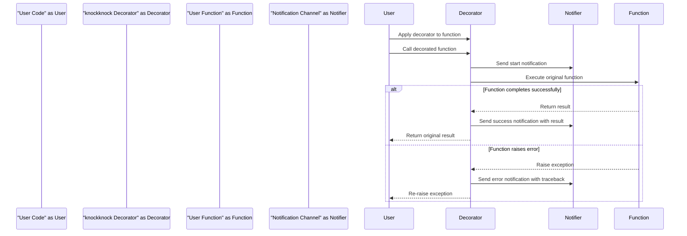
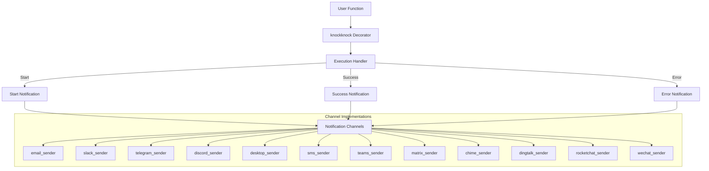
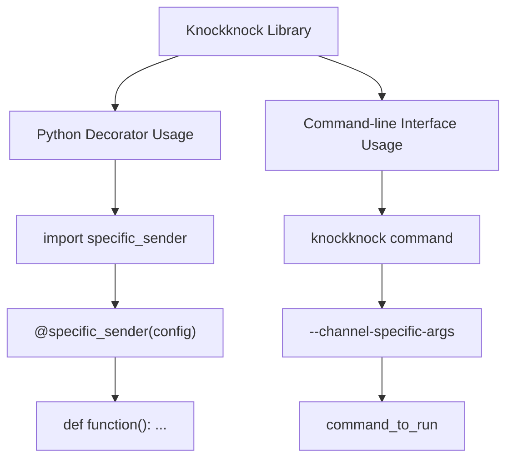
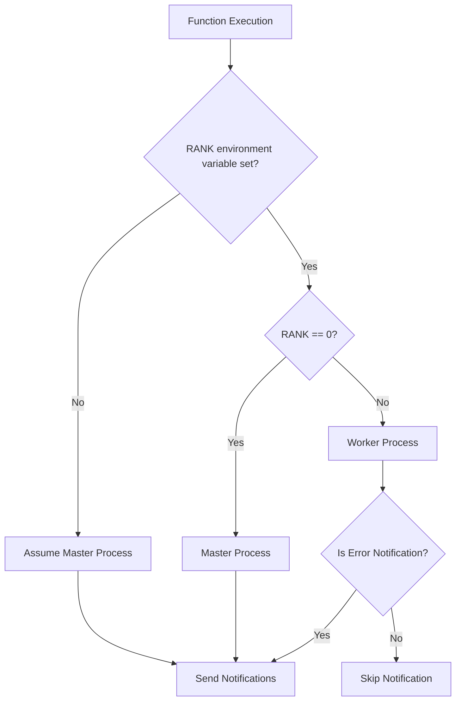

<!-- source: DeepWiki mcp.deepwiki.com · repo huggingface/knockknock · page 1 Overview · fetched 2026-10-26 -->

# Overview

<details>
<summary>Relevant source files</summary>

The following files were used as context for generating this wiki page:

- [README.md](README.md)
- [setup.py](setup.py)

</details>


Knockknock is a lightweight Python library that provides notification capabilities for long-running processes, particularly machine learning training jobs. With minimal code modification (just adding a decorator), users can receive notifications when their processes start, complete successfully, or crash.

## Purpose and Scope

The primary purpose of knockknock is to solve a common problem in machine learning and other computational fields: monitoring long-running processes without constant supervision. When training deep learning models with early stopping, it's difficult to predict exactly when training will finish. Knockknock addresses this by automatically sending notifications across various communication platforms.

For detailed installation instructions, see [Installation](#1.1).
For a quick start guide, see [Quick Start](#1.2).

## Core Architecture

Knockknock uses the decorator pattern to wrap around user functions, enabling it to execute notification actions before the function runs, after successful completion, and when errors occur.

### Decorator Flow

The following diagram illustrates how the decorator pattern is used to implement notifications:



Sources: [README.md:20-22]()

### System Components

Knockknock consists of several key components that work together to provide notification functionality:



Sources: [README.md:23-38](), [setup.py:22-29]()

## Notification Channels

Knockknock supports twelve different notification channels:

| Channel | Required Configuration | Python Import | CLI Command |
|---------|------------------------|---------------|-------------|
| Email | Sender email, Recipient email(s) | `email_sender` | `email` |
| Slack | Webhook URL, Channel | `slack_sender` | `slack` |
| Telegram | Token, Chat ID | `telegram_sender` | `telegram` |
| Discord | Webhook URL | `discord_sender` | `discord` |
| Desktop | Title (optional) | `desktop_sender` | `desktop` |
| SMS/Twilio | Account SID, Auth Token, Recipient Number, Sender Number | `sms_sender` | `sms` |
| Microsoft Teams | Webhook URL | `teams_sender` | `teams` |
| Matrix | Homeserver, Token, Room | `matrix_sender` | `matrix` |
| Amazon Chime | Webhook URL | `chime_sender` | `chime` |
| DingTalk | Webhook URL, Secret/Keywords | `dingtalk_sender` | `dingtalk` |
| RocketChat | Server URL, User ID, Auth Token, Channel | `rocketchat_sender` | `rocketchat` |
| WeChat Work | Webhook URL | `wechat_sender` | `wechat` |

Sources: [README.md:23-38](), [README.md:41-396]()

For more detailed information about specific notification channels, see [Notification Channels](#4).

## Usage Patterns

Knockknock can be used in two ways: as a Python decorator or via the command-line interface.



Sources: [README.md:19-22](), [setup.py:15-19]()

### Python Decorator Usage

The primary way to use knockknock is as a decorator in Python code:

```python
from knockknock import slack_sender

@slack_sender(webhook_url="<webhook_url>", channel="<channel>")
def train_model(parameters):
    # Long-running training process
    return {"loss": 0.9}  # Optional return value
```

Sources: [README.md:47-55](), [README.md:76-86]()

### Command-line Interface

Knockknock also provides a command-line interface for executing commands with notifications:

```bash
knockknock slack --webhook-url <url> --channel <channel> sleep 10
```

This allows users to run any command and get notifications without modifying code.

Sources: [README.md:57-64](), [README.md:91-97]()

## Distributed Training Support

Knockknock intelligently handles distributed training environments to prevent duplicate notifications:



In distributed training setups (like those using PyTorch's distributed.launch), the RANK environment variable identifies each process. Knockknock uses this to ensure that only the master process (RANK=0) sends notifications, except for error notifications which are always sent.

Sources: [README.md:401-405]()

## Package Structure

The knockknock package is organized into modules for each notification channel and includes a command-line interface:

```mermaid
classDiagram
    class "__main__" {
        +main()
        +parse_args()
        +execute_command()
    }
    
    class "Notification Decorators" {
        <<conceptual>>
        +decorator()
        +wrapper()
        +send_start_notification()
        +send_end_notification()
        +send_error_notification()
    }
    
    "__main__" --> "Notification Decorators" : Uses
    
    "Notification Decorators" <|-- "email_sender"
    "Notification Decorators" <|-- "slack_sender"
    "Notification Decorators" <|-- "telegram_sender"
    "Notification Decorators" <|-- "discord_sender"
    "Notification Decorators" <|-- "desktop_sender"
    "Notification Decorators" <|-- "sms_sender"
    "Notification Decorators" <|-- "teams_sender"
    "Notification Decorators" <|-- "matrix_sender"
    "Notification Decorators" <|-- "chime_sender"
    "Notification Decorators" <|-- "dingtalk_sender"
    "Notification Decorators" <|-- "rocketchat_sender"
    "Notification Decorators" <|-- "wechat_sender"
```

Sources: [README.md:23-38](), [setup.py:14-19](), [setup.py:22-29]()

## Summary

Knockknock provides a simple, elegant solution for monitoring long-running processes by sending notifications at key events. With support for multiple notification platforms and a flexible decorator-based architecture, it can be easily integrated into existing code with minimal changes. The library also handles distributed training environments to prevent notification spam.

For more details on the architecture, see [Architecture](#2).
For more information about the command-line interface, see [Command-Line Interface](#3).
For detailed documentation on specific notification channels, see [Notification Channels](#4).

Sources: [README.md:5-7](), [setup.py:7-8]()

---

