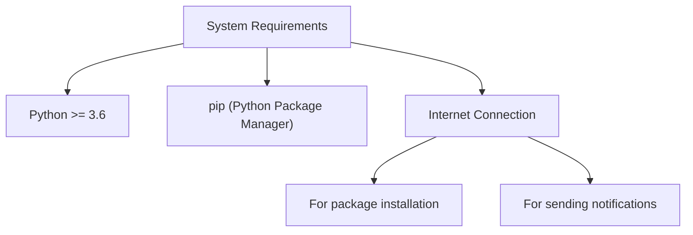
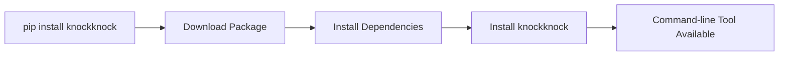
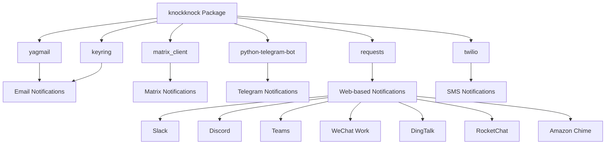
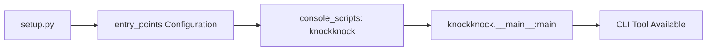
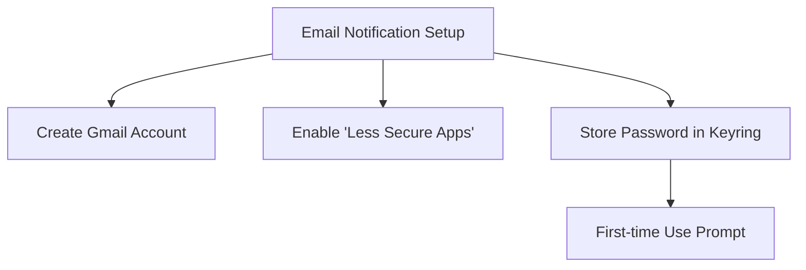
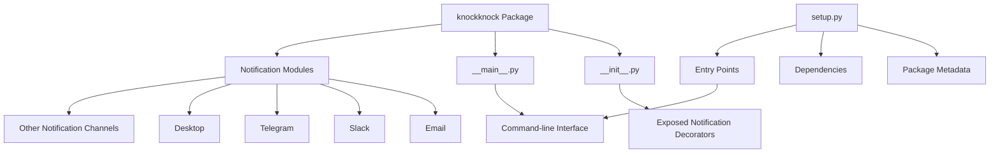

<!-- source: DeepWiki mcp.deepwiki.com · repo huggingface/knockknock · page 1.1 Installation · fetched 2026-10-26 -->

# Installation

<details>
<summary>Relevant source files</summary>

The following files were used as context for generating this wiki page:

- [README.md](README.md)
- [setup.py](setup.py)

</details>


This document provides detailed instructions for installing the knockknock library, a lightweight notification tool that allows you to receive alerts when your long-running processes (like machine learning training jobs) complete or crash. For information about using knockknock after installation, see [Quick Start](#1.2).

## System Requirements

knockknock requires **Python 3.6 or later** to function properly. The library has been primarily tested on Python 3.6+ environments, as specified in the package setup.



Sources: [README.md:17](), [setup.py:21]()

## Standard Installation

The simplest way to install knockknock is via pip:

```bash
pip install knockknock
```

This command installs the latest stable version of knockknock from PyPI along with all required dependencies.



Sources: [README.md:11-15](), [setup.py:4-7]()

## Package Dependencies

When you install knockknock, several dependencies are automatically installed to support various notification channels:

| Dependency | Purpose | Required For |
|------------|---------|--------------|
| yagmail (≥0.11.214) | Gmail/SMTP client | Email notifications |
| keyring | Secure credential storage | Email credentials |
| matrix_client | Matrix protocol client | Matrix notifications |
| python-telegram-bot | Telegram API client | Telegram notifications |
| requests | HTTP requests | Most web-based notifications (Slack, Discord, etc.) |
| twilio | SMS gateway client | Text message notifications |

Additional platform-specific dependencies may be required for desktop notifications, which vary by operating system.



Sources: [setup.py:22-29]()

## Command-line Installation

The installation of knockknock automatically makes the `knockknock` command-line tool available in your environment. This CLI tool provides the same notification functionality as the Python decorators but is usable directly from the command line.



Sources: [setup.py:15-19]()

## Verifying Installation

To verify that knockknock has been installed correctly, you can run the following command in your terminal:

```bash
pip list | grep knockknock
```

This should display the installed version of knockknock. Alternatively, you can check if the command-line interface is available:

```bash
knockknock --help
```

## Platform-specific Considerations

### Desktop Notifications

The desktop notification functionality has specific requirements depending on your operating system:

- **MacOS**: No additional requirements
- **Linux**: Requires a notification server and the `notify-send` command (available in most desktop environments)
- **Windows 10**: No additional requirements

### Email Notifications

For email notifications, you'll need to:

1. Have a Gmail account (for the sender)
2. Allow "less secure apps" access to your Gmail account
3. Store the password securely using the keyring library



Sources: [README.md:43-46]()

## Advanced Installation

### Installing from Source

For the latest development version or to contribute to the project, you can install directly from the GitHub repository:

```bash
git clone https://github.com/huggingface/knockknock.git
cd knockknock
pip install -e .
```

## Package Structure

knockknock's installation and package structure are designed for simplicity and extensibility:



Sources: [setup.py:1-37]()

## Troubleshooting

### Common Installation Issues

1. **Permission Errors**: If you encounter permission errors during installation, try:
   ```bash
   pip install --user knockknock
   ```

2. **Dependency Conflicts**: If you have conflicts with existing packages, consider using a virtual environment:
   ```bash
   python -m venv knockknock-env
   source knockknock-env/bin/activate  # On Windows: knockknock-env\Scripts\activate
   pip install knockknock
   ```

3. **Keyring Issues**: On headless servers, the keyring library might have trouble storing credentials. Consider using environment variables or configuration files instead.

---

