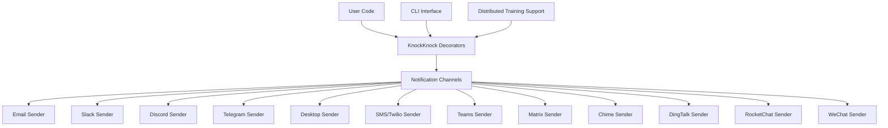
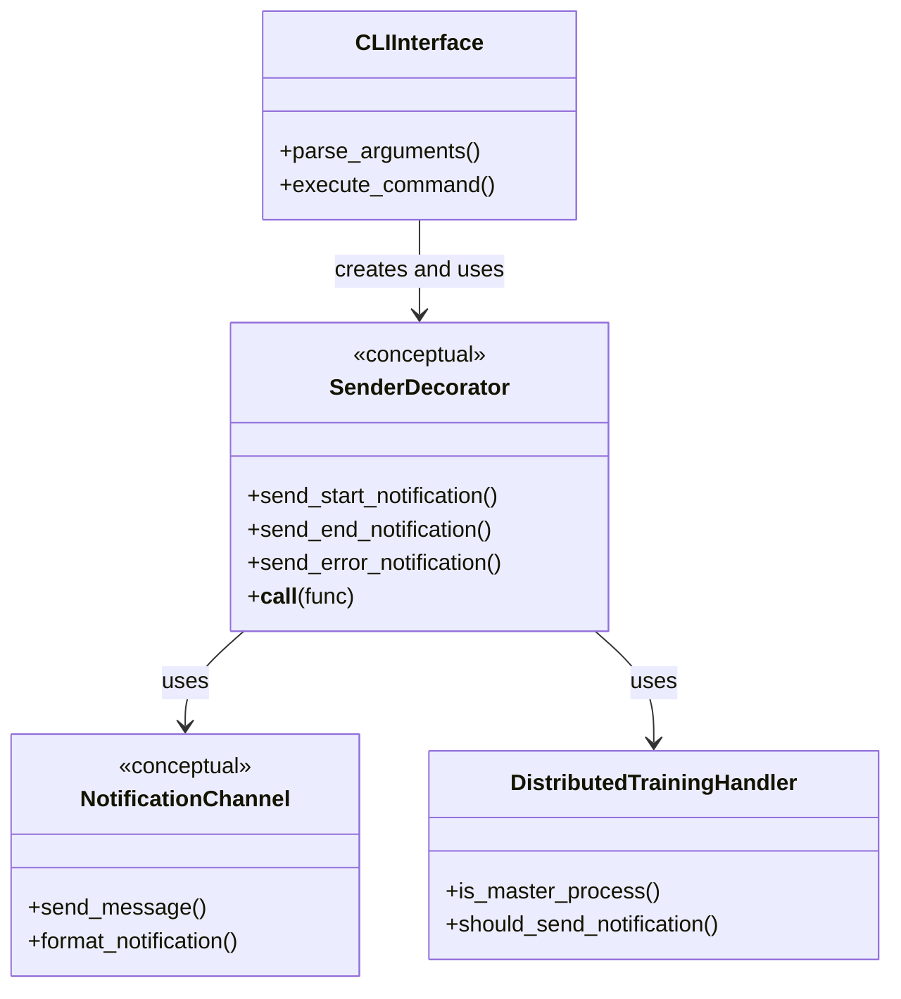
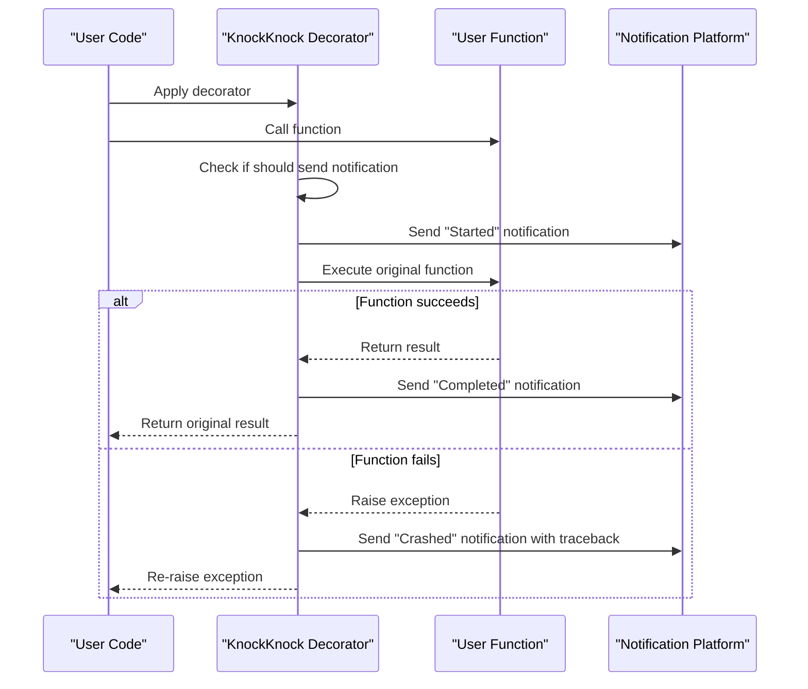
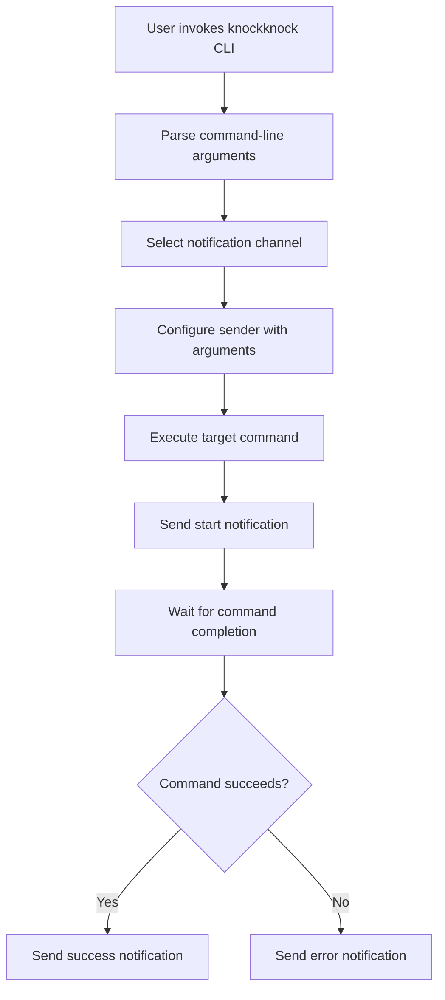
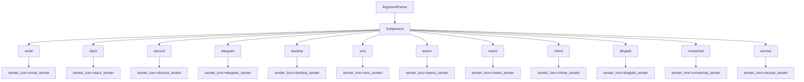
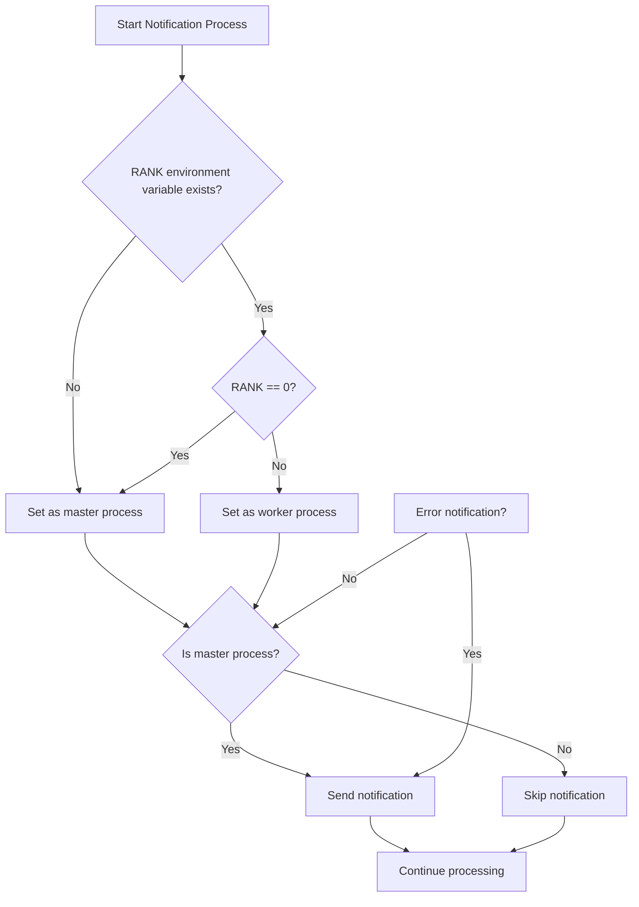
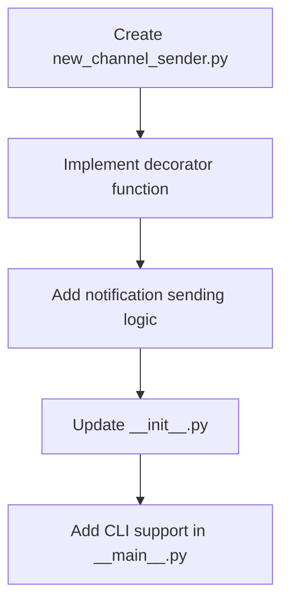

<!-- source: DeepWiki mcp.deepwiki.com · repo huggingface/knockknock · page 2 Architecture · fetched 2026-10-26 -->

# Architecture

Relevant source files

The following files were used as context for generating this wiki page:

- [README.md](README.md)
- [knockknock/__init__.py](knockknock/__init__.py)
- [knockknock/__main__.py](knockknock/__main__.py)

This document provides a technical overview of the design and architecture of the knockknock library. It explains the core components, their relationships, and the underlying patterns that enable the notification functionality. For information about installation and usage, see [Overview](#1) and [Quick Start](#1.2).

## Overview

KnockKnock is a Python library that provides notification capabilities for long-running processes, particularly machine learning training jobs. The library implements a decorator-based approach that allows users to receive notifications when their processes start, complete successfully, or crash.

The architecture follows a simple yet effective design centered around the decorator pattern. This enables users to add notification capabilities to their existing code with minimal modifications.

### High-Level Architecture

Sources: [README.md:1-406](), [knockknock/__init__.py:1-13](), [knockknock/__main__.py:1-212]()

## Core Components

KnockKnock consists of several key components that work together to provide the notification functionality:

1. **Decorators**: Python function decorators that wrap user-defined functions to add notification capabilities.
2. **Notification Senders**: Specialized modules that handle sending notifications to different platforms.
3. **CLI Interface**: Command-line interface for using KnockKnock without modifying code.
4. **Distributed Training Support**: Logic to handle notifications in distributed environments.

### Component Relationships

Sources: [README.md:19-69](), [knockknock/__main__.py:17-207]()

## Decorator Pattern Implementation

The decorator pattern is central to KnockKnock's design. It allows the library to intercept function calls, send notifications at appropriate times, and handle errors, all while being transparent to the wrapped function.

### Execution Flow

Sources: [README.md:46-55](), [README.md:77-86](), [README.md:112-119]()

## Notification Channels

KnockKnock supports multiple notification channels, each implemented as a separate module. Despite their different implementations, all channels follow a common pattern.

### Channel Structure

```mermaid
classDiagram
    class BaseSender {
        <<conceptual>>
        +send_start_notification()
        +send_success_notification()
        +send_failure_notification()
        +handle_distributed_training()
    }
    
    class email_sender {
        +configure_email_settings()
        +send_via_yagmail()
    }
    
    class slack_sender {
        +configure_webhook()
        +send_via_webhook()
    }
    
    class discord_sender {
        +configure_webhook()
        +send_via_webhook()
    }
    
    class telegram_sender {
        +configure_bot()
        +send_via_bot_api()
    }
    
    class teams_sender {
        +configure_webhook()
        +send_via_webhook()
    }
    
    class sms_sender {
        +configure_twilio()
        +send_via_twilio()
    }
    
    class desktop_sender {
        +detect_platform()
        +send_os_notification()
    }
    
    class matrix_sender {
        +configure_client()
        +send_via_matrix_api()
    }
    
    class chime_sender {
        +configure_webhook()
        +send_via_webhook()
    }
    
    class dingtalk_sender {
        +configure_webhook()
        +send_via_webhook()
    }
    
    class rocketchat_sender {
        +configure_client()
        +send_via_api()
    }
    
    class wechat_sender {
        +configure_webhook()
        +send_via_webhook()
    }
    
    BaseSender <|-- email_sender
    BaseSender <|-- slack_sender
    BaseSender <|-- discord_sender
    BaseSender <|-- telegram_sender
    BaseSender <|-- teams_sender
    BaseSender <|-- sms_sender
    BaseSender <|-- desktop_sender
    BaseSender <|-- matrix_sender
    BaseSender <|-- chime_sender
    BaseSender <|-- dingtalk_sender
    BaseSender <|-- rocketchat_sender
    BaseSender <|-- wechat_sender
```

Sources: [knockknock/__init__.py:1-13](), [README.md:41-399]()

## Command-Line Interface

KnockKnock provides a command-line interface that allows users to utilize its notification capabilities without modifying their code. The CLI is implemented in [knockknock/__main__.py]() and supports all the notification channels available in the library.

### CLI Flow

Sources: [knockknock/__main__.py:17-207]()

### CLI Structure

The CLI implementation defines a separate subparser for each notification channel, with specific arguments required for that channel.

Sources: [knockknock/__main__.py:17-192]()

## Distributed Training Support

KnockKnock includes support for distributed training environments, particularly for PyTorch distributed training. This prevents multiple notification messages from being sent when using multiple processes.

### Distributed Training Logic

Sources: [README.md:401-405]()

## Integration Methods

KnockKnock provides two main integration methods: Python decorators and the command-line interface.

### Integration Comparison

| Feature | Python Decorator | CLI |
|---------|------------------|-----|
| Code Modification | Requires adding decorators to functions | No code changes required |
| Configuration | Done in code | Done via command-line arguments |
| Flexibility | Can wrap any Python function | Wraps command-line commands |
| Function Return Value | Preserved and included in notification | Command exit code only |
| Integration Ease | Simple for Python code | Works with any executable |

Sources: [README.md:19-399]()

## Extensibility

KnockKnock's architecture is designed to be extensible, making it easy to add support for new notification channels. Each notification channel is implemented as a separate module with a similar interface.

### Adding a New Channel

To add a new notification channel, one would need to:

1. Create a new module in the knockknock package
2. Implement a decorator function that configures the notification channel
3. Add the notification sending logic
4. Update `__init__.py` to expose the new sender
5. Add CLI support in `__main__.py`

Sources: [knockknock/__init__.py:1-13](), [knockknock/__main__.py:17-192]()

## Summary

KnockKnock employs a simple yet effective architecture centered around the decorator pattern. This allows it to provide notification capabilities with minimal code changes. The library supports multiple notification channels and offers both programmatic and command-line interfaces for integration.

The system's distributed training support ensures that notifications work correctly in multi-process environments, preventing duplicate notifications while ensuring that error notifications are always sent.

Sources: [README.md:1-406](), [knockknock/__init__.py:1-13](), [knockknock/__main__.py:1-212]()

---

