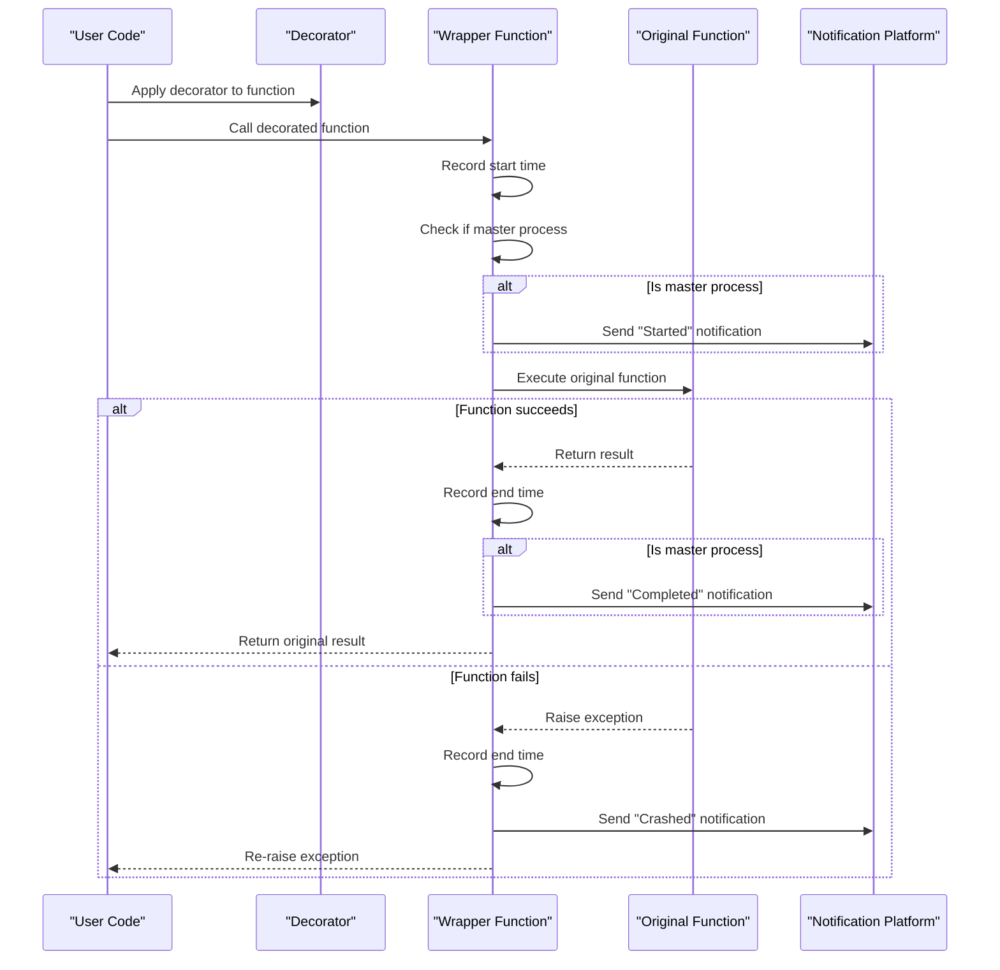
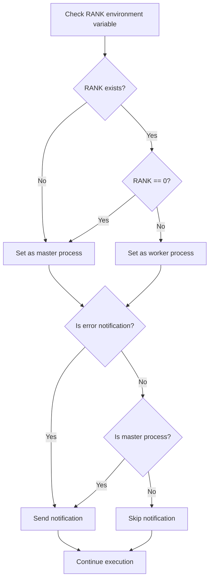

<!-- source: DeepWiki mcp.deepwiki.com · repo huggingface/knockknock · page 2.1 Decorator Pattern · fetched 2026-10-26 -->

# Decorator Pattern

<details>
<summary>Relevant source files</summary>

The following files were used as context for generating this wiki page:

- [knockknock/desktop_sender.py](knockknock/desktop_sender.py)
- [knockknock/email_sender.py](knockknock/email_sender.py)
- [knockknock/slack_sender.py](knockknock/slack_sender.py)

</details>


## Purpose and Scope

This page explains how the decorator pattern is implemented and used in the KnockKnock library. The decorator pattern is the central mechanism enabling KnockKnock to wrap long-running functions with notification capabilities, allowing users to receive alerts when their processes start, complete, or fail.

For information about the overall architecture of KnockKnock, see [Architecture](#2), and for specific notification channels, see [Notification Channels](#4).

## What is the Decorator Pattern?

In Python, decorators are a syntactic sugar for function wrappers, allowing you to modify the behavior of functions or methods without changing their actual code. KnockKnock uses decorators to intercept function calls and inject notification logic before execution, after successful completion, and when exceptions occur.

## KnockKnock's Decorator Structure

KnockKnock implements a three-level nested function structure for its decorators:

```mermaid
classDiagram
    class "OuterFunction" {
        +Configuration parameters
        +Returns decorator_sender
    }
    class "decorator_sender" {
        +Takes func as argument
        +Returns wrapper_sender
    }
    class "wrapper_sender" {
        +Takes *args, **kwargs
        +Send start notification
        +Execute func
        +Send result notification
        +Return func's return value
    }
    "OuterFunction" --> "decorator_sender" : returns
    "decorator_sender" --> "wrapper_sender" : returns
```

**Level 1: Outer Configuration Function**
- Accepts channel-specific configuration parameters
- Returns the actual decorator function
- Examples: `desktop_sender()`, `email_sender()`, `slack_sender()`

**Level 2: Decorator Function**
- Takes the function to be decorated as its argument
- Returns the wrapper function
- Implementation named `decorator_sender` in all notification modules

**Level 3: Wrapper Function**
- Captures the starting state (time, host, function name)
- Sends the "started" notification
- Executes the original function
- Sends "completed" or "crashed" notification based on outcome
- Returns the original function's return value or re-raises exceptions

Sources:
- [knockknock/desktop_sender.py:11-103]()
- [knockknock/email_sender.py:10-99]()
- [knockknock/slack_sender.py:12-109]()

## Execution Flow

Here's the execution flow when using a KnockKnock decorator:



This sequence diagram illustrates how KnockKnock's decorators intercept the function call, execute the original function within a try-except block, and send appropriate notifications based on the outcome.

Sources:
- [knockknock/desktop_sender.py:35-99]()
- [knockknock/email_sender.py:29-95]()
- [knockknock/slack_sender.py:35-105]()

## Common Implementation Pattern

All notification channels follow the same implementation pattern for the wrapper function:

1. **Record starting information**:
   ```python
   start_time = datetime.datetime.now()
   host_name = socket.gethostname()
   func_name = func.__name__
   ```

2. **Handle distributed training**:
   ```python
   if 'RANK' in os.environ:
       master_process = (int(os.environ['RANK']) == 0)
       host_name += ' - RANK: %s' % os.environ['RANK']
   else:
       master_process = True
   ```

3. **Send start notification** (if master process)
4. **Execute original function** in a try-except block
5. **On success**:
   - Record end time and calculate duration
   - Format success message with timing information
   - Add return value (if possible)
   - Send completion notification (if master process)
   - Return the original return value
6. **On exception**:
   - Record end time and calculate duration
   - Format error message with traceback
   - Send crash notification
   - Re-raise the exception

Sources:
- [knockknock/desktop_sender.py:35-99]()
- [knockknock/email_sender.py:29-95]()
- [knockknock/slack_sender.py:35-105]()

## Channel-Specific Implementations

While the decorator structure remains consistent, each notification channel implements its own sending mechanism:

| Channel | Configuration Parameters | Notification Method |
|---------|--------------------------|---------------------|
| Desktop | `title` | OS-specific notifications (AppleScript/notify-send/win10toast) |
| Email   | `recipient_emails`, `sender_email` | Sends emails via `yagmail` |
| Slack   | `webhook_url`, `channel`, `user_mentions` | Posts messages via webhook API |

Sources:
- [knockknock/desktop_sender.py:13-31]()
- [knockknock/email_sender.py:10-26]()
- [knockknock/slack_sender.py:12-32]()

## Handling Distributed Training

A key feature of KnockKnock's decorator pattern is its ability to handle distributed training environments intelligently:



In distributed training environments (like those using PyTorch's distributed module), multiple processes execute the same code. To prevent duplicate notifications:

1. KnockKnock checks for the `RANK` environment variable (set by frameworks like PyTorch)
2. Only the master process (`RANK=0`) sends start and completion notifications
3. All processes send crash notifications to ensure errors are not missed

This ensures users receive exactly one notification for each event, even when running in distributed mode.

Sources:
- [knockknock/desktop_sender.py:41-51]()
- [knockknock/email_sender.py:35-45]()
- [knockknock/slack_sender.py:41-51]()

## Benefits of the Decorator Pattern in KnockKnock

The decorator pattern provides several key benefits to KnockKnock:

1. **Non-invasive Integration**: Users can add notifications to existing code with minimal changes - just add a decorator
2. **Separation of Concerns**: Notification logic is completely separate from the actual task logic
3. **Configurability**: The outer function allows for configuration without changing the core wrapping behavior
4. **Consistent Interface**: All notification channels follow the same usage pattern
5. **Exception Transparency**: Original exceptions are preserved and re-raised after sending crash notifications

## Summary

The decorator pattern is the core mechanism enabling KnockKnock's notification functionality. By using a three-level nested function structure, KnockKnock provides a clean, consistent interface for adding notifications to long-running functions.

The pattern allows KnockKnock to intercept function calls, send start notifications, execute the original function, and then send appropriate completion or crash notifications. Through intelligent handling of distributed training environments, the library ensures appropriate notification behavior even in complex multi-process scenarios.

All notification channels follow the same structural pattern while implementing channel-specific sending mechanisms, making the library both consistent and extensible.

Sources:
- [knockknock/desktop_sender.py]()
- [knockknock/email_sender.py]()
- [knockknock/slack_sender.py]()

---

