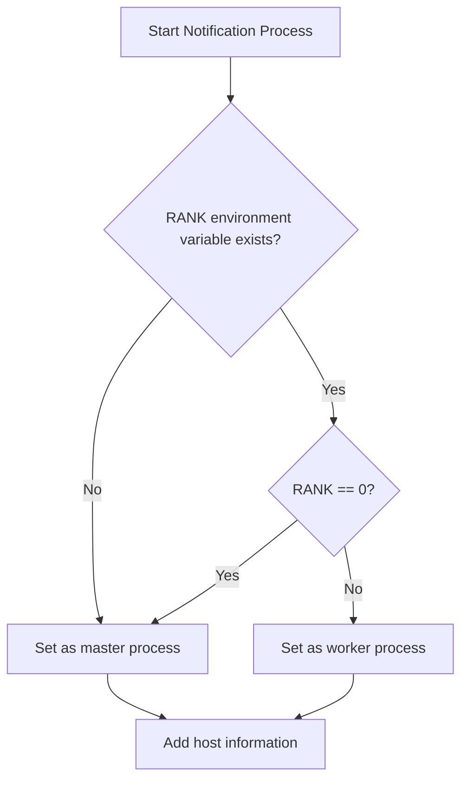
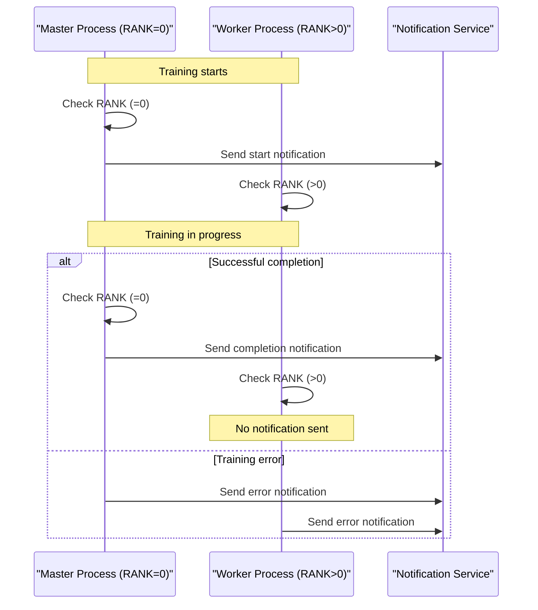
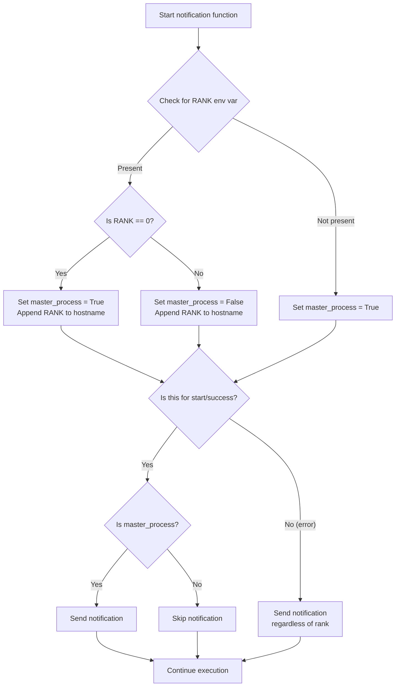

<!-- source: DeepWiki mcp.deepwiki.com · repo huggingface/knockknock · page 2.2 Distributed Training Support · fetched 2026-10-26 -->

# Distributed Training Support

<details>
<summary>Relevant source files</summary>

The following files were used as context for generating this wiki page:

- [knockknock/desktop_sender.py](knockknock/desktop_sender.py)
- [knockknock/email_sender.py](knockknock/email_sender.py)
- [knockknock/telegram_sender.py](knockknock/telegram_sender.py)

</details>


## Purpose and Scope

This page documents how KnockKnock handles notifications in distributed training environments. The primary purpose of this functionality is to prevent duplicate notifications when multiple training processes are running concurrently, which is common in distributed machine learning workflows. Instead of receiving multiple identical notifications (one from each process), KnockKnock intelligently determines which process should send notifications.

For information about using the notification decorators themselves, see [Decorator Pattern](#2.1).

## Distributed Training Challenge

In distributed machine learning training setups, especially those using frameworks like PyTorch's Distributed Data Parallel (DDP), multiple processes run the same code simultaneously across different devices or machines. Without proper handling, this would result in multiple identical notifications being sent for the same logical training job, creating notification spam.

KnockKnock solves this by:
1. Detecting distributed training environments
2. Identifying the master process
3. Limiting notifications to the master process (with exceptions for errors)

Sources: [knockknock/desktop_sender.py:41-50](). [knockknock/email_sender.py:35-44](), [knockknock/telegram_sender.py:35-44]()

## Detection Mechanism

### How KnockKnock Identifies Distributed Training

KnockKnock detects distributed training by checking for the presence of a `RANK` environment variable, which is commonly set by distributed training frameworks like PyTorch's distributed launcher.



### Master Process Determination

The process with `RANK=0` (or any process if `RANK` doesn't exist) is considered the master process. Only the master process sends start and completion notifications, while all processes send error notifications.

Sources: [knockknock/desktop_sender.py:41-50](). [knockknock/email_sender.py:35-44](), [knockknock/telegram_sender.py:35-44]()

## Notification Flow in Distributed Environments

KnockKnock uses a consistent pattern across all notification senders to handle distributed training:



### Hostname Enrichment

In distributed environments, KnockKnock appends the rank information to the hostname to make it clear which process sent the notification:

```
hostname - RANK: X
```

This helps identify the source of error notifications when they come from non-master processes.

Sources: [knockknock/desktop_sender.py:38-48](). [knockknock/email_sender.py:32-42](), [knockknock/telegram_sender.py:32-42]()

## Implementation Details

### Notification Control Flow

The distributed training support is implemented consistently across all notification channels. Here's the typical control flow:



### Code Pattern

The code pattern used in all notification senders follows this structure:

1. Check for the `RANK` environment variable
2. Determine if this is the master process
3. For start and success notifications, only send if it's the master process
4. For error notifications, always send (to ensure errors are never missed)

Sources: [knockknock/desktop_sender.py:41-98](). [knockknock/email_sender.py:35-95](), [knockknock/telegram_sender.py:35-92]()

## PyTorch Integration

KnockKnock is specifically designed to work with PyTorch's distributed training framework. The code includes comments that reference PyTorch's distributed launch logic:

```
# In PyTorch, the launch of `torch.distributed.launch` sets up a RANK environment variable for each process.
# This can be used to detect the master process.
# See https://github.com/pytorch/pytorch/blob/master/torch/distributed/launch.py#L211
```

This allows seamless integration with PyTorch's distributed training capabilities.

Sources: [knockknock/desktop_sender.py:36-39](). [knockknock/email_sender.py:36-39](), [knockknock/telegram_sender.py:36-39]()

## Usage Example

When using KnockKnock with distributed training, no special configuration is needed. Simply apply the decorator to your training function as usual:

```python
from knockknock import email_sender

@email_sender(recipient_emails=["your-email@example.com"])
def train_model():
    # Your distributed training code here
    # When launched with torch.distributed.launch
    # Only RANK 0 will send start/success notifications
    pass
```

When launching the training job with PyTorch's distributed launcher, KnockKnock will automatically handle the notification logic:

```bash
python -m torch.distributed.launch --nproc_per_node=4 train_script.py
```

## Special Case: Error Notifications

An important design decision in KnockKnock is that error notifications are always sent, regardless of whether the process is a master or worker. This ensures that no errors are missed, even if they occur only in specific worker processes.

The trade-off is that in case of an error that affects all processes, you may receive multiple error notifications (one from each process). However, this is considered better than missing error notifications.

Sources: [knockknock/desktop_sender.py:84-99](). [knockknock/email_sender.py:79-95](), [knockknock/telegram_sender.py:78-93]()

## Notification Content Differences

In distributed training environments, the notification content is slightly modified to include the rank information in the hostname. This provides context about which process sent the notification, particularly useful for error notifications from non-master processes.

| Notification Type | Master Process (RANK=0) | Worker Process (RANK>0) |
|------------------|------------------------|------------------------|
| Start            | Sends with hostname + rank | Does not send |
| Success          | Sends with hostname + rank | Does not send |
| Error            | Sends with hostname + rank | Sends with hostname + rank |

Sources: [knockknock/desktop_sender.py:38-48](). [knockknock/email_sender.py:32-42](), [knockknock/telegram_sender.py:32-42]()

---

