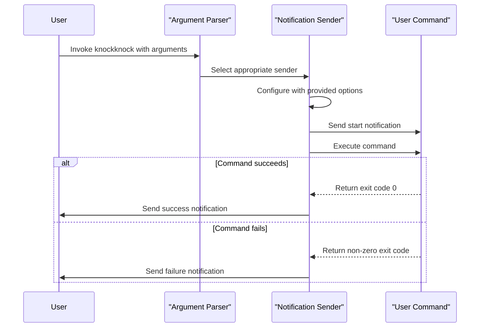
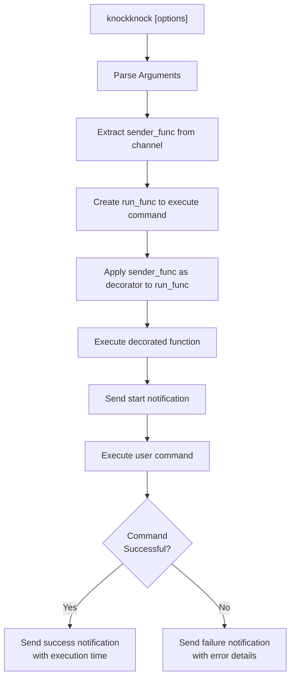

<!-- source: DeepWiki mcp.deepwiki.com · repo huggingface/knockknock · page 3 Command-Line Interface · fetched 2026-10-26 -->

# Command-Line Interface

<details>
<summary>Relevant source files</summary>

The following files were used as context for generating this wiki page:

- [README.md](README.md)
- [knockknock/__main__.py](knockknock/__main__.py)

</details>


This document describes the command-line interface (CLI) provided by the KnockKnock library. The CLI allows users to receive notifications when their long-running processes start, complete successfully, or fail, without having to modify their existing code. For information about using KnockKnock as a Python decorator in your code, see [Decorator Pattern](#2.1).

## Overview

The KnockKnock CLI provides a simple way to wrap any shell command with notification capabilities. When executed, it will:

1. Send a notification that the command has started
2. Run the specified command
3. Send a notification when the command completes or fails

All notification channels available through the Python API are also accessible through the CLI.

## CLI Architecture

The diagram below illustrates how the KnockKnock CLI is structured and processes commands:

```mermaid
flowchart TD
    A["User Command"] --> B["knockknock CLI"]
    B --> C["Argument Parser"]
    C --> D["Channel Selection"]
    D --> E["Notification Setup"]
    E --> F["Command Execution"] 
    F --> G1["Start Notification"]
    G1 --> H["Run User Command"]
    H --> I{"Command\nSuccessful?"}
    I -->|Yes| J["Success Notification"]
    I -->|No| K["Failure Notification"]
    
    subgraph "Notification Channels"
        N1["email"]
        N2["slack"]
        N3["telegram"]
        N4["teams"]
        N5["sms"]
        N6["discord"]
        N7["desktop"]
        N8["matrix"]
        N9["chime"]
        N10["dingtalk"]
        N11["rocketchat"]
        N12["wechat"]
    end
    
    D --> Notification Channels
```

Sources: [knockknock/__main__.py:1-211]()

## Command Structure

The general syntax for the KnockKnock CLI is:

```
knockknock [--verbose] <notification-channel> [channel-specific-options] <command-to-execute>
```

Where:
- `--verbose`: Optional flag to show the full command in the notification
- `<notification-channel>`: The notification channel to use (e.g., email, slack, telegram)
- `[channel-specific-options]`: Options specific to the chosen notification channel
- `<command-to-execute>`: The command you want to run and be notified about

Sources: [knockknock/__main__.py:17-22](), [knockknock/__main__.py:192-206]()

## Implementation Details

The CLI is implemented in the `__main__.py` file and follows these steps:

1. Parse command-line arguments using `argparse`
2. Determine which notification sender to use based on the subcommand
3. Create a function that runs the user's command using `subprocess.run`
4. Apply the selected notification sender as a decorator to this function
5. Execute the decorated function



Sources: [knockknock/__main__.py:17-211]()

## Supported Notification Channels

KnockKnock CLI supports the following notification channels, each with its own set of required and optional parameters:

### Email

Sends notifications via email.

```bash
knockknock email \
    --recipient-emails <emails> \
    [--sender-email <email>] \
    <command>
```

Sources: [knockknock/__main__.py:54-64]()

### Slack

Sends notifications to a Slack channel.

```bash
knockknock slack \
    --webhook-url <webhook_url> \
    --channel <channel> \
    [--user-mentions <user_ids>] \
    <command>
```

Sources: [knockknock/__main__.py:67-78]()

### Telegram

Sends notifications via Telegram.

```bash
knockknock telegram \
    --token <api_token> \
    --chat-id <chat_id> \
    <command>
```

Sources: [knockknock/__main__.py:99-108]()

### Microsoft Teams

Sends notifications to a Microsoft Teams channel.

```bash
knockknock teams \
    --webhook-url <webhook_url> \
    [--user-mentions <user_ids>] \
    <command>
```

Sources: [knockknock/__main__.py:111-120]()

### SMS (Twilio)

Sends SMS notifications via Twilio.

```bash
knockknock sms \
    --account-sid <account_sid> \
    --auth-token <auth_token> \
    --recipient-number <recipient_number> \
    --sender-number <sender_number> \
    <command>
```

Sources: [knockknock/__main__.py:123-137]()

### Discord

Sends notifications to a Discord channel.

```bash
knockknock discord \
    --webhook-url <webhook_url> \
    <command>
```

Sources: [knockknock/__main__.py:45-51]()

### Desktop

Sends desktop notifications.

```bash
knockknock desktop \
    [--title <title>] \
    <command>
```

Sources: [knockknock/__main__.py:37-42]()

### Matrix

Sends notifications via Matrix.

```bash
knockknock matrix \
    --homeserver <homeserver> \
    --token <token> \
    --room <room> \
    <command>
```

Sources: [knockknock/__main__.py:140-152]()

### Amazon Chime

Sends notifications to an Amazon Chime room.

```bash
knockknock chime \
    --webhook-url <webhook_url> \
    [--user-mentions <user_mentions>] \
    <command>
```

Sources: [knockknock/__main__.py:25-34]()

### DingTalk

Sends notifications to a DingTalk chatroom.

```bash
knockknock dingtalk \
    --webhook-url <webhook_url> \
    [--user-mentions <phone_numbers>] \
    [--secret <secret>] \
    [--keywords <keywords>] \
    <command>
```

Sources: [knockknock/__main__.py:81-96]()

### RocketChat

Sends notifications to a RocketChat channel.

```bash
knockknock rocketchat \
    --rocketchat-server-url <server_url> \
    --rocketchat-user-id <user_id> \
    --rocketchat-auth-token <auth_token> \
    --channel <channel> \
    [--user-mentions <user_names>] \
    [--alias <alias>] \
    <command>
```

Sources: [knockknock/__main__.py:155-175]()

### WeChat Work

Sends notifications to a WeChat Work chatroom.

```bash
knockknock wechat \
    --webhook-url <webhook_url> \
    [--user-mentions <user_ids>] \
    [--user-mentions-mobile <phone_numbers>] \
    <command>
```

Sources: [knockknock/__main__.py:178-190]()

## Command Execution Process

When you run a command with KnockKnock CLI, the following process occurs:



Sources: [knockknock/__main__.py:192-207]()

## Handling Distributed Training

The CLI, like the decorator API, is designed to handle distributed training environments. To prevent duplicate notifications, it checks for environment variables that indicate whether the current process is the master process. For more information about this feature, see [Distributed Training Support](#2.2).

Sources: [README.md:401-405]()

## CLI Usage Examples

Here are some practical examples of using the KnockKnock CLI:

### Training a Deep Learning Model with Email Notifications

```bash
knockknock email \
    --recipient-emails john@example.com,jane@example.com \
    python train_model.py --epochs 100 --batch-size 32
```

### Running a Data Processing Job with Slack Notifications

```bash
knockknock slack \
    --webhook-url https://hooks.slack.com/services/XXX/YYY/ZZZ \
    --channel "#ml-experiments" \
    --user-mentions U01234567,U76543210 \
    python process_data.py --input large_dataset.csv --output processed_data.csv
```

### Running a Long Download with Desktop Notifications

```bash
knockknock desktop \
    --title "Download Task" \
    wget https://example.com/large_file.zip
```

Sources: [README.md:57-396]()

## Internal Implementation

The CLI functionality is implemented through these key steps:

1. The main function in `__main__.py` sets up an argument parser with subparsers for each notification channel
2. Each subparser defines its own set of required and optional arguments
3. The parser creates a `sender_func` based on the selected notification channel
4. A wrapper function `run_func` is created to execute the user's command using `subprocess.run`
5. The `sender_func` is applied as a decorator to `run_func`
6. The decorated function is called, which:
   - Sends a start notification
   - Executes the command
   - Sends a success or failure notification depending on the outcome

The CLI architecture closely mirrors the decorator pattern used in the Python API, providing a consistent experience regardless of which interface is used.

Sources: [knockknock/__main__.py:17-211](), [README.md:19-22]()

---

