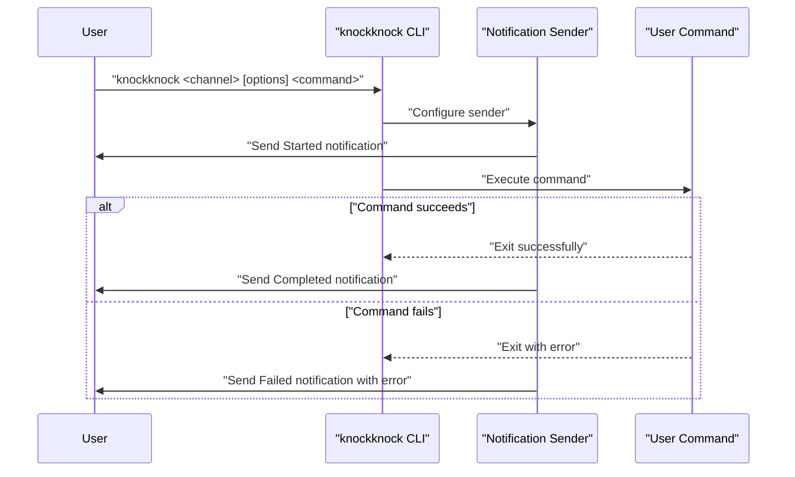
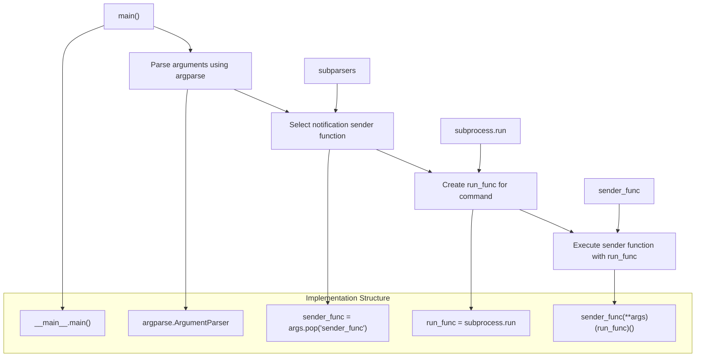

<!-- source: DeepWiki mcp.deepwiki.com · repo huggingface/knockknock · page 3.1 CLI Usage Examples · fetched 2026-10-26 -->

# CLI Usage Examples

<details>
<summary>Relevant source files</summary>

The following files were used as context for generating this wiki page:

- [README.md](README.md)
- [knockknock/__main__.py](knockknock/__main__.py)

</details>


## Purpose and Scope

This page provides comprehensive examples of using knockknock's command-line interface (CLI) to receive notifications when long-running processes start, complete, or crash. For information about using knockknock as a Python decorator in your code, see [Decorator Pattern](#2.1).

## CLI Structure and Command Flow

The knockknock CLI allows you to wrap any command-line process with notification capabilities without modifying its code.

### Command Pattern

```
knockknock [--verbose] <notification-channel> [channel-specific-options] <command>
```

Where:
- `[--verbose]` (optional) - Shows the full command in notifications
- `<notification-channel>` - The platform to send notifications through (e.g., slack, email)
- `[channel-specific-options]` - Configuration required for the chosen channel
- `<command>` - The command to execute and receive notifications for

### Command Structure Diagram

```mermaid
graph TD
    A["knockknock"] --> B["<channel>"]
    B --> C["[--channel-options]"]
    C --> D["<command>"]
    
    E["--verbose (optional)"] --> A
    
    subgraph "Available Channels"
        F["email"]
        G["slack"]
        H["discord"]
        I["telegram"]
        J["desktop"]
        K["sms"]
        L["teams"]
        M["matrix"]
        N["chime"]
        O["dingtalk"]
        P["rocketchat"]
        Q["wechat"]
    end
    
    B --> Available Channels
```

Sources: [knockknock/__main__.py:17-22](), [knockknock/__main__.py:192-198]()

### Execution Flow Diagram



Sources: [knockknock/__main__.py:192-207](), [knockknock/__main__.py:203-207]()

## Notification Channel Examples

This section provides examples for each supported notification channel.

### Email Notifications

```bash
knockknock email \
    --recipient-emails your_email@address.com,second_email@address.com \
    --sender-email sender_email@gmail.com \
    sleep 10
```

| Argument | Description | Required |
|----------|-------------|----------|
| `--recipient-emails` | Comma-separated list of email addresses to notify | Yes |
| `--sender-email` | Email address to send from | No (defaults to first recipient) |

Note: You'll be prompted for the sender's email password, which will be securely stored in your system's keyring.

Sources: [knockknock/__main__.py:54-64](), [README.md:57-64]()

### Slack Notifications

```bash
knockknock slack \
    --webhook-url https://hooks.slack.com/services/T00000000/B00000000/XXXXXXXX \
    --channel your-channel-name \
    sleep 10
```

| Argument | Description | Required |
|----------|-------------|----------|
| `--webhook-url` | The webhook URL for your Slack workspace | Yes |
| `--channel` | The Slack channel to send notifications to | Yes |
| `--user-mentions` | Comma-separated list of Slack user IDs to mention | No |

Sources: [knockknock/__main__.py:67-78](), [README.md:93-97]()

### Discord Notifications

```bash
knockknock discord \
    --webhook-url https://discord.com/api/webhooks/XXXXXXXX/XXXXXXXX \
    sleep 10
```

| Argument | Description | Required |
|----------|-------------|----------|
| `--webhook-url` | The webhook URL for your Discord server | Yes |

Sources: [knockknock/__main__.py:45-51](), [README.md:208-211]()

### Telegram Notifications

```bash
knockknock telegram \
    --token 123456789:ABCDEFGHIJKLMNOPQRSTUVWXYZ \
    --chat-id 123456789 \
    sleep 10
```

| Argument | Description | Required |
|----------|-------------|----------|
| `--token` | Your Telegram bot token | Yes |
| `--chat-id` | Your chat ID with the bot | Yes |

Sources: [knockknock/__main__.py:99-108](), [README.md:124-127]()

### Desktop Notifications

```bash
knockknock desktop \
    --title "My Long-Running Process" \
    sleep 10
```

| Argument | Description | Required |
|----------|-------------|----------|
| `--title` | The title of the notification | No (defaults to "knockknock") |

Sources: [knockknock/__main__.py:37-42](), [README.md:232-236]()

### SMS Notifications (via Twilio)

```bash
knockknock sms \
    --account-sid ACXXXXXXXXXXXXXXXXXXXXXXXXXXXXXXXX \
    --auth-token your_auth_token \
    --recipient-number +1234567890 \
    --sender-number +0987654321 \
    sleep 10
```

| Argument | Description | Required |
|----------|-------------|----------|
| `--account-sid` | Your Twilio account SID | Yes |
| `--auth-token` | Your Twilio auth token | Yes |
| `--recipient-number` | The phone number to receive notifications | Yes |
| `--sender-number` | Your Twilio phone number | Yes |

Sources: [knockknock/__main__.py:123-137](), [README.md:179-184]()

### Microsoft Teams Notifications

```bash
knockknock teams \
    --webhook-url https://outlook.office.com/webhook/XXXXXXXX/IncomingWebhook/YYYYYYYYY/ZZZZZZZZ \
    sleep 10
```

| Argument | Description | Required |
|----------|-------------|----------|
| `--webhook-url` | The webhook URL for your Microsoft Teams channel | Yes |
| `--user-mentions` | Comma-separated list of Teams user IDs to mention | No |

Sources: [knockknock/__main__.py:111-120](), [README.md:151-152]()

### Matrix Notifications

```bash
knockknock matrix \
    --homeserver https://matrix.org \
    --token your_access_token \
    --room #roomalias:matrix.org \
    sleep 10
```

| Argument | Description | Required |
|----------|-------------|----------|
| `--homeserver` | Your Matrix homeserver URL | Yes |
| `--token` | Your Matrix access token | Yes |
| `--room` | The alias of the room to send notifications to | Yes |

Sources: [knockknock/__main__.py:140-152](), [README.md:266-271]()

### Amazon Chime Notifications

```bash
knockknock chime \
    --webhook-url https://hooks.chime.aws/incomingwebhooks/XXXXXXXX?token=YYYYYYYY \
    sleep 10
```

| Argument | Description | Required |
|----------|-------------|----------|
| `--webhook-url` | The webhook URL for your Amazon Chime room | Yes |
| `--user-mentions` | Comma-separated list of user aliases to mention | No |

Sources: [knockknock/__main__.py:25-34](), [README.md:294-297]()

### DingTalk Notifications

```bash
knockknock dingtalk \
    --webhook-url https://oapi.dingtalk.com/robot/send?access_token=XXXXXXXX \
    --secret your_secret \
    sleep 10
```

| Argument | Description | Required |
|----------|-------------|----------|
| `--webhook-url` | The webhook URL for your DingTalk chatroom robot | Yes |
| `--secret` | Your DingTalk chatroom robot's secret | No |
| `--keywords` | Comma-separated list of accepted keywords | No |
| `--user-mentions` | Comma-separated list of phone numbers to notify | No |

Sources: [knockknock/__main__.py:81-96](), [README.md:322-326]()

### RocketChat Notifications

```bash
knockknock rocketchat \
    --rocketchat-server-url https://your-rocketchat-server.com \
    --rocketchat-user-id your_user_id \
    --rocketchat-auth-token your_auth_token \
    --channel general \
    sleep 10
```

| Argument | Description | Required |
|----------|-------------|----------|
| `--rocketchat-server-url` | Your RocketChat server URL | Yes |
| `--rocketchat-user-id` | Your RocketChat user ID | Yes |
| `--rocketchat-auth-token` | Your RocketChat personal access token | Yes |
| `--channel` | The RocketChat channel to send notifications to | Yes |
| `--user-mentions` | Comma-separated list of usernames to notify | No |
| `--alias` | Alias to use for the notification | No |

Sources: [knockknock/__main__.py:155-175](), [README.md:364-369]()

### WeChat Work Notifications

```bash
knockknock wechat \
    --webhook-url https://qyapi.weixin.qq.com/cgi-bin/webhook/send?key=XXXXXXXX \
    sleep 10
```

| Argument | Description | Required |
|----------|-------------|----------|
| `--webhook-url` | The webhook URL for your WeChat Work chatroom robot | Yes |
| `--user-mentions` | Comma-separated list of user IDs to notify | No |
| `--user-mentions-mobile` | Comma-separated list of phone numbers to notify | No |

Sources: [knockknock/__main__.py:178-190](), [README.md:393-396]()

## CLI Implementation Architecture

The knockknock CLI architecture is implemented in [knockknock/__main__.py]() and follows a modular design that routes commands to the appropriate notification sender.



Sources: [knockknock/__main__.py:17-207](), [knockknock/__main__.py:192-207]()

## Advanced Usage Examples

### Verbose Output

To include the full command in notifications:

```bash
knockknock --verbose slack \
    --webhook-url https://hooks.slack.com/services/TXXXXXX/BXXXXXX/XXXXXXXX \
    --channel your-channel-name \
    python train_model.py --epochs 100 --batch-size 32
```

Sources: [knockknock/__main__.py:20-21](), [knockknock/__main__.py:204-205]()

### Machine Learning Training Example

```bash
knockknock telegram \
    --token 123456789:ABCDEFGHIJKLMNOPQRSTUVWXYZ \
    --chat-id 123456789 \
    python train_model.py --dataset mnist --batch-size 64 --epochs 50
```

This example will notify you when the training starts, finishes successfully, or crashes during execution.

### Long Data Processing Job Example

```bash
knockknock email \
    --recipient-emails your_email@address.com \
    python process_data.py --input large_dataset.csv --output processed_data.csv
```

### Complex Pipeline Example

For complex commands with their own options, you might need to use `--` to separate knockknock options:

```bash
knockknock slack \
    --webhook-url https://hooks.slack.com/services/TXXXXXX/BXXXXXX/XXXXXXXX \
    --channel your-channel-name \
    -- python pipeline.py --step1 --step2 --output-dir="./results"
```

## Summary

The knockknock CLI provides a flexible way to add notification capabilities to any command-line process without modifying its code. By selecting the appropriate notification channel and providing the necessary credentials, you can receive alerts when your long-running processes start, complete successfully, or crash.

---

